# AGILE SRS - KRONOS (Living Requirements Specification)

| Thuộc tính | Giá trị |
|---|---|
| Tiêu chuẩn tham chiếu | ISO/IEC/IEEE 26515:2018 |
| Đối tượng đặc tả | Kho mã `phuongdvk47ds/kronos` (Kronos - mô hình nền tảng chuỗi nến tài chính) |
| Phương pháp trích xuất | Đọc trực tiếp mã nguồn, tệp kiểm thử, tệp cấu hình, tệp dữ liệu mẫu; bản đồ tệp từ ARE (`.are/discover.txt`) |
| Ngôn ngữ | Tiếng Việt; định danh mã nguồn giữ nguyên |
| Trạng thái bằng chứng | `[CODE]` có trong mã; `[TEST]` có kiểm thử; `[SPEC]` chỉ có trong tài liệu; `[ASSUMPTION]`, `[UNKNOWN]`, `[OPEN]`, `[PROPOSED]` theo nghĩa thông thường |

## 0. GHI CHÚ PHƯƠNG PHÁP VÀ GIỚI HẠN BẰNG CHỨNG

| Mã | Nội dung | Tác động lên tài liệu |
|---|---|---|
| N-01 | Công cụ ARE phiên bản hiện hành không có lệnh `scan`; các lệnh khả dụng là `install`, `init`, `discover`, `generate`, `update`, `specify`. Lệnh `discover` đã được chạy; kết quả lưu tại `.are/discover.txt` (79 tệp được nhận diện, 33 tệp bị loại trừ). Lệnh `generate` yêu cầu backend AI và không được chạy. Tệp `.are/summary.md` không tồn tại. | Bản đồ module lập từ `.are/discover.txt` và đọc mã trực tiếp. |
| N-02 | Kho mã là thư viện học máy và công cụ nghiên cứu, không phải hệ thống nghiệp vụ nhiều người dùng. Không tồn tại ORM, migration, cơ sở dữ liệu quan hệ, hàng đợi, middleware xác thực hay phân quyền. | Mục 2 ghi nhận vai trò theo mục đích sử dụng, không theo RBAC. Mục 5 mô tả thực thể dữ liệu theo định dạng tệp và đối tượng Hub, không theo bảng cơ sở dữ liệu. |
| N-03 | Kịch bản gốc đánh số Mục 1 đến Mục 6 cho tầm nhìn đến hợp đồng dịch vụ, Mục 7 cho User Story. Cấu trúc 8 phần trong skill đặt User Story ở Mục 5. Tài liệu này theo đánh số của kịch bản gốc; ánh xạ sang skill nêu tại bảng 0.1. | Xem bảng 0.1. |
| N-04 | Yêu cầu đầu vào bị cắt ngắn sau khoản "User Story Statement (As". Các phần của Giai đoạn 3 và Giai đoạn 4 được thực hiện theo khuôn của skill. | Mục 7 đến Mục 9 áp dụng khuôn skill. |

**Bảng 0.1 - Ánh xạ cấu trúc**

| Mục tài liệu này | Phần tương ứng trong skill (ISO/IEC/IEEE 26515) |
|---|---|
| 1 | 1 Product Vision and Purpose |
| 2 | 2 Personas and Role Matrix |
| 3 | 4 User Story Map and Epic Breakdown |
| 4 | 3 High-Level Architecture |
| 5 | 6 Living Data Requirements |
| 6 | 3.2 Context and Integration Map; hợp đồng API |
| 7 | 5 Detailed Epics and User Stories |
| 8 | 7 NFRs as Technical Stories |
| 9 | 8 DoR and DoD |

---

## 1. PRODUCT VISION & VALUE PROPOSITION

### 1.1 Vision Statement

| Thành phần | Nội dung | Bằng chứng |
|---|---|---|
| Dành cho | Nhà nghiên cứu định lượng, kỹ sư học máy và nhà phân tích thị trường cần dự báo chuỗi nến OHLCV | `README.md`, `examples/prediction_example.py` |
| Nhu cầu | Dự báo nhiều bước tương lai của chuỗi nến (open, high, low, close, volume, amount) từ ngữ cảnh lịch sử, và tinh chỉnh mô hình trên dữ liệu thị trường riêng | `model/kronos.py:KronosPredictor.predict`, `finetune/`, `finetune_csv/` |
| Sản phẩm | Kronos | `README.md` |
| Là | Mô hình nền tảng dạng decoder-only cho "ngôn ngữ" nến, gồm bộ mã hóa rời rạc (tokenizer) và mô hình tự hồi quy | `model/kronos.py:KronosTokenizer`, `model/kronos.py:Kronos` |
| Lợi ích chính | Chuyển chuỗi nến liên tục thành token phân cấp (s1, s2) bằng Binary Spherical Quantization, sinh chuỗi nến tương lai bằng lấy mẫu tự hồi quy có thể điều khiển (T, top_k, top_p, sample_count) | `model/module.py:BSQuantizer`, `model/kronos.py:auto_regressive_inference` |
| Khác với | Mô hình chuỗi thời gian tổng quát không xử lý riêng cấu trúc nến và khối lượng | `README.md` `[ASSUMPTION]`: so sánh định tính, không có phép đo đối chứng trong kho |
| Điểm khác biệt | Kênh dự báo hai tầng token (pre/post), lớp phụ thuộc có điều kiện s1, khung tinh chỉnh Qlib và CSV, giao diện web trình diễn | `model/module.py:DependencyAwareLayer`, `model/module.py:DualHead` |

### 1.2 Value Proposition Canvas

| Khía cạnh | Nội dung | Bằng chứng |
|---|---|---|
| Công việc của khách hàng (Customer Jobs) | Dự báo giá và khối lượng ngắn hạn; xác minh chất lượng dự báo; tinh chỉnh mô hình cho thị trường riêng; đánh giá tín hiệu giao dịch | `examples/`, `finetune*/` |
| Trở ngại quy trình (Pains) | Dữ liệu OHLCV khác thang đo giữa các mã; thiếu cột `volume`/`amount`; chuỗi dài vượt ngữ cảnh mô hình; kết quả ngẫu nhiên khó tái lập | `KronosPredictor.predict` (chuẩn hóa z-score, điền `volume`, `amount`), `tests/test_kronos_regression.py` (cố định seed) |
| Lợi ích mong đợi (Gains) | Tái lập kết quả (hồi quy 1e-5), dự báo hàng loạt, giao diện trực quan, khung tinh chỉnh hai pha | `tests/`, `predict_batch`, `webui/`, `finetune_csv/train_sequential.py` |
| Sản phẩm và dịch vụ (Products) | Thư viện `model`, CLI huấn luyện, Web UI Flask, tập ví dụ | Cây thư mục |
| Giảm trở ngại (Pain Relievers) | Chuẩn hóa tự động theo cửa sổ ngữ cảnh rồi phục hồi thang đo; cắt giá trị ngoại lai (`clip`, mặc định 5); điền giá trị `volume`/`amount` mặc định bằng 0 | `model/kronos.py:544-558` |
| Tạo lợi ích (Gain Creators) | Ba cấu hình mô hình công bố (mini 4.1M, small 24.7M, base 102.3M); lấy mẫu nhiều đường rồi lấy trung bình | `webui/app.py:AVAILABLE_MODELS`, `auto_regressive_inference` |

### 1.3 Phạm vi và Ranh giới

| Loại | Hạng mục |
|---|---|
| Trong phạm vi (In-Scope Epics) | EPIC-INF (suy luận), EPIC-WEB (giao diện web), EPIC-FTQ (tinh chỉnh Qlib), EPIC-FTC (tinh chỉnh CSV), EPIC-BKT (backtest minh họa), EPIC-QA (hồi quy) |
| Ngoài phạm vi (Out-of-Scope) | Xác thực và phân quyền; cơ sở dữ liệu; hàng đợi tác vụ; thực thi lệnh giao dịch thật; tư vấn đầu tư; huấn luyện tiền huấn luyện từ đầu (không có mã); mô hình Kronos-large (README ghi "chưa phát hành") |
| Spike đề xuất `[PROPOSED]` | Xác thực cho Web UI; giới hạn đường dẫn tệp; đóng gói gói Python; CI chạy kiểm thử |

### 1.4 Giả định kỹ thuật và phụ thuộc

| Nhóm | Phụ thuộc | Nguồn |
|---|---|---|
| Lõi | `torch>=2.0.0`, `numpy`, `pandas` | `requirements.txt` |
| Mô hình | `einops==0.8.1`, `huggingface_hub==0.33.1`, `safetensors==0.6.2` | `requirements.txt` |
| Trực quan | `matplotlib==3.9.3`, `tqdm==4.67.1` | `requirements.txt` |
| Web UI | `flask==2.3.3`, `flask-cors==4.0.0`, `plotly==5.17.0` | `webui/requirements.txt` |
| Tinh chỉnh Qlib | `qlib`, `torch.distributed` (DDP, lệnh `torchrun`), Comet ML tùy chọn | `finetune/` |
| Dữ liệu | Hugging Face Hub (`NeoQuasar/*`), Qlib `cn_data`, AKShare (ví dụ) | `README.md`, `examples/get_akshare_date_2024-2025_x.py` |
| Môi trường | Thiết bị `cpu`, `cuda:0`, `mps` tự động chọn | `KronosPredictor.__init__` |

### 1.5 Từ điển miền (Ubiquitous Language)

| Thuật ngữ | Định nghĩa | Nguồn |
|---|---|---|
| Candle / K-line | Một quan sát OHLCV tại một mốc thời gian | `KronosPredictor.price_cols` |
| `amount` | Giá trị giao dịch; mặc định `volume` nhân trung bình bốn cột giá khi vắng | `kronos.py:531-532` |
| Tokenizer | Bộ mã hóa chuỗi nến thành chỉ số nhị phân và giải mã ngược | `KronosTokenizer` |
| BSQuantizer | Bộ lượng tử hóa cầu nhị phân; tham số `beta`, `gamma0`, `gamma`, `zeta`, `group_size` | `model/module.py` |
| s1 (pre token), s2 (post token) | Hai nửa của mã lượng tử; s1 gồm `s1_bits`, s2 gồm `s2_bits` | `Kronos.__init__` |
| Lookback | Số nến lịch sử đầu vào | `finetune/config.py:lookback_window` |
| `pred_len` | Số nến cần dự báo | `predict(... pred_len ...)` |
| `max_context` | Độ dài tối đa của cửa sổ token; 512 hoặc 2048 theo mô hình | `webui/app.py:AVAILABLE_MODELS` |
| `T`, `top_k`, `top_p`, `sample_count` | Nhiệt độ, lọc top-k, lọc nhân (nucleus), số đường lấy mẫu được lấy trung bình | `sample_from_logits` |
| Stamp | Đặc trưng thời gian: minute, hour, weekday, day, month | `calc_time_stamps` |
| Walk-forward / Backtest | Mô phỏng tín hiệu giao dịch từ dự báo | `examples/run_backtest_kronos.py` |

---

## 2. USER PERSONAS & ROLE MATRIX

### 2.1 Personas

| ID | Persona | Mục tiêu chính | Trở ngại quy trình | Mức kỹ thuật | Bằng chứng |
|---|---|---|---|---|---|
| P-01 | Nhà nghiên cứu định lượng | Dự báo OHLCV từ DataFrame và so sánh với thực tế | Chuẩn hóa dữ liệu, tái lập kết quả | Cao (Python) | `examples/prediction_example.py`, `tests/` |
| P-02 | Kỹ sư học máy | Tinh chỉnh tokenizer và mô hình trên dữ liệu thị trường riêng | Cấu hình đường dẫn, huấn luyện phân tán, chọn mô hình tốt nhất | Cao (PyTorch, DDP) | `finetune/`, `finetune_csv/` |
| P-03 | Nhà phân tích thị trường | Nạp tệp CSV, chọn mô hình, xem biểu đồ dự báo trên trình duyệt | Không muốn viết mã | Trung bình | `webui/` |
| P-04 | Người đánh giá chiến lược | Chuyển dự báo thành tín hiệu mua/bán và đo hiệu suất | Phí giao dịch, ngưỡng tín hiệu | Trung bình-Cao | `examples/run_backtest_kronos.py`, `finetune/qlib_test.py` |
| P-05 | Người bảo trì kho mã | Giữ kết quả dự báo ổn định qua các thay đổi | Phụ thuộc bản sửa đổi mô hình trên Hub | Cao | `tests/test_kronos_regression.py` |

### 2.2 Ma trận vai trò và quyền

| Hạng mục kiểm soát | Kết quả khảo sát | Bằng chứng |
|---|---|---|
| Middleware xác thực | Không tồn tại | `webui/app.py` không có decorator xác thực |
| Guard phân quyền | Không tồn tại | Toàn bộ route công khai |
| Token claims | Không tồn tại | Không có JWT hoặc session |
| CORS | Mở cho mọi nguồn gốc | `CORS(app)` tại `webui/app.py:25` |
| Mạng | Máy chủ gắn `0.0.0.0:7070`, `debug=True` | `webui/app.py:708`, `webui/run.py:82` |

| Endpoint / Chức năng | P-01 | P-02 | P-03 | P-04 | P-05 | Điều kiện truy cập |
|---|---|---|---|---|---|---|
| `from_pretrained`, `predict`, `predict_batch` | X | X | - | X | X | Thư viện, không kiểm soát |
| `GET /`, `GET /api/data-files` | - | - | X | - | - | Không xác thực |
| `POST /api/load-data` | - | - | X | - | - | Không xác thực |
| `POST /api/load-model` | - | - | X | - | - | Không xác thực |
| `POST /api/predict` | - | - | X | - | - | Không xác thực; yêu cầu mô hình đã nạp |
| `GET /api/available-models`, `GET /api/model-status` | - | - | X | - | - | Không xác thực |
| Tập lệnh huấn luyện / backtest | - | X | - | X | - | Quyền hệ thống tệp cục bộ |

Chú giải: `X` có thể sử dụng; `-` không áp dụng. `[OPEN]`: yêu cầu xác thực cho Web UI khi triển khai ngoài máy cục bộ.

---

## 3. AGILE USER STORY MAPPING (USM)

### 3.1 Backbone và hành trình

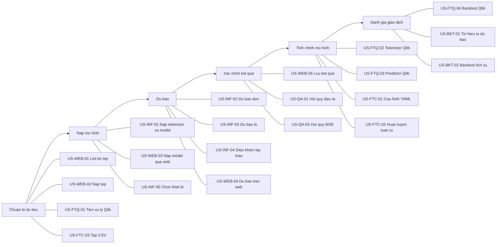

### 3.2 Walking Skeleton và Release

| Release | Mục tiêu | Story |
|---|---|---|
| R0 - Walking Skeleton `[CODE]` | Nạp mô hình công bố và tạo dự báo một chuỗi từ DataFrame | US-INF-01, US-INF-02, US-INF-05, US-INF-06 |
| R1 `[CODE]` | Điều khiển chất lượng dự báo, dự báo hàng loạt, tái lập kết quả | US-INF-03, US-INF-04, US-QA-01, US-QA-02 |
| R2 `[CODE]` | Giao diện web trình diễn | US-WEB-01 đến US-WEB-05 |
| R3 `[CODE]` | Tinh chỉnh trên Qlib và CSV | US-FTQ-01 đến US-FTQ-03, US-FTC-01 đến US-FTC-03 |
| R4 `[CODE]` | Backtest | US-FTQ-04, US-BKT-01, US-BKT-02 |
| Future `[PROPOSED]` | Xác thực Web UI; ràng buộc đường dẫn; kiểm thử Web UI; đóng gói; CI; Kronos-large | Ngoài mã hiện tại |

### 3.3 Ma trận Epic

| Epic ID | Tên | Mục tiêu cốt lõi | Persona chính | Module ánh xạ |
|---|---|---|---|---|
| EPIC-INF | Suy luận và dự báo | Sinh chuỗi OHLCV tương lai từ ngữ cảnh | P-01 | `model/kronos.py`, `model/module.py` |
| EPIC-WEB | Giao diện web | Dự báo và trực quan trên trình duyệt | P-03 | `webui/app.py`, `webui/run.py`, `webui/templates/index.html` |
| EPIC-FTQ | Tinh chỉnh Qlib | Huấn luyện và backtest trên dữ liệu Qlib | P-02, P-04 | `finetune/*` |
| EPIC-FTC | Tinh chỉnh CSV | Huấn luyện tuần tự từ tệp CSV và cấu hình YAML | P-02 | `finetune_csv/*` |
| EPIC-BKT | Backtest minh họa | Chuyển dự báo thành tín hiệu và chỉ số hiệu suất | P-04 | `examples/run_backtest_kronos.py`, `examples/yuce/historical_backtest.py` |
| EPIC-QA | Hồi quy chất lượng | Phát hiện thay đổi hành vi dự báo | P-05 | `tests/*` |

---

## 4. HIGH-LEVEL ARCHITECTURE & COMPONENT BOUNDARIES

### 4.1 Sơ đồ phân tầng

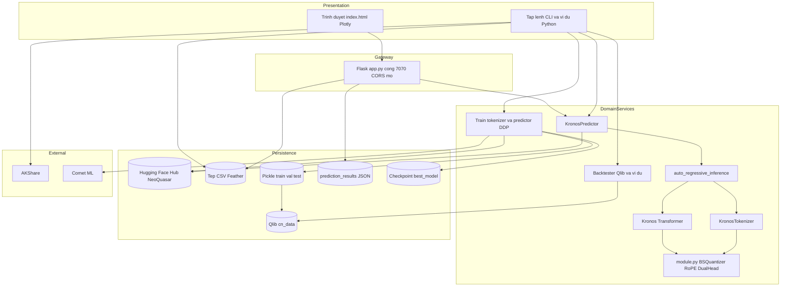

### 4.2 Ranh giới thành phần

| Thành phần | Trách nhiệm | Phụ thuộc đi | Ranh giới |
|---|---|---|---|
| `model/kronos.py` | Tokenizer, mô hình, lấy mẫu, bộ dự báo | `model/module.py`, `huggingface_hub` | API công khai: `Kronos`, `KronosTokenizer`, `KronosPredictor` (`model/__init__.py`) |
| `model/module.py` | Lớp khối: BSQuantizer, RMSNorm, RoPE, attention, embedding, DualHead | `torch` | Nội bộ |
| `webui/app.py` | HTTP API, nạp dữ liệu, biểu đồ, lưu kết quả | `model`, Flask, Plotly | Trạng thái toàn cục `tokenizer`, `model`, `predictor` trong tiến trình |
| `finetune/` | Tiền xử lý Qlib, huấn luyện, backtest Qlib | Qlib, DDP, Comet | Cấu hình `Config` tập trung |
| `finetune_csv/` | Tinh chỉnh từ CSV theo YAML | `model`, YAML | `CustomFinetuneConfig`, `SequentialTrainer` |
| `examples/` | Kịch bản minh họa và backtest | AKShare, matplotlib | Không thuộc API |
| `tests/` | Hồi quy đầu ra và MSE | Hub (khóa `revision`) | Yêu cầu mạng và tệp dữ liệu trong `tests/data/` |

### 4.3 Bản đồ tích hợp ngoại vi

Chi tiết tại Mục 6.2.

---

## 5. LIVING DOMAIN MODEL & DATA CONTRACTS

### 5.1 Phạm vi mô hình dữ liệu

| Khía cạnh | Kết luận | Bằng chứng |
|---|---|---|
| ORM / Entity class | Không tồn tại | Không có SQLAlchemy, Django models |
| Migration | Không tồn tại | Không có thư mục `migrations` |
| Lưu trữ bền vững | Tệp CSV/Feather (đầu vào), pickle (tập huấn luyện), JSON (kết quả web), thư mục checkpoint Hugging Face (`save_pretrained`) | `webui/app.py:save_prediction_results`, `finetune/qlib_data_preprocess.py:101-106`, `finetune/train_predictor.py:173` |
| Khóa | Không có PK/FK ràng buộc bởi hệ quản trị; khóa dưới đây là khóa logic `[ASSUMPTION]` suy ra từ tên tệp, mã chứng khoán và chỉ số thời gian | Suy luận từ mã |

### 5.2 Sơ đồ quan hệ thực thể

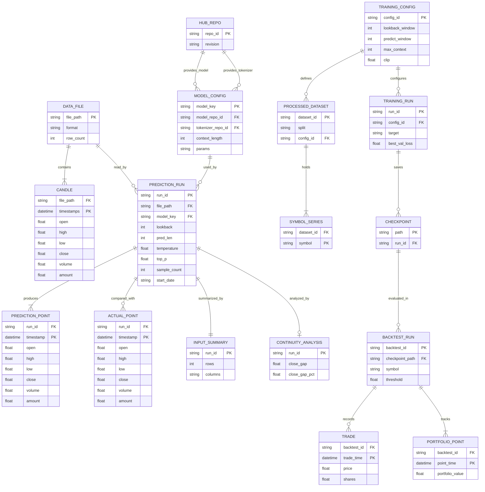

Quan hệ nhiều-nhiều giữa `DATA_FILE` và `MODEL_CONFIG` được giải quyết qua thực thể liên kết `PREDICTION_RUN` (một tệp dữ liệu được dự báo bởi nhiều mô hình; một mô hình dự báo nhiều tệp). `[CODE]` chỉ `PREDICTION_RUN` (qua tệp JSON), `CANDLE`, `HUB_REPO`, `MODEL_CONFIG` và `CHECKPOINT` có biểu diễn trực tiếp trong mã; `BACKTEST_RUN`, `TRADE`, `PORTFOLIO_POINT` tồn tại dưới dạng DataFrame và biểu đồ.

### 5.3 Từ điển dữ liệu

#### 5.3.1 CANDLE (tệp CSV / Feather đầu vào)

| Thuộc tính | Kiểu | Bắt buộc | Ràng buộc | Nguồn |
|---|---|---|---|---|
| `open`, `high`, `low`, `close` | float | Có | Phải có đủ bốn cột, nếu không từ chối; ép kiểu số, giá trị không hợp lệ chuyển thành NaN rồi bị loại | `webui/app.py:load_data_file`, `kronos.py:524` |
| `volume` | float | Không | Vắng thì điền 0.0 | `kronos.py:527-530` |
| `amount` | float | Không | Vắng mà có `volume` thì bằng `volume` nhân trung bình bốn cột giá; vắng cả `volume` thì 0.0 | `kronos.py:531-532` |
| `timestamps` | datetime | Không (Web UI) | Chấp nhận `timestamps`, `timestamp`, `date`; vắng thì sinh chuỗi từ `2024-01-01` bước 1 giờ | `webui/app.py:load_data_file` |
| Giá trị NaN | - | - | Thư viện từ chối khi có NaN; Web UI loại hàng chứa NaN | `kronos.py:534`, `webui/app.py` |

Định dạng khác biệt giữa các tệp mẫu: `tests/data/regression_input.csv` có cột `timestamps,open,high,low,close,volume,amount`; `finetune_csv/data/HK_ali_09988_kline_5min_all.csv` có thứ tự `timestamps,open,close,high,low,volume,amount` và dấu BOM.

#### 5.3.2 MODEL_CONFIG (hằng số `AVAILABLE_MODELS`)

| Khóa | Mô hình | Tokenizer | Ngữ cảnh | Tham số |
|---|---|---|---|---|
| `kronos-mini` | `NeoQuasar/Kronos-mini` | `NeoQuasar/Kronos-Tokenizer-2k` | 2048 | 4.1M |
| `kronos-small` | `NeoQuasar/Kronos-small` | `NeoQuasar/Kronos-Tokenizer-base` | 512 | 24.7M |
| `kronos-base` | `NeoQuasar/Kronos-base` | `NeoQuasar/Kronos-Tokenizer-base` | 512 | 102.3M |

#### 5.3.3 PREDICTION_RUN (tệp `webui/prediction_results/prediction_YYYYMMDD_HHMMSS.json`)

| Trường | Kiểu | Mô tả | Nguồn |
|---|---|---|---|
| `timestamp` | string ISO-8601 | Thời điểm lưu | `save_prediction_results` |
| `file_path` | string | Đường dẫn tệp dữ liệu | như trên |
| `prediction_type` | string | Mô tả chế độ cửa sổ | như trên |
| `prediction_params` | object | `lookback`, `pred_len`, `temperature`, `top_p`, `sample_count`, `start_date` (hoặc `latest`) | như trên |
| `input_data_summary` | object | `rows`, `columns`, `price_range`, `last_values` | như trên |
| `prediction_results` | array | Phần tử: `timestamp`, `open`, `high`, `low`, `close`, `volume`, `amount` | như trên |
| `actual_data` | array | Cùng lược đồ; rỗng khi không có dữ liệu so sánh | như trên |
| `analysis.continuity` | object | `last_prediction`, `first_actual`, `gaps`, `gap_percentages` | như trên |

Khóa `run_id` trong sơ đồ tương ứng với tên tệp; mã nguồn không sinh trường `run_id` và không ghi khóa `model_key` vào kết quả `[OPEN]`.

#### 5.3.4 TRAINING_CONFIG - luồng Qlib (`finetune/config.py:Config`)

| Nhóm | Thuộc tính và giá trị mặc định |
|---|---|
| Dữ liệu | `qlib_data_path=~/.qlib/qlib_data/cn_data`, `instrument=csi300`, `dataset_begin_time=2011-01-01`, `dataset_end_time=2025-06-05` |
| Cửa sổ | `lookback_window=90`, `predict_window=10`, `max_context=512`, `clip=5.0` |
| Đặc trưng | `feature_list=[open, high, low, close, vol, amt]`, `time_feature_list=[minute, hour, weekday, day, month]` |
| Phân chia | train 2011-01-01 đến 2022-12-31; val 2022-09-01 đến 2024-06-30; test 2024-04-01 đến 2025-06-05; backtest 2024-07-01 đến 2025-06-05 |
| Huấn luyện | `epochs=30`, `batch_size=50`, `tokenizer_learning_rate=2e-4`, `predictor_learning_rate=4e-5`, AdamW (beta 0.9, 0.95; decay 0.1), `seed=100` |
| Backtest | `backtest_n_symbol_hold=50`, `backtest_n_symbol_drop=5`, `backtest_hold_thresh=5`, `inference_T=0.6`, `inference_top_p=0.9`, `inference_sample_count=5` |
| Chuẩn so sánh | `csi800=SH000906`, `csi1000=SH000852`, `csi300=SH000300`; giá trị khác phát sinh `ValueError` |

#### 5.3.5 TRAINING_CONFIG - luồng CSV (`finetune_csv/configs/*.yaml`)

| Nhóm | Khóa |
|---|---|
| `data` | `data_path`, `lookback_window=512`, `predict_window=48`, `max_context=512`, `clip=5.0`, `train_ratio=0.9`, `val_ratio=0.1`, `test_ratio=0.0` |
| `training` | `tokenizer_epochs`, `basemodel_epochs`, `batch_size`, `log_interval`, `num_workers`, `seed`, `tokenizer_learning_rate`, `predictor_learning_rate`, `adam_beta1/2`, `adam_weight_decay`, `accumulation_steps` |
| `model_paths` | `pretrained_tokenizer`, `pretrained_predictor`, `exp_name`, `base_path`, `base_save_path`, `finetuned_tokenizer`, `tokenizer_save_name`, `basemodel_save_name` |
| `experiment` | `name`, `description`, `use_comet`, `train_tokenizer`, `train_basemodel`, `skip_existing` |
| `device` | `use_cuda`, `device_id` |

#### 5.3.6 PROCESSED_DATASET (pickle)

| Tệp | Cấu trúc | Nguồn |
|---|---|---|
| `{dataset_path}/train_data.pkl`, `val_data.pkl`, `test_data.pkl` | `dict[symbol -> DataFrame]` chỉ mục `datetime`, cột theo `feature_list` | `QlibDataPreprocessor.prepare_dataset` |
| Cửa sổ mẫu | `lookback_window + predict_window + 1`; mẫu chuẩn hóa z-score theo `lookback_window` rồi cắt `clip` | `finetune/dataset.py` |

#### 5.3.7 CHECKPOINT

| Thuộc tính | Giá trị | Nguồn |
|---|---|---|
| Đường dẫn Qlib | `{save_path}/{tokenizer\|predictor}_save_folder_name/checkpoints/best_model` | `finetune/config.py` |
| Đường dẫn CSV | `{base_path}/{exp_name}/tokenizer/best_model`, `.../basemodel/best_model` | YAML mẫu |
| Tiêu chí lưu | `val_loss` nhỏ hơn `best_val_loss`; lưu bằng `save_pretrained` | `finetune/train_predictor.py:170-173` |

---

## 6. SERVICE CONTRACTS & EXTERNAL BOUNDARIES

### 6.1 Chuẩn DTO chung

**Response Envelope (Web UI, `webui/app.py`)**

| Trường hợp | Mã HTTP | Thân phản hồi |
|---|---|---|
| Thành công (thao tác) | 200 | `{ "success": true, "message": string, ...tải trọng }` |
| Thành công (truy vấn) | 200 | Đối tượng hoặc mảng trực tiếp, không có `success` (`/api/data-files`, `/api/available-models`, `/api/model-status`) |
| Lỗi xác thực đầu vào / điều kiện tiên quyết | 400 | `{ "error": string }` |
| Lỗi nội bộ (ngoại lệ chưa lường) | 500 | `{ "error": string }` với tiền tố mô tả (`Failed to load data:`, `Prediction failed:`, `Model loading failed:`) |

**Error Wrapper:** Trường duy nhất `error` chứa chuỗi tự do; không có mã lỗi máy đọc được, không có `details`, không có `request_id`. `[PROPOSED]` bổ sung `code` và `request_id`.

**Phiên bản API:** Không có tiền tố phiên bản; `/api/*` `[CODE]`.

### 6.2 Hợp đồng endpoint (Web UI, cổng 7070)

| Phương thức | Đường dẫn | Yêu cầu | Phản hồi thành công | Lỗi |
|---|---|---|---|---|
| GET | `/` | - | HTML `templates/index.html` | - |
| GET | `/api/data-files` | - | Mảng `{name, path, size}` của `.csv`/`.feather` trong thư mục `<repo>/data` | Mảng rỗng nếu thư mục vắng |
| POST | `/api/load-data` | `{file_path}` | `{success, data_info{rows, columns, start_date, end_date, price_range{min,max}, prediction_columns, timeframe}, message}` | 400: đường dẫn rỗng, định dạng không hỗ trợ, thiếu cột `open/high/low/close`; 500 |
| POST | `/api/load-model` | `{model_key (mặc định kronos-small), device (mặc định cpu)}` | `{success, message, model_info{name, params, context_length, description}}` | 400: thư viện mô hình không khả dụng, `model_key` không hỗ trợ; 500 |
| GET | `/api/available-models` | - | `{models, model_available}` | - |
| GET | `/api/model-status` | - | `{available, loaded, message, current_model?{name, device}}` | - |
| POST | `/api/predict` | `{file_path, lookback=400, pred_len=120, temperature=1.0, top_p=0.9, sample_count=1, start_date?}` | `{success, prediction_type, chart (JSON Plotly), prediction_results[], actual_data[], has_comparison, message}` | 400: đường dẫn rỗng, lỗi tải dữ liệu, thiếu dữ liệu, mô hình chưa nạp; 500: suy luận thất bại |

### 6.3 Hợp đồng API thư viện

| Hàm | Tham số | Trả về | Ngoại lệ |
|---|---|---|---|
| `KronosTokenizer.from_pretrained(id, revision?)` | Mã Hub | Tokenizer | Lỗi mạng Hub |
| `Kronos.from_pretrained(id, revision?)` | Mã Hub | Mô hình | Lỗi mạng Hub |
| `KronosPredictor(model, tokenizer, device=None, max_context=512, clip=5)` | - | Bộ dự báo; `device=None` chọn `cuda:0`, `mps`, `cpu` | - |
| `predict(df, x_timestamp, y_timestamp, pred_len, T=1.0, top_k=0, top_p=0.9, sample_count=1, verbose=True)` | `df` có `open/high/low/close`; hai chuỗi thời gian là `Series` có `.dt` | `DataFrame` cột `open, high, low, close, volume, amount`, chỉ mục `y_timestamp` | `ValueError`: không phải DataFrame; thiếu cột giá; có NaN |
| `predict_batch(df_list, x_timestamp_list, y_timestamp_list, pred_len, ...)` | Danh sách cùng độ dài | Danh sách DataFrame | `ValueError`: kiểu không phải list/tuple; số lượng không khớp; phần tử không hợp lệ; độ dài lịch sử hoặc dự báo không đồng nhất; `y_timestamp` khác `pred_len` |

### 6.4 Danh mục kết nối ngoại vi

| Hệ thống | Loại | Hướng | Mục đích | Cấu hình | Bằng chứng |
|---|---|---|---|---|---|
| Hugging Face Hub (`NeoQuasar/*`) | HTTPS API | Ra | Tải trọng số mô hình và tokenizer | Mã repo cố định; tests khóa `revision` | `webui/app.py:AVAILABLE_MODELS`, `tests/test_kronos_regression.py:MODEL_REVISION` |
| Qlib `cn_data` | Dữ liệu cục bộ | Vào | Dữ liệu giá cổ phiếu Trung Quốc | `qlib_data_path` | `finetune/config.py` |
| AKShare | API dữ liệu thị trường | Ra | Thu thập dữ liệu ví dụ | Không có khóa trong mã | `examples/get_akshare_date_2024-2025_x.py` |
| Comet ML | SaaS theo dõi thử nghiệm | Ra | Ghi chỉ số huấn luyện | `comet_config.api_key="YOUR_COMET_API_KEY"` (giá trị giữ chỗ), `use_comet=True` mặc định | `finetune/config.py`, `train_*.py` |
| `torch.distributed` (NCCL) | Giao tiếp tiến trình | Hai chiều | Huấn luyện đa GPU qua `torchrun`; biến môi trường `RANK`, `WORLD_SIZE`, `LOCAL_RANK`, `DIST_BACKEND` | Môi trường | `finetune/utils/training_utils.py:setup_ddp`, `finetune_csv/train_sequential.py` |
| Webhook | - | - | Không tồn tại | - | - |
| Hàng đợi tin nhắn | - | - | Không tồn tại | - | - |
| Trình duyệt (axios, Plotly) | HTTP | Vào | Máy khách Web UI | CORS mở | `webui/templates/index.html` |

---

## 7. DETAILED EPICS & USER STORIES (SPECIFICATION BY EXAMPLE)

Quy ước: mỗi Story ghi nhãn bằng chứng `[CODE]` hoặc `[TEST]`; hành vi chưa kiểm thử ghi `[OPEN]`. Giao diện của thư viện và tập lệnh là giao diện dòng lệnh hoặc sổ tay Python; Wireframe thể hiện lời gọi và kết quả.

### EPIC-INF - Suy luận và dự báo chuỗi nến

**Mục tiêu nghiệp vụ:** Sinh chuỗi OHLCV tương lai từ ngữ cảnh lịch sử bằng tokenizer và mô hình Kronos, với khả năng điều khiển lấy mẫu và quản lý ngữ cảnh.

#### US-INF-01 - Nạp tokenizer và mô hình từ Hub

**Câu chuyện:** Với tư cách là nhà nghiên cứu định lượng (P-01), tôi muốn nạp KronosTokenizer và Kronos bằng định danh kho Hugging Face để khởi tạo bộ dự báo mà không huấn luyện lại.

**Truy vết mã nguồn và kiểm thử**

| Loại | Tham chiếu |
|---|---|
| Source Code Traceability | `model/kronos.py:KronosTokenizer`, `model/kronos.py:Kronos` (kế thừa `PyTorchModelHubMixin`), `model/__init__.py` |
| Automated Test Traceability | `tests/test_kronos_regression.py` (gọi `from_pretrained` với `revision` cố định) |

**Wireframe (Pattern A)**

```text
┌────────────────────────────────────────────────────────────────────────┐
│  STORY: US-INF-01 - LOAD TOKENIZER AND MODEL               [Cancel] [X]│
├────────────────────────────────────────────────────────────────────────┤
│  EPIC CONTEXT: EPIC-INF | STEP: Load pretrained artifacts              │
│  Progress: [●] Load ─── [○] Build predictor ─── [○] Predict            │
├────────────────────────────────────────────────────────────────────────┤
│  * Tokenizer repo id                 * Model repo id                   │
│  ┌──────────────────────────────┐   ┌──────────────────────────────┐   │
│  │ NeoQuasar/Kronos-Tokenizer-  │   │ NeoQuasar/Kronos-small       │   │
│  │ base                         │   │                              │   │
│  └──────────────────────────────┘   └──────────────────────────────┘   │
│  * Revision (optional)                                                 │
│  ┌──────────────────────────────┐                                      │
│  │ 901c26c1332695a2a8f243eb2f37 │                                      │
│  └──────────────────────────────┘                                      │
│  [!] Hub access required unless the artifacts are cached locally.      │
├────────────────────────────────────────────────────────────────────────┤
│  [ < Previous ]                [ Save Draft ]            [ Load > ]    │
└────────────────────────────────────────────────────────────────────────┘
```

**Luồng quyết định nghiệp vụ**

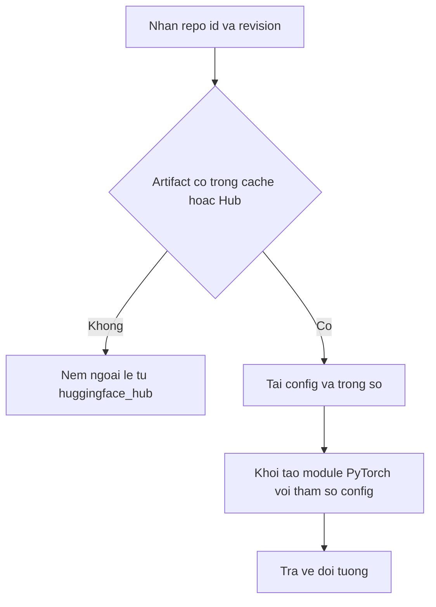

**Trình tự gọi thời gian chạy**

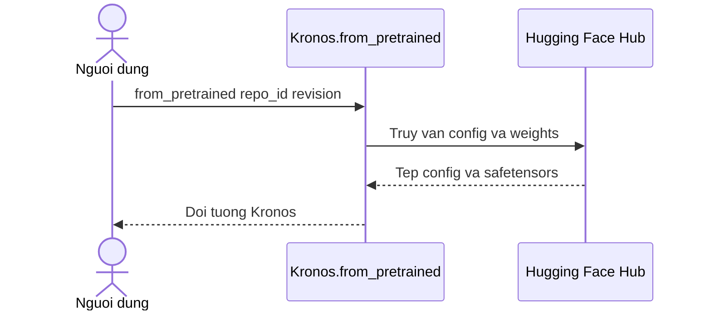

**Tiêu chuẩn nghiệm thu (Acceptance Criteria)**

```gherkin
Scenario 1: Happy Path
  Given kho "NeoQuasar/Kronos-small" khả dụng và thiết bị có kết nối Hub
  When Tác nhân gọi Kronos.from_pretrained với kho đó
  Then hệ thống trả về đối tượng Kronos với tham số lấy từ config của kho

Scenario 2: Validation Failure
  Given định danh kho không tồn tại hoặc Hub không truy cập được và bộ nhớ đệm trống
  When Tác nhân gọi Kronos.from_pretrained
  Then ngoại lệ của huggingface_hub được truyền lên và không có đối tượng nào được tạo
```

**Ghi chú bằng chứng**

- `[UNKNOWN]` loại ngoại lệ cụ thể do `huggingface_hub==0.33.1` quyết định, không được xử lý trong mã Kronos.

---

#### US-INF-02 - Dự báo OHLCV cho một chuỗi

**Câu chuyện:** Với tư cách là nhà nghiên cứu định lượng (P-01), tôi muốn gọi KronosPredictor.predict với DataFrame lịch sử và mốc thời gian tương lai để nhận DataFrame dự báo sáu cột cùng thang đo với dữ liệu đầu vào.

**Truy vết mã nguồn và kiểm thử**

| Loại | Tham chiếu |
|---|---|
| Source Code Traceability | `model/kronos.py:KronosPredictor.predict` (dòng 519-559), `calc_time_stamps`, `generate`, `auto_regressive_inference` |
| Automated Test Traceability | `tests/test_kronos_regression.py::test_kronos_predictor_regression`, `::test_kronos_predictor_mse`; `examples/prediction_example.py` (minh họa) |

**Wireframe (Pattern A)**

```text
┌────────────────────────────────────────────────────────────────────────┐
│  STORY: US-INF-02 - PREDICT SINGLE SERIES                  [Cancel] [X]│
├────────────────────────────────────────────────────────────────────────┤
│  EPIC CONTEXT: EPIC-INF | STEP: Submit prediction request              │
│  Progress: [●] Load ─── [●] Build predictor ─── [○] Predict            │
├────────────────────────────────────────────────────────────────────────┤
│  * History DataFrame               * pred_len                          │
│  ┌──────────────────────────────┐   ┌──────────────────────────────┐   │
│  │ df[open..close,volume,amount]│   │ 120                          │   │
│  └──────────────────────────────┘   └──────────────────────────────┘   │
│  * x_timestamp (Series)             * y_timestamp (Series)             │
│  ┌──────────────────────────────┐   ┌──────────────────────────────┐   │
│  │ 400 timestamps               │   │ 120 timestamps               │   │
│  └──────────────────────────────┘   └──────────────────────────────┘   │
│  [!] Required: open, high, low, close. No NaN in price or volume.      │
├────────────────────────────────────────────────────────────────────────┤
│  [ < Previous ]                [ Save Draft ]          [ Predict > ]   │
└────────────────────────────────────────────────────────────────────────┘
```

**Luồng quyết định nghiệp vụ**

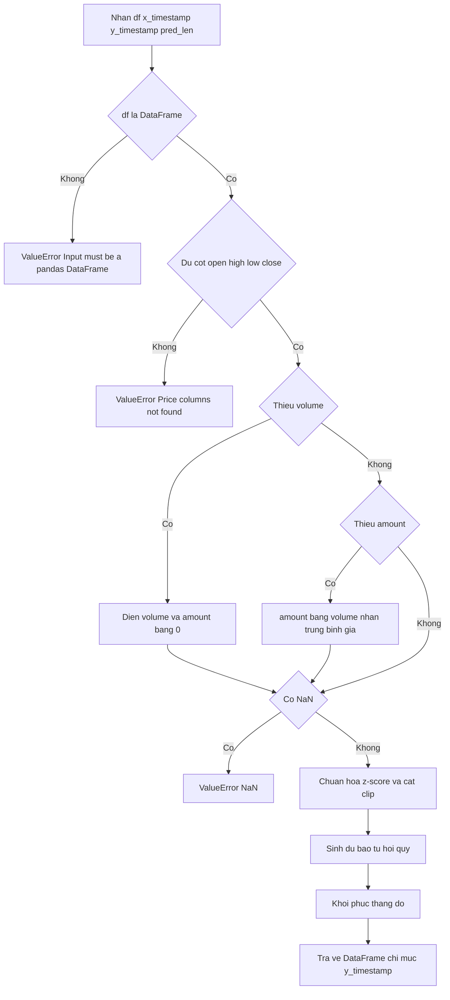

**Trình tự gọi thời gian chạy**

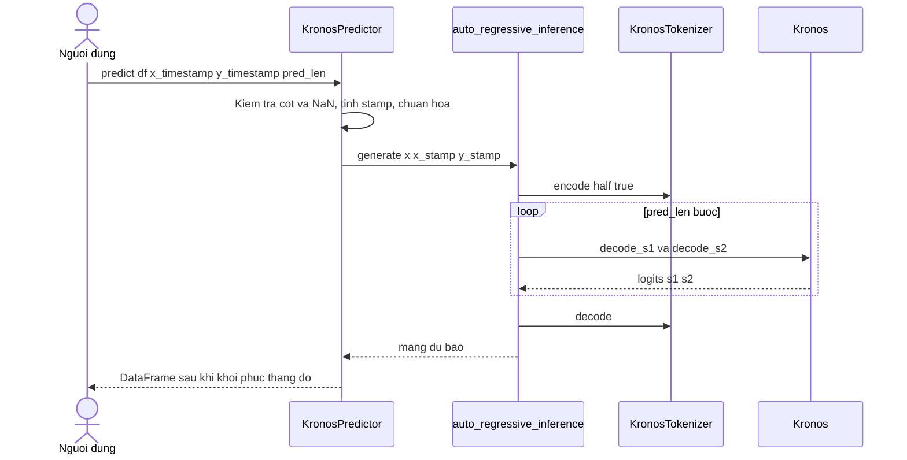

**Tiêu chuẩn nghiệm thu (Acceptance Criteria)**

```gherkin
Scenario 1: Happy Path
  Given df chứa các cột open, high, low, close, volume, amount không có NaN
  And x_timestamp có cùng độ dài với df và y_timestamp có độ dài pred_len
  When Tác nhân gọi predict
  Then kết quả là DataFrame có sáu cột open, high, low, close, volume, amount
  And chỉ mục của kết quả bằng y_timestamp
  And với top_k=1, seed cố định, kết quả khớp tệp tham chiếu trong sai số tương đối 1e-5

Scenario 2: Validation Failure
  Given df thiếu cột close
  When Tác nhân gọi predict
  Then hệ thống phát ValueError "Price columns ['open', 'high', 'low', 'close'] not found in DataFrame."
  And không có suy luận nào được thực thi

Scenario 3: Edge Case - dữ liệu thiếu khối lượng
  Given df chỉ có bốn cột giá
  When Tác nhân gọi predict
  Then hệ thống điền volume và amount bằng 0.0 trước khi chuẩn hóa

Scenario 4: Validation Failure - NaN
  Given df chứa giá trị NaN ở cột volume
  When Tác nhân gọi predict
  Then hệ thống phát ValueError "Input DataFrame contains NaN values in price or volume columns." 
```

**Ghi chú bằng chứng**

- `[OPEN]` hàm predict không kiểm tra độ dài `y_timestamp` bằng `pred_len`; hàm `predict_batch` có kiểm tra (US-INF-03).
- `[i]` Thang đo: trung bình và độ lệch chuẩn tính trên toàn bộ cửa sổ lịch sử; mẫu số cộng 1e-5.

---

#### US-INF-03 - Dự báo hàng loạt nhiều chuỗi

**Câu chuyện:** Với tư cách là nhà nghiên cứu định lượng (P-01), tôi muốn gọi predict_batch với danh sách DataFrame cùng độ dài để dự báo song song nhiều mã trong một lượt suy luận.

**Truy vết mã nguồn và kiểm thử**

| Loại | Tham chiếu |
|---|---|
| Source Code Traceability | `model/kronos.py:KronosPredictor.predict_batch` (dòng 562-661) |
| Automated Test Traceability | Không có kiểm thử tự động; minh họa tại `examples/prediction_batch_example.py` |

**Wireframe (Pattern C)**

```text
┌────────────────────────────────────────────────────────────────────────┐
│  STORY: US-INF-03 - BATCH PREDICTION                                   │
├────────────────────────────────────────────────────────────────────────┤
│  INPUT LIST VALIDATION:                                                │
│  Series count: [ 3 ]   History length: [ 400 ]   pred_len: [ 120 ]     │
├────────────────────────────────────────────────────────────────────────┤
│  ┌────┬──────────┬──────────┬─────────┬────────┬────────────┐          │
│  │ #  │ Series   │ History  │ y_stamp │ Cols   │ Status     │          │
│  ├────┼──────────┼──────────┼─────────┼────────┼────────────┤          │
│  │ 0  │ SYM_A    │ 400      │ 120     │ yes    │ READY      │          │
│  │ 1  │ SYM_B    │ 400      │ 120     │ yes    │ READY      │          │
│  │ 2  │ SYM_C    │ 380      │ 120     │ yes    │ [!] LENGTH │          │
│  └────┴──────────┴──────────┴─────────┴────────┴────────────┘          │
├────────────────────────────────────────────────────────────────────────┤
│  [!] All series require identical history length and prediction length.│
└────────────────────────────────────────────────────────────────────────┘
```

**Luồng quyết định nghiệp vụ**

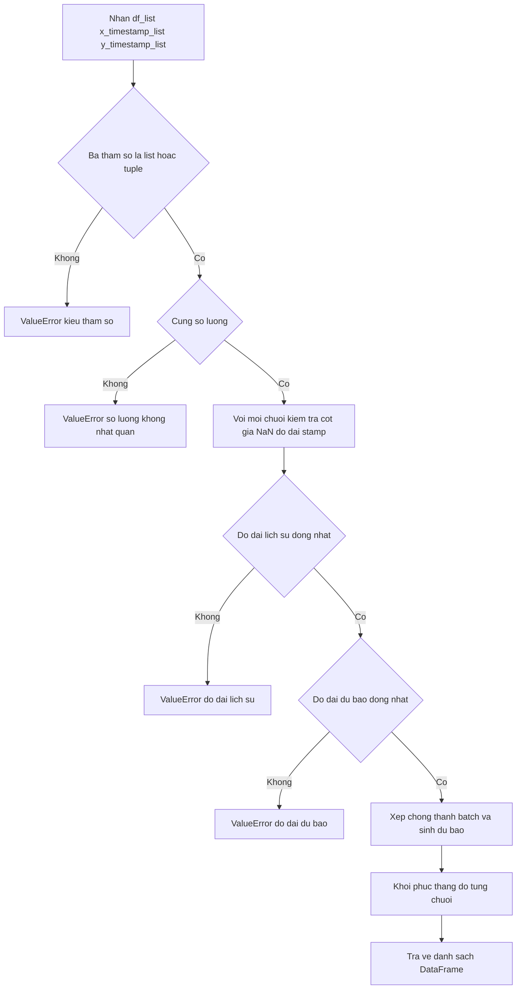

**Trình tự gọi thời gian chạy**

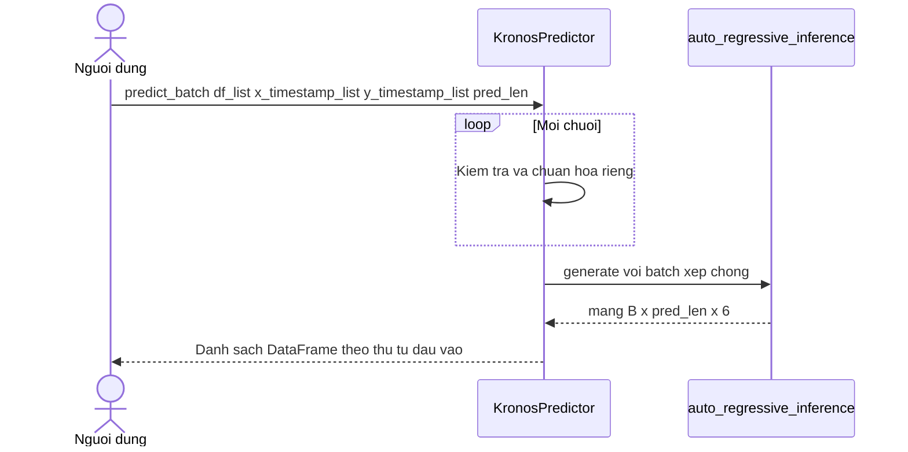

**Tiêu chuẩn nghiệm thu (Acceptance Criteria)**

```gherkin
Scenario 1: Happy Path
  Given ba DataFrame cùng độ dài lịch sử 400 và ba y_timestamp cùng độ dài 120
  When Tác nhân gọi predict_batch với pred_len=120
  Then kết quả là danh sách ba DataFrame theo đúng thứ tự đầu vào
  And mỗi DataFrame được chỉ mục bằng y_timestamp tương ứng

Scenario 2: Validation Failure
  Given một chuỗi có độ dài lịch sử khác các chuỗi còn lại
  When Tác nhân gọi predict_batch
  Then hệ thống phát ValueError "Parallel prediction requires all series to have consistent historical lengths"
  And không có DataFrame nào được trả về

Scenario 3: Validation Failure
  Given y_timestamp của một chuỗi có độ dài khác pred_len
  When Tác nhân gọi predict_batch
  Then hệ thống phát ValueError chỉ rõ chỉ số chuỗi vi phạm
```

**Ghi chú bằng chứng**

- `[OPEN]` không có kiểm thử tự động cho `predict_batch`.

---

#### US-INF-04 - Điều khiển lấy mẫu dự báo

**Câu chuyện:** Với tư cách là nhà nghiên cứu định lượng (P-01), tôi muốn thiết lập T, top_k, top_p và sample_count để cân bằng giữa tính xác định và độ đa dạng của dự báo.

**Truy vết mã nguồn và kiểm thử**

| Loại | Tham chiếu |
|---|---|
| Source Code Traceability | `model/kronos.py:sample_from_logits`, `top_k_top_p_filtering`, `auto_regressive_inference` (trung bình `sample_count` đường tại dòng 465-467) |
| Automated Test Traceability | `tests/test_kronos_regression.py` (dùng `top_k=1`, `top_p=1.0`, `sample_count=1`, `T=1.0`) |

**Wireframe (Pattern A)**

```text
┌────────────────────────────────────────────────────────────────────────┐
│  STORY: US-INF-04 - SAMPLING CONTROLS                      [Cancel] [X]│
├────────────────────────────────────────────────────────────────────────┤
│  EPIC CONTEXT: EPIC-INF | STEP: Configure sampling                     │
├────────────────────────────────────────────────────────────────────────┤
│  * Temperature T                   * top_k (0 = off)                   │
│  ┌──────────────────────────────┐   ┌──────────────────────────────┐   │
│  │ 1.0                          │   │ 0                            │   │
│  └──────────────────────────────┘   └──────────────────────────────┘   │
│  * top_p                            * sample_count                     │
│  ┌──────────────────────────────┐   ┌──────────────────────────────┐   │
│  │ 0.9                          │   │ 1                            │   │
│  └──────────────────────────────┘   └──────────────────────────────┘   │
│  [!] top_k greater than 0 takes precedence over top_p in the filter.   │
├────────────────────────────────────────────────────────────────────────┤
│  [ < Previous ]                [ Save Draft ]            [ Apply > ]   │
└────────────────────────────────────────────────────────────────────────┘
```

**Luồng quyết định nghiệp vụ**

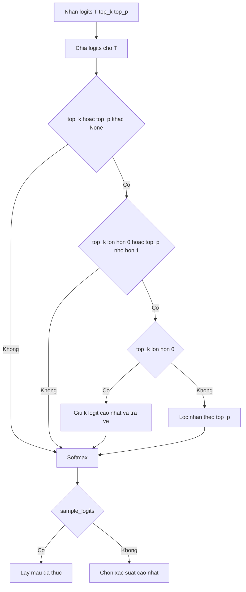

**Trình tự gọi thời gian chạy**

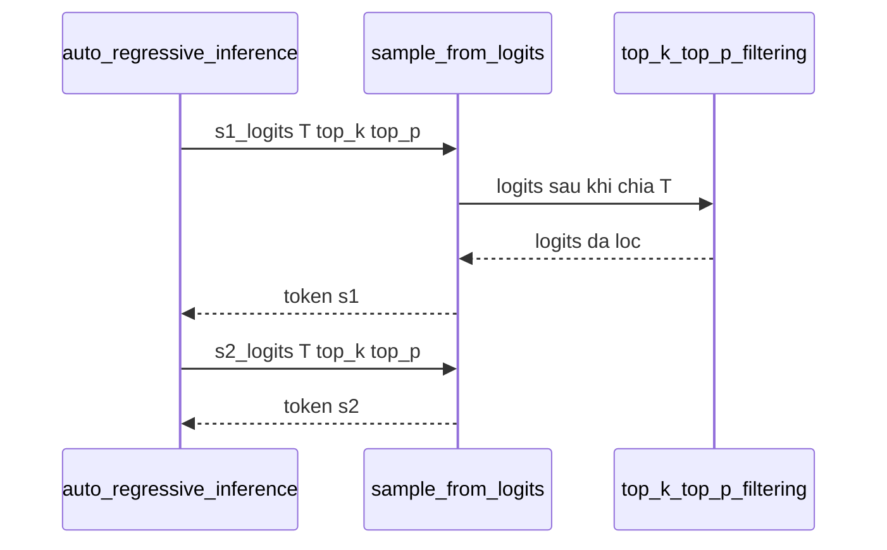

**Tiêu chuẩn nghiệm thu (Acceptance Criteria)**

```gherkin
Scenario 1: Happy Path - xác định
  Given top_k=1 và top_p=1.0 và seed cố định
  When Tác nhân gọi predict hai lần với cùng đầu vào
  Then hai kết quả trùng nhau trong sai số tương đối 1e-5

Scenario 2: Happy Path - lấy mẫu trung bình
  Given sample_count=5
  When Tác nhân gọi predict
  Then hệ thống sinh năm đường dự báo độc lập cho mỗi chuỗi
  And kết quả là trung bình số học của năm đường

Scenario 3: Edge Case - top_k và top_p cùng được đặt
  Given top_k=50 và top_p=0.9
  When hệ thống lọc logits
  Then hệ thống chỉ áp dụng top_k và bỏ qua top_p

Scenario 4: Validation Failure - tham số None
  Given Tác nhân gọi sample_from_logits với top_k=None và top_p=0.9
  When hệ thống đánh giá điều kiện top_k > 0
  Then Python phát TypeError
```

**Ghi chú bằng chứng**

- `[!]` Kịch bản 4 là hành vi thực tế của `sample_from_logits` (dòng 375-377); `KronosPredictor` luôn truyền `top_k=0` mặc định nên đường dẫn này không xảy ra qua API công khai.
- `[!]` `top_k_top_p_filtering` trả về ngay sau khi áp dụng top_k, nên `top_p` bị bỏ qua khi `top_k > 0` (dòng 347-352).

---

#### US-INF-05 - Chọn thiết bị tính toán tự động

**Câu chuyện:** Với tư cách là nhà nghiên cứu định lượng (P-01), tôi muốn khởi tạo KronosPredictor mà không chỉ định thiết bị để tận dụng GPU hoặc Apple Silicon khi khả dụng.

**Truy vết mã nguồn và kiểm thử**

| Loại | Tham chiếu |
|---|---|
| Source Code Traceability | `model/kronos.py:KronosPredictor.__init__` (dòng 484-506) |
| Automated Test Traceability | `tests/test_kronos_regression.py` (chỉ định `DEVICE="cpu"`; nhánh tự động chưa được kiểm thử) |

**Wireframe (Pattern A)**

```text
┌────────────────────────────────────────────────────────────────────────┐
│  STORY: US-INF-05 - DEVICE SELECTION                       [Cancel] [X]│
├────────────────────────────────────────────────────────────────────────┤
│  EPIC CONTEXT: EPIC-INF | STEP: Build predictor                        │
├────────────────────────────────────────────────────────────────────────┤
│  * device (None = auto)             Detected order:                    │
│  ┌──────────────────────────────┐   1. cuda:0                          │
│  │ None                       ▼ │   2. mps                             │
│  └──────────────────────────────┘   3. cpu                             │
│  [i] Model and tokenizer are moved to the selected device.             │
├────────────────────────────────────────────────────────────────────────┤
│  [ < Previous ]                [ Save Draft ]            [ Build > ]   │
└────────────────────────────────────────────────────────────────────────┘
```

**Luồng quyết định nghiệp vụ**

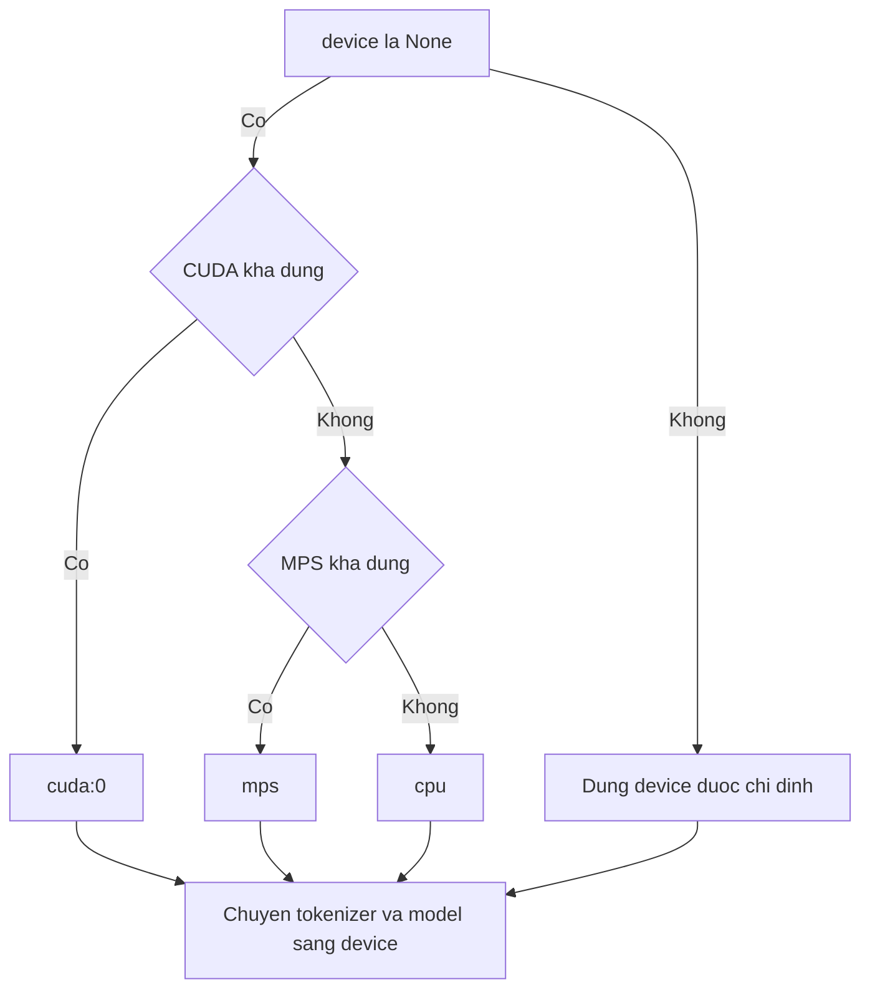

**Trình tự gọi thời gian chạy**

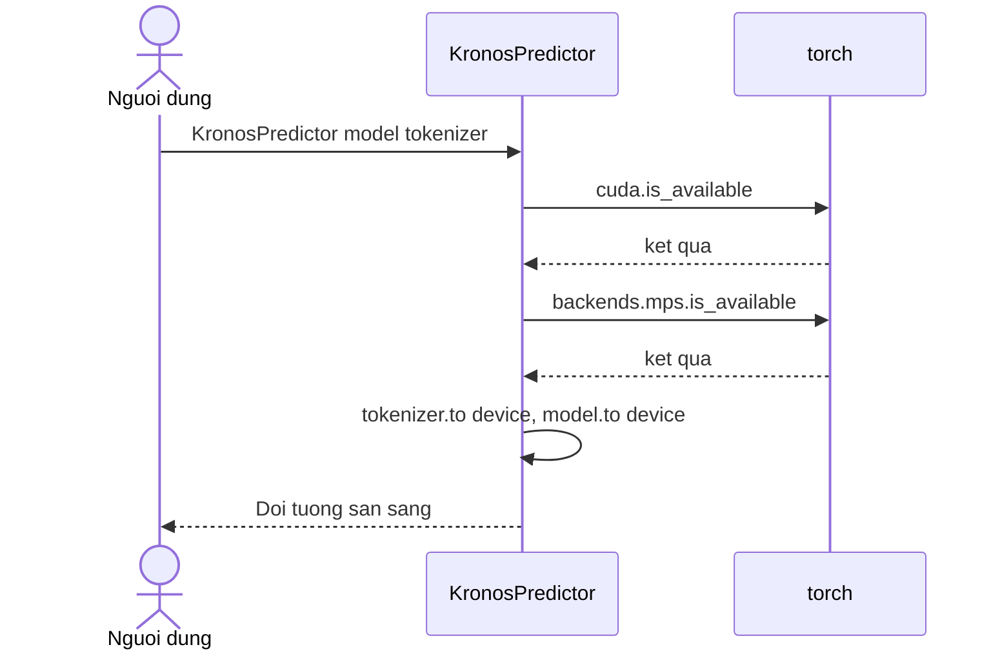

**Tiêu chuẩn nghiệm thu (Acceptance Criteria)**

```gherkin
Scenario 1: Happy Path
  Given thiết bị có CUDA khả dụng và tham số device không được chỉ định
  When Tác nhân tạo KronosPredictor
  Then hệ thống chọn thiết bị "cuda:0" và chuyển tokenizer cùng mô hình sang thiết bị đó

Scenario 2: Edge Case
  Given CUDA và MPS đều không khả dụng
  When Tác nhân tạo KronosPredictor với device=None
  Then hệ thống chọn thiết bị "cpu" 
```

---

#### US-INF-06 - Quản lý cửa sổ ngữ cảnh tối đa

**Câu chuyện:** Với tư cách là nhà nghiên cứu định lượng (P-01), tôi muốn cung cấp lịch sử dài hơn max_context để nhận dự báo mà không vượt giới hạn độ dài của mô hình.

**Truy vết mã nguồn và kiểm thử**

| Loại | Tham chiếu |
|---|---|
| Source Code Traceability | `model/kronos.py:auto_regressive_inference` (dòng 405-454: bộ đệm `pre_buffer`, `post_buffer`, `torch.roll`) |
| Automated Test Traceability | `tests/test_kronos_regression.py` (ngữ cảnh 512 và 256 với `max_context=512`; nhánh cắt bớt khi lịch sử vượt 512 chưa được kiểm thử trực tiếp) |

**Wireframe (Pattern B)**

```text
┌────────────────────────────────────────────────────────────────────────┐
│  STORY: US-INF-06 - CONTEXT WINDOW MANAGEMENT        [Status: Active ●]│
├────────────────────────────────────────────────────────────────────────┤
│  WINDOW METRICS                                                        │
│  ┌───────────────────┐  ┌───────────────────┐  ┌───────────────────┐   │
│  │ [HISTORY TOKENS]  │  │ [MAX_CONTEXT]     │  │ [PRED STEPS]      │   │
│  │ 600               │  │ 512               │  │ 120               │   │
│  │ Truncated: 88     │  │ Window: sliding   │  │ Roll per step     │   │
│  └───────────────────┘  └───────────────────┘  └───────────────────┘   │
├────────────────────────────────────────────────────────────────────────┤
│  [i] Initial buffer holds the last max_context tokens of the history.  │
│  [i] After the buffer is full each step rolls left by one token.       │
└────────────────────────────────────────────────────────────────────────┘
```

**Luồng quyết định nghiệp vụ**

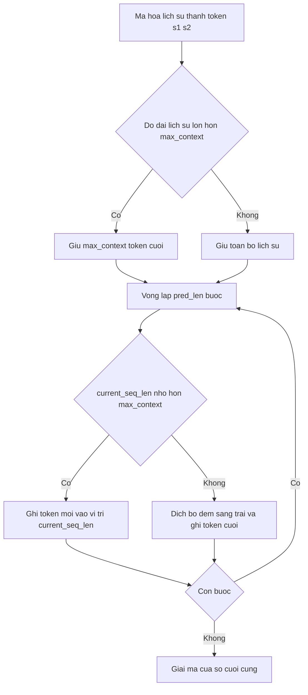

**Trình tự gọi thời gian chạy**

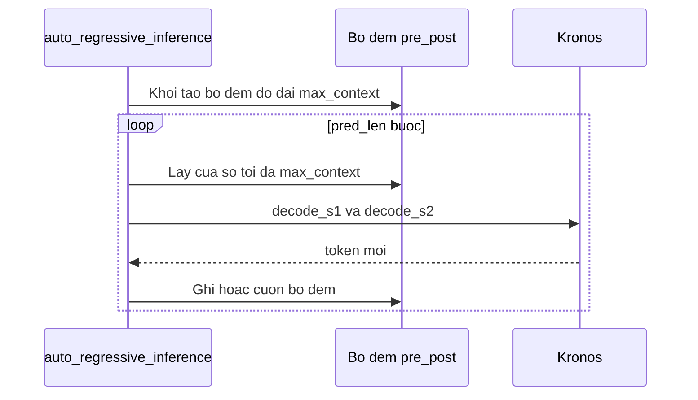

**Tiêu chuẩn nghiệm thu (Acceptance Criteria)**

```gherkin
Scenario 1: Happy Path
  Given lịch sử có 600 nến và max_context=512
  When hệ thống chạy suy luận tự hồi quy
  Then bộ đệm khởi tạo bằng 512 token cuối của lịch sử
  And mỗi bước suy luận dùng tối đa 512 token

Scenario 2: Edge Case
  Given lịch sử có 256 nến và max_context=512
  When hệ thống chạy suy luận
  Then hệ thống dùng toàn bộ 256 token và ghi token mới vào bộ đệm cho đến khi đầy 512
```

**Ghi chú bằng chứng**

- `[OPEN]` README ghi `max_context` của Kronos-small và Kronos-base là 512; Kronos-mini là 2048.

---


### EPIC-WEB - Giao diện web trình diễn

**Mục tiêu nghiệp vụ:** Cung cấp giao diện trình duyệt để nạp dữ liệu, nạp mô hình, dự báo và đối chiếu thực tế.

#### US-WEB-01 - Liệt kê tệp dữ liệu khả dụng

**Câu chuyện:** Với tư cách là nhà phân tích thị trường (P-03), tôi muốn xem danh sách tệp CSV và Feather trong thư mục dữ liệu để chọn tệp để nạp mà không nhập đường dẫn thủ công.

**Truy vết mã nguồn và kiểm thử**

| Loại | Tham chiếu |
|---|---|
| Source Code Traceability | `webui/app.py:get_data_files` -> `load_data_files` (dòng 60-76, route dòng 335-339) |
| Automated Test Traceability | Không có kiểm thử tự động |

**Wireframe (Pattern C)**

```text
┌────────────────────────────────────────────────────────────────────────┐
│  STORY: US-WEB-01 - DATA FILE LIST                                     │
├────────────────────────────────────────────────────────────────────────┤
│  Select Data File: [ Please load data file list first            ▼ ]   │
│  Source directory: <repo>/data     Extensions: .csv, .feather          │
├────────────────────────────────────────────────────────────────────────┤
│  ┌────────────────────────┬──────────────────────────┬────────────┐    │
│  │ Name                   │ Path                     │ Size       │    │
│  ├────────────────────────┼──────────────────────────┼────────────┤    │
│  │ XSHG_5min_600977.csv   │ <repo>/data/XSHG_5min... │ 182.4 KB   │    │
│  │ btc_1min.feather       │ <repo>/data/btc_1min...  │ 3.1 MB     │    │
│  └────────────────────────┴──────────────────────────┴────────────┘    │
├────────────────────────────────────────────────────────────────────────┤
│  [!] Empty list when the data directory does not exist.                │
└────────────────────────────────────────────────────────────────────────┘
```

**Luồng quyết định nghiệp vụ**

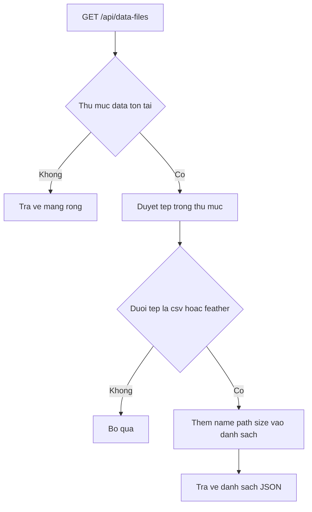

**Trình tự gọi thời gian chạy**

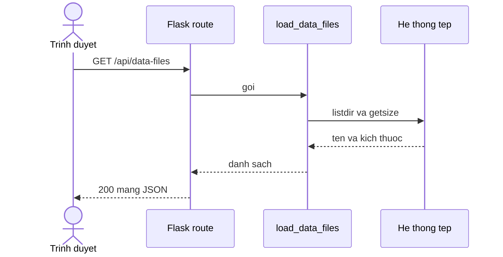

**Tiêu chuẩn nghiệm thu (Acceptance Criteria)**

```gherkin
Scenario 1: Happy Path
  Given thư mục "data" nằm cạnh thư mục "webui" và chứa tệp "a.csv" kích thước 2048 byte
  When trình duyệt gửi GET /api/data-files
  Then phản hồi là mã 200 với mảng chứa một phần tử có name "a.csv" và size "2.0 KB" 

Scenario 2: Edge Case
  Given thư mục "data" không tồn tại
  When trình duyệt gửi GET /api/data-files
  Then phản hồi là mã 200 với mảng rỗng
```

**Ghi chú bằng chứng**

- `[!]` Thư mục `data/` không có trong kho mã (`git ls-files`); chức năng trả về mảng rỗng cho đến khi thư mục được tạo.
- `[i]` Giao diện đọc `webui/templates/index.html` gọi `axios.get('/api/data-files')`.

---

#### US-WEB-02 - Nạp và kiểm tra tệp dữ liệu

**Câu chuyện:** Với tư cách là nhà phân tích thị trường (P-03), tôi muốn nạp một tệp CSV hoặc Feather và xem thông tin tổng hợp để xác nhận dữ liệu đủ điều kiện dự báo.

**Truy vết mã nguồn và kiểm thử**

| Loại | Tham chiếu |
|---|---|
| Source Code Traceability | `webui/app.py:load_data` (dòng 341-402), `load_data_file` (dòng 78-123) |
| Automated Test Traceability | Không có kiểm thử tự động |

**Wireframe (Pattern A)**

```text
┌────────────────────────────────────────────────────────────────────────┐
│  STORY: US-WEB-02 - LOAD DATA FILE                         [Cancel] [X]│
├────────────────────────────────────────────────────────────────────────┤
│  EPIC CONTEXT: EPIC-WEB | STEP: Load data                              │
│  Progress: [○] Model ─── [●] Data ─── [○] Predict ─── [○] Results      │
├────────────────────────────────────────────────────────────────────────┤
│  * Select Data File                                                    │
│  ┌──────────────────────────────────────────────┐                      │
│  │ XSHG_5min_600977.csv                       ▼ │                      │
│  └──────────────────────────────────────────────┘                      │
│  Data Information: Rows 8000 | Columns 7 | Frequency 5 minutes         │
│  Time Range: 2024-06-18 to 2024-09-30 | Prediction Columns: OHLCV      │
│  [!] Required columns: open, high, low, close.                         │
├────────────────────────────────────────────────────────────────────────┤
│  [ < Previous ]                                       [ Load Data > ]  │
└────────────────────────────────────────────────────────────────────────┘
```

**Luồng quyết định nghiệp vụ**

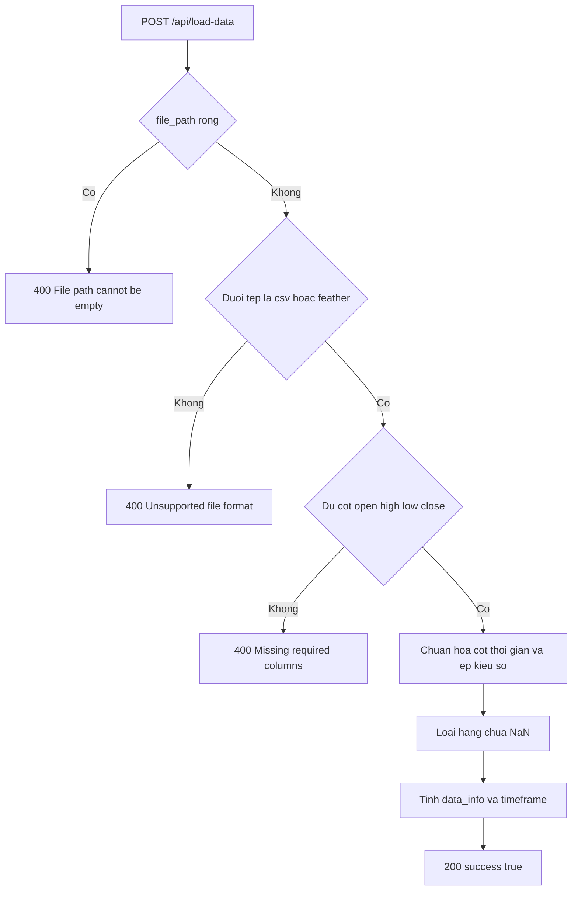

**Trình tự gọi thời gian chạy**

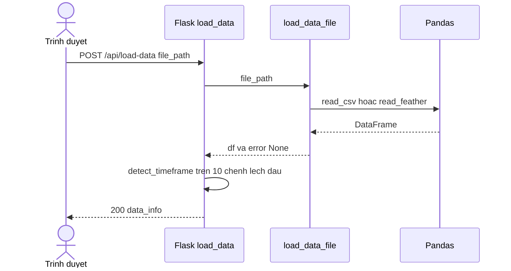

**Tiêu chuẩn nghiệm thu (Acceptance Criteria)**

```gherkin
Scenario 1: Happy Path
  Given tệp CSV hợp lệ có cột open, high, low, close và cột "timestamps"
  When trình duyệt gửi POST /api/load-data với file_path của tệp
  Then phản hồi là mã 200 với success=true
  And data_info chứa rows, columns, start_date, end_date, price_range, prediction_columns, timeframe

Scenario 2: Validation Failure - đường dẫn rỗng
  Given thân yêu cầu không có file_path
  When trình duyệt gửi POST /api/load-data
  Then phản hồi là mã 400 với error "File path cannot be empty" 

Scenario 3: Validation Failure - thiếu cột
  Given tệp thiếu cột "close"
  When trình duyệt gửi POST /api/load-data
  Then phản hồi là mã 400 với error bắt đầu bằng "Missing required columns" 

Scenario 4: Edge Case - không có cột thời gian
  Given tệp không có cột "timestamps", "timestamp" hoặc "date"
  When hệ thống nạp tệp
  Then hệ thống sinh cột timestamps từ 2024-01-01 với bước một giờ
```

**Ghi chú bằng chứng**

- `[!]` `file_path` được chấp nhận từ máy khách không bị ràng buộc vào thư mục dữ liệu; mọi tệp `.csv`/`.feather` đọc được trên máy chủ đều có thể nạp. `[PROPOSED]` giới hạn đường dẫn trong thư mục `data/`.
- `[i]` `prediction_columns` gồm `volume` chỉ khi cột này tồn tại; cột `amount` được ép kiểu nhưng không đưa vào đầu vào dự báo của Web UI.

---

#### US-WEB-03 - Nạp mô hình Kronos qua giao diện

**Câu chuyện:** Với tư cách là nhà phân tích thị trường (P-03), tôi muốn chọn mô hình và thiết bị rồi nạp mô hình để chuẩn bị bộ dự báo cho các lượt dự báo kế tiếp.

**Truy vết mã nguồn và kiểm thử**

| Loại | Tham chiếu |
|---|---|
| Source Code Traceability | `webui/app.py:load_model` (dòng 626-663), `get_available_models`, `get_model_status`, hằng số `AVAILABLE_MODELS` |
| Automated Test Traceability | Không có kiểm thử tự động |

**Wireframe (Pattern A)**

```text
┌────────────────────────────────────────────────────────────────────────┐
│  STORY: US-WEB-03 - LOAD MODEL                             [Cancel] [X]│
├────────────────────────────────────────────────────────────────────────┤
│  EPIC CONTEXT: EPIC-WEB | STEP: Load model                             │
│  Progress: [●] Model ─── [○] Data ─── [○] Predict ─── [○] Results      │
├────────────────────────────────────────────────────────────────────────┤
│  * Select Model                     * Select Device                    │
│  ┌──────────────────────────────┐   ┌──────────────────────────────┐   │
│  │ Kronos-small (24.7M)       ▼ │   │ CPU                        ▼ │   │
│  └──────────────────────────────┘   └──────────────────────────────┘   │
│  Options: kronos-mini | kronos-small | kronos-base                     │
│  Devices: CPU | CUDA (NVIDIA GPU) | MPS (Apple Silicon)                │
│  [!] Status: model library must be importable (MODEL_AVAILABLE).       │
├────────────────────────────────────────────────────────────────────────┤
│  [ < Previous ]                                       [ Load Model > ] │
└────────────────────────────────────────────────────────────────────────┘
```

**Luồng quyết định nghiệp vụ**

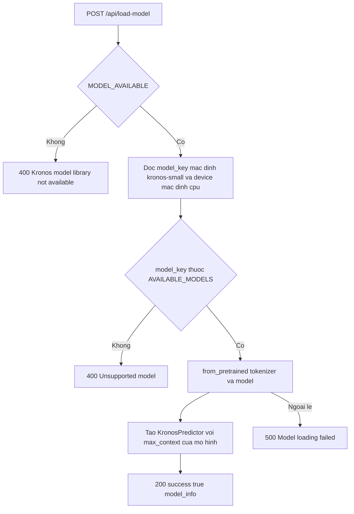

**Trình tự gọi thời gian chạy**

```mermaid
sequenceDiagram
    actor U as Trinh duyet
    participant R as Flask load_model
    participant H as Hugging Face Hub
    participant P as KronosPredictor
    U->>R: POST /api/load-model model_key device
    R->>H: KronosTokenizer.from_pretrained va Kronos.from_pretrained
    H-->>R: tokenizer va model
    R->>P: khoi tao voi device va context_length
    R-->>U: 200 model_info
```

**Tiêu chuẩn nghiệm thu (Acceptance Criteria)**

```gherkin
Scenario 1: Happy Path
  Given thư viện Kronos import được và model_key là "kronos-small"
  When trình duyệt gửi POST /api/load-model với device "cpu"
  Then phản hồi là mã 200 với success=true và model_info.context_length=512
  And biến toàn cục predictor khác None

Scenario 2: Validation Failure - mô hình không hỗ trợ
  Given model_key là "kronos-large"
  When trình duyệt gửi POST /api/load-model
  Then phản hồi là mã 400 với error "Unsupported model: kronos-large" 

Scenario 3: Validation Failure - thư viện không khả dụng
  Given việc import model thất bại khi khởi động ứng dụng
  When trình duyệt gửi POST /api/load-model
  Then phản hồi là mã 400 với error "Kronos model library not available" 
```

**Ghi chú bằng chứng**

- `[i]` Trạng thái mô hình là biến toàn cục theo tiến trình; không an toàn khi có nhiều worker hoặc yêu cầu đồng thời `[OPEN]`.

---

#### US-WEB-04 - Thực thi dự báo và hiển thị biểu đồ

**Câu chuyện:** Với tư cách là nhà phân tích thị trường (P-03), tôi muốn chạy dự báo với lookback, độ dài dự báo và tham số lấy mẫu để xem biểu đồ dự báo và đối chiếu với dữ liệu thực tế.

**Truy vết mã nguồn và kiểm thử**

| Loại | Tham chiếu |
|---|---|
| Source Code Traceability | `webui/app.py:predict` (dòng 404-624), `create_prediction_chart` (dòng 209-327) |
| Automated Test Traceability | Không có kiểm thử tự động |

**Wireframe (Pattern B)**

```text
┌────────────────────────────────────────────────────────────────────────┐
│  STORY: US-WEB-04 - PREDICT AND CHART                [Status: Model ●] │
│  Scope Filter: [ Custom window ▼ ]              Lookback 400 | Pred 120│
├────────────────────────────────────────────────────────────────────────┤
│  PARAMETERS                                                            │
│  ┌───────────────────┐  ┌───────────────────┐  ┌───────────────────┐   │
│  │ [T 0.1-2.0]       │  │ [top_p 0.1-1.0]   │  │ [sample_count]    │   │
│  │ 1.0               │  │ 0.9               │  │ 1 (range 1-5)     │   │
│  └───────────────────┘  └───────────────────┘  └───────────────────┘   │
├────────────────────────────────────────────────────────────────────────┤
│  PREDICTION CHART (Plotly)                                             │
│  Price  ┤        ····· predicted close                                 │
│         ┤  ─────── actual close                                        │
│         ┼──────────────────────────────────────────────────────────    │
│         [history 400]                     [forecast 120]               │
│  Metrics: MAE | RMSE | MAPE (when actual data exists)                  │
├────────────────────────────────────────────────────────────────────────┤
│  [ Predict > ]  disabled until the model is loaded                     │
└────────────────────────────────────────────────────────────────────────┘
```

**Luồng quyết định nghiệp vụ**

```mermaid
flowchart TD
    A[POST /api/predict] --> B{file_path rong}
    B -->|Co| E1[400 File path cannot be empty]
    B -->|Khong| C[Nap du lieu]
    C -->|Loi| E2[400 loi tai du lieu]
    C -->|OK| D{So hang nho hon lookback}
    D -->|Co| E3[400 Insufficient data length]
    D -->|Khong| F{Mo hinh da duoc nap}
    F -->|Khong| E4[400 Kronos model not loaded]
    F -->|Co| G{Co start_date}
    G -->|Co| H{So hang tu start_date nho hon lookback cong pred_len}
    H -->|Co| E5[400 Insufficient data from start time]
    H -->|Khong| I[Dung cua so tu start_date]
    G -->|Khong| J[Dung lookback hang dau lam dau vao]
    I --> K[predictor.predict]
    J --> K
    K -->|Ngoai le| E6[500 Kronos model prediction failed]
    K --> L[Tao bieu do va doi chieu thuc te]
    L --> M[Luu ket qua JSON]
    M --> N[200 success true]
```

**Trình tự gọi thời gian chạy**

```mermaid
sequenceDiagram
    actor U as Trinh duyet
    participant R as Flask predict
    participant L as load_data_file
    participant P as KronosPredictor
    participant C as create_prediction_chart
    participant S as save_prediction_results
    U->>R: POST /api/predict tham so
    R->>L: file_path
    L-->>R: df
    R->>P: predict x_df x_timestamp y_timestamp T top_p sample_count
    P-->>R: pred_df
    R->>C: df pred_df lookback pred_len
    C-->>R: chart JSON
    R->>S: luu ket qua
    R-->>U: 200 chart prediction_results actual_data
```

**Tiêu chuẩn nghiệm thu (Acceptance Criteria)**

```gherkin
Scenario 1: Happy Path
  Given mô hình đã nạp và tệp dữ liệu có ít nhất 520 hàng hợp lệ
  When trình duyệt gửi POST /api/predict với lookback=400, pred_len=120
  Then phản hồi là mã 200 với success=true
  And prediction_results chứa 120 phần tử
  And has_comparison=true khi tồn tại dữ liệu thực tế cho các mốc dự báo

Scenario 2: Validation Failure - mô hình chưa nạp
  Given predictor là None
  When trình duyệt gửi POST /api/predict
  Then phản hồi là mã 400 với error "Kronos model not loaded, please load model first" 

Scenario 3: Validation Failure - thiếu dữ liệu từ start_date
  Given số hàng từ start_date nhỏ hơn lookback + pred_len
  When trình duyệt gửi POST /api/predict
  Then phản hồi là mã 400 với error bắt đầu bằng "Insufficient data from start time" 

Scenario 4: Validation Failure - lỗi suy luận
  Given predictor.predict phát ngoại lệ
  When trình duyệt gửi POST /api/predict
  Then phản hồi là mã 500 với error bắt đầu bằng "Kronos model prediction failed" 
```

**Ghi chú bằng chứng**

- `[!]` Khi không có `start_date`, mã dùng `lookback` hàng đầu tiên của tệp (`df.iloc[:lookback]`) trong khi nhãn kiểu dự báo ghi "latest data".
- `[OPEN]` Khi không có `start_date` và số hàng nhỏ hơn `lookback + pred_len`, độ dài `y_timestamp` nhỏ hơn `pred_len`; hành vi chưa được kiểm thử.
- `[i]` Giá trị mặc định: lookback=400, pred_len=120, temperature=1.0, top_p=0.9, sample_count=1; giao diện giới hạn temperature 0.1-2.0, top_p 0.1-1.0, sample_count 1-5.

---

#### US-WEB-05 - Lưu kết quả dự báo và phân tích liên tục

**Câu chuyện:** Với tư cách là nhà phân tích thị trường (P-03), tôi muốn lưu mỗi lượt dự báo thành tệp JSON kèm phân tích chênh lệch để đối chiếu và truy vết kết quả sau này.

**Truy vết mã nguồn và kiểm thử**

| Loại | Tham chiếu |
|---|---|
| Source Code Traceability | `webui/app.py:save_prediction_results` (dòng 125-207) |
| Automated Test Traceability | Không có kiểm thử tự động; 28 tệp mẫu tại `webui/prediction_results/prediction_20250826_*.json` |

**Wireframe (Pattern C)**

```text
┌────────────────────────────────────────────────────────────────────────┐
│  STORY: US-WEB-05 - PREDICTION RESULT ARCHIVE                          │
├────────────────────────────────────────────────────────────────────────┤
│  Folder: webui/prediction_results/                                     │
│  Pattern: prediction_YYYYMMDD_HHMMSS.json                              │
├────────────────────────────────────────────────────────────────────────┤
│  ┌──────────────────────┬──────────┬────────┬────────┬───────────┐     │
│  │ File (suffix)        │ Lookback │ PredLn │ Actual │ Close gap │     │
│  ├──────────────────────┼──────────┼────────┼────────┼───────────┤     │
│  │ 20250826_163800      │ 400      │ 120    │ yes    │ 0.35 pct  │     │
│  │ 20250826_164030      │ 400      │ 120    │ yes    │ see file  │     │
│  └──────────────────────┴──────────┴────────┴────────┴───────────┘     │
├────────────────────────────────────────────────────────────────────────┤
│  [i] Save failure is logged to stdout and does not fail the API        │
│      response.                                                         │
└────────────────────────────────────────────────────────────────────────┘
```

**Luồng quyết định nghiệp vụ**

```mermaid
flowchart TD
    A[Nhan ket qua du bao] --> B[Tao thu muc prediction_results neu chua co]
    B --> C[Dat ten prediction_timestamp.json]
    C --> D[Tom tat dau vao rows columns price_range last_values]
    D --> E{Co actual_data}
    E -->|Co| F[Tinh gaps va gap_percentages giua diem du bao dau va diem thuc dau]
    E -->|Khong| G[analysis rong]
    F --> H[Ghi JSON UTF-8]
    G --> H
    H -->|Ngoai le| I[In loi va tra ve None]
```

**Trình tự gọi thời gian chạy**

```mermaid
sequenceDiagram
    participant R as Flask predict
    participant S as save_prediction_results
    participant D as He thong tep
    R->>S: file_path loai tham so du bao dau vao
    S->>D: makedirs prediction_results
    S->>D: ghi prediction_timestamp.json
    D-->>S: ket qua
    S-->>R: duong dan hoac None
```

**Tiêu chuẩn nghiệm thu (Acceptance Criteria)**

```gherkin
Scenario 1: Happy Path
  Given một lượt dự báo thành công có dữ liệu thực tế đối chiếu
  When hệ thống lưu kết quả
  Then hệ thống tạo tệp "prediction_<YYYYMMDD_HHMMSS>.json" chứa timestamp, file_path, prediction_type, prediction_params, input_data_summary, prediction_results, actual_data, analysis
  And analysis.continuity chứa gaps và gap_percentages cho open, high, low, close

Scenario 2: Edge Case - không có dữ liệu thực tế
  Given actual_data rỗng
  When hệ thống lưu kết quả
  Then analysis là đối tượng rỗng

Scenario 3: Validation Failure
  Given thư mục đích không ghi được
  When hệ thống lưu kết quả
  Then hệ thống in thông báo "Failed to save prediction results" và API vẫn trả về mã 200
```

**Ghi chú bằng chứng**

- `[i]` `analysis.continuity.last_prediction` thực chất là phần tử dự báo đầu tiên (`prediction_results[0]`) so với phần tử thực tế đầu tiên.
- `[OPEN]` Tên tệp theo giây; hai lượt lưu trong cùng một giây ghi đè nhau.

---


### EPIC-FTQ - Tinh chỉnh và backtest trên dữ liệu Qlib

**Mục tiêu nghiệp vụ:** Chuẩn bị dữ liệu Qlib, tinh chỉnh tokenizer và mô hình dự báo bằng DDP, rồi đánh giá bằng backtest danh mục.

#### US-FTQ-01 - Tiền xử lý dữ liệu Qlib thành tập pickle

**Câu chuyện:** Với tư cách là kỹ sư học máy (P-02), tôi muốn chạy bộ tiền xử lý để chia dữ liệu Qlib thành tập huấn luyện, kiểm định và kiểm thử để cung cấp đầu vào cho các tập lệnh huấn luyện.

**Truy vết mã nguồn và kiểm thử**

| Loại | Tham chiếu |
|---|---|
| Source Code Traceability | `finetune/qlib_data_preprocess.py:QlibDataPreprocessor` (`initialize_qlib`, `load_qlib_data`, `prepare_dataset`), `finetune/config.py:Config` |
| Automated Test Traceability | Không có kiểm thử tự động |

**Wireframe (Pattern A)**

```text
┌────────────────────────────────────────────────────────────────────────┐
│  STORY: US-FTQ-01 - PREPROCESS QLIB DATA                   [Cancel] [X]│
├────────────────────────────────────────────────────────────────────────┤
│  EPIC CONTEXT: EPIC-FTQ | STEP: Prepare dataset                        │
│  Progress: [●] Init Qlib ─── [●] Load ─── [○] Split ─── [○] Save       │
├────────────────────────────────────────────────────────────────────────┤
│  * Qlib data path                  * Instrument                        │
│  ┌──────────────────────────────┐   ┌──────────────────────────────┐   │
│  │ ~/.qlib/qlib_data/cn_data    │   │ csi300                       │   │
│  └──────────────────────────────┘   └──────────────────────────────┘   │
│  Train 2011-01-01..2022-12-31 | Val 2022-09-01..2024-06-30             │
│  Test 2024-04-01..2025-06-05                                           │
│  [!] Fields: open, close, high, low, volume, vwap. Output: pickle      │
│      files.                                                            │
├────────────────────────────────────────────────────────────────────────┤
│  [ < Previous ]                                          [ Run > ]     │
└────────────────────────────────────────────────────────────────────────┘
```

**Luồng quyết định nghiệp vụ**

```mermaid
flowchart TD
    A[Khoi tao Qlib voi provider_uri REG_CN] --> B[Doc lich giao dich D.calendar]
    B --> C[Mo rong cua so them lookback va predict_window]
    C --> D[QlibDataLoader nap truong open close high low volume vwap]
    D --> E[Pivot theo ma chung khoan]
    E --> F[Chia theo train_time_range val_time_range test_time_range]
    F --> G[Ghi train_data.pkl val_data.pkl test_data.pkl]
```

**Trình tự gọi thời gian chạy**

```mermaid
sequenceDiagram
    actor U as Ky su ML
    participant P as QlibDataPreprocessor
    participant Q as Qlib
    participant D as He thong tep
    U->>P: initialize_qlib
    P->>Q: qlib.init provider_uri
    U->>P: load_qlib_data
    P->>Q: QlibDataLoader load instrument
    Q-->>P: DataFrame
    U->>P: prepare_dataset
    P->>D: pickle.dump train val test
```

**Tiêu chuẩn nghiệm thu (Acceptance Criteria)**

```gherkin
Scenario 1: Happy Path
  Given thư mục Qlib hợp lệ và instrument "csi300"
  When Tác nhân chạy bộ tiền xử lý
  Then hệ thống ghi ba tệp train_data.pkl, val_data.pkl, test_data.pkl vào dataset_path
  And mỗi tệp là từ điển ánh xạ mã chứng khoán tới DataFrame chỉ mục datetime

Scenario 2: Edge Case - khoảng thời gian chồng lấn có chủ đích
  Given val_time_range bắt đầu 2022-09-01 trước khi train_time_range kết thúc 2022-12-31
  When hệ thống chia dữ liệu
  Then hệ thống giữ phần chồng lấn để bù lookback_window
```

**Ghi chú bằng chứng**

- `[OPEN]` Đường dẫn Qlib và `dataset_path` là giá trị mặc định cần chỉnh (ghi chú `TODO` trong `finetune/config.py`).
- `[UNKNOWN]` Hành vi khi thư mục Qlib vắng mặt phụ thuộc thư viện Qlib, không được xử lý trong mã.

---

#### US-FTQ-02 - Tinh chỉnh tokenizer bằng DDP

**Câu chuyện:** Với tư cách là kỹ sư học máy (P-02), tôi muốn huấn luyện tokenizer trên tập pickle bằng torchrun để thích nghi bộ mã hóa với phân bố dữ liệu thị trường riêng.

**Truy vết mã nguồn và kiểm thử**

| Loại | Tham chiếu |
|---|---|
| Source Code Traceability | `finetune/train_tokenizer.py:train_model`, `main`, `create_dataloaders`; `finetune/dataset.py:QlibDataset`; `finetune/utils/training_utils.py:setup_ddp` |
| Automated Test Traceability | Không có kiểm thử tự động |

**Wireframe (Pattern B)**

```text
┌────────────────────────────────────────────────────────────────────────┐
│  STORY: US-FTQ-02 - TRAIN TOKENIZER (DDP)          [Status: Training ●]│
│  Launcher: torchrun --standalone --nproc_per_node=NUM_GPUS             │
├────────────────────────────────────────────────────────────────────────┤
│  TRAINING KPI CARDS                                                    │
│  ┌───────────────────┐  ┌───────────────────┐  ┌───────────────────┐   │
│  │ [TRAIN LOSS]      │  │ [VAL LOSS]        │  │ [BEST CHECKPOINT] │   │
│  │ (recon+bsq)/2     │  │ lower is better   │  │ best_model        │   │
│  │ OneCycleLR        │  │ all_reduce SUM    │  │ save_pretrained   │   │
│  └───────────────────┘  └───────────────────┘  └───────────────────┘   │
├────────────────────────────────────────────────────────────────────────┤
│  Epoch loop: 30 | batch 50 per GPU | lr 2e-4 | grad clip max_norm 2.0  │
│  [!] Script raises RuntimeError when WORLD_SIZE is absent from the env.│
└────────────────────────────────────────────────────────────────────────┘
```

**Luồng quyết định nghiệp vụ**

```mermaid
flowchart TD
    A[Khoi dong qua torchrun] --> B{WORLD_SIZE co trong moi truong}
    B -->|Khong| E1[RuntimeError phai chay bang torchrun]
    B -->|Co| C[setup_ddp nccl rank world_size local_rank]
    C --> D[Nap tokenizer pretrained]
    D --> F[Tao DataLoader tren QlibDataset train va val]
    F --> G[Moi epoch: huan luyen voi OneCycleLR]
    G --> H[loss = recon pre cong recon all cong bsq chia 2]
    H --> I[Cat gradient max_norm 2.0]
    I --> J[Kiem dinh va gop val_loss bang all_reduce]
    J --> K{val_loss nho hon best_val_loss}
    K -->|Co| L[save_pretrained best_model]
    K -->|Khong| G
```

**Trình tự gọi thời gian chạy**

```mermaid
sequenceDiagram
    actor U as Ky su ML
    participant M as train_tokenizer main
    participant T as KronosTokenizer
    participant D as QlibDataset DataLoader
    participant C as Comet va Checkpoint
    U->>M: torchrun train_tokenizer.py
    M->>T: from_pretrained pretrained_tokenizer_path
    loop moi epoch
        M->>D: lay batch
        D-->>M: x va x_stamp
        M->>T: forward
        T-->>M: z_pre z bsq_loss
        M->>C: log_metric neu use_comet
    end
    M->>C: save_pretrained khi val_loss giam
```

**Tiêu chuẩn nghiệm thu (Acceptance Criteria)**

```gherkin
Scenario 1: Happy Path
  Given tệp train_data.pkl và val_data.pkl tồn tại và tiến trình được khởi chạy bằng torchrun
  When hệ thống hoàn thành một epoch huấn luyện và kiểm định
  Then hệ thống tính val_loss trung bình qua mọi rank
  And hệ thống lưu checkpoint vào thư mục best_model khi val_loss nhỏ hơn giá trị tốt nhất trước đó

Scenario 2: Validation Failure
  Given biến môi trường WORLD_SIZE không tồn tại
  When Tác nhân chạy tập lệnh bằng python trực tiếp
  Then hệ thống phát RuntimeError "This script must be launched with `torchrun`." 
```

**Ghi chú bằng chứng**

- `[OPEN]` `use_comet=True` là mặc định và `api_key="YOUR_COMET_API_KEY"` là giá trị giữ chỗ; huấn luyện cần đặt `use_comet=False` hoặc cấu hình khóa hợp lệ.
- `[i]` Hàm mất mát: `(recon_loss + bsq_loss) / 2` với `recon_loss = MSE(z_pre, x) + MSE(z, x)`.

---

#### US-FTQ-03 - Tinh chỉnh mô hình dự báo bằng DDP

**Câu chuyện:** Với tư cách là kỹ sư học máy (P-02), tôi muốn huấn luyện mô hình Kronos dùng tokenizer đã tinh chỉnh để cải thiện chất lượng dự báo trên dữ liệu thị trường riêng.

**Truy vết mã nguồn và kiểm thử**

| Loại | Tham chiếu |
|---|---|
| Source Code Traceability | `finetune/train_predictor.py:train_model`, `main`; `model/module.py:DualHead.compute_loss` |
| Automated Test Traceability | Không có kiểm thử tự động |

**Wireframe (Pattern B)**

```text
┌────────────────────────────────────────────────────────────────────────┐
│  STORY: US-FTQ-03 - TRAIN PREDICTOR (DDP)          [Status: Training ●]│
│  Launcher: torchrun --standalone --nproc_per_node=NUM_GPUS             │
├────────────────────────────────────────────────────────────────────────┤
│  TRAINING KPI CARDS                                                    │
│  ┌───────────────────┐  ┌───────────────────┐  ┌───────────────────┐   │
│  │ [TRAIN LOSS]      │  │ [S1 / S2 LOSS]    │  │ [VAL LOSS]        │   │
│  │ DualHead loss     │  │ logged per batch  │  │ best saved        │   │
│  │ lr 4e-5           │  │                   │  │ best_model        │   │
│  └───────────────────┘  └───────────────────┘  └───────────────────┘   │
├────────────────────────────────────────────────────────────────────────┤
│  Epoch loop: 30 | batch 50 per GPU | grad clip max_norm 3.0 |          │
│      OneCycleLR                                                        │
└────────────────────────────────────────────────────────────────────────┘
```

**Luồng quyết định nghiệp vụ**

```mermaid
flowchart TD
    A[Khoi dong qua torchrun] --> B{WORLD_SIZE co trong moi truong}
    B -->|Khong| E1[RuntimeError phai chay bang torchrun]
    B -->|Co| C[Nap tokenizer da tinh chinh va model pretrained]
    C --> D[Moi batch: tokenizer.encode thanh token_in va token_out]
    D --> E[model forward]
    E --> F[head.compute_loss s1 s2]
    F --> G[backward va cat gradient 3.0]
    G --> H[Kiem dinh va all_reduce val_loss]
    H --> I{val_loss nho hon best_val_loss}
    I -->|Co| J[save_pretrained best_model]
    I -->|Khong| D
```

**Trình tự gọi thời gian chạy**

```mermaid
sequenceDiagram
    actor U as Ky su ML
    participant M as train_predictor main
    participant T as KronosTokenizer
    participant K as Kronos
    participant C as Checkpoint
    U->>M: torchrun train_predictor.py
    M->>T: from_pretrained finetuned_tokenizer_path
    M->>K: from_pretrained pretrained_predictor_path
    loop moi batch
        M->>T: encode half true
        M->>K: forward token_in
        K-->>M: logits s1 s2
        M->>K: head.compute_loss
    end
    M->>C: save_pretrained khi val_loss giam
```

**Tiêu chuẩn nghiệm thu (Acceptance Criteria)**

```gherkin
Scenario 1: Happy Path
  Given tokenizer đã tinh chỉnh tại finetuned_tokenizer_path và tập pickle tồn tại
  When hệ thống hoàn thành một epoch
  Then hệ thống ghi nhận train_predictor_loss, train_S1_loss, train_S2_loss khi use_comet=True
  And hệ thống lưu checkpoint tốt nhất theo val_loss

Scenario 2: Validation Failure
  Given biến môi trường WORLD_SIZE không tồn tại
  When Tác nhân chạy tập lệnh bằng python trực tiếp
  Then hệ thống phát RuntimeError yêu cầu khởi chạy bằng torchrun
```

**Ghi chú bằng chứng**

- `[OPEN]` Thứ tự bắt buộc: US-FTQ-02 hoàn thành trước US-FTQ-03; mã không kiểm tra sự tồn tại của tokenizer đã tinh chỉnh trước khi nạp.

---

#### US-FTQ-04 - Backtest tín hiệu dự báo trên Qlib

**Câu chuyện:** Với tư cách là người đánh giá chiến lược (P-04), tôi muốn sinh tín hiệu dự báo trên tập kiểm thử và chạy backtest danh mục top-k để đo lợi suất vượt chuẩn có phí và không phí.

**Truy vết mã nguồn và kiểm thử**

| Loại | Tham chiếu |
|---|---|
| Source Code Traceability | `finetune/qlib_test.py:generate_predictions`, `QlibBacktest.run_single_backtest`, `run_and_plot_results`, `load_models` |
| Automated Test Traceability | Không có kiểm thử tự động |

**Wireframe (Pattern B)**

```text
┌────────────────────────────────────────────────────────────────────────┐
│  STORY: US-FTQ-04 - QLIB BACKTEST                    [Status: Report ●]│
│  Benchmark: SH000300 (csi300)         Period: 2024-07-01..2025-06-05   │
├────────────────────────────────────────────────────────────────────────┤
│  PORTFOLIO RULES                                                       │
│  ┌───────────────────┐  ┌───────────────────┐  ┌───────────────────┐   │
│  │ [HOLD TOPK]       │  │ [N_DROP]          │  │ [HOLD THRESH]     │   │
│  │ 50                │  │ 5                 │  │ 5                 │   │
│  └───────────────────┘  └───────────────────┘  └───────────────────┘   │
├────────────────────────────────────────────────────────────────────────┤
│  Cumulative: bench | return with cost | excess return with cost        │
│  Output: risk_analysis for benchmark, excess without cost, excess      │
│      with cost                                                         │
└────────────────────────────────────────────────────────────────────────┘
```

**Luồng quyết định nghiệp vụ**

```mermaid
flowchart TD
    A[Nap test_data.pkl va model da tinh chinh] --> B[Sinh du bao theo lo qua DataLoader]
    B --> C[Tao tin hieu theo loai vi du mean va last]
    C --> D[Voi moi tin hieu: stack va sap xep theo instrument datetime]
    D --> E[TopkDropoutStrategy topk 50 n_drop 5]
    E --> F[backtest voi SimulatorExecutor]
    F --> G[Tinh risk_analysis excess co phi va khong phi]
    G --> H[Ve duong loi suat tich luy]
```

**Trình tự gọi thời gian chạy**

```mermaid
sequenceDiagram
    actor U as Nguoi danh gia
    participant M as qlib_test main
    participant G as generate_predictions
    participant B as QlibBacktest
    participant Q as Qlib backtest
    U->>M: chay qlib_test
    M->>G: config va test_data
    G-->>M: signals
    M->>B: run_and_plot_results signals
    B->>Q: backtest strategy executor
    Q-->>B: report
    B-->>U: bang risk_analysis va bieu do
```

**Tiêu chuẩn nghiệm thu (Acceptance Criteria)**

```gherkin
Scenario 1: Happy Path
  Given test_data.pkl, tokenizer và mô hình đã tinh chỉnh tồn tại
  When Tác nhân chạy qlib_test
  Then hệ thống sinh các tín hiệu dự báo
  And hệ thống chạy backtest cho từng tín hiệu với topk=50, n_drop=5
  And hệ thống in phân tích lợi suất vượt chuẩn có phí và không phí

Scenario 2: Validation Failure
  Given instrument không thuộc csi300, csi800, csi1000
  When hệ thống khởi tạo Config
  Then hệ thống phát ValueError "Benchmark not defined for instrument" 
```

**Ghi chú bằng chứng**

- `[i]` Cấu hình suy luận của backtest: `inference_T=0.6`, `inference_top_p=0.9`, `inference_sample_count=5`.

---


### EPIC-FTC - Tinh chỉnh từ tệp CSV

**Mục tiêu nghiệp vụ:** Tinh chỉnh tokenizer và mô hình tuần tự từ tệp CSV nến, điều khiển bằng tệp YAML.

#### US-FTC-01 - Nạp cấu hình tinh chỉnh từ YAML

**Câu chuyện:** Với tư cách là kỹ sư học máy (P-02), tôi muốn khai báo dữ liệu, siêu tham số, đường dẫn và cờ huấn luyện trong một tệp YAML để tái lập thí nghiệm không sửa mã.

**Truy vết mã nguồn và kiểm thử**

| Loại | Tham chiếu |
|---|---|
| Source Code Traceability | `finetune_csv/config_loader.py:ConfigLoader`, `CustomFinetuneConfig`; mẫu `finetune_csv/configs/config_ali09988_candle-5min.yaml` |
| Automated Test Traceability | Không có kiểm thử tự động |

**Wireframe (Pattern A)**

```text
┌────────────────────────────────────────────────────────────────────────┐
│  STORY: US-FTC-01 - LOAD YAML CONFIG                       [Cancel] [X]│
├────────────────────────────────────────────────────────────────────────┤
│  EPIC CONTEXT: EPIC-FTC | STEP: Configure                              │
│  Sections: data | training | model_paths | experiment | device         │
├────────────────────────────────────────────────────────────────────────┤
│  * data_path                       * exp_name                          │
│  ┌──────────────────────────────┐   ┌──────────────────────────────┐   │
│  │ finetune_csv/data/HK_ali_... │   │ HK_ali_09988_kline_5min_all  │   │
│  └──────────────────────────────┘   └──────────────────────────────┘   │
│  * train_ratio 0.9    * val_ratio 0.1    * test_ratio 0.0              │
│  [!] Paths in the template are placeholders (/xxxx/, /xxx/).           │
├────────────────────────────────────────────────────────────────────────┤
│  [ < Previous ]                [ Save Draft ]            [ Load > ]    │
└────────────────────────────────────────────────────────────────────────┘
```

**Luồng quyết định nghiệp vụ**

```mermaid
flowchart TD
    A[Nhan duong dan YAML] --> B{Tep ton tai}
    B -->|Khong| E1[FileNotFoundError config file not found]
    B -->|Co| C[Doc cac phan data training model_paths experiment device]
    C --> D[Ap dung gia tri mac dinh]
    D --> E{base_save_path va finetuned_tokenizer rong}
    E -->|Co| F[Sinh duong dan tu base_path va exp_name]
    E -->|Khong| G[Thay the exp_name trong mau chuoi]
    F --> H[Tra ve CustomFinetuneConfig]
    G --> H
```

**Trình tự gọi thời gian chạy**

```mermaid
sequenceDiagram
    actor U as Ky su ML
    participant C as CustomFinetuneConfig
    participant L as ConfigLoader
    participant Y as Tep YAML
    U->>C: CustomFinetuneConfig config_path
    C->>L: ConfigLoader config_path
    L->>Y: doc YAML
    Y-->>L: noi dung
    L-->>C: cac phan cau hinh
    C-->>U: thuoc tinh da chuan hoa
```

**Tiêu chuẩn nghiệm thu (Acceptance Criteria)**

```gherkin
Scenario 1: Happy Path
  Given tệp YAML tồn tại với các phần data, training, model_paths, experiment, device
  When Tác nhân tạo CustomFinetuneConfig
  Then hệ thống trả về cấu hình với lookback_window=512, predict_window=48, train_ratio=0.9, val_ratio=0.1 theo mẫu

Scenario 2: Validation Failure
  Given đường dẫn tệp YAML không tồn tại
  When Tác nhân tạo ConfigLoader
  Then hệ thống phát FileNotFoundError "config file not found: <path>" 

Scenario 3: Edge Case - tương thích khóa cũ
  Given phần training chỉ có khóa "epochs" và không có "tokenizer_epochs"
  When hệ thống nạp cấu hình
  Then tokenizer_epochs nhận giá trị của "epochs" 
```

---

#### US-FTC-02 - Huấn luyện tuần tự tokenizer rồi mô hình

**Câu chuyện:** Với tư cách là kỹ sư học máy (P-02), tôi muốn chạy một lệnh huấn luyện hai pha có thể bỏ qua pha đã hoàn thành để tinh chỉnh toàn bộ chuỗi mà không điều phối thủ công.

**Truy vết mã nguồn và kiểm thử**

| Loại | Tham chiếu |
|---|---|
| Source Code Traceability | `finetune_csv/train_sequential.py:SequentialTrainer` (`train_tokenizer_phase`, `train_basemodel_phase`, `run_training`), `finetune_csv/finetune_tokenizer.py`, `finetune_csv/finetune_base_model.py` |
| Automated Test Traceability | Không có kiểm thử tự động |

**Wireframe (Pattern A)**

```text
┌────────────────────────────────────────────────────────────────────────┐
│  STORY: US-FTC-02 - SEQUENTIAL TRAINING                    [Cancel] [X]│
├────────────────────────────────────────────────────────────────────────┤
│  EPIC CONTEXT: EPIC-FTC | STEP: Run phases                             │
│  Progress: [●] Tokenizer ─── [●] Base model ─── [○] Complete           │
├────────────────────────────────────────────────────────────────────────┤
│  * train_tokenizer  (•) true ( ) false  * train_basemodel (•) true (   │
│      ) false                                                           │
│  * skip_existing    ( ) true (•) false   * DIST_BACKEND  nccl (default)│
│  Output: {base_path}/{exp_name}/tokenizer/best_model                   │
│          {base_path}/{exp_name}/basemodel/best_model                   │
│  [!] A failed phase terminates the run and returns False.              │
├────────────────────────────────────────────────────────────────────────┤
│  [ < Previous ]                [ Save Draft ]             [ Train > ]  │
└────────────────────────────────────────────────────────────────────────┘
```

**Luồng quyết định nghiệp vụ**

```mermaid
flowchart TD
    A[run_training] --> B[Thiet lap phan tan va tao thu muc]
    B --> C{train_tokenizer}
    C -->|Khong| D[Bo qua pha tokenizer]
    C -->|Co| E{Da ton tai va skip_existing}
    E -->|Co| D
    E -->|Khong| F[train_tokenizer_phase]
    F -->|That bai| X[Dung va tra ve False]
    F --> G{train_basemodel}
    D --> G
    G -->|Khong| H[Bo qua pha base model]
    G -->|Co| I{Da ton tai va skip_existing}
    I -->|Co| H
    I -->|Khong| J[train_basemodel_phase]
    J -->|That bai| X
    J --> K[In tong thoi gian va duong dan best_model]
    H --> K
```

**Trình tự gọi thời gian chạy**

```mermaid
sequenceDiagram
    actor U as Ky su ML
    participant S as SequentialTrainer
    participant T as finetune_tokenizer
    participant B as finetune_base_model
    U->>S: run_training
    S->>T: train_tokenizer
    T-->>S: best_val_loss
    S->>B: train_model voi tokenizer da tinh chinh
    B-->>S: ket qua
    S-->>U: True hoac False
```

**Tiêu chuẩn nghiệm thu (Acceptance Criteria)**

```gherkin
Scenario 1: Happy Path
  Given train_tokenizer=true, train_basemodel=true và skip_existing=false
  When Tác nhân chạy run_training
  Then hệ thống huấn luyện tokenizer rồi mô hình cơ sở
  And hệ thống in đường dẫn best_model của cả hai và trả về True

Scenario 2: Edge Case - bỏ qua pha đã có
  Given thư mục tokenizer/best_model tồn tại và skip_existing=true
  When Tác nhân chạy run_training
  Then hệ thống bỏ qua pha huấn luyện tokenizer

Scenario 3: Validation Failure
  Given pha tokenizer trả về thất bại
  When hệ thống đánh giá kết quả pha
  Then hệ thống in "Tokenizer training failed, terminating training" và trả về False mà không chạy pha base model
```

---

#### US-FTC-03 - Tạo mẫu huấn luyện từ tệp CSV

**Câu chuyện:** Với tư cách là kỹ sư học máy (P-02), tôi muốn chia chuỗi nến CSV theo thứ tự thời gian thành tập huấn luyện, kiểm định, kiểm thử để huấn luyện không rò rỉ dữ liệu tương lai.

**Truy vết mã nguồn và kiểm thử**

| Loại | Tham chiếu |
|---|---|
| Source Code Traceability | `finetune_csv/finetune_base_model.py:CustomKlineDataset` (`_split_data_by_time`, `__getitem__`) |
| Automated Test Traceability | Không có kiểm thử tự động; dữ liệu mẫu `finetune_csv/data/HK_ali_09988_kline_5min_all.csv` |

**Wireframe (Pattern C)**

```text
┌────────────────────────────────────────────────────────────────────────┐
│  STORY: US-FTC-03 - CSV DATASET SPLIT                                  │
├────────────────────────────────────────────────────────────────────────┤
│  Source: finetune_csv/data/HK_ali_09988_kline_5min_all.csv             │
│  Window = lookback_window + predict_window + 1                         │
├────────────────────────────────────────────────────────────────────────┤
│  ┌──────────┬────────────────────────┬──────────────┬────────────────  │
│      ──┐                                                               │
│  │ Split    │ Time points           │ Ratio        │ Sampling         ││
│  ├──────────┼────────────────────────┼──────────────┼────────────────  │
│      ──┤                                                               │
│  │ train    │ first N * train_ratio  │ 0.9         │ shuffled index   ││
│  │ val      │ next N * val_ratio     │ 0.1         │ idx modulo       ││
│  │ test     │ remaining             │ 0.0          │ idx modulo       ││
│  └──────────┴────────────────────────┴──────────────┴────────────────  │
│      ──┘                                                               │
├────────────────────────────────────────────────────────────────────────┤
│  [!] __getitem__ raises ValueError when data length is below window    │
│      size.                                                             │
└────────────────────────────────────────────────────────────────────────┘
```

**Luồng quyết định nghiệp vụ**

```mermaid
flowchart TD
    A[Doc CSV va chuan hoa cot] --> B[Cat theo thu tu thoi gian: train_end va val_end]
    B --> C{data_type}
    C -->|train| D[start_idx tu epoch va idx]
    C -->|val hoac test| E[start_idx bang idx chia du max_start cong 1]
    D --> F{max_start lon hon 0}
    E --> F
    F -->|Khong| E1[ValueError Data length insufficient to create samples]
    F -->|Co| G[Cat cua so dai window]
    G --> H[z-score theo cua so va clip]
    H --> I[Tra ve tensor x va x_stamp]
```

**Trình tự gọi thời gian chạy**

```mermaid
sequenceDiagram
    participant L as DataLoader
    participant D as CustomKlineDataset
    participant P as pandas
    L->>D: set_epoch_seed epoch
    L->>D: __getitem__ idx
    D->>P: iloc cua so window
    P-->>D: window_data
    D-->>L: x_tensor va x_stamp_tensor
```

**Tiêu chuẩn nghiệm thu (Acceptance Criteria)**

```gherkin
Scenario 1: Happy Path
  Given CSV có N hàng, train_ratio=0.9, val_ratio=0.1
  When hệ thống tạo tập "train"
  Then hệ thống dùng int(N * 0.9) điểm thời gian đầu tiên
  And mỗi mẫu được chuẩn hóa z-score theo cửa sổ rồi cắt trong khoảng [-clip, clip]

Scenario 2: Validation Failure
  Given số hàng của phân vùng nhỏ hơn hoặc bằng kích thước cửa sổ
  When DataLoader truy xuất mẫu
  Then hệ thống phát ValueError "Data length insufficient to create samples" 
```

**Ghi chú bằng chứng**

- `[i]` Khác với luồng Qlib, chuẩn hóa tính trên toàn bộ cửa sổ gồm cả phần dự báo; luồng Qlib chỉ tính trên `lookback_window` (`finetune/dataset.py`). Ghi nhận chênh lệch, chưa kết luận lỗi `[OPEN]`.

---


### EPIC-BKT - Backtest minh họa

**Mục tiêu nghiệp vụ:** Chuyển dự báo giá thành tín hiệu giao dịch và đo hiệu suất trên một mã.

#### US-BKT-01 - Backtest tín hiệu từ dự báo Kronos

**Câu chuyện:** Với tư cách là người đánh giá chiến lược (P-04), tôi muốn tạo tín hiệu mua/bán từ tệp dự báo và mô phỏng danh mục để đo hiệu suất của dự báo trên một mã cổ phiếu.

**Truy vết mã nguồn và kiểm thử**

| Loại | Tham chiếu |
|---|---|
| Source Code Traceability | `examples/run_backtest_kronos.py:KronosBacktester` (`load_historical_data`, `load_predictions`, `align_data`, `calculate_trading_signals`, `run_backtest`, `calculate_metrics`, `plot_backtest_results`) |
| Automated Test Traceability | Không có kiểm thử tự động |

**Wireframe (Pattern B)**

```text
┌────────────────────────────────────────────────────────────────────────┐
│  STORY: US-BKT-01 - SIGNAL BACKTEST                  [Status: Report ●]│
│  Stock: 000831 | Threshold: 2.0 pct | Initial capital: 100000          │
├────────────────────────────────────────────────────────────────────────┤
│  PERFORMANCE SUMMARY                                                   │
│  ┌───────────────────┐  ┌───────────────────┐  ┌───────────────────┐   │
│  │ [PORTFOLIO]       │  │ [TRADES]          │  │ [SIGNAL RULE]     │   │
│  │ capital + shares  │  │ list of trades    │  │ ret > +T buy      │   │
│  │                   │  │                   │  │ ret < -T sell     │   │
│  └───────────────────┘  └───────────────────┘  └───────────────────┘   │
├────────────────────────────────────────────────────────────────────────┤
│  [!] Config paths in main() are fixed Windows paths. No fee model.     │
└────────────────────────────────────────────────────────────────────────┘
```

**Luồng quyết định nghiệp vụ**

```mermaid
flowchart TD
    A[Nap du lieu lich su va tep du bao] --> B{Tim thay tep du bao}
    B -->|Khong| E1[pred_df None va ngoai le duoc bat]
    B -->|Co| C[Can chinh du lieu theo ngay]
    C --> D[pred_return bang pct_change cua gia du bao]
    D --> E{pred_return lon hon nguong}
    E -->|Co| F[signal bang 1]
    E -->|Khong| G{pred_return nho hon am nguong}
    G -->|Co| H[signal bang -1]
    G -->|Khong| I[signal bang 0]
    F --> J[position giu tin hieu gan nhat bang ffill]
    H --> J
    I --> J
    J --> K[run_backtest cap nhat von va co phan]
    K --> L[calculate_metrics va ve bieu do]
```

**Trình tự gọi thời gian chạy**

```mermaid
sequenceDiagram
    actor U as Nguoi danh gia
    participant B as KronosBacktester
    participant D as Tep CSV du lieu va du bao
    U->>B: run_complete_backtest stock_code output_dir threshold
    B->>D: load_historical_data va load_predictions
    D-->>B: hist_df va pred_df
    B->>B: align_data, calculate_trading_signals
    B->>B: run_backtest, calculate_metrics
    B-->>U: bieu do va chi so
```

**Tiêu chuẩn nghiệm thu (Acceptance Criteria)**

```gherkin
Scenario 1: Happy Path
  Given tệp dữ liệu lịch sử và tệp dự báo "<mã>_kronos_predictions.csv" tồn tại
  When Tác nhân chạy run_complete_backtest với threshold=0.02
  Then hệ thống tạo tín hiệu +1 khi lợi suất dự báo lớn hơn 2 phần trăm và -1 khi nhỏ hơn -2 phần trăm
  And hệ thống ghi biểu đồ và chỉ số vào thư mục đầu ra

Scenario 2: Edge Case - không có dự báo
  Given không tồn tại tệp dự báo nào trong ba tên tệp ứng viên
  When hệ thống nạp dự báo
  Then load_predictions trả về None và bước tính tín hiệu phát ngoại lệ
  And khối try của run_complete_backtest xử lý ngoại lệ và kết thúc backtest cho mã đó
```

**Ghi chú bằng chứng**

- `[!]` `main()` đặt `data_dir` và `model_dir` là đường dẫn Windows cố định (`D:\lianghuajiaoyi\...`) và `stock_code="000831"`.
- `[i]` Mã không mô hình hóa phí giao dịch hay trượt giá.
- `[ASSUMPTION]` Tham số `method` của `Series.replace` (dùng cho `ffill`) bị cảnh báo ngừng hỗ trợ từ pandas 2.1; phiên bản ghim là 2.2.2.

---

#### US-BKT-02 - Backtest lịch sử với dự báo mô phỏng

**Câu chuyện:** Với tư cách là người đánh giá chiến lược (P-04), tôi muốn chạy khung backtest lịch sử với bộ dự báo thay thế để kiểm tra quy trình đánh giá trước khi nối mô hình thật.

**Truy vết mã nguồn và kiểm thử**

| Loại | Tham chiếu |
|---|---|
| Source Code Traceability | `examples/yuce/historical_backtest.py:HistoricalBacktester` (`simulate_model_prediction`, `simple_prediction`, `calculate_prediction_accuracy`, `run_trading_strategy`) |
| Automated Test Traceability | Không có kiểm thử tự động |

**Wireframe (Pattern B)**

```text
┌────────────────────────────────────────────────────────────────────────┐
│  STORY: US-BKT-02 - HISTORICAL BACKTEST (SIMULATED)  [Status: Demo ●]  │
│  lookback_days 60 | pred_days 30 | threshold 3.0 pct                   │
├────────────────────────────────────────────────────────────────────────┤
│  ACCURACY METRICS                                                      │
│  ┌───────────────────┐  ┌───────────────────┐  ┌───────────────────┐   │
│  │ [MEAN ABS ERR]    │  │ [WITHIN 5 PCT]    │  │ [DIRECTION]       │   │
│  │ abs_error_pct     │  │ ratio < 0.05      │  │ sign match        │   │
│  └───────────────────┘  └───────────────────┘  └───────────────────┘   │
├────────────────────────────────────────────────────────────────────────┤
│  [!] simple_prediction uses a random walk, not the Kronos model.       │
└────────────────────────────────────────────────────────────────────────┘
```

**Luồng quyết định nghiệp vụ**

```mermaid
flowchart TD
    A[Nap du lieu lich su] --> B[Chon cac diem kiem tra cach nhau pred_days]
    B --> C[simple_prediction: random walk theo do bien dong lich su]
    C --> D[So sanh voi gia dong cua thuc te]
    D --> E[calculate_prediction_accuracy]
    E --> F[run_trading_strategy voi nguong]
    F --> G[calculate_performance va ve bieu do]
```

**Trình tự gọi thời gian chạy**

```mermaid
sequenceDiagram
    actor U as Nguoi danh gia
    participant H as HistoricalBacktester
    U->>H: run_complete_backtest stock_code
    H->>H: load_historical_data
    H->>H: simulate_model_prediction
    H->>H: calculate_prediction_accuracy
    H->>H: run_trading_strategy
    H-->>U: bieu do va chi so
```

**Tiêu chuẩn nghiệm thu (Acceptance Criteria)**

```gherkin
Scenario 1: Happy Path
  Given dữ liệu lịch sử của mã có nhiều hơn lookback_days + pred_days hàng
  When Tác nhân chạy run_complete_backtest
  Then hệ thống sinh dự báo bằng random walk với độ biến động lịch sử
  And hệ thống tính sai số tuyệt đối trung bình, tỷ lệ sai số dưới 5 phần trăm và độ chính xác hướng

Scenario 2: Edge Case
  Given dữ liệu có ít hàng hơn lookback_days + pred_days
  When hệ thống chọn điểm kiểm tra
  Then danh sách điểm kiểm tra rỗng và DataFrame kết quả không có hàng
```

**Ghi chú bằng chứng**

- `[!]` Hàm dự báo trong tệp này không gọi Kronos; chú thích mã ghi "thay bằng mô hình thực". Kết quả không phản ánh chất lượng Kronos.
- `[OPEN]` Dự báo dùng `np.random.normal` không đặt seed; kết quả không tái lập.

---


### EPIC-QA - Hồi quy chất lượng dự báo

**Mục tiêu nghiệp vụ:** Phát hiện thay đổi hành vi hoặc chất lượng dự báo qua các sửa đổi mã và mô hình.

#### US-QA-01 - Hồi quy đầu ra theo tệp tham chiếu

**Câu chuyện:** Với tư cách là người bảo trì kho mã (P-05), tôi muốn so khớp dự báo xác định với tệp CSV tham chiếu để phát hiện thay đổi hành vi số học sau mỗi sửa đổi.

**Truy vết mã nguồn và kiểm thử**

| Loại | Tham chiếu |
|---|---|
| Source Code Traceability | `model/kronos.py:KronosPredictor.predict` |
| Automated Test Traceability | `tests/test_kronos_regression.py::test_kronos_predictor_regression` (tham số hóa ngữ cảnh 512, 256); dữ liệu `tests/data/regression_input.csv`, `regression_output_512.csv`, `regression_output_256.csv`; sinh lại bằng `tests/data/generate_regression_output.py` |

**Wireframe (Pattern C)**

```text
┌────────────────────────────────────────────────────────────────────────┐
│  STORY: US-QA-01 - OUTPUT REGRESSION                                   │
├────────────────────────────────────────────────────────────────────────┤
│  Run: pytest tests/test_kronos_regression.py    Device: cpu | Seed: 123│
│  Revision: model 901c26c1... | tokenizer 0e011738...                   │
├────────────────────────────────────────────────────────────────────────┤
│  ┌──────────┬────────────┬────────────┬────────────────┬────────────┐  │
│  │ Context  │ pred_len   │ rtol       │ Params         │ Result     │  │
│  ├──────────┼────────────┼────────────┼────────────────┼────────────┤  │
│  │ 512      │ 8          │ 1e-5       │ T1.0 k1 p1.0   │ PASS       │  │
│  │ 256      │ 8          │ 1e-5       │ T1.0 k1 p1.0   │ PASS       │  │
│  └──────────┴────────────┴────────────┴────────────────┴────────────┘  │
├────────────────────────────────────────────────────────────────────────┤
│  [i] Result column is illustrative; the run outcome is not recorded    │
│      here.                                                             │
└────────────────────────────────────────────────────────────────────────┘
```

**Luồng quyết định nghiệp vụ**

```mermaid
flowchart TD
    A[set_seed 123] --> B[Doc regression_input.csv va tep tham chieu]
    B --> C{Du hang cho context va pred_len}
    C -->|Khong| E1[ValueError du lieu khong du]
    C -->|Co| D[from_pretrained voi revision co dinh]
    D --> E[predict voi T 1.0 top_k 1 top_p 1.0 sample_count 1]
    E --> F[assert_allclose rtol 1e-5]
```

**Trình tự gọi thời gian chạy**

```mermaid
sequenceDiagram
    participant T as pytest
    participant H as Hugging Face Hub
    participant P as KronosPredictor
    T->>T: set_seed 123
    T->>H: from_pretrained tokenizer va model theo revision
    T->>P: predict
    P-->>T: pred_df
    T->>T: assert_allclose voi tep tham chieu
```

**Tiêu chuẩn nghiệm thu (Acceptance Criteria)**

```gherkin
Scenario 1: Happy Path
  Given dữ liệu đầu vào, tệp tham chiếu và seed 123
  When kiểm thử chạy dự báo với top_k=1, top_p=1.0, T=1.0, sample_count=1 trên CPU
  Then đầu ra khớp tệp tham chiếu với sai số tương đối 1e-5 cho sáu đặc trưng

Scenario 2: Validation Failure
  Given số hàng của dữ liệu nhỏ hơn context_len cộng độ dài tệp tham chiếu
  When kiểm thử khởi động
  Then kiểm thử phát ValueError "Example data does not contain enough rows for the regression test." 
```

**Ghi chú bằng chứng**

- `[OPEN]` Kiểm thử yêu cầu truy cập Hub; môi trường không có mạng thì kiểm thử không chạy được.

---

#### US-QA-02 - Hồi quy sai số bình phương trung bình

**Câu chuyện:** Với tư cách là người bảo trì kho mã (P-05), tôi muốn kiểm tra MSE trung bình trên các mẫu ngẫu nhiên cố định seed để phát hiện suy giảm chất lượng dự báo.

**Truy vết mã nguồn và kiểm thử**

| Loại | Tham chiếu |
|---|---|
| Source Code Traceability | `model/kronos.py:KronosPredictor.predict` |
| Automated Test Traceability | `tests/test_kronos_regression.py::test_kronos_predictor_mse` (MSE kỳ vọng 0.008979 cho ngữ cảnh 512 và 0.003741 cho 256; dung sai 0.000001; 4 mẫu; `pred_len=30`) |

**Wireframe (Pattern B)**

```text
┌────────────────────────────────────────────────────────────────────────┐
│  STORY: US-QA-02 - MSE REGRESSION                    [Status: Gate ●]  │
│  Samples: 4 | pred_len: 30 | tolerance: 0.000001                       │
├────────────────────────────────────────────────────────────────────────┤
│  EXPECTED MSE                                                          │
│  ┌───────────────────┐  ┌───────────────────┐  ┌───────────────────┐   │
│  │ [CONTEXT 512]     │  │ [CONTEXT 256]     │  │ [FEATURES]        │   │
│  │ 0.008979          │  │ 0.003741          │  │ open high low     │   │
│  │                   │  │                   │  │ close             │   │
│  └───────────────────┘  └───────────────────┘  └───────────────────┘   │
├────────────────────────────────────────────────────────────────────────┤
│  Assertion: abs(mse - expected) <= 0.000001                            │
└────────────────────────────────────────────────────────────────────────┘
```

**Luồng quyết định nghiệp vụ**

```mermaid
flowchart TD
    A[set_seed 123] --> B{Du hang cho mau}
    B -->|Khong| E1[ValueError du lieu khong du]
    B -->|Co| C[Lay 4 mau ngau nhien random_state 123]
    C --> D[Voi moi mau: predict 30 buoc]
    D --> E[MSE tren open high low close]
    E --> F[Trung binh 4 MSE]
    F --> G{abs chenh lech nho hon hoac bang 1e-6}
    G -->|Khong| X[AssertionError MSE khac ky vong]
    G -->|Co| Y[Dat]
```

**Trình tự gọi thời gian chạy**

```mermaid
sequenceDiagram
    participant T as pytest
    participant P as KronosPredictor
    T->>T: sample 4 hang random_state 123
    loop moi mau
        T->>P: predict context_len den pred_len 30
        P-->>T: pred_df
        T->>T: tinh MSE
    end
    T->>T: assert chenh lech MSE
```

**Tiêu chuẩn nghiệm thu (Acceptance Criteria)**

```gherkin
Scenario 1: Happy Path
  Given ngữ cảnh 512 và bốn mẫu chọn bằng random_state=123
  When kiểm thử dự báo 30 bước cho từng mẫu và lấy trung bình MSE
  Then MSE trung bình lệch khỏi 0.008979 không quá 0.000001

Scenario 2: Validation Failure
  Given MSE trung bình lệch kỳ vọng quá dung sai
  When kiểm thử đánh giá
  Then kiểm thử phát AssertionError "MSE <giá trị> differs from expected <kỳ vọng>" 
```

---


## 8. NON-FUNCTIONAL REQUIREMENTS (NFRs) AS TECHNICAL STORIES

Các Technical Story dưới đây phân loại theo trạng thái bằng chứng: `[CODE]` mô tả hành vi hiện có; `[PROPOSED]` mô tả yêu cầu cần bổ sung. Không Technical Story nào được tuyên bố đã triển khai trừ khi gắn `[CODE]`.

### 8.1 Bảo mật và tuân thủ

| ID | Phát hiện | Bằng chứng | Trạng thái | Technical Story |
|---|---|---|---|---|
| TS-SEC-01 | Web UI không có xác thực hay phân quyền | `webui/app.py` không có guard | `[CODE]` hiện trạng | Với tư cách là người vận hành, tôi muốn Web UI yêu cầu xác thực khi gắn vào giao diện mạng ngoài localhost để ngăn truy cập trái phép. `[PROPOSED]` |
| TS-SEC-02 | Chế độ debug bật cùng `host='0.0.0.0'` | `webui/app.py:708`, `webui/run.py:82` | `[CODE]` hiện trạng | Với tư cách là người vận hành, tôi muốn Web UI tắt chế độ debug và ràng buộc `127.0.0.1` theo mặc định để loại trừ bề mặt tấn công của trình gỡ lỗi. `[PROPOSED]` |
| TS-SEC-03 | `file_path` do máy khách cung cấp không bị ràng buộc | `webui/app.py:load_data` | `[CODE]` hiện trạng | Với tư cách là người vận hành, tôi muốn hệ thống chỉ chấp nhận tệp nằm trong thư mục `data/` đã chuẩn hóa để ngăn đọc tệp tùy ý. `[PROPOSED]` |
| TS-SEC-04 | CORS mở cho mọi nguồn gốc | `CORS(app)` | `[CODE]` hiện trạng | Với tư cách là người vận hành, tôi muốn danh sách nguồn gốc được phép cấu hình được. `[PROPOSED]` |
| TS-SEC-05 | Tập huấn luyện nạp bằng `pickle.load` | `finetune/dataset.py:__init__` | `[CODE]` hiện trạng | Với tư cách là kỹ sư học máy, tôi muốn chỉ nạp tệp pickle do quy trình tiền xử lý nội bộ tạo ra, vì giải tuần tự hóa pickle thực thi mã tùy ý. `[PROPOSED]` ghi chú vận hành |
| TS-SEC-06 | Khóa Comet là giá trị giữ chỗ trong mã | `finetune/config.py` (`YOUR_COMET_API_KEY`); chú thích đề xuất `os.getenv` | `[CODE]` hiện trạng | Với tư cách là kỹ sư học máy, tôi muốn khóa API đọc từ biến môi trường để không lưu bí mật trong kho mã. `[PROPOSED]` |
| TS-SEC-07 | Phiên bản mô hình được khóa theo `revision` trong kiểm thử | `tests/test_kronos_regression.py` | `[CODE]` | Hệ thống kiểm thử cố định `revision` của mô hình và tokenizer để bảo đảm tính toàn vẹn chuỗi cung ứng trong hồi quy. |

```gherkin
Scenario: TS-SEC-03 Happy Path [PROPOSED]
  Given thư mục dữ liệu được cấu hình là "<repo>/data"
  When máy khách gửi POST /api/load-data với file_path nằm ngoài thư mục đó
  Then hệ thống trả về mã 400 và không đọc tệp

Scenario: TS-SEC-02 Validation [PROPOSED]
  Given biến môi trường không bật chế độ phát triển
  When ứng dụng khởi động
  Then ứng dụng lắng nghe tại 127.0.0.1 với debug=False
```

### 8.2 Hiệu năng và khả năng mở rộng

| ID | Yêu cầu | Bằng chứng | Trạng thái |
|---|---|---|---|
| TS-PERF-01 | Suy luận chạy trong `torch.no_grad()`; số bước sinh bằng `pred_len`, mỗi bước gọi `decode_s1` và `decode_s2` | `auto_regressive_inference` | `[CODE]` |
| TS-PERF-02 | `sample_count` nhân kích thước batch (lặp dữ liệu `sample_count` lần) | `kronos.py:394-396` | `[CODE]` |
| TS-PERF-03 | Cửa sổ ngữ cảnh bị chặn bởi `max_context` (512 hoặc 2048) | `AVAILABLE_MODELS` | `[CODE]` |
| TS-PERF-04 | Web UI chạy suy luận đồng bộ trong yêu cầu HTTP; trạng thái mô hình toàn cục theo tiến trình | `webui/app.py` | `[CODE]` hiện trạng |
| TS-PERF-05 | Ngưỡng độ trễ, thông lượng hoặc tài nguyên bộ nhớ | Không có | `[UNKNOWN]`; `[PROPOSED]` đo chuẩn trên CPU và GPU cho ba cấu hình mô hình |
| TS-PERF-06 | Huấn luyện đa GPU qua DDP, `DistributedSampler` và `all_reduce` cho `val_loss` | `finetune/train_*.py`, `finetune_csv/finetune_base_model.py` | `[CODE]` |

```gherkin
Scenario: TS-PERF-02 Edge Case
  Given sample_count=5 và hai chuỗi trong lô
  When hệ thống chạy suy luận
  Then kích thước batch nội bộ bằng 10
  And kết quả cuối cùng có kích thước batch bằng 2 sau khi lấy trung bình theo trục mẫu
```

### 8.3 Độ tin cậy và khả năng phục hồi

| ID | Yêu cầu | Bằng chứng | Trạng thái |
|---|---|---|---|
| TS-REL-01 | Mã lỗi HTTP 400 cho lỗi đầu vào và 500 cho ngoại lệ chưa lường | `webui/app.py` | `[CODE]` |
| TS-REL-02 | Lỗi lưu tệp kết quả không làm hỏng phản hồi dự báo | `save_prediction_results` | `[CODE]` |
| TS-REL-03 | Tái lập: `set_seed`, `cudnn.deterministic=True`, `benchmark=False` trong kiểm thử | `tests/test_kronos_regression.py:set_seed` | `[TEST]` |
| TS-REL-04 | Kiểm tra sức khỏe: `GET /api/model-status` báo trạng thái nạp mô hình; không có endpoint health tổng quát | `webui/app.py:get_model_status` | `[CODE]` một phần |
| TS-REL-05 | Thử lại, ngắt mạch (circuit breaker), giao dịch | Không có | `[UNKNOWN]` không áp dụng cho mã hiện có (không có dịch vụ ngoại vi cần ngắt mạch ngoài Hub) |
| TS-REL-06 | Huấn luyện lưu checkpoint tốt nhất theo `val_loss` | `train_predictor.py:170-173`, `train_tokenizer.py` | `[CODE]` |
| TS-REL-07 | Khôi phục huấn luyện từ checkpoint giữa chừng | Không phát hiện trong các tập lệnh đã đọc | `[OPEN]` |
| TS-REL-08 | Kiểm thử hồi quy phụ thuộc kết nối Hub | `tests/test_kronos_regression.py` | `[CODE]` hiện trạng; `[PROPOSED]` bộ nhớ đệm trọng số cho CI |

---

## 9. DEFINITION OF READY (DoR) & DEFINITION OF DONE (DoD)

### 9.1 Definition of Ready

| Mã | Tiêu chí | Cách kiểm tra |
|---|---|---|
| DoR-01 | Story theo khuôn "Với tư cách là ..., tôi muốn ... để ..." | Đọc Story |
| DoR-02 | Tiêu chuẩn nghiệm thu có tối thiểu một kịch bản Happy Path và một kịch bản Validation Failure theo Given - When - Then | Đọc Gherkin |
| DoR-03 | Truy vết mã nguồn nêu tệp và hàm xử lý | Đối chiếu đường dẫn |
| DoR-04 | Wireframe ASCII chọn Pattern A, B hoặc C, chiều rộng 74 ký tự | Chạy kiểm tra độ rộng |
| DoR-05 | Hợp đồng đầu vào và đầu ra nêu trong Mục 6; dữ liệu nêu trong Mục 5 | Đối chiếu Mục 5 và 6 |
| DoR-06 | Phụ thuộc ngoại vi (Hub, Qlib, GPU, Comet) và điều kiện truy cập được xác định | Đối chiếu Mục 6.4 |
| DoR-07 | Mọi nội dung chưa có trong mã gắn nhãn `[SPEC]`, `[PROPOSED]`, `[ASSUMPTION]`, `[UNKNOWN]` hoặc `[OPEN]` | Rà soát nhãn |

### 9.2 Definition of Done

| Mã | Tiêu chí | Cách kiểm tra |
|---|---|---|
| DoD-01 | Mã được hợp nhất vào nhánh chính sau rà soát | Lịch sử Git |
| DoD-02 | `pytest tests/test_kronos_regression.py` đạt (hồi quy 1e-5 và MSE dung sai 1e-6) | Chạy kiểm thử `[OPEN]`: yêu cầu truy cập Hub |
| DoD-03 | Kiểm thử mới được bổ sung cho hành vi mới; Story không có kiểm thử ghi rõ trong "Automated Test Traceability" | Rà soát |
| DoD-04 | Tài liệu `README.md` hoặc `webui/README.md` cập nhật khi giao diện hoặc tham số thay đổi | Rà soát |
| DoD-05 | `docs/AGILE_SRS.md` cập nhật cùng thay đổi mã; mọi khối mermaid qua trình phân tích cú pháp | Chạy trình xác thực Mermaid |
| DoD-06 | Thay đổi Web UI không mở rộng bề mặt bảo mật hiện trạng (TS-SEC-01 đến TS-SEC-04) | Rà soát bảo mật |

---

## 10. PHỤ LỤC - MA TRẬN TRUY VẾT VÀ PHÁT HIỆN

### 10.1 Ma trận Story - Mã nguồn - Kiểm thử

| Story | Tệp chính | Kiểm thử tự động |
|---|---|---|
| US-INF-01 | `model/kronos.py` | Gián tiếp: `tests/test_kronos_regression.py` |
| US-INF-02 | `model/kronos.py` | `tests/test_kronos_regression.py` |
| US-INF-03 | `model/kronos.py` | Không có |
| US-INF-04 | `model/kronos.py` | Gián tiếp: `top_k=1` |
| US-INF-05 | `model/kronos.py` | Không có |
| US-INF-06 | `model/kronos.py` | Gián tiếp |
| US-WEB-01 đến US-WEB-05 | `webui/app.py`, `webui/templates/index.html` | Không có |
| US-FTQ-01 đến US-FTQ-04 | `finetune/*` | Không có |
| US-FTC-01 đến US-FTC-03 | `finetune_csv/*` | Không có |
| US-BKT-01, US-BKT-02 | `examples/*` | Không có |
| US-QA-01, US-QA-02 | `tests/*` | Chính nó |

Tỷ lệ Story có kiểm thử tự động trực tiếp hoặc gián tiếp: 6/22 (US-INF-01, 02, 04, 06, US-QA-01, 02).

### 10.2 Sổ đăng ký phát hiện

| ID | Mức | Phát hiện | Vị trí |
|---|---|---|---|
| F-01 | Cao | Web UI không xác thực, `debug=True`, `host=0.0.0.0` | `webui/app.py:708`, `webui/run.py:82` |
| F-02 | Cao | Đường dẫn tệp từ máy khách không bị ràng buộc | `webui/app.py:load_data`, `predict` |
| F-03 | Trung bình | Nhánh "latest data" dùng `lookback` hàng đầu của tệp | `webui/app.py:predict` |
| F-04 | Trung bình | `top_p` bị bỏ qua khi `top_k > 0`; `top_k=None` gây `TypeError` | `model/kronos.py:347-377` |
| F-05 | Trung bình | `use_comet=True` mặc định kèm khóa giữ chỗ | `finetune/config.py` |
| F-06 | Trung bình | Backtest minh họa dùng đường dẫn Windows cố định; `historical_backtest.py` dùng random walk thay mô hình | `examples/run_backtest_kronos.py`, `examples/yuce/historical_backtest.py` |
| F-07 | Thấp | Thư mục `data/` mà Web UI quét không có trong kho mã | `webui/app.py:load_data_files` |
| F-08 | Thấp | Tên tệp kết quả theo giây có thể ghi đè | `save_prediction_results` |
| F-09 | Thấp | Chuẩn hóa mẫu huấn luyện khác nhau giữa luồng Qlib (theo lookback) và luồng CSV (theo cả cửa sổ) | `finetune/dataset.py`, `finetune_csv/finetune_base_model.py` |
| F-10 | Thấp | Tệp `rev/task.txt` chứa lời nhắc nhiệm vụ, không phải tài liệu phụ thuộc | `rev/task.txt` |

---
