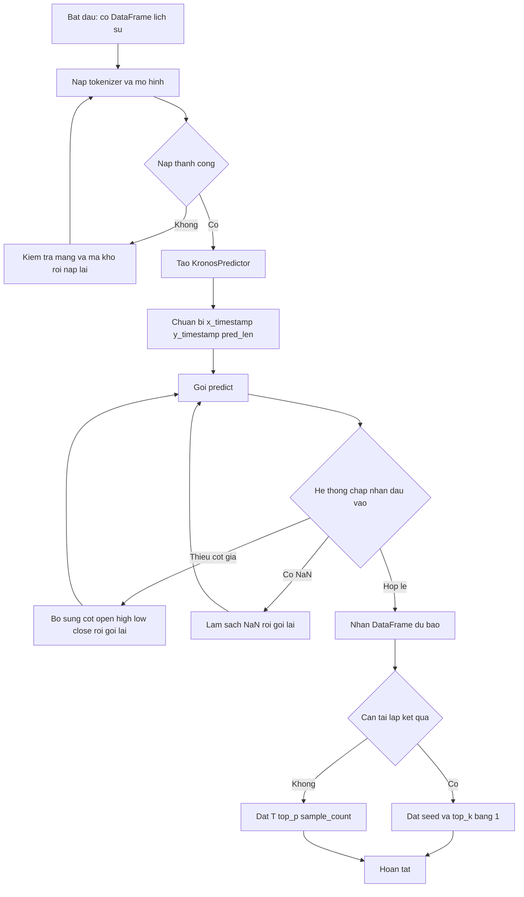
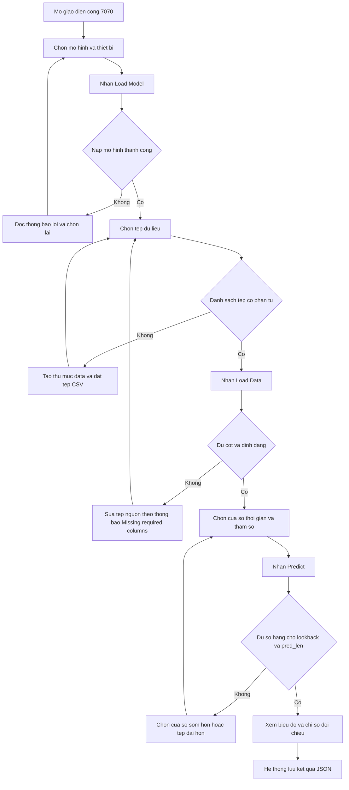
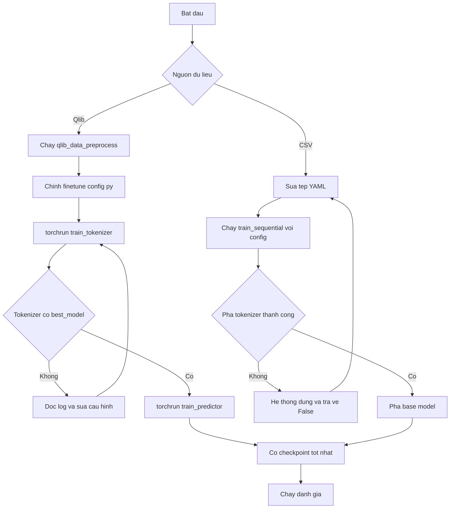
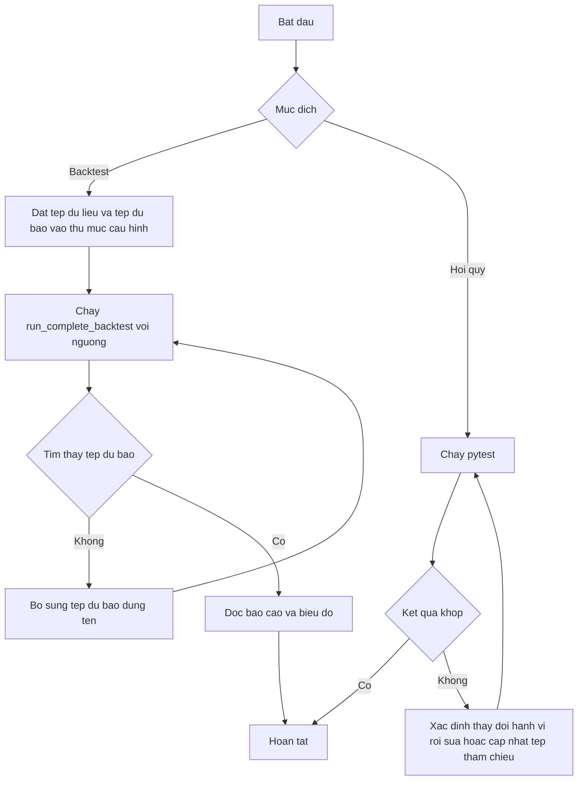

# USER REQUIREMENTS DOCUMENT (URD) - KRONOS

| Thuộc tính | Giá trị |
|---|---|
| Tiêu chuẩn tham chiếu | ISO 9241-210:2019 (thiết kế lấy con người làm trung tâm); ISO 9241-11 (khả dụng) |
| Đối tượng | Kho mã `phuongdvk47ds/kronos` |
| Nguồn | `docs/AGILE_SRS.md` (User Story `US-*`), mã nguồn, `.are/discover.txt` (ARE) |
| Nhãn bằng chứng | `[CODE]` có trong mã; `[SPEC]`, `[PROPOSED]`, `[ASSUMPTION]`, `[UNKNOWN]`, `[OPEN]` theo nghĩa thông thường |

## 0. NHẬN DIỆN LOẠI HÌNH HỆ THỐNG VÀ RẼ NHÁNH

| Thành phần | Dấu hiệu trong mã | Nhánh áp dụng | Artifact tương tác |
|---|---|---|---|
| Web UI trình diễn | `webui/templates/index.html`, Flask, Plotly, axios | Nhánh 1 (UI-driven) | Low-Fi ASCII Mockup Pattern A1, A2, A3 |
| Thư viện suy luận | `model/kronos.py` (lời gọi Python) | Nhánh 2 (Headless) | Pattern B2 (ma trận tương tác dữ liệu) |
| Tập lệnh huấn luyện, tiền xử lý, backtest, kiểm thử | `finetune/`, `finetune_csv/`, `examples/`, `tests/` | Nhánh 2 (CLI) | Pattern B1 (mô phỏng terminal) |

Kết luận: hệ thống thuộc loại hỗn hợp. Chỉ các yêu cầu `UR-WEB-*` dùng Mockup giao diện. Các yêu cầu còn lại không dựng giao diện web hay ứng dụng.

Ghi chú phương pháp: lệnh `are scan` không tồn tại trong phiên bản ARE hiện hành; bản đồ tệp lấy từ `.are/discover.txt` (lệnh `discover`). Thang "Mức thuận lợi": Thấp / Trung bình / Cao. Các giá trị tần suất, số liệu khả dụng và ngưỡng nghiệm thu mang nhãn `[ASSUMPTION]` hoặc `[PROPOSED]` vì kho mã không có phép đo.

---

## 1. GIỚI THIỆU & NGUYÊN TẮC HCD

### 1.1 Mục đích tài liệu

| Mục tiêu | Mô tả |
|---|---|
| Xác định yêu cầu nghiệp vụ của Tác nhân | Chuyển 22 User Story của `AGILE_SRS.md` thành yêu cầu theo góc nhìn tác vụ và ngữ cảnh sử dụng |
| Thiết lập tiêu chí khả dụng | Định nghĩa tiêu chuẩn nghiệm thu theo hiệu quả, hiệu suất và mức thỏa mãn (ISO 9241-11) |
| Cơ sở đánh giá | Cung cấp kịch bản kiểm thử khả dụng cho Mục 8 |

### 1.2 Tuyên bố lấy con người làm trung tâm

| Nguyên tắc ISO 9241-210 | Áp dụng cho Kronos |
|---|---|
| Thiết kế dựa trên hiểu biết rõ ràng về người dùng, tác vụ, môi trường | Mục 2 và Mục 3 |
| Người dùng tham gia suốt quá trình thiết kế | `[OPEN]` kho mã không ghi nhận phiên nghiên cứu người dùng |
| Thiết kế được điều khiển và tinh chỉnh bằng đánh giá lấy người dùng làm trung tâm | Mục 8 |
| Quy trình lặp | Quy trình huấn luyện và hồi quy lặp (US-FTQ, US-QA) |
| Giải quyết toàn bộ trải nghiệm | Mục 4 |
| Nhóm thiết kế đa ngành | `[UNKNOWN]` |

Mục tiêu giảm tải nhận thức: hệ thống áp dụng giá trị mặc định (lookback 400, pred_len 120, T 1.0, top_p 0.9, sample_count 1), tự chọn thiết bị (`cuda:0`, `mps`, `cpu`) và tự điền cột `volume`, `amount` khi vắng `[CODE]`.

### 1.3 Thuật ngữ cho Tác nhân

| Thuật ngữ | Định nghĩa nghiệp vụ |
|---|---|
| Nến (candle) | Một bản ghi giá mở, cao, thấp, đóng cùng khối lượng tại một mốc thời gian |
| Lịch sử (lookback) | Số nến quá khứ cung cấp cho mô hình |
| Độ dài dự báo (`pred_len`) | Số nến tương lai cần sinh |
| Nhiệt độ (T) | Tham số điều khiển độ đa dạng của dự báo; giá trị thấp cho kết quả ổn định hơn |
| `top_p`, `top_k` | Giới hạn tập token ứng viên khi lấy mẫu |
| `sample_count` | Số đường dự báo độc lập được lấy trung bình |
| Tokenizer | Bộ mã hóa chuỗi nến thành token và giải mã ngược |
| Tinh chỉnh (fine-tune) | Huấn luyện tiếp mô hình công bố trên dữ liệu riêng |
| Checkpoint tốt nhất | Thư mục `best_model` lưu khi `val_loss` giảm |
| Backtest | Mô phỏng tín hiệu giao dịch từ dự báo |

---

## 2. BỐI CẢNH SỬ DỤNG (CONTEXT OF USE)

### 2.1 Đặc điểm Tác nhân

| Tác nhân | Trình độ | Thói quen làm việc | Tần suất sử dụng | Nguồn |
|---|---|---|---|---|
| A-01 Nhà nghiên cứu định lượng | Cao: Python, pandas | Notebook và tập lệnh | Hằng ngày `[ASSUMPTION]` | `examples/`, `tests/` |
| A-02 Kỹ sư học máy | Cao: PyTorch, DDP | Terminal, `torchrun`, tệp cấu hình | Theo chu kỳ huấn luyện `[ASSUMPTION]` | `finetune/`, `finetune_csv/` |
| A-03 Nhà phân tích thị trường | Trung bình: không lập trình | Trình duyệt, tệp CSV | Theo phiên phân tích `[ASSUMPTION]` | `webui/` |
| A-04 Người đánh giá chiến lược | Trung bình-Cao | Tập lệnh Python, biểu đồ | Theo đợt đánh giá `[ASSUMPTION]` | `examples/run_backtest_kronos.py`, `finetune/qlib_test.py` |
| A-05 Người bảo trì kho mã | Cao | `pytest`, Git | Mỗi thay đổi mã `[ASSUMPTION]` | `tests/` |

### 2.2 Môi trường vận hành

| Hạng mục | Mô tả | Nguồn |
|---|---|---|
| Thiết bị | CPU, GPU CUDA, Apple MPS; Web UI cung cấp lựa chọn CPU, CUDA, MPS | `KronosPredictor.__init__`, `webui/templates/index.html` |
| Web UI | Trình duyệt truy cập `http://localhost:7070`; máy chủ gắn `0.0.0.0` | `webui/run.py`, `webui/app.py` |
| Terminal | Bash; huấn luyện đa GPU bằng `torchrun --standalone --nproc_per_node=N` | `README.md`, `finetune_csv/README.md` |
| Mạng | Cần truy cập Hugging Face Hub khi nạp mô hình lần đầu; hồi quy yêu cầu Hub | `tests/test_kronos_regression.py` |
| Dữ liệu | CSV/Feather có cột `open, high, low, close` (bắt buộc); `volume`, `amount`, `timestamps` (tùy chọn) | `webui/app.py:load_data_file` |
| Áp lực thời gian | Dự báo tự hồi quy chạy tuần tự `pred_len` bước; thời gian đáp ứng chưa được đo `[UNKNOWN]` | `auto_regressive_inference` |
| Hệ điều hành | Mẫu backtest chứa đường dẫn Windows cố định | `examples/run_backtest_kronos.py:main` |

### 2.3 Nhiệm vụ cốt lõi

| Mã | Nhiệm vụ | Tác nhân | Tần suất `[ASSUMPTION]` | Mức quan trọng | Yêu cầu |
|---|---|---|---|---|---|
| T-01 | Nạp tokenizer và mô hình | A-01, A-03 | Mỗi phiên | Cao | UR-INF-01, UR-WEB-02 |
| T-02 | Dự báo chuỗi nến | A-01, A-03 | Cao | Cao | UR-INF-02, UR-INF-03, UR-WEB-03 |
| T-03 | Điều chỉnh tham số lấy mẫu | A-01, A-03 | Trung bình | Trung bình | UR-INF-04, UR-WEB-03 |
| T-04 | Nạp và kiểm tra dữ liệu | A-03 | Mỗi phiên | Cao | UR-WEB-01 |
| T-05 | Đối chiếu dự báo với thực tế | A-03 | Trung bình | Trung bình | UR-WEB-03, UR-WEB-04 |
| T-06 | Chuẩn bị dữ liệu huấn luyện | A-02 | Thấp | Cao | UR-FTQ-01, UR-FTC-02 |
| T-07 | Tinh chỉnh mô hình | A-02 | Thấp | Cao | UR-FTQ-02, UR-FTC-01 |
| T-08 | Đánh giá tín hiệu giao dịch | A-04 | Thấp | Trung bình | UR-FTQ-03, UR-BKT-01 |
| T-09 | Kiểm tra hồi quy | A-05 | Mỗi thay đổi | Cao | UR-QA-01 |

---

## 3. CHÂN DUNG TÁC NHÂN VÀ BẢN ĐỒ THẤU CẢM

Tác nhân được bóc tách từ cách sử dụng trong mã. Kho mã không có vai trò hay guard xác thực; mục này không có vai trò RBAC `[CODE]`.

### 3.1 A-01 Nhà nghiên cứu định lượng

| Thuộc tính | Nội dung |
|---|---|
| Mục tiêu | Dự báo OHLCV từ DataFrame và so khớp với thực tế |
| Điểm chạm | `KronosPredictor.predict`, `predict_batch`, `from_pretrained` |
| Trở ngại quy trình | Lệch thang đo giữa các mã; thiếu `volume`/`amount`; kết quả ngẫu nhiên khó tái lập; chuỗi dài hơn ngữ cảnh |

| Says | Thinks | Does | Feels (Mức thuận lợi) |
|---|---|---|---|
| Yêu cầu thông tin: tham số nào ảnh hưởng độ đa dạng; cách tái lập kết quả | Nhận định: kết quả cần xác định khi `top_k=1` | Chuẩn bị DataFrame và hai chuỗi thời gian; gọi `predict`; so sánh với thực tế | Cao khi đầu vào hợp lệ; Trung bình khi lỗi `ValueError` thiếu thông tin vị trí lỗi |

### 3.2 A-02 Kỹ sư học máy

| Thuộc tính | Nội dung |
|---|---|
| Mục tiêu | Tinh chỉnh tokenizer và mô hình trên dữ liệu thị trường riêng |
| Điểm chạm | `torchrun train_tokenizer.py`, `train_predictor.py`, `train_sequential.py --config`, tệp YAML, `finetune/config.py` |
| Trở ngại quy trình | Đường dẫn giữ chỗ trong cấu hình; Comet bật mặc định; phải khởi chạy bằng `torchrun`; chuỗi hai pha phụ thuộc thứ tự |

| Says | Thinks | Does | Feels (Mức thuận lợi) |
|---|---|---|---|
| Yêu cầu thông tin: đường dẫn checkpoint, `val_loss` tốt nhất | Nhận định: tokenizer phải hoàn thành trước mô hình | Chỉnh cấu hình; khởi chạy huấn luyện; theo dõi log và Comet | Trung bình: cần chỉnh nhiều đường dẫn; Cao sau khi cấu hình ổn định |

### 3.3 A-03 Nhà phân tích thị trường

| Thuộc tính | Nội dung |
|---|---|
| Mục tiêu | Nạp CSV, chọn mô hình, xem biểu đồ dự báo mà không viết mã |
| Điểm chạm | Web UI: Control Panel, Data Information, Time Window Selection, Prediction Results Chart |
| Trở ngại quy trình | Thư mục `data/` vắng trong kho mã nên danh sách tệp rỗng; thông báo lỗi dạng chuỗi tự do; trạng thái mô hình toàn cục |

| Says | Thinks | Does | Feels (Mức thuận lợi) |
|---|---|---|---|
| Yêu cầu thông tin: kích thước tệp, khoảng thời gian dữ liệu, trạng thái mô hình | Nhận định: dự báo chỉ chạy khi mô hình đã nạp | Chọn mô hình và thiết bị; nạp dữ liệu; điều chỉnh T, top_p, sample_count; chạy dự báo | Cao khi luồng thông thường; Thấp khi danh sách tệp rỗng mà không có hướng dẫn |

### 3.4 A-04 Người đánh giá chiến lược

| Thuộc tính | Nội dung |
|---|---|
| Mục tiêu | Chuyển dự báo thành tín hiệu và đo hiệu suất |
| Điểm chạm | `python finetune/qlib_test.py --device cuda:0`, `KronosBacktester.run_complete_backtest` |
| Trở ngại quy trình | Không có mô hình phí giao dịch trong mẫu; đường dẫn cố định; ví dụ lịch sử dùng random walk |

| Says | Thinks | Does | Feels (Mức thuận lợi) |
|---|---|---|---|
| Yêu cầu thông tin: lợi suất vượt chuẩn có phí và không phí | Nhận định: kết quả phải truy nguyên được tới tệp dự báo | Chạy backtest; đọc `risk_analysis`; xem biểu đồ lũy kế | Trung bình |

### 3.5 A-05 Người bảo trì kho mã

| Thuộc tính | Nội dung |
|---|---|
| Mục tiêu | Phát hiện thay đổi hành vi dự báo sau sửa đổi |
| Điểm chạm | `pytest tests/test_kronos_regression.py` |
| Trở ngại quy trình | Kiểm thử cần mạng tới Hub; dung sai MSE 1e-6 nhạy với môi trường |

| Says | Thinks | Does | Feels (Mức thuận lợi) |
|---|---|---|---|
| Yêu cầu thông tin: giá trị lệch so với kỳ vọng | Nhận định: seed và `revision` phải cố định | Chạy hồi quy; cập nhật tệp tham chiếu bằng `generate_regression_output.py` khi thay đổi có chủ đích | Cao khi kết quả khớp; Trung bình khi lệch mà không có chỉ dẫn nguyên nhân |

---

## 4. BẢN ĐỒ HÀNH TRÌNH TRẢI NGHIỆM (USER JOURNEY MAPS)

### 4.1 J-01 Dự báo qua thư viện (A-01)

| Giai đoạn | Điểm chạm | Hành động của Tác nhân | Mức thuận lợi | Trở ngại quy trình | Yêu cầu |
|---|---|---|---|---|---|
| Chuẩn bị dữ liệu | DataFrame, hai chuỗi thời gian | Dựng `df` và `x_timestamp`, `y_timestamp` | Trung bình | `y_timestamp` không được kiểm tra độ dài trong `predict` `[OPEN]` | UR-INF-02 |
| Nạp mô hình | `from_pretrained`, Hub | Gọi hai lần cho tokenizer và mô hình | Trung bình | Phụ thuộc mạng; ngoại lệ Hub không được diễn giải | UR-INF-01 |
| Dự báo | `KronosPredictor.predict` | Gọi `predict` với tham số lấy mẫu | Cao | `top_p` bị bỏ qua khi `top_k > 0` | UR-INF-02, UR-INF-04 |
| Xác minh | DataFrame kết quả | So sánh với giá thực tế | Cao | Không có công cụ so sánh sẵn trong thư viện | UR-INF-02 |
| Mở rộng | `predict_batch` | Dự báo nhiều mã | Trung bình | Phải cùng độ dài lịch sử và dự báo | UR-INF-03 |

### 4.2 J-02 Dự báo qua Web UI (A-03)

| Giai đoạn | Điểm chạm | Hành động của Tác nhân | Mức thuận lợi | Trở ngại quy trình | Yêu cầu |
|---|---|---|---|---|---|
| Khởi động | `python run.py`, trình duyệt cổng 7070 | Mở giao diện | Cao | Phải khởi chạy từ thư mục `webui` | UR-WEB-02 |
| Chọn mô hình | Control Panel: Select Model, Select Device | Chọn mô hình và thiết bị, nạp | Trung bình | Tải trọng số lần đầu chưa có chỉ báo tiến trình `[UNKNOWN]` | UR-WEB-02 |
| Chọn dữ liệu | Select Data File, Data Information | Chọn tệp, nạp, đọc thông tin tổng hợp | Thấp | Danh sách rỗng khi thiếu thư mục `data/` | UR-WEB-01 |
| Cấu hình dự báo | Time Window Selection, T, top_p, sample_count | Đặt cửa sổ và tham số | Cao | Lookback và pred_len cố định (readonly) trong giao diện | UR-WEB-03 |
| Dự báo | Nút Predict, Loading | Chạy dự báo | Trung bình | Yêu cầu đồng bộ; thời gian chờ chưa đo | UR-WEB-03 |
| Đối chiếu | Prediction Results Chart, MAE, RMSE, MAPE | Đọc biểu đồ và chỉ số | Cao | Chỉ số chỉ có khi tồn tại dữ liệu thực tế | UR-WEB-03 |
| Lưu và truy vết | `prediction_results/*.json` | Mở tệp JSON | Trung bình | Không có giao diện duyệt lại; tên tệp theo giây | UR-WEB-04 |

### 4.3 J-03 Tinh chỉnh mô hình (A-02)

| Giai đoạn | Điểm chạm | Hành động của Tác nhân | Mức thuận lợi | Trở ngại quy trình | Yêu cầu |
|---|---|---|---|---|---|
| Chuẩn bị dữ liệu | `qlib_data_preprocess.py` hoặc CSV | Tạo tập pickle hoặc chuẩn bị CSV | Trung bình | Phụ thuộc Qlib và đường dẫn cục bộ | UR-FTQ-01, UR-FTC-02 |
| Cấu hình | `finetune/config.py`, YAML | Chỉnh đường dẫn, siêu tham số | Thấp | Giá trị giữ chỗ; Comet bật mặc định | UR-FTC-01 |
| Huấn luyện tokenizer | `torchrun train_tokenizer.py` | Khởi chạy, theo dõi `val_loss` | Trung bình | Dừng nếu thiếu `WORLD_SIZE` | UR-FTQ-02 |
| Huấn luyện mô hình | `torchrun train_predictor.py` | Khởi chạy | Trung bình | Phải sau tokenizer | UR-FTQ-02 |
| Đánh giá | `qlib_test.py` | Chạy backtest | Trung bình | Thiết bị mặc định `cuda:1` | UR-FTQ-03 |

### 4.4 J-04 Đánh giá chiến lược và hồi quy (A-04, A-05)

| Giai đoạn | Điểm chạm | Hành động của Tác nhân | Mức thuận lợi | Trở ngại quy trình | Yêu cầu |
|---|---|---|---|---|---|
| Chuẩn bị tệp dự báo | `<mã>_kronos_predictions.csv` | Đặt tệp vào `model_dir` | Trung bình | Tên tệp cố định, ba ứng viên | UR-BKT-01 |
| Chạy backtest | `run_complete_backtest` | Chạy với ngưỡng 2 phần trăm | Trung bình | Đường dẫn Windows cố định trong `main()` | UR-BKT-01 |
| Chạy hồi quy | `pytest` | Chạy kiểm thử | Cao | Cần Hub; dung sai hẹp | UR-QA-01 |

---

## 5. SƠ ĐỒ LUỒNG CÔNG VIỆC CỦA TÁC NHÂN (TASK FLOWS)

### 5.1 TF-01 Dự báo qua thư viện (kèm phòng ngừa lỗi)



### 5.2 TF-02 Dự báo qua Web UI



### 5.3 TF-03 Tinh chỉnh từ CSV hoặc Qlib



### 5.4 TF-04 Backtest và hồi quy



---

## 6. ĐẶC TẢ CHI TIẾT YÊU CẦU NGƯỜI DÙNG

Quy ước: `UR-[MODULE]-[STT]`. Module `INF`, `FTQ`, `FTC`, `BKT`, `QA` thuộc Nhánh 2 (Pattern B1 hoặc B2). Module `WEB` thuộc Nhánh 1 (Pattern A1, A2, A3). Thông điệp trong khung là nội dung mã hiện phát ra `[CODE]`; nội dung đề xuất gắn `[PROPOSED]`.

### 6.1 Module INF - Suy luận qua thư viện

#### UR-INF-01 - Nạp tokenizer và mô hình

| Thuộc tính | Nội dung |
|---|---|
| Tác nhân | A-01 |
| Truy vết | US-INF-01; `model/kronos.py:KronosTokenizer.from_pretrained`, `Kronos.from_pretrained` |
| Nhánh / Artifact | Nhánh 2 / Pattern B1 |

**Yêu cầu nghiệp vụ**

- Hệ thống tải cấu hình và trọng số từ kho Hub theo định danh và `revision` tùy chọn.
- Hệ thống trả về đối tượng sẵn sàng cho `KronosPredictor`.
- Hệ thống chuyển tokenizer và mô hình sang thiết bị đã chọn.

**Artifact tương tác (Pattern B1)**

```text
┌────────────────────────────────────────────────────────────────────────┐
│  TERMINAL CLI INTERACTION: LOAD PRETRAINED ARTIFACTS                   │
├────────────────────────────────────────────────────────────────────────┤
│  >>> from model import Kronos, KronosTokenizer, KronosPredictor        │
│  >>> tok = KronosTokenizer.from_pretrained(                            │
│  ...     "NeoQuasar/Kronos-Tokenizer-base")                            │
│  >>> mdl = Kronos.from_pretrained("NeoQuasar/Kronos-small")            │
│  >>> pred = KronosPredictor(mdl, tok, max_context=512)                 │
│  ┌──────────────────────────────────────────────────────────────────┐  │
│  │ Result  : predictor ready on cuda:0 | mps | cpu (auto-detected)  │  │
│  │ Context : max_context=512, clip=5                                │  │
│  └──────────────────────────────────────────────────────────────────┘  │
│  [!] Hub unreachable and cache empty: exception from huggingface_hub.  │
└────────────────────────────────────────────────────────────────────────┘
```

**Kịch bản tương tác**

| Loại | Diễn tiến |
|---|---|
| Luồng tối ưu | Tác nhân cung cấp hai định danh kho, tạo `KronosPredictor` với `max_context` phù hợp mô hình. |
| Luồng ngoại lệ / thay thế | Hub không truy cập được: ngoại lệ được truyền lên, không có đối tượng nào được tạo. `[PROPOSED]` thông điệp nêu tên kho và gợi ý kiểm tra mạng. |

**Quy tắc công thái học và chống sai sót**

- Giá trị mặc định cho `max_context=512` và `clip=5`; Tác nhân chỉ khai báo khi khác mặc định.
- Khóa `revision` khi cần tái lập (đã áp dụng trong `tests/`).
- Cặp mô hình và tokenizer theo bảng `AVAILABLE_MODELS` để tránh ghép sai (mini với Tokenizer-2k; small và base với Tokenizer-base).

---

#### UR-INF-02 - Dự báo một chuỗi nến

| Thuộc tính | Nội dung |
|---|---|
| Tác nhân | A-01 |
| Truy vết | US-INF-02, US-INF-06; `KronosPredictor.predict` |
| Nhánh / Artifact | Nhánh 2 / Pattern B2 |

**Yêu cầu nghiệp vụ**

- Hệ thống kiểm tra kiểu đầu vào, cột giá và NaN trước khi suy luận.
- Hệ thống chuẩn hóa z-score, cắt giá trị trong khoảng `[-clip, clip]` và khôi phục thang đo sau dự báo.
- Hệ thống cắt ngữ cảnh về `max_context` token cuối khi lịch sử dài hơn.

**Artifact tương tác (Pattern B2)**

```text
┌────────────────────────────────────────────────────────────────────────┐
│  API STAKEHOLDER INTERACTION: PREDICT SINGLE SERIES                    │
├────────────────────────────────────────────────────────────────────────┤
│  Hành động Tác nhân: gọi predict với lịch sử và mốc thời gian tương lai│
│  Dữ liệu cung cấp: [ df, x_timestamp, y_timestamp, pred_len ]          │
│  ┌──────────────────────────────────────────────────────────────────┐  │
│  │ KẾT QUẢ TRẢ VỀ                                                   │  │
│  │ * DataFrame 6 cột: open high low close volume amount             │  │
│  │ * Chỉ mục = y_timestamp; thang đo = thang đo của df đầu vào      │  │
│  │ * Thiếu volume: điền 0.0; thiếu amount: volume x trung bình giá  │  │
│  │ Lỗi: ValueError - Input must be a pandas DataFrame.              │  │
│  │ Lỗi: ValueError - Price columns [...] not found in DataFrame.    │  │
│  │ Lỗi: ValueError - Input DataFrame contains NaN values ...        │  │
│  └──────────────────────────────────────────────────────────────────┘  │
└────────────────────────────────────────────────────────────────────────┘
```

**Kịch bản tương tác**

| Loại | Diễn tiến |
|---|---|
| Luồng tối ưu | Đầu vào hợp lệ: Tác nhân nhận DataFrame có chỉ mục bằng `y_timestamp`; với `top_k=1` kết quả khớp tệp tham chiếu sai số tương đối 1e-5 `[TEST]`. |
| Luồng ngoại lệ / thay thế | Thiếu cột hoặc có NaN: hệ thống phát `ValueError` trước mọi suy luận; Tác nhân sửa dữ liệu và gọi lại. `y_timestamp` ngắn hơn `pred_len`: `[OPEN]` hành vi chưa kiểm thử. |

**Quy tắc công thái học và chống sai sót**

- Thông điệp lỗi nêu rõ danh sách cột bắt buộc để Tác nhân sửa không cần tra cứu thêm.
- Tự điền `volume`, `amount` để giảm số bước chuẩn bị dữ liệu.
- `[PROPOSED]` kiểm tra `len(y_timestamp) == pred_len` với thông điệp rõ nghĩa, nhất quán với `predict_batch`.

---

#### UR-INF-03 - Dự báo hàng loạt

| Thuộc tính | Nội dung |
|---|---|
| Tác nhân | A-01 |
| Truy vết | US-INF-03; `KronosPredictor.predict_batch` |
| Nhánh / Artifact | Nhánh 2 / Pattern B2 |

**Yêu cầu nghiệp vụ**

- Hệ thống kiểm tra từng chuỗi và chỉ rõ chỉ số chuỗi vi phạm.
- Hệ thống xếp chồng các chuỗi thành một lô và dự báo trong một lượt.

**Artifact tương tác (Pattern B2)**

```text
┌────────────────────────────────────────────────────────────────────────┐
│  API STAKEHOLDER INTERACTION: BATCH PREDICTION                         │
├────────────────────────────────────────────────────────────────────────┤
│  Hành động Tác nhân: gọi predict_batch với danh sách DataFrame         │
│  Dữ liệu cung cấp: [ df_list, x_timestamp_list, y_timestamp_list ]     │
│  ┌──────────────────────────────────────────────────────────────────┐  │
│  │ KẾT QUẢ TRẢ VỀ                                                   │  │
│  │ * Danh sách DataFrame theo đúng thứ tự đầu vào                   │  │
│  │ Điều kiện: cùng độ dài lịch sử; cùng độ dài dự báo = pred_len    │  │
│  │ Lỗi: ValueError - Parallel prediction requires all series to     │  │
│  │      have consistent historical lengths, got: [400, 400, 380]    │  │
│  └──────────────────────────────────────────────────────────────────┘  │
└────────────────────────────────────────────────────────────────────────┘
```

**Kịch bản tương tác**

| Loại | Diễn tiến |
|---|---|
| Luồng tối ưu | Các chuỗi cùng độ dài: Tác nhân nhận danh sách kết quả cùng thứ tự. |
| Luồng ngoại lệ / thay thế | Một chuỗi khác độ dài: hệ thống từ chối toàn lô; Tác nhân cắt hoặc nhóm lại chuỗi. `[OPEN]` chưa có kiểm thử tự động. |

**Quy tắc công thái học và chống sai sót**

- Thông điệp lỗi liệt kê toàn bộ độ dài để định vị chuỗi sai.
- Kết quả giữ thứ tự đầu vào, loại bỏ nhu cầu ghép lại theo khóa.

---

#### UR-INF-04 - Điều khiển lấy mẫu

| Thuộc tính | Nội dung |
|---|---|
| Tác nhân | A-01, A-03 |
| Truy vết | US-INF-04; `sample_from_logits`, `top_k_top_p_filtering` |
| Nhánh / Artifact | Nhánh 2 / Pattern B2 |

**Yêu cầu nghiệp vụ**

- Hệ thống chia logits cho T, áp dụng lọc top_k hoặc top_p, rồi lấy mẫu.
- Hệ thống sinh `sample_count` đường độc lập và trả về trung bình.

**Artifact tương tác (Pattern B2)**

```text
┌────────────────────────────────────────────────────────────────────────┐
│  API STAKEHOLDER INTERACTION: SAMPLING CONTROLS                        │
├────────────────────────────────────────────────────────────────────────┤
│  Dữ liệu cung cấp: [ T, top_k, top_p, sample_count ]                   │
│  ┌──────────────────────────────────────────────────────────────────┐  │
│  │ Mặc định predict : T=1.0 top_k=0 top_p=0.9 sample_count=1        │  │
│  │ Xác định         : top_k=1, top_p=1.0, seed cố định              │  │
│  │ Ổn định hơn      : sample_count lớn, kết quả là trung bình       │  │
│  │ [!] top_k > 0 được ưu tiên; top_p bị bỏ qua khi cùng được đặt    │  │
│  └──────────────────────────────────────────────────────────────────┘  │
└────────────────────────────────────────────────────────────────────────┘
```

**Kịch bản tương tác**

| Loại | Diễn tiến |
|---|---|
| Luồng tối ưu | Tác nhân đặt `top_k=1` để nhận kết quả xác định `[TEST]`, hoặc tăng `sample_count` để giảm phương sai. |
| Luồng ngoại lệ / thay thế | Tác nhân đặt cả `top_k` và `top_p`: chỉ `top_k` có hiệu lực `[CODE]`. Gọi trực tiếp `sample_from_logits` với `top_k=None` và `top_p` có giá trị gây `TypeError` `[CODE]`. |

**Quy tắc công thái học và chống sai sót**

- Bảng mặc định hiển thị trong tài liệu và README để tránh phải suy đoán.
- `[PROPOSED]` cảnh báo khi `top_k` và `top_p` cùng được đặt; chuẩn hóa `None` thành `0` và `1.0`.

---

#### UR-INF-05 - Thiết bị tính toán và cửa sổ ngữ cảnh

| Thuộc tính | Nội dung |
|---|---|
| Tác nhân | A-01 |
| Truy vết | US-INF-05, US-INF-06; `KronosPredictor.__init__`, `auto_regressive_inference` |
| Nhánh / Artifact | Nhánh 2 / Pattern B1 |

**Yêu cầu nghiệp vụ**

- Hệ thống ưu tiên `cuda:0`, sau đó `mps`, sau đó `cpu` khi `device=None`.
- Hệ thống chỉ dùng tối đa `max_context` token cuối của lịch sử.

**Artifact tương tác (Pattern B1)**

```text
┌────────────────────────────────────────────────────────────────────────┐
│  TERMINAL CLI INTERACTION: DEVICE AND CONTEXT                          │
├────────────────────────────────────────────────────────────────────────┤
│  >>> pred = KronosPredictor(mdl, tok)            # device=None         │
│  > Detect cuda:0 ... [no]   mps ... [no]   cpu ... [OK]                │
│  ┌──────────────────────────────────────────────────────────────────┐  │
│  │ Device       : cpu                                               │  │
│  │ History      : 600 candles  -> last 512 tokens used              │  │
│  │ max_context  : 512 (Kronos-mini: 2048)                           │  │
│  └──────────────────────────────────────────────────────────────────┘  │
│  [i] Window slides one token per generated step after the buffer fills.│
└────────────────────────────────────────────────────────────────────────┘
```

**Kịch bản tương tác**

| Loại | Diễn tiến |
|---|---|
| Luồng tối ưu | Tác nhân khởi tạo không chỉ định thiết bị và nhận thiết bị khả dụng tốt nhất. |
| Luồng ngoại lệ / thay thế | Tác nhân cung cấp lịch sử dài hơn `max_context`: hệ thống cắt bớt phần đầu, không phát lỗi. |

**Quy tắc công thái học và chống sai sót**

- Mặc định thông minh giảm số quyết định.
- `[PROPOSED]` hiển thị thiết bị đã chọn và số nến bị cắt trong log.

---

### 6.2 Module WEB - Giao diện web trình diễn

#### UR-WEB-01 - Chọn và nạp tệp dữ liệu

| Thuộc tính | Nội dung |
|---|---|
| Tác nhân | A-03 |
| Truy vết | US-WEB-01, US-WEB-02; `GET /api/data-files`, `POST /api/load-data`; `webui/app.py:load_data_file` |
| Nhánh / Artifact | Nhánh 1 / Pattern A3 |

**Yêu cầu nghiệp vụ**

- Hệ thống liệt kê tệp `.csv` và `.feather` kèm kích thước.
- Hệ thống từ chối tệp thiếu cột `open`, `high`, `low`, `close` bằng mã 400.
- Hệ thống hiển thị số hàng, khoảng thời gian, khoảng giá, tần suất và cột dự báo.

**Artifact tương tác (Pattern A3)**

```text
┌────────────────────────────────────────────────────────────────────────┐
│  DATA FILE SELECTION                                        [Load Data]│
├────────────────────────────────────────────────────────────────────────┤
│  Select Data File: [ XSHG_5min_600977.csv                          ▼ ] │
│  Directory: <repo>/data     Extensions: .csv, .feather                 │
├────────────────────────────────────────────────────────────────────────┤
│  ┌────────────────────────┬──────────────────────────┬────────────┐    │
│  │ Name                   │ Path                     │ Size       │    │
│  ├────────────────────────┼──────────────────────────┼────────────┤    │
│  │ XSHG_5min_600977.csv   │ <repo>/data/XSHG_5min... │ 182.4 KB   │    │
│  │ btc_1min.feather       │ <repo>/data/btc_1min...  │ 3.1 MB     │    │
│  └────────────────────────┴──────────────────────────┴────────────┘    │
├────────────────────────────────────────────────────────────────────────┤
│  DATA INFORMATION                                                      │
│  Rows: 8000 | Columns: 7 | Time Frequency: 5 minutes                   │
│  Time Range: 2024-06-18 .. 2024-09-30 | Price Range: 10.80 .. 12.45    │
│  Prediction Columns: open, high, low, close, volume                    │
├────────────────────────────────────────────────────────────────────────┤
│  [!] Missing required columns: open, high, low, close                  │
└────────────────────────────────────────────────────────────────────────┘
```

**Kịch bản tương tác**

| Loại | Diễn tiến |
|---|---|
| Luồng tối ưu | Tác nhân chọn tệp, nhấn Load Data và nhận bảng thông tin dữ liệu. |
| Luồng ngoại lệ / thay thế | Thư mục `data/` vắng: danh sách rỗng `[CODE]`; `[PROPOSED]` hiển thị hướng dẫn tạo thư mục. Tệp thiếu cột: thông báo nêu danh sách cột bắt buộc. |

**Quy tắc công thái học và chống sai sót**

- Hiển thị kích thước tệp dạng KB/MB để phát hiện nhầm tệp.
- Thông tin tổng hợp hiển thị ngay sau khi nạp để Tác nhân xác nhận dữ liệu trước khi dự báo.
- `[!]` đường dẫn tệp không bị ràng buộc trong thư mục dữ liệu; `[PROPOSED]` giới hạn (xem AGILE_SRS TS-SEC-03).

---

#### UR-WEB-02 - Chọn và nạp mô hình

| Thuộc tính | Nội dung |
|---|---|
| Tác nhân | A-03 |
| Truy vết | US-WEB-03; `POST /api/load-model`, `GET /api/available-models`, `GET /api/model-status` |
| Nhánh / Artifact | Nhánh 1 / Pattern A1 |

**Yêu cầu nghiệp vụ**

- Hệ thống hiển thị danh sách mô hình khả dụng và trạng thái nạp.
- Hệ thống tải tokenizer và mô hình, tạo bộ dự báo với `context_length` của mô hình.
- Hệ thống từ chối `model_key` ngoài danh sách bằng mã 400.

**Artifact tương tác (Pattern A1)**

```text
┌────────────────────────────────────────────────────────────────────────┐
│  LOAD MODEL                                                [Cancel] [X]│
├────────────────────────────────────────────────────────────────────────┤
│  STEP INDICATOR:                                                       │
│  [1] Model/Device ─── (2) Data ─── (3) Predict ─── (4) Results         │
│        [Active]       [Upcoming]   [Upcoming]      [Upcoming]          │
├────────────────────────────────────────────────────────────────────────┤
│  * Select Model                    * Select Device                     │
│  ┌──────────────────────────────┐   ┌──────────────────────────────┐   │
│  │ Kronos-small (24.7M)       ▼ │   │ CPU                        ▼ │   │
│  └──────────────────────────────┘   └──────────────────────────────┘   │
│  Options: Kronos-mini 4.1M | Kronos-small 24.7M | Kronos-base 102.3M   │
│  Devices: CPU | CUDA (NVIDIA GPU) | MPS (Apple Silicon)                │
│  [i] Status: Kronos model available but not loaded                     │
│  [!] Unsupported model: <key>  /  Kronos model library not available   │
├────────────────────────────────────────────────────────────────────────┤
│  [ < Back ]                                           [ Load Model > ] │
└────────────────────────────────────────────────────────────────────────┘
```

**Kịch bản tương tác**

| Loại | Diễn tiến |
|---|---|
| Luồng tối ưu | Tác nhân chọn mô hình và thiết bị, nhấn Load Model, nhận thông báo "Model loaded successfully" kèm tên, số tham số và thiết bị `[CODE]`. |
| Luồng ngoại lệ / thay thế | Thư viện mô hình không import được: thông báo 400 "Kronos model library not available". Lỗi tải: mã 500 "Model loading failed". `[UNKNOWN]` chỉ báo tiến trình tải lần đầu. |

**Quy tắc công thái học và chống sai sót**

- Mô tả ngắn từng mô hình (nhẹ, cân bằng, chất lượng cao) hỗ trợ lựa chọn không cần kiến thức nền.
- Nút Predict vô hiệu cho đến khi mô hình được nạp.
- Trạng thái mô hình là biến toàn cục: nạp lại thay thế mô hình trước đó `[CODE]`.

---

#### UR-WEB-03 - Dự báo và đối chiếu bằng biểu đồ

| Thuộc tính | Nội dung |
|---|---|
| Tác nhân | A-03 |
| Truy vết | US-WEB-04; `POST /api/predict`; `create_prediction_chart` |
| Nhánh / Artifact | Nhánh 1 / Pattern A2 |

**Yêu cầu nghiệp vụ**

- Hệ thống từ chối dự báo khi mô hình chưa nạp (mã 400).
- Hệ thống từ chối khi số hàng nhỏ hơn `lookback` hoặc `lookback + pred_len` tính từ `start_date`.
- Hệ thống hiển thị biểu đồ lịch sử, dự báo và dữ liệu thực tế, kèm MAE, RMSE, MAPE khi có dữ liệu thực tế.

**Artifact tương tác (Pattern A2)**

```text
┌────────────────────────────────────────────────────────────────────────┐
│  PREDICTION RESULTS                                [Model: loaded ●]   │
│  Time Window: Start 2024-07-02 09:35 | Size: 400+120=520 points        │
├────────────────────────────────────────────────────────────────────────┤
│  PARAMETERS                                                            │
│  ┌───────────────────┐  ┌───────────────────┐  ┌───────────────────┐   │
│  │ [T 0.1 - 2.0]     │  │ [top_p 0.1 - 1.0] │  │ [sample_count]    │   │
│  │ 1.0               │  │ 0.9               │  │ 1  (range 1 - 5)  │   │
│  └───────────────────┘  └───────────────────┘  └───────────────────┘   │
├────────────────────────────────────────────────────────────────────────┤
│  CHART (Plotly)                                                        │
│   Price ┤  ─────────  actual close                                     │
│         ┤            ·········  predicted close                        │
│         ┼──────────────────────────────────────────────────────        │
│         [history: 400 points]        [forecast: 120 points]            │
├────────────────────────────────────────────────────────────────────────┤
│  COMPARISON  MAE: 0.12 | RMSE: 0.15 | MAPE: 0.35 pct   (example values)│
│  [WARN] Insufficient data from start time, need 520 points, have 310   │
├────────────────────────────────────────────────────────────────────────┤
│  [ Predict > ]   disabled until the model is loaded                    │
└────────────────────────────────────────────────────────────────────────┘
```

**Kịch bản tương tác**

| Loại | Diễn tiến |
|---|---|
| Luồng tối ưu | Tác nhân đặt cửa sổ và tham số, nhấn Predict, nhận biểu đồ và chỉ số đối chiếu. |
| Luồng ngoại lệ / thay thế | Mô hình chưa nạp: thông báo "Kronos model not loaded, please load model first". Thiếu dữ liệu: thông báo nêu số điểm cần và số điểm hiện có. Lỗi suy luận: mã 500 "Kronos model prediction failed". |

**Quy tắc công thái học và chống sai sót**

- Giới hạn thanh trượt: T 0.1-2.0, top_p 0.1-1.0, sample_count 1-5 ngăn giá trị vô nghĩa.
- Lookback (400) và pred_len (120) hiển thị chỉ đọc để tránh cấu hình không nhất quán.
- Chỉ báo Loading trong lúc suy luận đồng bộ.
- `[!]` Khi không đặt `start_date`, hệ thống dùng các hàng đầu của tệp trong khi nhãn ghi "latest data"; `[PROPOSED]` đồng bộ nhãn với hành vi.

---

#### UR-WEB-04 - Lưu và truy vết kết quả dự báo

| Thuộc tính | Nội dung |
|---|---|
| Tác nhân | A-03, A-04 |
| Truy vết | US-WEB-05; `save_prediction_results`; `webui/prediction_results/` |
| Nhánh / Artifact | Nhánh 1 / Pattern A3 |

**Yêu cầu nghiệp vụ**

- Hệ thống ghi mỗi lượt dự báo thành tệp JSON gồm tham số, tóm tắt đầu vào, dự báo, dữ liệu thực tế và phân tích liên tục.
- Hệ thống không làm hỏng phản hồi dự báo khi lưu tệp thất bại.

**Artifact tương tác (Pattern A3)**

```text
┌────────────────────────────────────────────────────────────────────────┐
│  PREDICTION RESULT ARCHIVE                                [Open Folder]│
├────────────────────────────────────────────────────────────────────────┤
│  Folder: webui/prediction_results/                                     │
│  Pattern: prediction_YYYYMMDD_HHMMSS.json   [read-only listing]        │
├────────────────────────────────────────────────────────────────────────┤
│  ┌──────────────────────┬──────────┬────────┬────────┬───────────┐     │
│  │ File (suffix)        │ Lookback │ PredLn │ Actual │ Close gap │     │
│  ├──────────────────────┼──────────┼────────┼────────┼───────────┤     │
│  │ 20250826_163800      │ 400      │ 120    │ yes    │ 0.35 pct  │     │
│  │ 20250826_164030      │ 400      │ 120    │ yes    │ see file  │     │
│  └──────────────────────┴──────────┴────────┴────────┴───────────┘     │
├────────────────────────────────────────────────────────────────────────┤
│  Fields: prediction_params | input_data_summary | prediction_results   │
│          actual_data | analysis.continuity (gaps, gap_percentages)     │
├────────────────────────────────────────────────────────────────────────┤
│  [i] Save failure is logged; the prediction response is still returned.│
└────────────────────────────────────────────────────────────────────────┘
```

**Kịch bản tương tác**

| Loại | Diễn tiến |
|---|---|
| Luồng tối ưu | Tác nhân hoàn tất dự báo; tệp JSON xuất hiện trong `prediction_results/` với dấu thời gian trong tên. |
| Luồng ngoại lệ / thay thế | Hai lượt trong cùng một giây ghi đè nhau `[OPEN]`; không có giao diện duyệt lại kết quả đã lưu `[PROPOSED]`. |

**Quy tắc công thái học và chống sai sót**

- Tên tệp theo dấu thời gian giúp sắp xếp theo thứ tự thực hiện.
- Phân tích chênh lệch (gap, gap_percentages) cho phép đối chiếu mà không cần tính lại.

---

### 6.3 Module FTQ - Tinh chỉnh và backtest trên Qlib

#### UR-FTQ-01 - Tiền xử lý dữ liệu Qlib

| Thuộc tính | Nội dung |
|---|---|
| Tác nhân | A-02 |
| Truy vết | US-FTQ-01; `python finetune/qlib_data_preprocess.py` |
| Nhánh / Artifact | Nhánh 2 / Pattern B1 |

**Yêu cầu nghiệp vụ**

- Hệ thống khởi tạo Qlib, nạp trường open, close, high, low, volume, vwap và chia theo ba khoảng thời gian.
- Hệ thống ghi ba tệp pickle ánh xạ mã chứng khoán tới DataFrame.

**Artifact tương tác (Pattern B1)**

```text
┌────────────────────────────────────────────────────────────────────────┐
│  TERMINAL CLI INTERACTION: PREPROCESS QLIB DATA                        │
├────────────────────────────────────────────────────────────────────────┤
│  $ python finetune/qlib_data_preprocess.py                             │
│  > Initializing Qlib...                                                │
│  > Loading and processing data from Qlib...                            │
│  > Processing Symbols: 100%|############| 300/300                      │
│  > Splitting data into train, validation, and test sets...             │
│  ┌──────────────────────────────────────────────────────────────────┐  │
│  │ Output : {dataset_path}/train_data.pkl                           │  │
│  │          {dataset_path}/val_data.pkl                             │  │
│  │          {dataset_path}/test_data.pkl                            │  │
│  └──────────────────────────────────────────────────────────────────┘  │
│  > Datasets prepared and saved successfully.                           │
└────────────────────────────────────────────────────────────────────────┘
```

**Kịch bản tương tác**

| Loại | Diễn tiến |
|---|---|
| Luồng tối ưu | Tác nhân cấu hình `qlib_data_path`, chạy lệnh và nhận ba tệp đầu ra. |
| Luồng ngoại lệ / thay thế | Thư mục Qlib vắng hoặc `dataset_path` không hợp lệ: lỗi do Qlib hoặc hệ thống tệp `[UNKNOWN]`. |

**Quy tắc công thái học và chống sai sót**

- Thông báo tiến trình từng giai đoạn theo mã.
- Khoảng thời gian chồng lấn giữa các tập có chủ đích để bù lookback; tài liệu hóa trong cấu hình.
- `[!]` tệp pickle chỉ được nạp từ nguồn tin cậy.

---

#### UR-FTQ-02 - Tinh chỉnh tokenizer và mô hình dự báo

| Thuộc tính | Nội dung |
|---|---|
| Tác nhân | A-02 |
| Truy vết | US-FTQ-02, US-FTQ-03; `torchrun finetune/train_tokenizer.py`, `finetune/train_predictor.py` |
| Nhánh / Artifact | Nhánh 2 / Pattern B1 |

**Yêu cầu nghiệp vụ**

- Hệ thống huấn luyện theo OneCycleLR, cắt gradient (2.0 cho tokenizer, 3.0 cho mô hình) và gộp `val_loss` qua các rank.
- Hệ thống lưu `best_model` khi `val_loss` giảm; thứ tự bắt buộc: tokenizer trước, mô hình sau.

**Artifact tương tác (Pattern B1)**

```text
┌────────────────────────────────────────────────────────────────────────┐
│  TERMINAL CLI INTERACTION: FINE-TUNE (DDP)                             │
├────────────────────────────────────────────────────────────────────────┤
│  $ torchrun --standalone --nproc_per_node=4 finetune/train_tokenizer.py│
│  > [DDP Setup] Global Rank: 0/4, Local Rank (GPU): 0                   │
│  > Epoch 1/30 ... Loss: 0.4123  Validation Loss: 0.3871                │
│  ┌──────────────────────────────────────────────────────────────────┐  │
│  │ Best model saved to {save_path}/.../checkpoints/best_model       │  │
│  └──────────────────────────────────────────────────────────────────┘  │
│  $ torchrun --standalone --nproc_per_node=4 finetune/train_predictor.py│
│  [!] Run with python directly: RuntimeError - must be launched with    │
│      `torchrun`.                                                       │
└────────────────────────────────────────────────────────────────────────┘
```

**Kịch bản tương tác**

| Loại | Diễn tiến |
|---|---|
| Luồng tối ưu | Tác nhân chạy lần lượt hai lệnh `torchrun`, nhận hai thư mục `best_model`. |
| Luồng ngoại lệ / thay thế | Thiếu `WORLD_SIZE`: `RuntimeError` yêu cầu `torchrun`. Comet bật mặc định với khóa giữ chỗ: Tác nhân đặt `use_comet=False` hoặc cấu hình khóa `[OPEN]`. |

**Quy tắc công thái học và chống sai sót**

- Thông báo `RuntimeError` nêu đúng lệnh khởi chạy cần dùng.
- Chỉ số huấn luyện (loss, S1 loss, S2 loss, recon loss) ghi nhận ở mức batch và epoch khi bật Comet.
- `[PROPOSED]` kiểm tra tồn tại checkpoint tokenizer trước khi huấn luyện mô hình.

---

#### UR-FTQ-03 - Backtest tín hiệu trên Qlib

| Thuộc tính | Nội dung |
|---|---|
| Tác nhân | A-04 |
| Truy vết | US-FTQ-04; `python finetune/qlib_test.py --device cuda:0` |
| Nhánh / Artifact | Nhánh 2 / Pattern B1 |

**Yêu cầu nghiệp vụ**

- Hệ thống sinh tín hiệu dự báo trên tập kiểm thử rồi chạy backtest danh mục top-k.
- Hệ thống in phân tích lợi suất chuẩn, vượt chuẩn không phí và có phí, đồng thời vẽ đường lũy kế.

**Artifact tương tác (Pattern B1)**

```text
┌────────────────────────────────────────────────────────────────────────┐
│  TERMINAL CLI INTERACTION: QLIB BACKTEST                               │
├────────────────────────────────────────────────────────────────────────┤
│  $ python finetune/qlib_test.py --device cuda:0                        │
│  > Backtesting signal: mean...                                         │
│  --- Backtest Analysis ---                                             │
│  ┌──────────────────────────────────────────────────────────────────┐  │
│  │ Benchmark Return        : risk_analysis (SH000300)               │  │
│  │ Excess Return (w/o cost): risk_analysis                          │  │
│  │ Excess Return (w/ cost) : risk_analysis                          │  │
│  └──────────────────────────────────────────────────────────────────┘  │
│  [i] Portfolio: topk=50, n_drop=5. Default device is cuda:1.           │
└────────────────────────────────────────────────────────────────────────┘
```

**Kịch bản tương tác**

| Loại | Diễn tiến |
|---|---|
| Luồng tối ưu | Tác nhân chạy lệnh với `--device` phù hợp và nhận bảng phân tích cùng biểu đồ. |
| Luồng ngoại lệ / thay thế | Thiết bị mặc định `cuda:1` không tồn tại: Tác nhân truyền `--device`. Chỉ số không thuộc `csi300`, `csi800`, `csi1000`: `ValueError` "Benchmark not defined". |

**Quy tắc công thái học và chống sai sót**

- Tham số `--device` có mô tả và ví dụ trong `--help`.
- Kết quả có phí và không phí hiển thị cạnh nhau để so sánh trực tiếp.

---

### 6.4 Module FTC - Tinh chỉnh từ tệp CSV

#### UR-FTC-01 - Cấu hình và huấn luyện tuần tự bằng YAML

| Thuộc tính | Nội dung |
|---|---|
| Tác nhân | A-02 |
| Truy vết | US-FTC-01, US-FTC-02; `python train_sequential.py --config <yaml>`; `finetune_csv/config_loader.py` |
| Nhánh / Artifact | Nhánh 2 / Pattern B1 |

**Yêu cầu nghiệp vụ**

- Hệ thống nạp YAML gồm các phần `data`, `training`, `model_paths`, `experiment`, `device` và áp dụng giá trị mặc định.
- Hệ thống huấn luyện tokenizer rồi mô hình cơ sở; bỏ qua pha theo cờ `--skip-*`, `skip_existing` hoặc `train_*`.
- Hệ thống dừng toàn bộ khi một pha thất bại.

**Artifact tương tác (Pattern B1)**

```text
┌────────────────────────────────────────────────────────────────────────┐
│  TERMINAL CLI INTERACTION: SEQUENTIAL FINE-TUNE                        │
├────────────────────────────────────────────────────────────────────────┤
│  $ cd finetune_csv                                                     │
│  $ python train_sequential.py --config                                 │
│      configs/config_ali09988_candle-5min.yaml                          │
│  $ python train_sequential.py --config <yaml> --skip-existing          │
│  $ python train_sequential.py --config <yaml> --skip-tokenizer         │
│  $ torchrun --standalone --nproc_per_node=8 train_sequential.py        │
│      --config <yaml>                                                   │
│  ┌──────────────────────────────────────────────────────────────────┐  │
│  │ Training completed!                                              │  │
│  │ Tokenizer model: {base_path}/{exp_name}/tokenizer/best_model     │  │
│  │ Basemodel model: {base_path}/{exp_name}/basemodel/best_model     │  │
│  └──────────────────────────────────────────────────────────────────┘  │
│  [!] Tokenizer training failed, terminating training  -> returns False │
└────────────────────────────────────────────────────────────────────────┘
```

**Kịch bản tương tác**

| Loại | Diễn tiến |
|---|---|
| Luồng tối ưu | Tác nhân sửa YAML, chạy một lệnh và nhận hai đường dẫn `best_model`. |
| Luồng ngoại lệ / thay thế | Tệp YAML vắng: `FileNotFoundError` "config file not found". Pha tokenizer thất bại: hệ thống in thông báo và trả về False, không chạy pha mô hình. |

**Quy tắc công thái học và chống sai sót**

- Mẫu YAML kèm chú thích song ngữ; đường dẫn `/xxxx/` là giá trị giữ chỗ phải thay.
- Đường dẫn đầu ra sinh tự động từ `exp_name` để giảm số trường cần nhập.
- Cờ `--skip-existing` cho phép chạy lại không mất kết quả đã có.

---

#### UR-FTC-02 - Chia tập dữ liệu CSV theo thời gian

| Thuộc tính | Nội dung |
|---|---|
| Tác nhân | A-02 |
| Truy vết | US-FTC-03; `CustomKlineDataset._split_data_by_time` |
| Nhánh / Artifact | Nhánh 2 / Pattern B2 |

**Yêu cầu nghiệp vụ**

- Hệ thống chia theo thứ tự thời gian, không xáo trộn giữa các phân vùng.
- Hệ thống từ chối phân vùng ngắn hơn kích thước cửa sổ.

**Artifact tương tác (Pattern B2)**

```text
┌────────────────────────────────────────────────────────────────────────┐
│  API STAKEHOLDER INTERACTION: CSV DATASET SPLIT                        │
├────────────────────────────────────────────────────────────────────────┤
│  Dữ liệu cung cấp: [ data_path, lookback_window, predict_window,       │
│                      train_ratio, val_ratio, test_ratio, clip ]        │
│  ┌──────────────────────────────────────────────────────────────────┐  │
│  │ Phân chia: train = N x 0.9 điểm đầu; val = phần kế tiếp (0.1)    │  │
│  │ Cửa sổ    : lookback + predict + 1; chuẩn hóa z-score + clip     │  │
│  │ Lỗi       : ValueError - Data length insufficient to create      │  │
│  │             samples                                              │  │
│  └──────────────────────────────────────────────────────────────────┘  │
└────────────────────────────────────────────────────────────────────────┘
```

**Kịch bản tương tác**

| Loại | Diễn tiến |
|---|---|
| Luồng tối ưu | Tác nhân khai báo tỷ lệ chia; hệ thống in số điểm thời gian của từng tập. |
| Luồng ngoại lệ / thay thế | Dữ liệu quá ngắn: `ValueError` khi truy xuất mẫu đầu tiên `[CODE]`; `[PROPOSED]` kiểm tra sớm khi khởi tạo. |

**Quy tắc công thái học và chống sai sót**

- In khoảng thời gian của từng tập để Tác nhân kiểm tra rò rỉ dữ liệu.
- `[OPEN]` chuẩn hóa tính trên toàn cửa sổ (CSV) khác với luồng Qlib (chỉ lookback).

---

### 6.5 Module BKT - Backtest minh họa

#### UR-BKT-01 - Backtest tín hiệu từ tệp dự báo

| Thuộc tính | Nội dung |
|---|---|
| Tác nhân | A-04 |
| Truy vết | US-BKT-01, US-BKT-02; `KronosBacktester.run_complete_backtest`, `HistoricalBacktester.run_complete_backtest` |
| Nhánh / Artifact | Nhánh 2 / Pattern B1 |

**Yêu cầu nghiệp vụ**

- Hệ thống tìm tệp dự báo theo ba tên ứng viên và căn chỉnh theo ngày.
- Hệ thống tạo tín hiệu theo ngưỡng, giữ vị thế bằng tín hiệu gần nhất, tính chỉ số và vẽ biểu đồ.

**Artifact tương tác (Pattern B1)**

```text
┌────────────────────────────────────────────────────────────────────────┐
│  TERMINAL CLI INTERACTION: SIGNAL BACKTEST                             │
├────────────────────────────────────────────────────────────────────────┤
│  $ python examples/run_backtest_kronos.py                              │
│  > Step 1: load history and predictions...                             │
│  > Step 2: compute trading signals...                                  │
│  > Step 3: run backtest...  Step 4: metrics...  Step 5: charts...      │
│  ┌──────────────────────────────────────────────────────────────────┐  │
│  │ Signal rule : predicted return > +2.0 pct -> buy (1)             │  │
│  │               predicted return < -2.0 pct -> sell (-1)           │  │
│  │ Capital     : initial 100000 | no fee or slippage model          │  │
│  └──────────────────────────────────────────────────────────────────┘  │
│  [!] main() uses fixed Windows paths and stock_code 000831.            │
└────────────────────────────────────────────────────────────────────────┘
```

**Kịch bản tương tác**

| Loại | Diễn tiến |
|---|---|
| Luồng tối ưu | Tác nhân đặt đường dẫn, mã, ngưỡng; nhận biểu đồ và báo cáo. |
| Luồng ngoại lệ / thay thế | Không có tệp dự báo: hệ thống bắt ngoại lệ và kết thúc cho mã đó. Biến thể lịch sử dùng random walk không seed: kết quả không phản ánh Kronos và không tái lập `[CODE]`. |

**Quy tắc công thái học và chống sai sót**

- `[PROPOSED]` đường dẫn và mã nhận từ đối số dòng lệnh thay vì mã hóa cứng.
- `[PROPOSED]` bổ sung phí giao dịch và trượt giá trước khi diễn giải hiệu suất.

---

### 6.6 Module QA - Hồi quy

#### UR-QA-01 - Kiểm thử hồi quy đầu ra và MSE

| Thuộc tính | Nội dung |
|---|---|
| Tác nhân | A-05 |
| Truy vết | US-QA-01, US-QA-02; `pytest tests/test_kronos_regression.py` |
| Nhánh / Artifact | Nhánh 2 / Pattern B1 |

**Yêu cầu nghiệp vụ**

- Hệ thống cố định seed, thiết bị CPU và `revision` của mô hình, tokenizer.
- Hệ thống in sai lệch tuyệt đối, tương đối và chênh lệch MSE để Tác nhân đánh giá.

**Artifact tương tác (Pattern B1)**

```text
┌────────────────────────────────────────────────────────────────────────┐
│  TERMINAL CLI INTERACTION: REGRESSION                                  │
├────────────────────────────────────────────────────────────────────────┤
│  $ pytest tests/test_kronos_regression.py -s                           │
│  > test_kronos_predictor_regression[512]  Abs diff / Rel diff printed  │
│  > test_kronos_predictor_regression[256]                               │
│  > test_kronos_predictor_mse[512-0.008979]  Average MSE / Diff vs      │
│      expected                                                          │
│  > test_kronos_predictor_mse[256-0.003741]                             │
│  ┌──────────────────────────────────────────────────────────────────┐  │
│  │ Gate : rtol 1e-5 (output) | abs MSE diff <= 0.000001             │  │
│  │ Fixed: seed 123 | device cpu | revisions pinned                  │  │
│  └──────────────────────────────────────────────────────────────────┘  │
│  [!] Requires Hub access to the pinned model and tokenizer revisions.  │
└────────────────────────────────────────────────────────────────────────┘
```

**Kịch bản tương tác**

| Loại | Diễn tiến |
|---|---|
| Luồng tối ưu | Tác nhân chạy lệnh, kiểm thử đạt khi sai lệch trong dung sai. |
| Luồng ngoại lệ / thay thế | Sai lệch vượt dung sai: kiểm thử thất bại kèm giá trị lệch. Dữ liệu không đủ hàng: `ValueError` "Example data does not contain enough rows". |

**Quy tắc công thái học và chống sai sót**

- Thông điệp thất bại nêu cả giá trị đo và giá trị kỳ vọng.
- Quy trình cập nhật tệp tham chiếu bằng `tests/data/generate_regression_output.py` cần được ghi trong hướng dẫn đóng góp `[PROPOSED]`.

---


## 7. TIÊU CHÍ KHẢ DỤNG VÀ CÔNG THÁI HỌC (ISO 9241-11)

Kho mã không chứa phép đo khả dụng. Mọi ngưỡng dưới đây mang nhãn `[PROPOSED]` và là mục tiêu nghiệm thu cho phiên đánh giá ở Mục 8.

### 7.1 Tính hiệu quả (Effectiveness)

| Mã | Chỉ số | Ngưỡng `[PROPOSED]` | Yêu cầu liên quan | Hiện trạng mã |
|---|---|---|---|---|
| EFF-01 | Tỷ lệ hoàn thành nhiệm vụ dự báo qua Web UI không hỗ trợ | Trên 95 phần trăm | UR-WEB-01, UR-WEB-02, UR-WEB-03 | Chưa đo; danh sách tệp rỗng khi thiếu `data/` là điểm rủi ro |
| EFF-02 | Tỷ lệ hoàn thành dự báo qua thư viện từ ví dụ `prediction_example.py` | Trên 95 phần trăm | UR-INF-01, UR-INF-02 | Chưa đo |
| EFF-03 | Tỷ lệ lỗi đầu vào được chặn trước suy luận bằng thông điệp rõ nghĩa | 100 phần trăm với lỗi thiếu cột, NaN, độ dài lô | UR-INF-02, UR-INF-03 | `[CODE]` đã có `ValueError` cho các trường hợp này |
| EFF-04 | Tính tái lập kết quả với `top_k=1` | Sai số tương đối không quá 1e-5 | UR-INF-04, UR-QA-01 | `[TEST]` |
| EFF-05 | Hoàn thành chuỗi tinh chỉnh hai pha | Trên 90 phần trăm lượt chạy có cấu hình hợp lệ | UR-FTQ-02, UR-FTC-01 | Chưa đo |

### 7.2 Tính hiệu suất (Efficiency)

| Mã | Chỉ số | Ngưỡng `[PROPOSED]` | Yêu cầu | Hiện trạng mã |
|---|---|---|---|---|
| EFC-01 | Số bước thao tác Web UI từ mở giao diện đến biểu đồ | Không quá 7 (chọn mô hình, thiết bị, nạp mô hình, chọn tệp, nạp dữ liệu, chọn cửa sổ, Predict) | UR-WEB-01 đến UR-WEB-03 | Thiết kế hiện tại đạt 7 bước |
| EFC-02 | Số dòng mã Python tối thiểu để dự báo | Không quá 6 dòng sau import | UR-INF-01, UR-INF-02 | `examples/prediction_example.py` |
| EFC-03 | Thời gian phản hồi dự báo mặc định (400 lịch sử, 120 bước) trên CPU và GPU | `[UNKNOWN]` cần đo chuẩn | UR-WEB-03 | Chưa đo |
| EFC-04 | Số tham số cấu hình bắt buộc phải sửa trước khi huấn luyện CSV | Không quá 4 (`data_path`, `pretrained_tokenizer`, `pretrained_predictor`, `base_path`) | UR-FTC-01 | Mẫu YAML có 4 đường dẫn giữ chỗ |
| EFC-05 | Chỉ báo trạng thái trong tác vụ dài (tải mô hình, suy luận) | Hiển thị trong mọi tác vụ trên 3 giây | UR-WEB-02, UR-WEB-03 | Có chỉ báo Loading cho dự báo; tải mô hình `[UNKNOWN]` |

### 7.3 Mức thỏa mãn và khả năng tiếp cận (Satisfaction, Accessibility, Developer Experience)

| Mã | Tiêu chí | Ngưỡng `[PROPOSED]` | Ghi chú |
|---|---|---|---|
| SAT-01 | Điểm SUS cho Web UI | Từ 68 trở lên | Cần phiên đánh giá |
| SAT-02 | Điểm hài lòng tác nhân A-01 về thông điệp lỗi | Từ 4 trên 5 | Cần khảo sát |
| ACC-01 | Biểu đồ Plotly có mô tả thay thế dạng bảng số liệu (`prediction_results`) | Có | `[CODE]` phản hồi API chứa mảng số liệu; giao diện hiển thị bảng `[UNKNOWN]` |
| ACC-02 | Tương phản màu và thao tác bàn phím của Web UI | `[UNKNOWN]` | Chưa rà soát `index.html` theo WCAG |
| ACC-03 | Ngôn ngữ giao diện | Tiếng Anh `[CODE]`; bản địa hóa `[OPEN]` | Nhãn trong `index.html` bằng tiếng Anh |
| DX-01 | Thông điệp lỗi API có mã máy đọc được | Có trường `code` | `[CODE]` hiện chỉ có `error` chuỗi tự do |
| DX-02 | Tài liệu tham số và giá trị mặc định ở một nơi | Có | README và docstring `[CODE]`; bảng mặc định thống nhất `[PROPOSED]` |

### 7.4 Khả năng học hỏi (Learnability)

| Mã | Tiêu chí | Ngưỡng `[PROPOSED]` | Hiện trạng |
|---|---|---|---|
| LRN-01 | Tác nhân A-01 mới hoàn thành dự báo đầu tiên không cần hỗ trợ | Trong 15 phút | README có mã mẫu; chưa đo |
| LRN-02 | Tác nhân A-03 mới hoàn thành dự báo trên Web UI không cần hỗ trợ | Trong 10 phút | `webui/README.md`; chưa đo |
| LRN-03 | Tác nhân A-02 mới hoàn thành tinh chỉnh CSV với dữ liệu mẫu | Trong 1 giờ (không tính thời gian huấn luyện) | `finetune_csv/README.md`; chưa đo |
| LRN-04 | Thông điệp lỗi nêu hành động khắc phục | 100 phần trăm lỗi đầu vào | Một phần: lỗi thiếu cột nêu tên cột; lỗi Hub không diễn giải |

---

## 8. PHƯƠNG PHÁP ĐÁNH GIÁ TRẢI NGHIỆM (USABILITY EVALUATION)

### 8.1 Phương pháp

| Hạng mục | Nội dung `[PROPOSED]` |
|---|---|
| Hình thức | Kiểm thử khả dụng có quan sát, tác vụ định sẵn, nói to suy nghĩ |
| Mẫu | 5 Tác nhân cho mỗi nhóm A-01, A-02, A-03 |
| Môi trường | Máy có CPU; máy có GPU cho tác vụ huấn luyện; trình duyệt hiện hành |
| Dữ liệu | `tests/data/regression_input.csv`, `finetune_csv/data/HK_ali_09988_kline_5min_all.csv` |
| Ghi nhận | Tỷ lệ hoàn thành, thời gian, số lỗi, số lần xin hỗ trợ, SUS |

### 8.2 Kịch bản kiểm thử

| Mã | Tác vụ | Tác nhân | Yêu cầu | Tiêu chí đạt | Tiêu chí không đạt |
|---|---|---|---|---|---|
| UT-01 | Nạp Kronos-small và dự báo 120 nến từ 400 nến bằng thư viện | A-01 | UR-INF-01, UR-INF-02 | Nhận DataFrame 120 hàng, 6 cột trong 15 phút | Không nhận kết quả hoặc cần hỗ trợ trực tiếp |
| UT-02 | Sửa dữ liệu thiếu cột `close` theo thông điệp lỗi | A-01 | UR-INF-02 | Sửa đúng sau lần đọc thông điệp đầu tiên | Cần hơn 2 lần thử |
| UT-03 | Dự báo xác định hai lần liên tiếp | A-01 | UR-INF-04 | Hai kết quả trùng nhau | Kết quả khác nhau |
| UT-04 | Dự báo hàng loạt 3 mã; xử lý lỗi độ dài không đồng nhất | A-01 | UR-INF-03 | Nhận danh sách 3 DataFrame sau khi sửa độ dài | Không xác định được chuỗi sai |
| UT-05 | Nạp mô hình và tệp dữ liệu qua Web UI | A-03 | UR-WEB-01, UR-WEB-02 | Hoàn thành không hỗ trợ trong 10 phút | Bế tắc ở danh sách tệp rỗng |
| UT-06 | Dự báo với T=0.8, top_p=0.9, sample_count=3 và đọc MAE, RMSE, MAPE | A-03 | UR-WEB-03 | Đọc đúng ba chỉ số | Đọc sai hoặc không tìm thấy chỉ số |
| UT-07 | Xử lý thông báo "Insufficient data from start time" | A-03 | UR-WEB-03 | Chọn lại cửa sổ hợp lệ và hoàn thành | Không hiểu nguyên nhân |
| UT-08 | Tìm tệp JSON kết quả lượt dự báo vừa chạy | A-03 | UR-WEB-04 | Tìm đúng tệp theo dấu thời gian | Không tìm được |
| UT-09 | Tinh chỉnh CSV bằng `train_sequential.py` với dữ liệu mẫu | A-02 | UR-FTC-01, UR-FTC-02 | Có hai thư mục `best_model` | Dừng ở lỗi cấu hình mà không tự khắc phục |
| UT-10 | Khởi chạy `train_tokenizer.py` bằng python thay vì torchrun và khắc phục | A-02 | UR-FTQ-02 | Chuyển sang `torchrun` sau thông điệp lỗi | Không xác định được cách khắc phục |
| UT-11 | Chạy backtest Qlib với `--device cpu` | A-04 | UR-FTQ-03 | Nhận bảng risk_analysis | Dừng vì thiết bị mặc định |
| UT-12 | Chạy hồi quy và diễn giải kết quả lệch | A-05 | UR-QA-01 | Xác định đúng bài kiểm tra và giá trị lệch | Không xác định được nguyên nhân |

### 8.3 Ma trận truy vết Yêu cầu - Story - Kiểm thử khả dụng

| Yêu cầu | User Story (AGILE_SRS) | Kiểm thử khả dụng | Kiểm thử tự động |
|---|---|---|---|
| UR-INF-01 | US-INF-01 | UT-01 | Gián tiếp |
| UR-INF-02 | US-INF-02, US-INF-06 | UT-01, UT-02 | Có |
| UR-INF-03 | US-INF-03 | UT-04 | Không |
| UR-INF-04 | US-INF-04 | UT-03 | Gián tiếp |
| UR-INF-05 | US-INF-05, US-INF-06 | UT-01 | Không |
| UR-WEB-01 | US-WEB-01, US-WEB-02 | UT-05 | Không |
| UR-WEB-02 | US-WEB-03 | UT-05 | Không |
| UR-WEB-03 | US-WEB-04 | UT-06, UT-07 | Không |
| UR-WEB-04 | US-WEB-05 | UT-08 | Không |
| UR-FTQ-01 | US-FTQ-01 | UT-09 | Không |
| UR-FTQ-02 | US-FTQ-02, US-FTQ-03 | UT-10 | Không |
| UR-FTQ-03 | US-FTQ-04 | UT-11 | Không |
| UR-FTC-01 | US-FTC-01, US-FTC-02 | UT-09 | Không |
| UR-FTC-02 | US-FTC-03 | UT-09 | Không |
| UR-BKT-01 | US-BKT-01, US-BKT-02 | UT-11 | Không |
| UR-QA-01 | US-QA-01, US-QA-02 | UT-12 | Có |

### 8.4 Phát hiện khả dụng từ rà soát mã (chưa qua đánh giá người dùng)

| ID | Trở ngại quy trình | Yêu cầu | Đề xuất `[PROPOSED]` |
|---|---|---|---|
| UX-01 | Danh sách tệp rỗng khi thiếu thư mục `data/`, không có hướng dẫn | UR-WEB-01 | Hiển thị hướng dẫn tạo thư mục |
| UX-02 | Nhãn "latest data" không khớp hành vi dùng hàng đầu tệp | UR-WEB-03 | Đồng bộ nhãn hoặc đổi hành vi |
| UX-03 | Lỗi API chỉ có chuỗi tự do | UR-WEB-01 đến UR-WEB-03 | Bổ sung `code` và `request_id` |
| UX-04 | Thiết bị mặc định `cuda:1` trong `qlib_test.py` | UR-FTQ-03 | Mặc định `cuda:0` hoặc tự phát hiện |
| UX-05 | Đường dẫn Windows cố định trong backtest mẫu | UR-BKT-01 | Nhận đối số dòng lệnh |
| UX-06 | Comet bật mặc định kèm khóa giữ chỗ | UR-FTQ-02 | Mặc định tắt hoặc đọc từ biến môi trường |
| UX-07 | `top_p` bị bỏ qua khi `top_k > 0` mà không cảnh báo | UR-INF-04 | Cảnh báo hoặc áp dụng cả hai |

---
