# SOFTWARE REQUIREMENTS SPECIFICATION (SRS) - KRONOS

| Thuộc tính | Giá trị |
|---|---|
| Tiêu chuẩn tham chiếu | ISO/IEC/IEEE 29148:2018 |
| Đối tượng đặc tả | Kho mã `phuongdvk47ds/kronos` |
| Phương pháp | Đọc trực tiếp mã nguồn, kiểm thử, cấu hình; bản đồ tệp từ ARE (`.are/discover.txt`); đối chiếu `docs/AGILE_SRS.md` |
| Nhãn bằng chứng | `[CODE]` có trong mã; `[TEST]` có kiểm thử tự động; `[SPEC]`, `[PROPOSED]`, `[ASSUMPTION]`, `[UNKNOWN]`, `[OPEN]` |

Ghi chú phương pháp: lệnh `are scan` không tồn tại trong phiên bản ARE hiện hành; lệnh `discover` đã chạy và kết quả nằm tại `.are/discover.txt`. Không có `.are/summary.md`. Kho mã là thư viện học máy kèm Web UI; không có ORM, migration, cơ sở dữ liệu, hàng đợi hay cơ chế xác thực. Các mục 5 và 7 phản ánh thực tế này.

## 1. INTRODUCTION

### 1.1 Purpose

Tài liệu xác định yêu cầu phần mềm của Kronos ở mức có thể kiểm chứng với mã nguồn. Đối tượng tiếp nhận: kỹ sư phát triển, kỹ sư học máy, kiểm thử viên, kiến trúc sư và đơn vị vận hành Web UI.

### 1.2 Scope

| Hạng mục | Nội dung |
|---|---|
| Tên sản phẩm | Kronos - mô hình nền tảng cho chuỗi nến tài chính |
| Mục tiêu thiết kế | Sinh chuỗi OHLCV tương lai từ ngữ cảnh lịch sử bằng tokenizer lượng tử hóa nhị phân và mô hình Transformer tự hồi quy |
| Trong ranh giới | Thư viện `model/`; Web UI `webui/`; tinh chỉnh Qlib `finetune/`; tinh chỉnh CSV `finetune_csv/`; ví dụ và backtest `examples/`; hồi quy `tests/` |
| Ngoài ranh giới | Xác thực và phân quyền; cơ sở dữ liệu; hàng đợi tác vụ; thực thi giao dịch thật; huấn luyện tiền huấn luyện từ đầu; mô hình Kronos-large (chưa phát hành) |

### 1.3 Product Overview

| Thành phần | Vai trò | Giao diện với Tác nhân |
|---|---|---|
| `model/kronos.py`, `model/module.py` | Tokenizer, mô hình, lấy mẫu, bộ dự báo | Lời gọi Python |
| `webui/` | Ứng dụng Flask, cổng 7070, giao diện trình duyệt | HTTP JSON và HTML |
| `finetune/` | Tiền xử lý Qlib, huấn luyện DDP, backtest Qlib | Dòng lệnh (`python`, `torchrun`) |
| `finetune_csv/` | Tinh chỉnh hai pha từ CSV theo YAML | Dòng lệnh |
| `examples/` | Kịch bản dự báo, thu thập dữ liệu, backtest | Dòng lệnh |
| `tests/` | Hồi quy đầu ra và MSE | `pytest` |

Hệ thống chạy cục bộ trong tiến trình của Tác nhân; không có dịch vụ triển khai đa người dùng `[CODE]`. Trọng số tải từ Hugging Face Hub.

### 1.4 Definitions, Acronyms, and Abbreviations

| Thuật ngữ | Định nghĩa | Nguồn |
|---|---|---|
| OHLCV | Open, High, Low, Close, Volume | `KronosPredictor.price_cols` |
| `amount` | Giá trị giao dịch; mặc định bằng `volume` nhân trung bình bốn cột giá | `kronos.py:531-532` |
| BSQ | Binary Spherical Quantization | `model/module.py:BSQuantizer` |
| s1, s2 | Token tiền (pre) và hậu (post) của mã lượng tử | `Kronos.__init__` |
| Tokenizer | `KronosTokenizer`: mã hóa nến thành chỉ số nhị phân và giải mã ngược | `model/kronos.py` |
| `lookback`, `pred_len` | Số nến lịch sử và số nến dự báo | `webui/app.py:predict` |
| `max_context` | Độ dài tối đa cửa sổ token (512 hoặc 2048) | `AVAILABLE_MODELS` |
| `T`, `top_k`, `top_p`, `sample_count` | Nhiệt độ, lọc top-k, lọc nhân, số đường lấy mẫu được lấy trung bình | `sample_from_logits` |
| Stamp | Đặc trưng thời gian minute, hour, weekday, day, month | `calc_time_stamps` |
| DDP | Distributed Data Parallel (`torch.distributed`) | `finetune/utils/training_utils.py` |
| Qlib | Thư viện dữ liệu định lượng của Microsoft | `finetune/qlib_data_preprocess.py` |
| Checkpoint tốt nhất | Thư mục `best_model` lưu khi `val_loss` giảm | `finetune/train_predictor.py` |

## 2. REFERENCES

| Mã | Tài liệu | Phiên bản / Nguồn |
|---|---|---|
| R-01 | ISO/IEC/IEEE 29148:2018 | Chuẩn kỹ thuật yêu cầu |
| R-02 | `README.md`, `webui/README.md`, `finetune_csv/README.md` | Kho mã |
| R-03 | `docs/AGILE_SRS.md` | Đặc tả Agile (User Story `US-*`) |
| R-04 | PyTorch | `torch>=2.0.0` (`requirements.txt`); Web UI `torch>=2.1.0` |
| R-05 | Hugging Face Hub | `huggingface_hub==0.33.1`, `safetensors==0.6.2` |
| R-06 | einops, numpy, pandas, tqdm, matplotlib | `einops==0.8.1`, `pandas==2.2.2`, `tqdm==4.67.1`, `matplotlib==3.9.3` |
| R-07 | Flask, flask-cors, Plotly | `flask==2.3.3`, `flask-cors==4.0.0`, `plotly==5.17.0` (`webui/requirements.txt`) |
| R-08 | Qlib (`pyqlib`), Comet ML | Cài thủ công (README); phiên bản `[UNKNOWN]` |
| R-09 | Holtzman et al. - Nucleus sampling (arXiv:1904.09751) | Tham chiếu trong `top_k_top_p_filtering` |
| R-10 | Mô hình `NeoQuasar/Kronos-mini`, `-small`, `-base`; `NeoQuasar/Kronos-Tokenizer-2k`, `-base` | Hugging Face Hub |

## 3. SPECIFIC SYSTEM CONSTRAINTS

### 3.1 Regulatory & Compliance Constraints

| Mã | Ràng buộc | Trạng thái |
|---|---|---|
| C-REG-01 | Giấy phép MIT (`LICENSE`, 2025 ShiYu) | `[CODE]` |
| C-REG-02 | Kết quả dự báo không phải tư vấn đầu tư; kho mã không chứa tuyên bố miễn trừ trong giao diện | `[OPEN]` |
| C-REG-03 | Không có chuẩn tuân thủ dữ liệu (GDPR, PCI) được tham chiếu trong mã | `[UNKNOWN]` |
| C-REG-04 | Tệp pickle chỉ được nạp từ nguồn tin cậy vì giải tuần tự hóa thực thi mã tùy ý | `[PROPOSED]` |

### 3.2 Hardware and Environment Limitations

| Mã | Ràng buộc | Nguồn |
|---|---|---|
| C-HW-01 | Thiết bị tính toán: CPU, CUDA hoặc MPS; chọn tự động theo thứ tự `cuda:0`, `mps`, `cpu` | `KronosPredictor.__init__` |
| C-HW-02 | Huấn luyện DDP dùng backend NCCL, yêu cầu GPU CUDA và biến `RANK`, `WORLD_SIZE`, `LOCAL_RANK` | `setup_ddp` |
| C-HW-03 | Cấu hình CPU, bộ nhớ và dung lượng lưu trữ tối thiểu | `[UNKNOWN]`; kích thước mô hình 4.1M, 24.7M, 102.3M tham số |
| C-HW-04 | Cần kết nối Hub ở lần nạp đầu tiên khi bộ nhớ đệm trống | `from_pretrained` |
| C-HW-05 | Web UI lắng nghe `0.0.0.0:7070` | `webui/app.py`, `webui/run.py` |

### 3.3 Technology Stack Constraints

| Mã | Ràng buộc | Nguồn |
|---|---|---|
| C-TECH-01 | Python 3.10 trở lên | `README.md` |
| C-TECH-02 | Khung học sâu PyTorch; mô hình kế thừa `nn.Module` và `PyTorchModelHubMixin` | `model/kronos.py` |
| C-TECH-03 | Xử lý dữ liệu bằng pandas và numpy | `requirements.txt` |
| C-TECH-04 | Web UI Flask, Plotly, axios | `webui/` |
| C-TECH-05 | Không có cơ sở dữ liệu, bộ nhớ đệm hay hàng đợi | Khảo sát mã |
| C-TECH-06 | Cấu hình huấn luyện: lớp `Config` (Qlib) và tệp YAML (CSV) | `finetune/config.py`, `finetune_csv/config_loader.py` |

## 4. SYSTEM ARCHITECTURE & HIGH LEVEL DESIGN (HLD)

### 4.1 High-Level Design Architecture

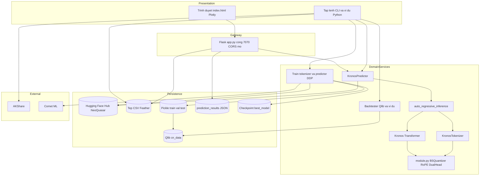

Phân tầng: Presentation (trình duyệt, CLI) -> Gateway (Flask, cổng 7070) -> Domain Services (predictor, tokenizer, mô hình, huấn luyện, backtest) -> Persistence (Hub, CSV, pickle, JSON, checkpoint, Qlib) và External (AKShare, Comet ML).

### 4.2 Integration Context

| Hệ thống | Loại | Hướng | Mục đích | Cấu hình |
|---|---|---|---|---|
| Hugging Face Hub | HTTPS | Ra | Tải trọng số mô hình và tokenizer | Định danh kho; khóa `revision` trong kiểm thử |
| Qlib `cn_data` | Dữ liệu cục bộ | Vào | Dữ liệu giá cổ phiếu | `qlib_data_path` |
| AKShare | API dữ liệu | Ra | Thu thập dữ liệu ví dụ | `examples/get_akshare_date_2024-2025_x.py` |
| Comet ML | SaaS | Ra | Ghi chỉ số huấn luyện | `comet_config` (khóa giữ chỗ) |
| `torch.distributed` | NCCL | Hai chiều | Huấn luyện đa GPU | `torchrun` |
| Webhook, hàng đợi | - | - | Không tồn tại | - |

## 5. USER CHARACTERISTICS & ROLES

Kho mã không có middleware xác thực, guard phân quyền, bảng User hay Role `[CODE]`. Mọi route công khai. Bảng dưới phân loại Tác nhân theo mục đích sử dụng, không theo RBAC.

| Tác nhân | Mô tả | Trình độ | Chức năng sử dụng | Kiểm soát truy cập |
|---|---|---|---|---|
| A-01 Nhà nghiên cứu định lượng | Dự báo qua thư viện | Cao (Python) | FR-INF-* | Không |
| A-02 Kỹ sư học máy | Tinh chỉnh mô hình | Cao (PyTorch, DDP) | FR-FTQ-01..03, FR-FTC-* | Quyền hệ thống tệp |
| A-03 Nhà phân tích thị trường | Dự báo qua trình duyệt | Trung bình | FR-WEB-* | Không |
| A-04 Người đánh giá chiến lược | Backtest | Trung bình-Cao | FR-FTQ-04, FR-BKT-* | Quyền hệ thống tệp |
| A-05 Người bảo trì | Hồi quy | Cao | FR-QA-* | Quyền hệ thống tệp |

| Endpoint | Xác thực | CORS | Ghi chú |
|---|---|---|---|
| `GET /`, `GET /api/*`, `POST /api/*` | Không | Mở cho mọi nguồn gốc (`CORS(app)`) | `[!]` `debug=True`, `host=0.0.0.0` |

## 6. OPERATIONAL SCENARIOS & USE CASE MODELING

### 6.1 Use Case Matrix

| UC | Tên | Tác nhân chính | Điều kiện trước | Điều kiện sau | FR |
|---|---|---|---|---|---|
| UC-01 | Nạp mô hình | A-01, A-03 | Truy cập Hub hoặc có bộ nhớ đệm | Predictor sẵn sàng | FR-INF-01, FR-WEB-03 |
| UC-02 | Dự báo một chuỗi | A-01 | DataFrame có cột giá, không NaN | DataFrame dự báo | FR-INF-02, FR-INF-05, FR-INF-06 |
| UC-03 | Dự báo hàng loạt | A-01 | Các chuỗi cùng độ dài | Danh sách DataFrame | FR-INF-03 |
| UC-04 | Điều chỉnh lấy mẫu | A-01, A-03 | Predictor sẵn sàng | Dự báo theo tham số | FR-INF-04 |
| UC-05 | Nạp dữ liệu qua Web | A-03 | Tệp CSV/Feather hợp lệ | Thông tin dữ liệu hiển thị | FR-WEB-01, FR-WEB-02 |
| UC-06 | Dự báo qua Web | A-03 | Mô hình và dữ liệu đã nạp | Biểu đồ, tệp JSON | FR-WEB-04, FR-WEB-05 |
| UC-07 | Chuẩn bị dữ liệu huấn luyện | A-02 | Qlib hoặc CSV khả dụng | Tập pickle hoặc phân vùng CSV | FR-FTQ-01, FR-FTC-03 |
| UC-08 | Tinh chỉnh mô hình | A-02 | Dữ liệu huấn luyện, GPU | `best_model` | FR-FTQ-02, FR-FTQ-03, FR-FTC-01, FR-FTC-02 |
| UC-09 | Đánh giá backtest | A-04 | Mô hình hoặc tệp dự báo | Báo cáo hiệu suất | FR-FTQ-04, FR-BKT-01, FR-BKT-02 |
| UC-10 | Hồi quy | A-05 | Truy cập Hub | Kết quả đạt hoặc không đạt | FR-QA-01, FR-QA-02 |

### 6.2 Sơ đồ tương tác tổng thể

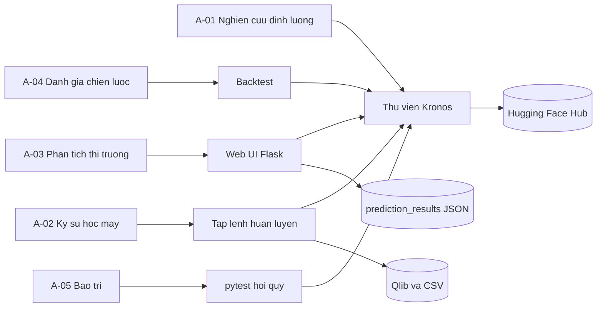


## 7. DATA REQUIREMENTS & LOGICAL DATABASE

Hệ thống không có cơ sở dữ liệu, ORM hay migration `[CODE]`. Khóa PK và FK dưới đây là khóa logic `[ASSUMPTION]` suy ra từ tên tệp, mã chứng khoán và chỉ số thời gian. Lưu trữ bền vững gồm CSV/Feather (đầu vào), pickle (tập huấn luyện), JSON (kết quả Web UI) và thư mục checkpoint Hugging Face.

### 7.1 Entity-Relationship Diagram

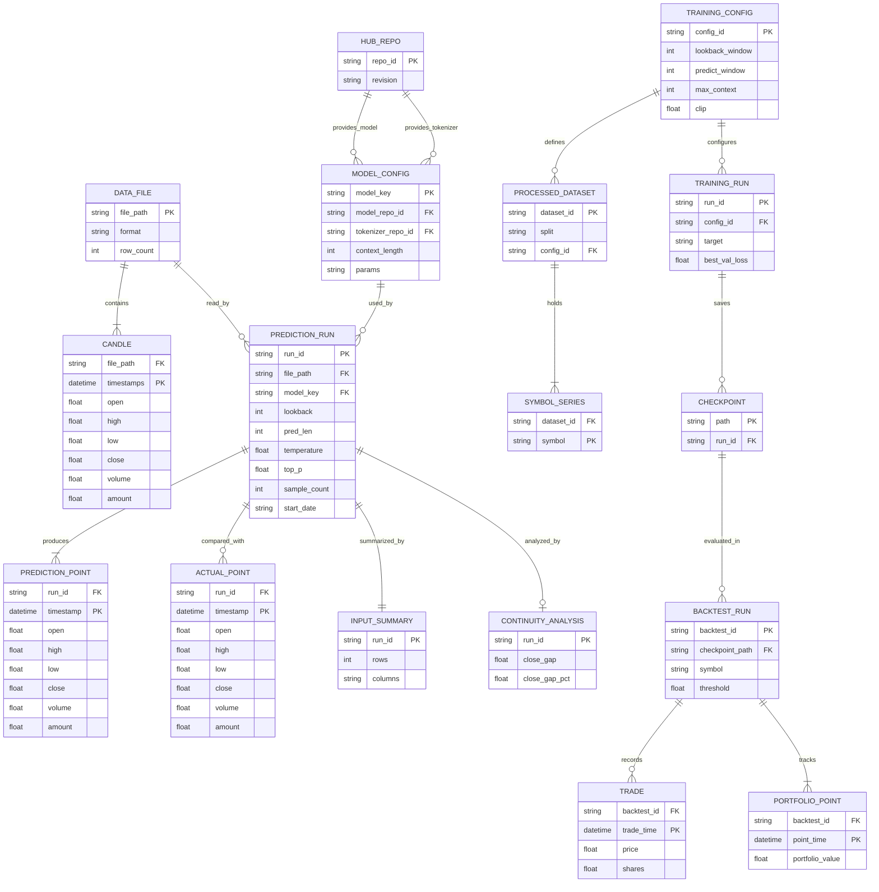

Quan hệ n-n giữa `DATA_FILE` và `MODEL_CONFIG` được giải quyết qua thực thể liên kết `PREDICTION_RUN`. Chỉ `HUB_REPO`, `MODEL_CONFIG`, `CANDLE`, `PREDICTION_RUN` và `CHECKPOINT` có biểu diễn trực tiếp trong mã; `BACKTEST_RUN`, `TRADE`, `PORTFOLIO_POINT` tồn tại dưới dạng DataFrame và biểu đồ.

### 7.2 Data Dictionary


#### 7.2.1 CANDLE (tệp CSV / Feather đầu vào)

| Thuộc tính | Kiểu | Bắt buộc | Ràng buộc | Nguồn |
|---|---|---|---|---|
| `open`, `high`, `low`, `close` | float | Có | Phải có đủ bốn cột, nếu không từ chối; ép kiểu số, giá trị không hợp lệ chuyển thành NaN rồi bị loại | `webui/app.py:load_data_file`, `kronos.py:524` |
| `volume` | float | Không | Vắng thì điền 0.0 | `kronos.py:527-530` |
| `amount` | float | Không | Vắng mà có `volume` thì bằng `volume` nhân trung bình bốn cột giá; vắng cả `volume` thì 0.0 | `kronos.py:531-532` |
| `timestamps` | datetime | Không (Web UI) | Chấp nhận `timestamps`, `timestamp`, `date`; vắng thì sinh chuỗi từ `2024-01-01` bước 1 giờ | `webui/app.py:load_data_file` |
| Giá trị NaN | - | - | Thư viện từ chối khi có NaN; Web UI loại hàng chứa NaN | `kronos.py:534`, `webui/app.py` |

Định dạng khác biệt giữa các tệp mẫu: `tests/data/regression_input.csv` có cột `timestamps,open,high,low,close,volume,amount`; `finetune_csv/data/HK_ali_09988_kline_5min_all.csv` có thứ tự `timestamps,open,close,high,low,volume,amount` và dấu BOM.

#### 7.2.2 MODEL_CONFIG (hằng số `AVAILABLE_MODELS`)

| Khóa | Mô hình | Tokenizer | Ngữ cảnh | Tham số |
|---|---|---|---|---|
| `kronos-mini` | `NeoQuasar/Kronos-mini` | `NeoQuasar/Kronos-Tokenizer-2k` | 2048 | 4.1M |
| `kronos-small` | `NeoQuasar/Kronos-small` | `NeoQuasar/Kronos-Tokenizer-base` | 512 | 24.7M |
| `kronos-base` | `NeoQuasar/Kronos-base` | `NeoQuasar/Kronos-Tokenizer-base` | 512 | 102.3M |

#### 7.2.3 PREDICTION_RUN (tệp `webui/prediction_results/prediction_YYYYMMDD_HHMMSS.json`)

| Trường | Kiểu | Mô tả | Nguồn |
|---|---|---|---|
| `timestamp` | string ISO-8601 | Thời điểm lưu | `save_prediction_results` |
| `file_path` | string | Đường dẫn tệp dữ liệu | như trên |
| `prediction_type` | string | Mô tả chế độ cửa sổ | như trên |
| `prediction_params` | object | `lookback`, `pred_len`, `temperature`, `top_p`, `sample_count`, `start_date` (hoặc `latest`) | như trên |
| `input_data_summary` | object | `rows`, `columns`, `price_range`, `last_values` | như trên |
| `prediction_results` | array | Phần tử: `timestamp`, `open`, `high`, `low`, `close`, `volume`, `amount` | như trên |
| `actual_data` | array | Cùng lược đồ; rỗng khi không có dữ liệu so sánh | như trên |
| `analysis.continuity` | object | `last_prediction`, `first_actual`, `gaps`, `gap_percentages` | như trên |

Khóa `run_id` trong sơ đồ tương ứng với tên tệp; mã nguồn không sinh trường `run_id` và không ghi khóa `model_key` vào kết quả `[OPEN]`.

#### 7.2.4 TRAINING_CONFIG - luồng Qlib (`finetune/config.py:Config`)

| Nhóm | Thuộc tính và giá trị mặc định |
|---|---|
| Dữ liệu | `qlib_data_path=~/.qlib/qlib_data/cn_data`, `instrument=csi300`, `dataset_begin_time=2011-01-01`, `dataset_end_time=2025-06-05` |
| Cửa sổ | `lookback_window=90`, `predict_window=10`, `max_context=512`, `clip=5.0` |
| Đặc trưng | `feature_list=[open, high, low, close, vol, amt]`, `time_feature_list=[minute, hour, weekday, day, month]` |
| Phân chia | train 2011-01-01 đến 2022-12-31; val 2022-09-01 đến 2024-06-30; test 2024-04-01 đến 2025-06-05; backtest 2024-07-01 đến 2025-06-05 |
| Huấn luyện | `epochs=30`, `batch_size=50`, `tokenizer_learning_rate=2e-4`, `predictor_learning_rate=4e-5`, AdamW (beta 0.9, 0.95; decay 0.1), `seed=100` |
| Backtest | `backtest_n_symbol_hold=50`, `backtest_n_symbol_drop=5`, `backtest_hold_thresh=5`, `inference_T=0.6`, `inference_top_p=0.9`, `inference_sample_count=5` |
| Chuẩn so sánh | `csi800=SH000906`, `csi1000=SH000852`, `csi300=SH000300`; giá trị khác phát sinh `ValueError` |

#### 7.2.5 TRAINING_CONFIG - luồng CSV (`finetune_csv/configs/*.yaml`)

| Nhóm | Khóa |
|---|---|
| `data` | `data_path`, `lookback_window=512`, `predict_window=48`, `max_context=512`, `clip=5.0`, `train_ratio=0.9`, `val_ratio=0.1`, `test_ratio=0.0` |
| `training` | `tokenizer_epochs`, `basemodel_epochs`, `batch_size`, `log_interval`, `num_workers`, `seed`, `tokenizer_learning_rate`, `predictor_learning_rate`, `adam_beta1/2`, `adam_weight_decay`, `accumulation_steps` |
| `model_paths` | `pretrained_tokenizer`, `pretrained_predictor`, `exp_name`, `base_path`, `base_save_path`, `finetuned_tokenizer`, `tokenizer_save_name`, `basemodel_save_name` |
| `experiment` | `name`, `description`, `use_comet`, `train_tokenizer`, `train_basemodel`, `skip_existing` |
| `device` | `use_cuda`, `device_id` |

#### 7.2.6 PROCESSED_DATASET (pickle)

| Tệp | Cấu trúc | Nguồn |
|---|---|---|
| `{dataset_path}/train_data.pkl`, `val_data.pkl`, `test_data.pkl` | `dict[symbol -> DataFrame]` chỉ mục `datetime`, cột theo `feature_list` | `QlibDataPreprocessor.prepare_dataset` |
| Cửa sổ mẫu | `lookback_window + predict_window + 1`; mẫu chuẩn hóa z-score theo `lookback_window` rồi cắt `clip` | `finetune/dataset.py` |

#### 7.2.7 CHECKPOINT

| Thuộc tính | Giá trị | Nguồn |
|---|---|---|
| Đường dẫn Qlib | `{save_path}/{tokenizer\|predictor}_save_folder_name/checkpoints/best_model` | `finetune/config.py` |
| Đường dẫn CSV | `{base_path}/{exp_name}/tokenizer/best_model`, `.../basemodel/best_model` | YAML mẫu |
| Tiêu chí lưu | `val_loss` nhỏ hơn `best_val_loss`; lưu bằng `save_pretrained` | `finetune/train_predictor.py:170-173` |

## 8. EXTERNAL INTERFACE REQUIREMENTS

### 8.1 User Interfaces

| Mã | Yêu cầu | Nguồn |
|---|---|---|
| UI-01 | Web UI phải hiển thị Control Panel (chọn mô hình, thiết bị, tệp dữ liệu), Data Information, Time Window Selection, tham số lấy mẫu và Prediction Results Chart | `webui/templates/index.html` |
| UI-02 | Web UI phải vô hiệu hóa nút Predict cho đến khi mô hình được nạp | `index.html` (`predict-btn disabled`) |
| UI-03 | Thanh trượt phải giới hạn T trong 0.1-2.0, top_p trong 0.1-1.0; sample_count trong 1-5 | `index.html` |
| UI-04 | Giao diện dùng tiếng Anh; bản địa hóa chưa có | `[CODE]`, `[OPEN]` |
| UI-05 | Giao diện dòng lệnh phải phát thông điệp tiến trình và đường dẫn đầu ra | `finetune*/`, `examples/` |
| UI-06 | Tương phản màu và thao tác bàn phím chưa được rà soát | `[UNKNOWN]` |

### 8.2 Software & API Interfaces

Định dạng: RESTful JSON (Flask). Xác thực: không có. Common Request Headers: `Content-Type: application/json` cho `POST`. CORS: mở cho mọi nguồn gốc.

#### 8.2.1 Response Envelope và Error Wrapper

**Response Envelope (Web UI, `webui/app.py`)**

| Trường hợp | Mã HTTP | Thân phản hồi |
|---|---|---|
| Thành công (thao tác) | 200 | `{ "success": true, "message": string, ...tải trọng }` |
| Thành công (truy vấn) | 200 | Đối tượng hoặc mảng trực tiếp, không có `success` (`/api/data-files`, `/api/available-models`, `/api/model-status`) |
| Lỗi xác thực đầu vào / điều kiện tiên quyết | 400 | `{ "error": string }` |
| Lỗi nội bộ (ngoại lệ chưa lường) | 500 | `{ "error": string }` với tiền tố mô tả (`Failed to load data:`, `Prediction failed:`, `Model loading failed:`) |

**Error Wrapper:** Trường duy nhất `error` chứa chuỗi tự do; không có mã lỗi máy đọc được, không có `details`, không có `request_id`. `[PROPOSED]` bổ sung `code` và `request_id`.

**Phiên bản API:** Không có tiền tố phiên bản; `/api/*` `[CODE]`.

#### 8.2.2 Hợp đồng endpoint (Web UI)

| Phương thức | Đường dẫn | Yêu cầu | Phản hồi thành công | Lỗi |
|---|---|---|---|---|
| GET | `/` | - | HTML `templates/index.html` | - |
| GET | `/api/data-files` | - | Mảng `{name, path, size}` của `.csv`/`.feather` trong thư mục `<repo>/data` | Mảng rỗng nếu thư mục vắng |
| POST | `/api/load-data` | `{file_path}` | `{success, data_info{rows, columns, start_date, end_date, price_range{min,max}, prediction_columns, timeframe}, message}` | 400: đường dẫn rỗng, định dạng không hỗ trợ, thiếu cột `open/high/low/close`; 500 |
| POST | `/api/load-model` | `{model_key (mặc định kronos-small), device (mặc định cpu)}` | `{success, message, model_info{name, params, context_length, description}}` | 400: thư viện mô hình không khả dụng, `model_key` không hỗ trợ; 500 |
| GET | `/api/available-models` | - | `{models, model_available}` | - |
| GET | `/api/model-status` | - | `{available, loaded, message, current_model?{name, device}}` | - |
| POST | `/api/predict` | `{file_path, lookback=400, pred_len=120, temperature=1.0, top_p=0.9, sample_count=1, start_date?}` | `{success, prediction_type, chart (JSON Plotly), prediction_results[], actual_data[], has_comparison, message}` | 400: đường dẫn rỗng, lỗi tải dữ liệu, thiếu dữ liệu, mô hình chưa nạp; 500: suy luận thất bại |

#### 8.2.3 Hợp đồng API thư viện

| Hàm | Tham số | Trả về | Ngoại lệ |
|---|---|---|---|
| `KronosTokenizer.from_pretrained(id, revision?)` | Mã Hub | Tokenizer | Lỗi mạng Hub |
| `Kronos.from_pretrained(id, revision?)` | Mã Hub | Mô hình | Lỗi mạng Hub |
| `KronosPredictor(model, tokenizer, device=None, max_context=512, clip=5)` | - | Bộ dự báo; `device=None` chọn `cuda:0`, `mps`, `cpu` | - |
| `predict(df, x_timestamp, y_timestamp, pred_len, T=1.0, top_k=0, top_p=0.9, sample_count=1, verbose=True)` | `df` có `open/high/low/close`; hai chuỗi thời gian là `Series` có `.dt` | `DataFrame` cột `open, high, low, close, volume, amount`, chỉ mục `y_timestamp` | `ValueError`: không phải DataFrame; thiếu cột giá; có NaN |
| `predict_batch(df_list, x_timestamp_list, y_timestamp_list, pred_len, ...)` | Danh sách cùng độ dài | Danh sách DataFrame | `ValueError`: kiểu không phải list/tuple; số lượng không khớp; phần tử không hợp lệ; độ dài lịch sử hoặc dự báo không đồng nhất; `y_timestamp` khác `pred_len` |

### 8.3 Communication Protocols

| Giao thức | Cổng / Phạm vi | Mã hóa | Nguồn |
|---|---|---|---|
| HTTP (Flask) | TCP 7070, `0.0.0.0` | Không có TLS; `[PROPOSED]` đặt sau reverse proxy TLS | `webui/app.py` |
| HTTPS tới Hugging Face Hub | TCP 443 | TLS | `huggingface_hub` |
| NCCL qua `torchrun` | Nút huấn luyện | Không mã hóa `[UNKNOWN]` | `setup_ddp` |
| Truy cập tệp cục bộ | Hệ thống tệp | Không | CSV, pickle, JSON |

## 9. SYSTEM REQUIREMENTS

### 9.1 Functional Requirements

Mỗi FR ánh xạ một-một với User Story cùng số thứ tự trong `docs/AGILE_SRS.md` (`FR-INF-01` tương ứng `US-INF-01`). Yêu cầu dùng "phải" cho điều bắt buộc.

#### Module INF - Suy luận và dự báo (thư viện)

##### FR-INF-01 - Nạp tokenizer và mô hình từ Hub

| Thuộc tính | Nội dung |
|---|---|
| Identifier | FR-INF-01 (User Story US-INF-01) |
| Code Traceability | `model/kronos.py:KronosTokenizer`, `model/kronos.py:Kronos` (kế thừa `PyTorchModelHubMixin`), `model/__init__.py` |
| Test Traceability | `tests/test_kronos_regression.py` (gọi `from_pretrained` với `revision` cố định) |
| Data Entities | HUB_REPO, MODEL_CONFIG (logic, xem Mục 7) |

**Yêu cầu**

- Hệ thống phải tải cấu hình và trọng số từ kho Hub theo định danh và `revision` tùy chọn.
- Hệ thống phải trả về đối tượng `KronosTokenizer` hoặc `Kronos` đã khởi tạo theo tham số trong cấu hình kho.

**UI / Interaction Mockup (Pattern A)**

```text
┌────────────────────────────────────────────────────────────────────────┐
│  FR: FR-INF-01 - LOAD TOKENIZER AND MODEL                  [Cancel] [X]│
├────────────────────────────────────────────────────────────────────────┤
│  MODULE: INF | STEP: Load pretrained artifacts                         │
│  Progress: [●] Load ─── [○] Build predictor ─── [○] Predict            │
├────────────────────────────────────────────────────────────────────────┤
│  * Tokenizer repo id                 * Model repo id                   │
│  ┌──────────────────────────────┐   ┌──────────────────────────────┐   │
│  │ NeoQuasar/Kronos-Tokenizer-  │   │ NeoQuasar/Kronos-small       │   │
│  │ base                         │   │                              │   │
│  └──────────────────────────────┘   └──────────────────────────────┘   │
│  * Revision (optional)                                                 │
│  ┌──────────────────────────────┐                                      │
│  │ 901c26c1332695a2a8f243eb2f37 │                                      │
│  └──────────────────────────────┘                                      │
│  [!] Hub access required unless the artifacts are cached locally.      │
├────────────────────────────────────────────────────────────────────────┤
│  [ < Previous ]                [ Save Draft ]            [ Load > ]    │
└────────────────────────────────────────────────────────────────────────┘
```

**Preconditions và Postconditions**

| Loại | Nội dung |
|---|---|
| Precondition | Bộ nhớ đệm có artifact hoặc Hub truy cập được. |
| Postcondition | Đối tượng mô-đun PyTorch sẵn sàng; chưa gắn thiết bị. |

**Inputs và Validation Rules**

| Trường | Kiểu | Bắt buộc | Ràng buộc |
|---|---|---|---|
| repo_id | string | Có | Định danh kho Hub, ví dụ `NeoQuasar/Kronos-small` |
| revision | string | Không | Mã commit hoặc nhánh Hub |

**Logic Decision Flowchart**

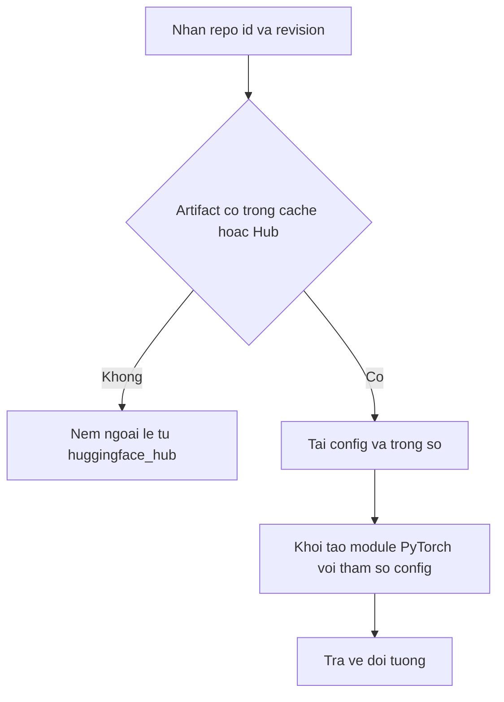

**Call-Stack Sequence Diagram**

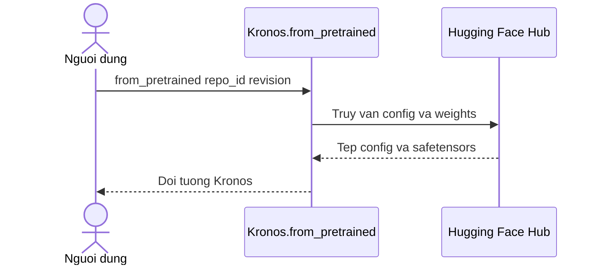

**Exception và Error Handling**

| Error Code | Thông điệp / Loại | Điều kiện kích hoạt | HTTP / Cơ chế rollback |
|---|---|---|---|
| EX-INF-01 | Ngoại lệ `huggingface_hub` | Kho không tồn tại hoặc không có mạng và bộ nhớ đệm trống | Không có đối tượng nào được tạo; không có trạng thái cần rollback |

- `[UNKNOWN]` loại ngoại lệ cụ thể do `huggingface_hub==0.33.1` quyết định, không được xử lý trong mã Kronos.

---

##### FR-INF-02 - Dự báo OHLCV cho một chuỗi

| Thuộc tính | Nội dung |
|---|---|
| Identifier | FR-INF-02 (User Story US-INF-02) |
| Code Traceability | `model/kronos.py:KronosPredictor.predict` (dòng 519-559), `calc_time_stamps`, `generate`, `auto_regressive_inference` |
| Test Traceability | `tests/test_kronos_regression.py::test_kronos_predictor_regression`, `::test_kronos_predictor_mse`; `examples/prediction_example.py` (minh họa) |
| Data Entities | CANDLE, PREDICTION_POINT (logic, xem Mục 7) |

**Yêu cầu**

- Hệ thống phải từ chối đầu vào không phải `pandas.DataFrame`.
- Hệ thống phải từ chối DataFrame thiếu một trong các cột `open`, `high`, `low`, `close`.
- Hệ thống phải từ chối DataFrame có NaN ở cột giá hoặc khối lượng.
- Hệ thống phải điền `volume` và `amount` bằng 0.0 khi thiếu `volume`.
- Hệ thống phải trả về DataFrame sáu cột có chỉ mục bằng `y_timestamp` và thang đo của đầu vào.

**UI / Interaction Mockup (Pattern A)**

```text
┌────────────────────────────────────────────────────────────────────────┐
│  FR: FR-INF-02 - PREDICT SINGLE SERIES                     [Cancel] [X]│
├────────────────────────────────────────────────────────────────────────┤
│  MODULE: INF | STEP: Submit prediction request                         │
│  Progress: [●] Load ─── [●] Build predictor ─── [○] Predict            │
├────────────────────────────────────────────────────────────────────────┤
│  * History DataFrame               * pred_len                          │
│  ┌──────────────────────────────┐   ┌──────────────────────────────┐   │
│  │ df[open..close,volume,amount]│   │ 120                          │   │
│  └──────────────────────────────┘   └──────────────────────────────┘   │
│  * x_timestamp (Series)             * y_timestamp (Series)             │
│  ┌──────────────────────────────┐   ┌──────────────────────────────┐   │
│  │ 400 timestamps               │   │ 120 timestamps               │   │
│  └──────────────────────────────┘   └──────────────────────────────┘   │
│  [!] Required: open, high, low, close. No NaN in price or volume.      │
├────────────────────────────────────────────────────────────────────────┤
│  [ < Previous ]                [ Save Draft ]          [ Predict > ]   │
└────────────────────────────────────────────────────────────────────────┘
```

**Preconditions và Postconditions**

| Loại | Nội dung |
|---|---|
| Precondition | `KronosPredictor` đã khởi tạo; `x_timestamp`, `y_timestamp` là `Series` có thuộc tính `.dt`. |
| Postcondition | DataFrame dự báo có `pred_len` hàng; không thay đổi `df` gốc (bản sao được dùng). |

**Inputs và Validation Rules**

| Trường | Kiểu | Bắt buộc | Ràng buộc |
|---|---|---|---|
| df | DataFrame | Có | Có cột open, high, low, close; không NaN |
| x_timestamp | Series datetime | Có | Cùng độ dài với `df` |
| y_timestamp | Series datetime | Có | Độ dài `pred_len` (không được kiểm tra trong `predict`) |
| pred_len | int | Có | Số nến dự báo |
| T, top_k, top_p, sample_count | float, int, float, int | Không | Mặc định 1.0, 0, 0.9, 1 |

**Logic Decision Flowchart**

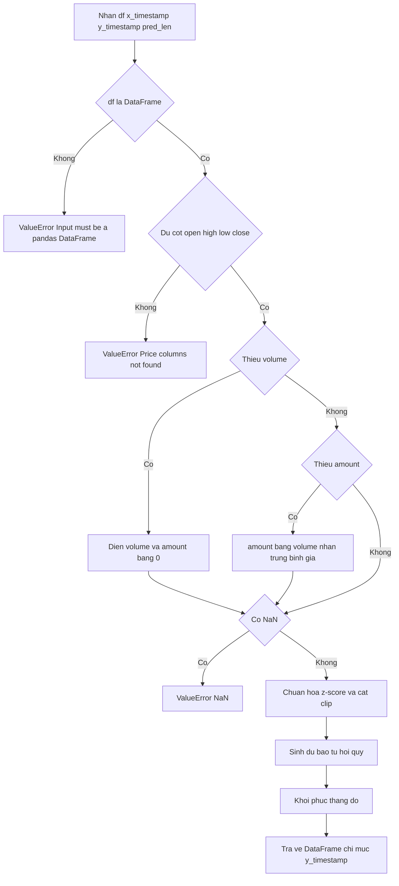

**Call-Stack Sequence Diagram**

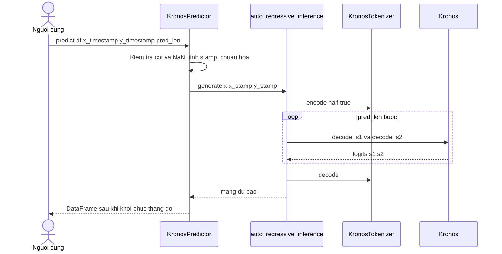

**Exception và Error Handling**

| Error Code | Thông điệp / Loại | Điều kiện kích hoạt | HTTP / Cơ chế rollback |
|---|---|---|---|
| EX-INF-02a | `ValueError` Input must be a pandas DataFrame. | `df` sai kiểu | Từ chối trước suy luận; không thay đổi trạng thái |
| EX-INF-02b | `ValueError` Price columns [...] not found in DataFrame. | Thiếu cột giá | Từ chối trước suy luận |
| EX-INF-02c | `ValueError` Input DataFrame contains NaN values in price or volume columns. | Có NaN | Từ chối trước suy luận |

- `[OPEN]` hàm predict không kiểm tra độ dài `y_timestamp` bằng `pred_len`; hàm `predict_batch` có kiểm tra (US-INF-03).
- `[i]` Thang đo: trung bình và độ lệch chuẩn tính trên toàn bộ cửa sổ lịch sử; mẫu số cộng 1e-5.

---

##### FR-INF-03 - Dự báo hàng loạt nhiều chuỗi

| Thuộc tính | Nội dung |
|---|---|
| Identifier | FR-INF-03 (User Story US-INF-03) |
| Code Traceability | `model/kronos.py:KronosPredictor.predict_batch` (dòng 562-661) |
| Test Traceability | Không có kiểm thử tự động; minh họa tại `examples/prediction_batch_example.py` |
| Data Entities | CANDLE, PREDICTION_POINT (logic, xem Mục 7) |

**Yêu cầu**

- Hệ thống phải từ chối tham số không phải `list` hoặc `tuple`.
- Hệ thống phải từ chối khi số lượng DataFrame, `x_timestamp_list`, `y_timestamp_list` khác nhau.
- Hệ thống phải từ chối khi độ dài lịch sử hoặc độ dài dự báo không đồng nhất giữa các chuỗi.
- Hệ thống phải trả về danh sách DataFrame theo thứ tự đầu vào.

**UI / Interaction Mockup (Pattern C)**

```text
┌────────────────────────────────────────────────────────────────────────┐
│  FR: FR-INF-03 - BATCH PREDICTION                                      │
├────────────────────────────────────────────────────────────────────────┤
│  INPUT LIST VALIDATION:                                                │
│  Series count: [ 3 ]   History length: [ 400 ]   pred_len: [ 120 ]     │
├────────────────────────────────────────────────────────────────────────┤
│  ┌────┬──────────┬──────────┬─────────┬────────┬────────────┐          │
│  │ #  │ Series   │ History  │ y_stamp │ Cols   │ Status     │          │
│  ├────┼──────────┼──────────┼─────────┼────────┼────────────┤          │
│  │ 0  │ SYM_A    │ 400      │ 120     │ yes    │ READY      │          │
│  │ 1  │ SYM_B    │ 400      │ 120     │ yes    │ READY      │          │
│  │ 2  │ SYM_C    │ 380      │ 120     │ yes    │ [!] LENGTH │          │
│  └────┴──────────┴──────────┴─────────┴────────┴────────────┘          │
├────────────────────────────────────────────────────────────────────────┤
│  [!] All series require identical history length and prediction length.│
└────────────────────────────────────────────────────────────────────────┘
```

**Preconditions và Postconditions**

| Loại | Nội dung |
|---|---|
| Precondition | Các chuỗi cùng độ dài lịch sử và `y_timestamp` có độ dài `pred_len`. |
| Postcondition | Danh sách DataFrame; mỗi phần tử có chỉ mục bằng `y_timestamp` tương ứng. |

**Inputs và Validation Rules**

| Trường | Kiểu | Bắt buộc | Ràng buộc |
|---|---|---|---|
| df_list | list[DataFrame] | Có | Mỗi phần tử có cột giá, không NaN |
| x_timestamp_list | list[Series] | Có | Độ dài bằng `df` tương ứng |
| y_timestamp_list | list[Series] | Có | Độ dài `pred_len` |
| pred_len | int | Có | Đồng nhất |

**Logic Decision Flowchart**

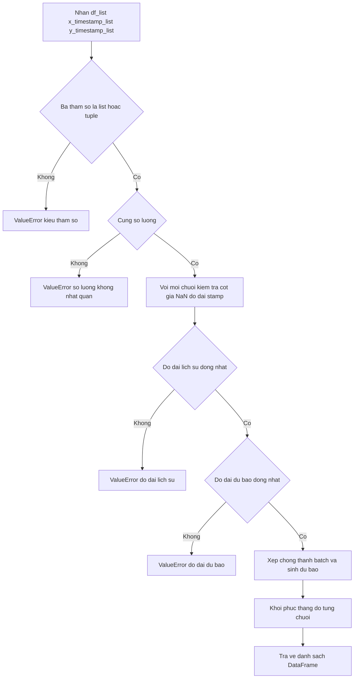

**Call-Stack Sequence Diagram**

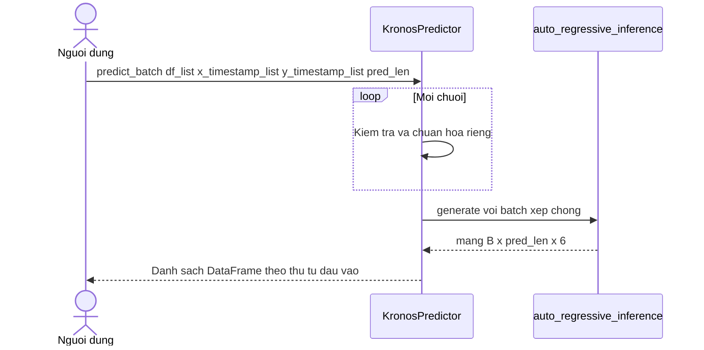

**Exception và Error Handling**

| Error Code | Thông điệp / Loại | Điều kiện kích hoạt | HTTP / Cơ chế rollback |
|---|---|---|---|
| EX-INF-03a | `ValueError` kiểu tham số | Tham số không phải list/tuple | Từ chối toàn lô |
| EX-INF-03b | `ValueError` Parallel prediction requires all series to have consistent historical lengths | Độ dài lịch sử khác nhau | Từ chối toàn lô |
| EX-INF-03c | `ValueError` y_timestamp length at index i should equal pred_len | Độ dài `y_timestamp` khác `pred_len` | Từ chối toàn lô |

- `[OPEN]` không có kiểm thử tự động cho `predict_batch`.

---

##### FR-INF-04 - Điều khiển lấy mẫu dự báo

| Thuộc tính | Nội dung |
|---|---|
| Identifier | FR-INF-04 (User Story US-INF-04) |
| Code Traceability | `model/kronos.py:sample_from_logits`, `top_k_top_p_filtering`, `auto_regressive_inference` (trung bình `sample_count` đường tại dòng 465-467) |
| Test Traceability | `tests/test_kronos_regression.py` (dùng `top_k=1`, `top_p=1.0`, `sample_count=1`, `T=1.0`) |
| Data Entities | PREDICTION_RUN (logic, xem Mục 7) |

**Yêu cầu**

- Hệ thống phải chia logits cho `T` trước khi lọc.
- Hệ thống phải ưu tiên `top_k` khi `top_k > 0` và không áp dụng `top_p` trong trường hợp đó.
- Hệ thống phải trả về trung bình số học của `sample_count` đường dự báo.
- Hệ thống phải cho kết quả xác định khi `top_k=1`, `top_p=1.0` và seed cố định.

**UI / Interaction Mockup (Pattern A)**

```text
┌────────────────────────────────────────────────────────────────────────┐
│  FR: FR-INF-04 - SAMPLING CONTROLS                         [Cancel] [X]│
├────────────────────────────────────────────────────────────────────────┤
│  MODULE: INF | STEP: Configure sampling                                │
├────────────────────────────────────────────────────────────────────────┤
│  * Temperature T                   * top_k (0 = off)                   │
│  ┌──────────────────────────────┐   ┌──────────────────────────────┐   │
│  │ 1.0                          │   │ 0                            │   │
│  └──────────────────────────────┘   └──────────────────────────────┘   │
│  * top_p                            * sample_count                     │
│  ┌──────────────────────────────┐   ┌──────────────────────────────┐   │
│  │ 0.9                          │   │ 1                            │   │
│  └──────────────────────────────┘   └──────────────────────────────┘   │
│  [!] top_k greater than 0 takes precedence over top_p in the filter.   │
├────────────────────────────────────────────────────────────────────────┤
│  [ < Previous ]                [ Save Draft ]            [ Apply > ]   │
└────────────────────────────────────────────────────────────────────────┘
```

**Preconditions và Postconditions**

| Loại | Nội dung |
|---|---|
| Precondition | Predictor đã khởi tạo. |
| Postcondition | Token s1, s2 được lấy mẫu theo tham số. |

**Inputs và Validation Rules**

| Trường | Kiểu | Bắt buộc | Ràng buộc |
|---|---|---|---|
| T | float | Không | Lớn hơn 0; mặc định 1.0 |
| top_k | int | Không | 0 tắt lọc |
| top_p | float | Không | Dưới 1.0 bật lọc nhân |
| sample_count | int | Không | Lớn hơn hoặc bằng 1 |

**Logic Decision Flowchart**

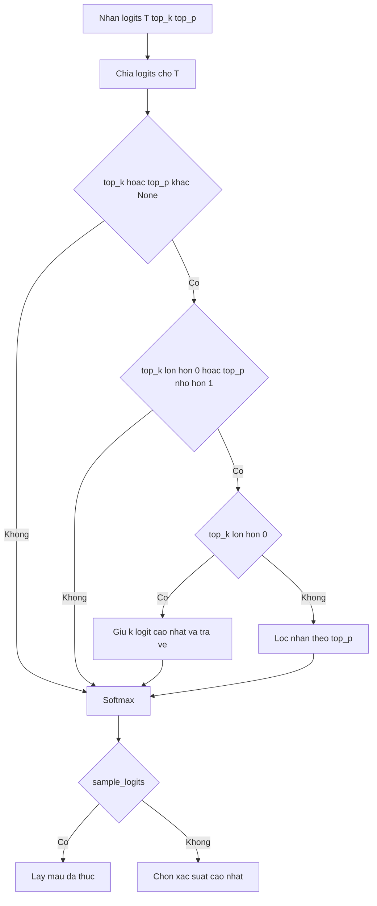

**Call-Stack Sequence Diagram**

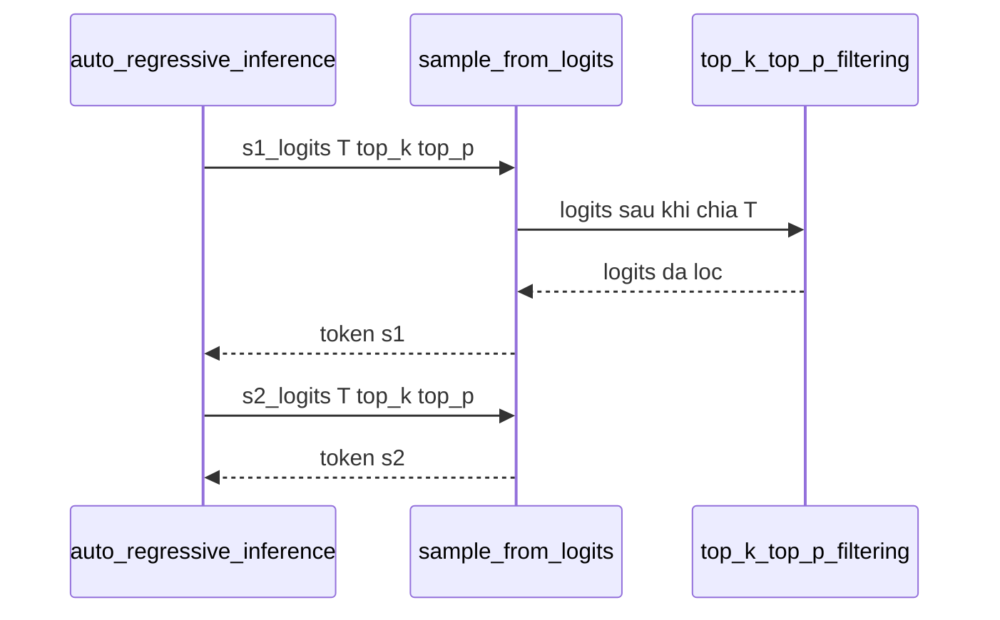

**Exception và Error Handling**

| Error Code | Thông điệp / Loại | Điều kiện kích hoạt | HTTP / Cơ chế rollback |
|---|---|---|---|
| EX-INF-04 | `TypeError` | Gọi trực tiếp `sample_from_logits` với `top_k=None` và `top_p` có giá trị | Ngoại lệ Python; `KronosPredictor` không kích hoạt do `top_k=0` mặc định |

- `[!]` Kịch bản 4 là hành vi thực tế của `sample_from_logits` (dòng 375-377); `KronosPredictor` luôn truyền `top_k=0` mặc định nên đường dẫn này không xảy ra qua API công khai.
- `[!]` `top_k_top_p_filtering` trả về ngay sau khi áp dụng top_k, nên `top_p` bị bỏ qua khi `top_k > 0` (dòng 347-352).

---

##### FR-INF-05 - Chọn thiết bị tính toán tự động

| Thuộc tính | Nội dung |
|---|---|
| Identifier | FR-INF-05 (User Story US-INF-05) |
| Code Traceability | `model/kronos.py:KronosPredictor.__init__` (dòng 484-506) |
| Test Traceability | `tests/test_kronos_regression.py` (chỉ định `DEVICE="cpu"`; nhánh tự động chưa được kiểm thử) |
| Data Entities | MODEL_CONFIG (logic, xem Mục 7) |

**Yêu cầu**

- Hệ thống phải chọn thiết bị theo thứ tự `cuda:0`, `mps`, `cpu` khi `device=None`.
- Hệ thống phải chuyển tokenizer và mô hình sang thiết bị đã chọn.

**UI / Interaction Mockup (Pattern A)**

```text
┌────────────────────────────────────────────────────────────────────────┐
│  FR: FR-INF-05 - DEVICE SELECTION                          [Cancel] [X]│
├────────────────────────────────────────────────────────────────────────┤
│  MODULE: INF | STEP: Build predictor                                   │
├────────────────────────────────────────────────────────────────────────┤
│  * device (None = auto)             Detected order:                    │
│  ┌──────────────────────────────┐   1. cuda:0                          │
│  │ None                       ▼ │   2. mps                             │
│  └──────────────────────────────┘   3. cpu                             │
│  [i] Model and tokenizer are moved to the selected device.             │
├────────────────────────────────────────────────────────────────────────┤
│  [ < Previous ]                [ Save Draft ]            [ Build > ]   │
└────────────────────────────────────────────────────────────────────────┘
```

**Preconditions và Postconditions**

| Loại | Nội dung |
|---|---|
| Precondition | PyTorch cài đặt. |
| Postcondition | Tokenizer và mô hình nằm trên thiết bị đã chọn. |

**Inputs và Validation Rules**

| Trường | Kiểu | Bắt buộc | Ràng buộc |
|---|---|---|---|
| device | string | Không | `cpu`, `cuda:N` hoặc `mps`; mặc định tự phát hiện |
| max_context | int | Không | Mặc định 512 |
| clip | float | Không | Mặc định 5 |

**Logic Decision Flowchart**

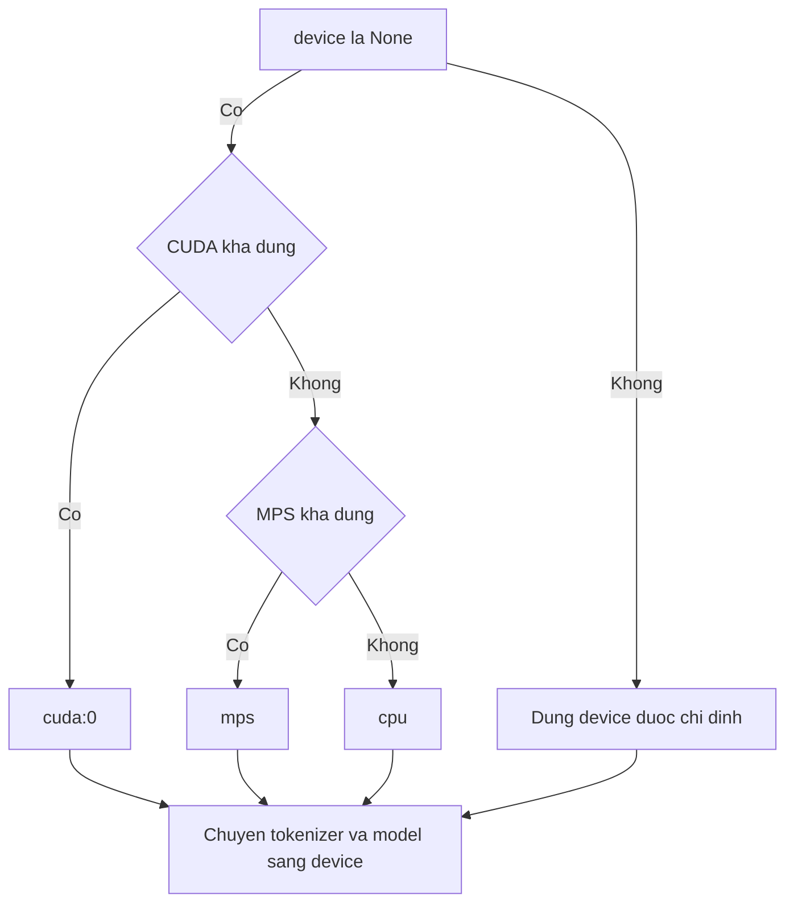

**Call-Stack Sequence Diagram**

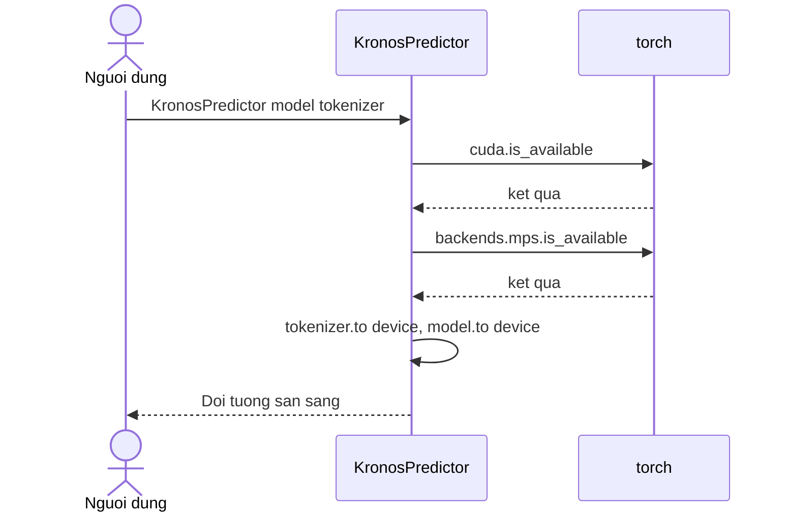

**Exception và Error Handling**

| Error Code | Thông điệp / Loại | Điều kiện kích hoạt | HTTP / Cơ chế rollback |
|---|---|---|---|
| EX-INF-05 | Lỗi PyTorch | Thiết bị chỉ định không khả dụng | Ngoại lệ khi chuyển thiết bị `[UNKNOWN]` |


---

##### FR-INF-06 - Quản lý cửa sổ ngữ cảnh tối đa

| Thuộc tính | Nội dung |
|---|---|
| Identifier | FR-INF-06 (User Story US-INF-06) |
| Code Traceability | `model/kronos.py:auto_regressive_inference` (dòng 405-454: bộ đệm `pre_buffer`, `post_buffer`, `torch.roll`) |
| Test Traceability | `tests/test_kronos_regression.py` (ngữ cảnh 512 và 256 với `max_context=512`; nhánh cắt bớt khi lịch sử vượt 512 chưa được kiểm thử trực tiếp) |
| Data Entities | CANDLE (logic, xem Mục 7) |

**Yêu cầu**

- Hệ thống phải giữ tối đa `max_context` token cuối của lịch sử làm ngữ cảnh.
- Hệ thống phải dịch bộ đệm một token sau mỗi bước khi bộ đệm đầy.

**UI / Interaction Mockup (Pattern B)**

```text
┌────────────────────────────────────────────────────────────────────────┐
│  FR: FR-INF-06 - CONTEXT WINDOW MANAGEMENT        [Status: Active ●]   │
├────────────────────────────────────────────────────────────────────────┤
│  WINDOW METRICS                                                        │
│  ┌───────────────────┐  ┌───────────────────┐  ┌───────────────────┐   │
│  │ [HISTORY TOKENS]  │  │ [MAX_CONTEXT]     │  │ [PRED STEPS]      │   │
│  │ 600               │  │ 512               │  │ 120               │   │
│  │ Truncated: 88     │  │ Window: sliding   │  │ Roll per step     │   │
│  └───────────────────┘  └───────────────────┘  └───────────────────┘   │
├────────────────────────────────────────────────────────────────────────┤
│  [i] Initial buffer holds the last max_context tokens of the history.  │
│  [i] After the buffer is full each step rolls left by one token.       │
└────────────────────────────────────────────────────────────────────────┘
```

**Preconditions và Postconditions**

| Loại | Nội dung |
|---|---|
| Precondition | Lịch sử đã được mã hóa thành token. |
| Postcondition | Dự báo `pred_len` bước không vượt `max_context` token mỗi lượt suy luận. |

**Inputs và Validation Rules**

| Trường | Kiểu | Bắt buộc | Ràng buộc |
|---|---|---|---|
| max_context | int | Có | 512 (small, base) hoặc 2048 (mini) |
| pred_len | int | Có | Lớn hơn 0 |

**Logic Decision Flowchart**

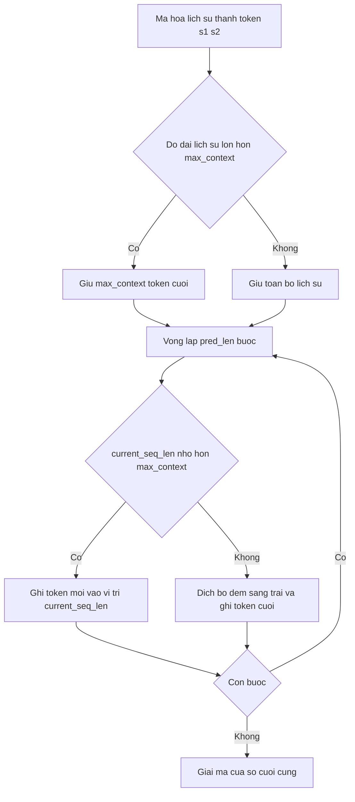

**Call-Stack Sequence Diagram**

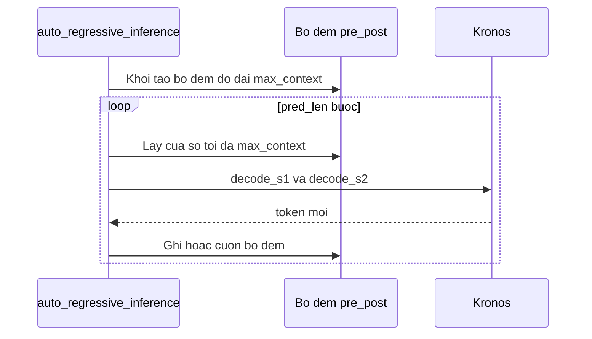

**Exception và Error Handling**

| Error Code | Thông điệp / Loại | Điều kiện kích hoạt | HTTP / Cơ chế rollback |
|---|---|---|---|
| EX-INF-06 | Không có | Lịch sử dài hơn `max_context` | Hệ thống cắt phần đầu, không phát lỗi |

- `[OPEN]` README ghi `max_context` của Kronos-small và Kronos-base là 512; Kronos-mini là 2048.

---


#### Module WEB - Web UI

##### FR-WEB-01 - Liệt kê tệp dữ liệu khả dụng

| Thuộc tính | Nội dung |
|---|---|
| Identifier | FR-WEB-01 (User Story US-WEB-01) |
| Code Traceability | `webui/app.py:get_data_files` -> `load_data_files` (dòng 60-76, route dòng 335-339) |
| Test Traceability | Không có kiểm thử tự động |
| Data Entities | DATA_FILE (logic, xem Mục 7) |

**Yêu cầu**

- Hệ thống phải liệt kê tệp `.csv` và `.feather` trong thư mục `data/` cạnh `webui/` kèm kích thước dạng KB hoặc MB.
- Hệ thống phải trả về mảng rỗng khi thư mục không tồn tại.

**UI / Interaction Mockup (Pattern C)**

```text
┌────────────────────────────────────────────────────────────────────────┐
│  FR: FR-WEB-01 - DATA FILE LIST                                        │
├────────────────────────────────────────────────────────────────────────┤
│  Select Data File: [ Please load data file list first            ▼ ]   │
│  Source directory: <repo>/data     Extensions: .csv, .feather          │
├────────────────────────────────────────────────────────────────────────┤
│  ┌────────────────────────┬──────────────────────────┬────────────┐    │
│  │ Name                   │ Path                     │ Size       │    │
│  ├────────────────────────┼──────────────────────────┼────────────┤    │
│  │ XSHG_5min_600977.csv   │ <repo>/data/XSHG_5min... │ 182.4 KB   │    │
│  │ btc_1min.feather       │ <repo>/data/btc_1min...  │ 3.1 MB     │    │
│  └────────────────────────┴──────────────────────────┴────────────┘    │
├────────────────────────────────────────────────────────────────────────┤
│  [!] Empty list when the data directory does not exist.                │
└────────────────────────────────────────────────────────────────────────┘
```

**Preconditions và Postconditions**

| Loại | Nội dung |
|---|---|
| Precondition | Ứng dụng Flask đang chạy. |
| Postcondition | Danh sách `{name, path, size}` được trả về; không thay đổi trạng thái. |

**Inputs và Validation Rules**

| Trường | Kiểu | Bắt buộc | Ràng buộc |
|---|---|---|---|
| (không có tham số) | - | - | GET `/api/data-files` |

**Logic Decision Flowchart**

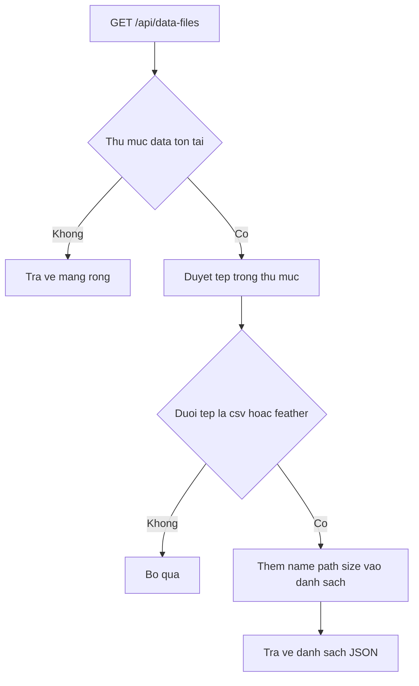

**Call-Stack Sequence Diagram**

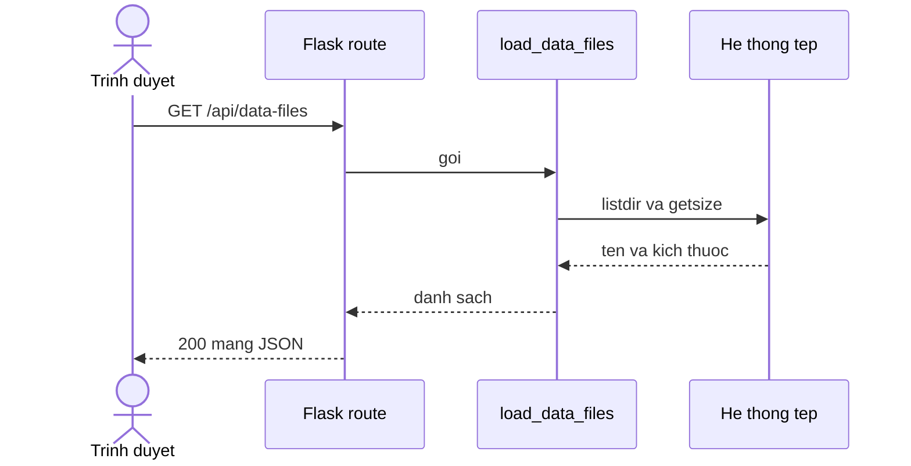

**Exception và Error Handling**

| Error Code | Thông điệp / Loại | Điều kiện kích hoạt | HTTP / Cơ chế rollback |
|---|---|---|---|
| EX-WEB-01 | 200 mảng rỗng | Thư mục `data/` vắng | Không có lỗi; `[PROPOSED]` hiển thị hướng dẫn |

- `[!]` Thư mục `data/` không có trong kho mã (`git ls-files`); chức năng trả về mảng rỗng cho đến khi thư mục được tạo.
- `[i]` Giao diện đọc `webui/templates/index.html` gọi `axios.get('/api/data-files')`.

---

##### FR-WEB-02 - Nạp và kiểm tra tệp dữ liệu

| Thuộc tính | Nội dung |
|---|---|
| Identifier | FR-WEB-02 (User Story US-WEB-02) |
| Code Traceability | `webui/app.py:load_data` (dòng 341-402), `load_data_file` (dòng 78-123) |
| Test Traceability | Không có kiểm thử tự động |
| Data Entities | DATA_FILE, CANDLE (logic, xem Mục 7) |

**Yêu cầu**

- Hệ thống phải từ chối `file_path` rỗng bằng mã 400.
- Hệ thống phải từ chối định dạng ngoài `.csv`, `.feather` và tệp thiếu cột `open`, `high`, `low`, `close` bằng mã 400.
- Hệ thống phải chuẩn hóa cột thời gian từ `timestamps`, `timestamp` hoặc `date`, và sinh chuỗi từ 2024-01-01 bước 1 giờ khi vắng.
- Hệ thống phải loại hàng chứa NaN sau khi ép kiểu số.

**UI / Interaction Mockup (Pattern A)**

```text
┌────────────────────────────────────────────────────────────────────────┐
│  FR: FR-WEB-02 - LOAD DATA FILE                            [Cancel] [X]│
├────────────────────────────────────────────────────────────────────────┤
│  MODULE: WEB | STEP: Load data                                         │
│  Progress: [○] Model ─── [●] Data ─── [○] Predict ─── [○] Results      │
├────────────────────────────────────────────────────────────────────────┤
│  * Select Data File                                                    │
│  ┌──────────────────────────────────────────────┐                      │
│  │ XSHG_5min_600977.csv                       ▼ │                      │
│  └──────────────────────────────────────────────┘                      │
│  Data Information: Rows 8000 | Columns 7 | Frequency 5 minutes         │
│  Time Range: 2024-06-18 to 2024-09-30 | Prediction Columns: OHLCV      │
│  [!] Required columns: open, high, low, close.                         │
├────────────────────────────────────────────────────────────────────────┤
│  [ < Previous ]                                       [ Load Data > ]  │
└────────────────────────────────────────────────────────────────────────┘
```

**Preconditions và Postconditions**

| Loại | Nội dung |
|---|---|
| Precondition | Tệp đọc được trên máy chủ. |
| Postcondition | `data_info` trả về gồm rows, columns, start_date, end_date, price_range, prediction_columns, timeframe. |

**Inputs và Validation Rules**

| Trường | Kiểu | Bắt buộc | Ràng buộc |
|---|---|---|---|
| file_path | string | Có | Không rỗng; đuôi `.csv` hoặc `.feather`; không bị ràng buộc thư mục `[!]` |

**Logic Decision Flowchart**

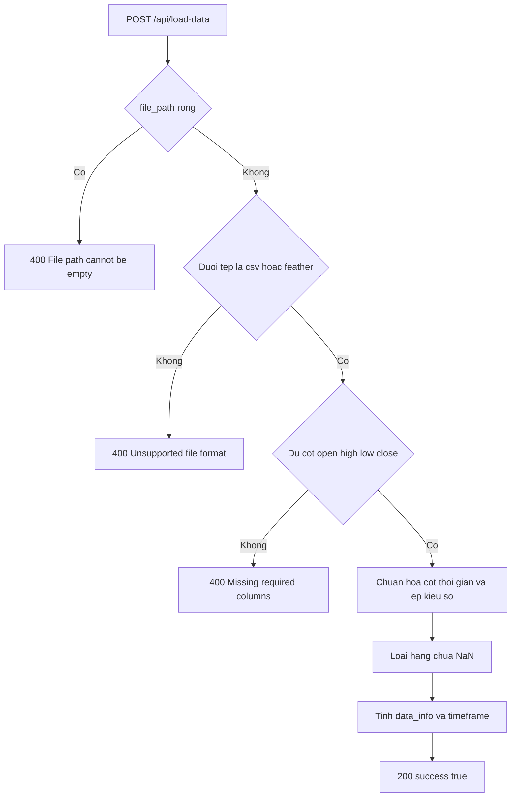

**Call-Stack Sequence Diagram**

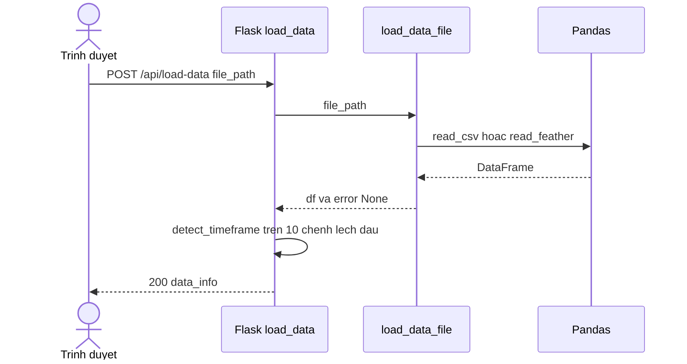

**Exception và Error Handling**

| Error Code | Thông điệp / Loại | Điều kiện kích hoạt | HTTP / Cơ chế rollback |
|---|---|---|---|
| EX-WEB-02a | 400 File path cannot be empty | `file_path` rỗng | Từ chối |
| EX-WEB-02b | 400 Unsupported file format / Missing required columns | Sai định dạng hoặc thiếu cột | Từ chối |
| EX-WEB-02c | 500 Failed to load data | Ngoại lệ đọc tệp | Không thay đổi trạng thái |

- `[!]` `file_path` được chấp nhận từ máy khách không bị ràng buộc vào thư mục dữ liệu; mọi tệp `.csv`/`.feather` đọc được trên máy chủ đều có thể nạp. `[PROPOSED]` giới hạn đường dẫn trong thư mục `data/`.
- `[i]` `prediction_columns` gồm `volume` chỉ khi cột này tồn tại; cột `amount` được ép kiểu nhưng không đưa vào đầu vào dự báo của Web UI.

---

##### FR-WEB-03 - Nạp mô hình Kronos qua giao diện

| Thuộc tính | Nội dung |
|---|---|
| Identifier | FR-WEB-03 (User Story US-WEB-03) |
| Code Traceability | `webui/app.py:load_model` (dòng 626-663), `get_available_models`, `get_model_status`, hằng số `AVAILABLE_MODELS` |
| Test Traceability | Không có kiểm thử tự động |
| Data Entities | MODEL_CONFIG, HUB_REPO (logic, xem Mục 7) |

**Yêu cầu**

- Hệ thống phải từ chối `model_key` ngoài `kronos-mini`, `kronos-small`, `kronos-base` bằng mã 400.
- Hệ thống phải từ chối khi thư viện mô hình không import được (mã 400).
- Hệ thống phải tạo `KronosPredictor` với `max_context` bằng `context_length` của mô hình.
- Mô hình đã nạp phải thay thế mô hình trước đó trong biến toàn cục.

**UI / Interaction Mockup (Pattern A)**

```text
┌────────────────────────────────────────────────────────────────────────┐
│  FR: FR-WEB-03 - LOAD MODEL                                [Cancel] [X]│
├────────────────────────────────────────────────────────────────────────┤
│  MODULE: WEB | STEP: Load model                                        │
│  Progress: [●] Model ─── [○] Data ─── [○] Predict ─── [○] Results      │
├────────────────────────────────────────────────────────────────────────┤
│  * Select Model                     * Select Device                    │
│  ┌──────────────────────────────┐   ┌──────────────────────────────┐   │
│  │ Kronos-small (24.7M)       ▼ │   │ CPU                        ▼ │   │
│  └──────────────────────────────┘   └──────────────────────────────┘   │
│  Options: kronos-mini | kronos-small | kronos-base                     │
│  Devices: CPU | CUDA (NVIDIA GPU) | MPS (Apple Silicon)                │
│  [!] Status: model library must be importable (MODEL_AVAILABLE).       │
├────────────────────────────────────────────────────────────────────────┤
│  [ < Previous ]                                       [ Load Model > ] │
└────────────────────────────────────────────────────────────────────────┘
```

**Preconditions và Postconditions**

| Loại | Nội dung |
|---|---|
| Precondition | Hub truy cập được hoặc có bộ nhớ đệm. |
| Postcondition | Biến toàn cục `predictor` khác None. |

**Inputs và Validation Rules**

| Trường | Kiểu | Bắt buộc | Ràng buộc |
|---|---|---|---|
| model_key | string | Không | Mặc định `kronos-small`; thuộc `AVAILABLE_MODELS` |
| device | string | Không | Mặc định `cpu` |

**Logic Decision Flowchart**

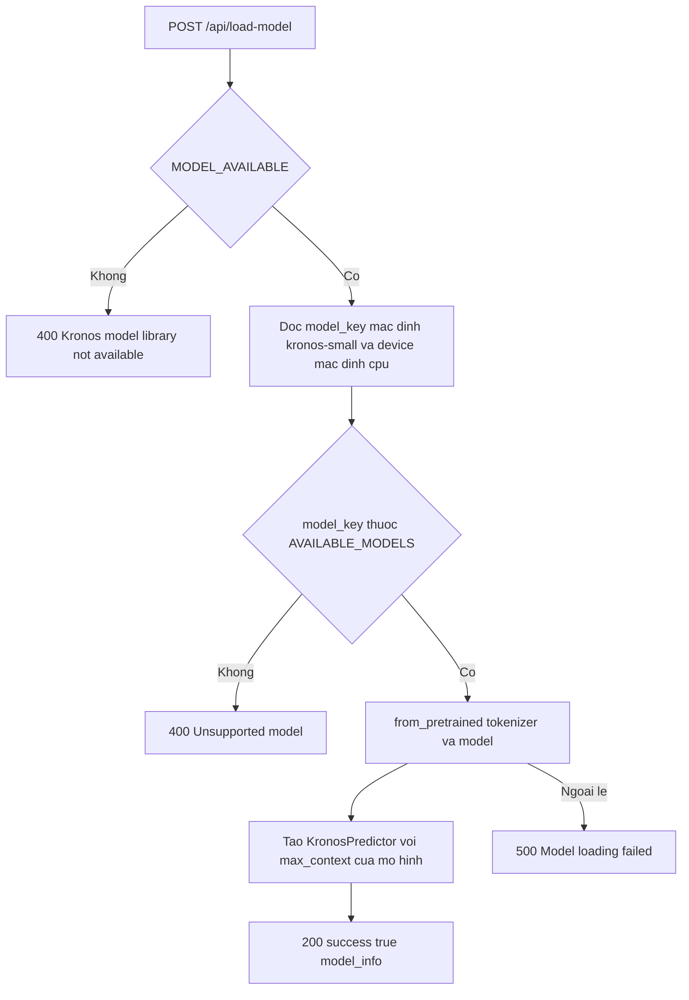

**Call-Stack Sequence Diagram**

```mermaid
sequenceDiagram
    actor U as Trinh duyet
    participant R as Flask load_model
    participant H as Hugging Face Hub
    participant P as KronosPredictor
    U->>R: POST /api/load-model model_key device
    R->>H: KronosTokenizer.from_pretrained va Kronos.from_pretrained
    H-->>R: tokenizer va model
    R->>P: khoi tao voi device va context_length
    R-->>U: 200 model_info
```

**Exception và Error Handling**

| Error Code | Thông điệp / Loại | Điều kiện kích hoạt | HTTP / Cơ chế rollback |
|---|---|---|---|
| EX-WEB-03a | 400 Unsupported model: <key> | `model_key` không hợp lệ | Từ chối |
| EX-WEB-03b | 400 Kronos model library not available | `MODEL_AVAILABLE=False` | Từ chối |
| EX-WEB-03c | 500 Model loading failed | Ngoại lệ tải | Biến toàn cục giữ giá trị cũ nếu lỗi xảy ra trước phép gán `predictor` |

- `[i]` Trạng thái mô hình là biến toàn cục theo tiến trình; không an toàn khi có nhiều worker hoặc yêu cầu đồng thời `[OPEN]`.

---

##### FR-WEB-04 - Thực thi dự báo và hiển thị biểu đồ

| Thuộc tính | Nội dung |
|---|---|
| Identifier | FR-WEB-04 (User Story US-WEB-04) |
| Code Traceability | `webui/app.py:predict` (dòng 404-624), `create_prediction_chart` (dòng 209-327) |
| Test Traceability | Không có kiểm thử tự động |
| Data Entities | DATA_FILE, PREDICTION_RUN, PREDICTION_POINT, ACTUAL_POINT (logic, xem Mục 7) |

**Yêu cầu**

- Hệ thống phải từ chối dự báo khi `predictor` là None (mã 400).
- Hệ thống phải từ chối khi số hàng nhỏ hơn `lookback` hoặc nhỏ hơn `lookback + pred_len` kể từ `start_date` (mã 400).
- Hệ thống phải trả về biểu đồ, kết quả dự báo, dữ liệu thực tế và cờ `has_comparison`.
- Hệ thống phải trả về mã 500 khi suy luận phát ngoại lệ.

**UI / Interaction Mockup (Pattern B)**

```text
┌────────────────────────────────────────────────────────────────────────┐
│  FR: FR-WEB-04 - PREDICT AND CHART                [Status: Model ●]    │
│  Scope Filter: [ Custom window ▼ ]              Lookback 400 | Pred 120│
├────────────────────────────────────────────────────────────────────────┤
│  PARAMETERS                                                            │
│  ┌───────────────────┐  ┌───────────────────┐  ┌───────────────────┐   │
│  │ [T 0.1-2.0]       │  │ [top_p 0.1-1.0]   │  │ [sample_count]    │   │
│  │ 1.0               │  │ 0.9               │  │ 1 (range 1-5)     │   │
│  └───────────────────┘  └───────────────────┘  └───────────────────┘   │
├────────────────────────────────────────────────────────────────────────┤
│  PREDICTION CHART (Plotly)                                             │
│  Price  ┤        ····· predicted close                                 │
│         ┤  ─────── actual close                                        │
│         ┼──────────────────────────────────────────────────────────    │
│         [history 400]                     [forecast 120]               │
│  Metrics: MAE | RMSE | MAPE (when actual data exists)                  │
├────────────────────────────────────────────────────────────────────────┤
│  [ Predict > ]  disabled until the model is loaded                     │
└────────────────────────────────────────────────────────────────────────┘
```

**Preconditions và Postconditions**

| Loại | Nội dung |
|---|---|
| Precondition | Mô hình đã nạp; tệp dữ liệu hợp lệ. |
| Postcondition | Phản hồi 200 chứa biểu đồ Plotly JSON; tệp JSON kết quả được ghi (FR-WEB-05). |

**Inputs và Validation Rules**

| Trường | Kiểu | Bắt buộc | Ràng buộc |
|---|---|---|---|
| file_path | string | Có | Không rỗng |
| lookback | int | Không | Mặc định 400 |
| pred_len | int | Không | Mặc định 120 |
| temperature | float | Không | Mặc định 1.0; giao diện 0.1-2.0 |
| top_p | float | Không | Mặc định 0.9; giao diện 0.1-1.0 |
| sample_count | int | Không | Mặc định 1; giao diện 1-5 |
| start_date | string | Không | Định dạng ISO; vắng thì dùng `lookback` hàng đầu của tệp |

**Logic Decision Flowchart**

```mermaid
flowchart TD
    A[POST /api/predict] --> B{file_path rong}
    B -->|Co| E1[400 File path cannot be empty]
    B -->|Khong| C[Nap du lieu]
    C -->|Loi| E2[400 loi tai du lieu]
    C -->|OK| D{So hang nho hon lookback}
    D -->|Co| E3[400 Insufficient data length]
    D -->|Khong| F{Mo hinh da duoc nap}
    F -->|Khong| E4[400 Kronos model not loaded]
    F -->|Co| G{Co start_date}
    G -->|Co| H{So hang tu start_date nho hon lookback cong pred_len}
    H -->|Co| E5[400 Insufficient data from start time]
    H -->|Khong| I[Dung cua so tu start_date]
    G -->|Khong| J[Dung lookback hang dau lam dau vao]
    I --> K[predictor.predict]
    J --> K
    K -->|Ngoai le| E6[500 Kronos model prediction failed]
    K --> L[Tao bieu do va doi chieu thuc te]
    L --> M[Luu ket qua JSON]
    M --> N[200 success true]
```

**Call-Stack Sequence Diagram**

```mermaid
sequenceDiagram
    actor U as Trinh duyet
    participant R as Flask predict
    participant L as load_data_file
    participant P as KronosPredictor
    participant C as create_prediction_chart
    participant S as save_prediction_results
    U->>R: POST /api/predict tham so
    R->>L: file_path
    L-->>R: df
    R->>P: predict x_df x_timestamp y_timestamp T top_p sample_count
    P-->>R: pred_df
    R->>C: df pred_df lookback pred_len
    C-->>R: chart JSON
    R->>S: luu ket qua
    R-->>U: 200 chart prediction_results actual_data
```

**Exception và Error Handling**

| Error Code | Thông điệp / Loại | Điều kiện kích hoạt | HTTP / Cơ chế rollback |
|---|---|---|---|
| EX-WEB-04a | 400 Kronos model not loaded, please load model first | Chưa nạp mô hình | Từ chối |
| EX-WEB-04b | 400 Insufficient data length / Insufficient data from start time | Thiếu hàng | Từ chối |
| EX-WEB-04c | 500 Kronos model prediction failed / Prediction failed | Ngoại lệ suy luận | Không ghi tệp kết quả |

- `[!]` Khi không có `start_date`, mã dùng `lookback` hàng đầu tiên của tệp (`df.iloc[:lookback]`) trong khi nhãn kiểu dự báo ghi "latest data".
- `[OPEN]` Khi không có `start_date` và số hàng nhỏ hơn `lookback + pred_len`, độ dài `y_timestamp` nhỏ hơn `pred_len`; hành vi chưa được kiểm thử.
- `[i]` Giá trị mặc định: lookback=400, pred_len=120, temperature=1.0, top_p=0.9, sample_count=1; giao diện giới hạn temperature 0.1-2.0, top_p 0.1-1.0, sample_count 1-5.

---

##### FR-WEB-05 - Lưu kết quả dự báo và phân tích liên tục

| Thuộc tính | Nội dung |
|---|---|
| Identifier | FR-WEB-05 (User Story US-WEB-05) |
| Code Traceability | `webui/app.py:save_prediction_results` (dòng 125-207) |
| Test Traceability | Không có kiểm thử tự động; 28 tệp mẫu tại `webui/prediction_results/prediction_20250826_*.json` |
| Data Entities | PREDICTION_RUN, INPUT_SUMMARY, CONTINUITY_ANALYSIS (logic, xem Mục 7) |

**Yêu cầu**

- Hệ thống phải ghi mỗi lượt dự báo thành tệp `prediction_<YYYYMMDD_HHMMSS>.json` trong `webui/prediction_results/`.
- Hệ thống phải tính `analysis.continuity` chỉ khi tồn tại `actual_data`.
- Hệ thống không được làm hỏng phản hồi dự báo khi ghi tệp thất bại.

**UI / Interaction Mockup (Pattern C)**

```text
┌────────────────────────────────────────────────────────────────────────┐
│  FR: FR-WEB-05 - PREDICTION RESULT ARCHIVE                             │
├────────────────────────────────────────────────────────────────────────┤
│  Folder: webui/prediction_results/                                     │
│  Pattern: prediction_YYYYMMDD_HHMMSS.json                              │
├────────────────────────────────────────────────────────────────────────┤
│  ┌──────────────────────┬──────────┬────────┬────────┬───────────┐     │
│  │ File (suffix)        │ Lookback │ PredLn │ Actual │ Close gap │     │
│  ├──────────────────────┼──────────┼────────┼────────┼───────────┤     │
│  │ 20250826_163800      │ 400      │ 120    │ yes    │ 0.35 pct  │     │
│  │ 20250826_164030      │ 400      │ 120    │ yes    │ see file  │     │
│  └──────────────────────┴──────────┴────────┴────────┴───────────┘     │
├────────────────────────────────────────────────────────────────────────┤
│  [i] Save failure is logged to stdout and does not fail the API        │
│      response.                                                         │
└────────────────────────────────────────────────────────────────────────┘
```

**Preconditions và Postconditions**

| Loại | Nội dung |
|---|---|
| Precondition | Dự báo thành công. |
| Postcondition | Tệp JSON tồn tại hoặc thông báo lỗi được in ra stdout. |

**Inputs và Validation Rules**

| Trường | Kiểu | Bắt buộc | Ràng buộc |
|---|---|---|---|
| prediction_params | object | Có | lookback, pred_len, temperature, top_p, sample_count, start_date |
| input_data | DataFrame | Có | Tóm tắt rows, columns, price_range, last_values |

**Logic Decision Flowchart**

```mermaid
flowchart TD
    A[Nhan ket qua du bao] --> B[Tao thu muc prediction_results neu chua co]
    B --> C[Dat ten prediction_timestamp.json]
    C --> D[Tom tat dau vao rows columns price_range last_values]
    D --> E{Co actual_data}
    E -->|Co| F[Tinh gaps va gap_percentages giua diem du bao dau va diem thuc dau]
    E -->|Khong| G[analysis rong]
    F --> H[Ghi JSON UTF-8]
    G --> H
    H -->|Ngoai le| I[In loi va tra ve None]
```

**Call-Stack Sequence Diagram**

```mermaid
sequenceDiagram
    participant R as Flask predict
    participant S as save_prediction_results
    participant D as He thong tep
    R->>S: file_path loai tham so du bao dau vao
    S->>D: makedirs prediction_results
    S->>D: ghi prediction_timestamp.json
    D-->>S: ket qua
    S-->>R: duong dan hoac None
```

**Exception và Error Handling**

| Error Code | Thông điệp / Loại | Điều kiện kích hoạt | HTTP / Cơ chế rollback |
|---|---|---|---|
| EX-WEB-05 | In `Failed to save prediction results` | Thư mục không ghi được | Phản hồi dự báo vẫn trả về 200; không rollback |

- `[i]` `analysis.continuity.last_prediction` thực chất là phần tử dự báo đầu tiên (`prediction_results[0]`) so với phần tử thực tế đầu tiên.
- `[OPEN]` Tên tệp theo giây; hai lượt lưu trong cùng một giây ghi đè nhau.

---


#### Module FTQ - Tinh chỉnh và backtest Qlib

##### FR-FTQ-01 - Tiền xử lý dữ liệu Qlib thành tập pickle

| Thuộc tính | Nội dung |
|---|---|
| Identifier | FR-FTQ-01 (User Story US-FTQ-01) |
| Code Traceability | `finetune/qlib_data_preprocess.py:QlibDataPreprocessor` (`initialize_qlib`, `load_qlib_data`, `prepare_dataset`), `finetune/config.py:Config` |
| Test Traceability | Không có kiểm thử tự động |
| Data Entities | PROCESSED_DATASET, SYMBOL_SERIES (logic, xem Mục 7) |

**Yêu cầu**

- Hệ thống phải chia dữ liệu theo `train_time_range`, `val_time_range`, `test_time_range`.
- Hệ thống phải ghi `train_data.pkl`, `val_data.pkl`, `test_data.pkl` vào `dataset_path`.

**UI / Interaction Mockup (Pattern A)**

```text
┌────────────────────────────────────────────────────────────────────────┐
│  FR: FR-FTQ-01 - PREPROCESS QLIB DATA                      [Cancel] [X]│
├────────────────────────────────────────────────────────────────────────┤
│  MODULE: FTQ | STEP: Prepare dataset                                   │
│  Progress: [●] Init Qlib ─── [●] Load ─── [○] Split ─── [○] Save       │
├────────────────────────────────────────────────────────────────────────┤
│  * Qlib data path                  * Instrument                        │
│  ┌──────────────────────────────┐   ┌──────────────────────────────┐   │
│  │ ~/.qlib/qlib_data/cn_data    │   │ csi300                       │   │
│  └──────────────────────────────┘   └──────────────────────────────┘   │
│  Train 2011-01-01..2022-12-31 | Val 2022-09-01..2024-06-30             │
│  Test 2024-04-01..2025-06-05                                           │
│  [!] Fields: open, close, high, low, volume, vwap. Output: pickle      │
│      files.                                                            │
├────────────────────────────────────────────────────────────────────────┤
│  [ < Previous ]                                          [ Run > ]     │
└────────────────────────────────────────────────────────────────────────┘
```

**Preconditions và Postconditions**

| Loại | Nội dung |
|---|---|
| Precondition | Dữ liệu Qlib tại `qlib_data_path`. |
| Postcondition | Ba tệp pickle ánh xạ mã chứng khoán tới DataFrame. |

**Inputs và Validation Rules**

| Trường | Kiểu | Bắt buộc | Ràng buộc |
|---|---|---|---|
| qlib_data_path | string | Có | Thư mục Qlib hợp lệ |
| instrument | string | Có | Ví dụ `csi300` |
| dataset_begin_time, dataset_end_time | date | Có | Trong lịch Qlib |

**Logic Decision Flowchart**

```mermaid
flowchart TD
    A[Khoi tao Qlib voi provider_uri REG_CN] --> B[Doc lich giao dich D.calendar]
    B --> C[Mo rong cua so them lookback va predict_window]
    C --> D[QlibDataLoader nap truong open close high low volume vwap]
    D --> E[Pivot theo ma chung khoan]
    E --> F[Chia theo train_time_range val_time_range test_time_range]
    F --> G[Ghi train_data.pkl val_data.pkl test_data.pkl]
```

**Call-Stack Sequence Diagram**

```mermaid
sequenceDiagram
    actor U as Ky su ML
    participant P as QlibDataPreprocessor
    participant Q as Qlib
    participant D as He thong tep
    U->>P: initialize_qlib
    P->>Q: qlib.init provider_uri
    U->>P: load_qlib_data
    P->>Q: QlibDataLoader load instrument
    Q-->>P: DataFrame
    U->>P: prepare_dataset
    P->>D: pickle.dump train val test
```

**Exception và Error Handling**

| Error Code | Thông điệp / Loại | Điều kiện kích hoạt | HTTP / Cơ chế rollback |
|---|---|---|---|
| EX-FTQ-01 | Lỗi Qlib / hệ thống tệp | Thư mục Qlib hoặc đích không hợp lệ | Không có tệp đầu ra hoàn chỉnh `[UNKNOWN]` |

- `[OPEN]` Đường dẫn Qlib và `dataset_path` là giá trị mặc định cần chỉnh (ghi chú `TODO` trong `finetune/config.py`).
- `[UNKNOWN]` Hành vi khi thư mục Qlib vắng mặt phụ thuộc thư viện Qlib, không được xử lý trong mã.

---

##### FR-FTQ-02 - Tinh chỉnh tokenizer bằng DDP

| Thuộc tính | Nội dung |
|---|---|
| Identifier | FR-FTQ-02 (User Story US-FTQ-02) |
| Code Traceability | `finetune/train_tokenizer.py:train_model`, `main`, `create_dataloaders`; `finetune/dataset.py:QlibDataset`; `finetune/utils/training_utils.py:setup_ddp` |
| Test Traceability | Không có kiểm thử tự động |
| Data Entities | TRAINING_CONFIG, TRAINING_RUN, CHECKPOINT (logic, xem Mục 7) |

**Yêu cầu**

- Hệ thống phải từ chối chạy khi thiếu biến môi trường `WORLD_SIZE` (không dùng `torchrun`).
- Hệ thống phải tối ưu bằng AdamW và OneCycleLR, cắt gradient `max_norm=2.0`.
- Hệ thống phải lưu `best_model` khi `val_loss` nhỏ hơn giá trị tốt nhất trước đó.
- Hàm mất mát phải bằng `(recon_loss + bsq_loss) / 2`.

**UI / Interaction Mockup (Pattern B)**

```text
┌────────────────────────────────────────────────────────────────────────┐
│  FR: FR-FTQ-02 - TRAIN TOKENIZER (DDP)           [Status: Training ●]  │
│  Launcher: torchrun --standalone --nproc_per_node=NUM_GPUS             │
├────────────────────────────────────────────────────────────────────────┤
│  TRAINING KPI CARDS                                                    │
│  ┌───────────────────┐  ┌───────────────────┐  ┌───────────────────┐   │
│  │ [TRAIN LOSS]      │  │ [VAL LOSS]        │  │ [BEST CHECKPOINT] │   │
│  │ (recon+bsq)/2     │  │ lower is better   │  │ best_model        │   │
│  │ OneCycleLR        │  │ all_reduce SUM    │  │ save_pretrained   │   │
│  └───────────────────┘  └───────────────────┘  └───────────────────┘   │
├────────────────────────────────────────────────────────────────────────┤
│  Epoch loop: 30 | batch 50 per GPU | lr 2e-4 | grad clip max_norm 2.0  │
│  [!] Script raises RuntimeError when WORLD_SIZE is absent from the env.│
└────────────────────────────────────────────────────────────────────────┘
```

**Preconditions và Postconditions**

| Loại | Nội dung |
|---|---|
| Precondition | `train_data.pkl`, `val_data.pkl` tồn tại; GPU và NCCL khả dụng. |
| Postcondition | Thư mục `best_model` của tokenizer. |

**Inputs và Validation Rules**

| Trường | Kiểu | Bắt buộc | Ràng buộc |
|---|---|---|---|
| epochs | int | Có | Mặc định 30 |
| batch_size | int | Có | Mặc định 50 mỗi GPU |
| tokenizer_learning_rate | float | Có | Mặc định 2e-4 |
| use_comet | bool | Có | Mặc định True; cần khóa hợp lệ hoặc tắt |

**Logic Decision Flowchart**

```mermaid
flowchart TD
    A[Khoi dong qua torchrun] --> B{WORLD_SIZE co trong moi truong}
    B -->|Khong| E1[RuntimeError phai chay bang torchrun]
    B -->|Co| C[setup_ddp nccl rank world_size local_rank]
    C --> D[Nap tokenizer pretrained]
    D --> F[Tao DataLoader tren QlibDataset train va val]
    F --> G[Moi epoch: huan luyen voi OneCycleLR]
    G --> H[loss = recon pre cong recon all cong bsq chia 2]
    H --> I[Cat gradient max_norm 2.0]
    I --> J[Kiem dinh va gop val_loss bang all_reduce]
    J --> K{val_loss nho hon best_val_loss}
    K -->|Co| L[save_pretrained best_model]
    K -->|Khong| G
```

**Call-Stack Sequence Diagram**

```mermaid
sequenceDiagram
    actor U as Ky su ML
    participant M as train_tokenizer main
    participant T as KronosTokenizer
    participant D as QlibDataset DataLoader
    participant C as Comet va Checkpoint
    U->>M: torchrun train_tokenizer.py
    M->>T: from_pretrained pretrained_tokenizer_path
    loop moi epoch
        M->>D: lay batch
        D-->>M: x va x_stamp
        M->>T: forward
        T-->>M: z_pre z bsq_loss
        M->>C: log_metric neu use_comet
    end
    M->>C: save_pretrained khi val_loss giam
```

**Exception và Error Handling**

| Error Code | Thông điệp / Loại | Điều kiện kích hoạt | HTTP / Cơ chế rollback |
|---|---|---|---|
| EX-FTQ-02 | `RuntimeError` This script must be launched with `torchrun`. | Thiếu `WORLD_SIZE` | Dừng trước huấn luyện |

- `[OPEN]` `use_comet=True` là mặc định và `api_key="YOUR_COMET_API_KEY"` là giá trị giữ chỗ; huấn luyện cần đặt `use_comet=False` hoặc cấu hình khóa hợp lệ.
- `[i]` Hàm mất mát: `(recon_loss + bsq_loss) / 2` với `recon_loss = MSE(z_pre, x) + MSE(z, x)`.

---

##### FR-FTQ-03 - Tinh chỉnh mô hình dự báo bằng DDP

| Thuộc tính | Nội dung |
|---|---|
| Identifier | FR-FTQ-03 (User Story US-FTQ-03) |
| Code Traceability | `finetune/train_predictor.py:train_model`, `main`; `model/module.py:DualHead.compute_loss` |
| Test Traceability | Không có kiểm thử tự động |
| Data Entities | TRAINING_RUN, CHECKPOINT (logic, xem Mục 7) |

**Yêu cầu**

- Hệ thống phải nạp tokenizer đã tinh chỉnh và mô hình tiền huấn luyện.
- Hệ thống phải tính mất mát s1, s2 bằng `DualHead.compute_loss`, cắt gradient `max_norm=3.0`.
- Hệ thống phải lưu `best_model` theo `val_loss` gộp qua các rank.

**UI / Interaction Mockup (Pattern B)**

```text
┌────────────────────────────────────────────────────────────────────────┐
│  FR: FR-FTQ-03 - TRAIN PREDICTOR (DDP)           [Status: Training ●]  │
│  Launcher: torchrun --standalone --nproc_per_node=NUM_GPUS             │
├────────────────────────────────────────────────────────────────────────┤
│  TRAINING KPI CARDS                                                    │
│  ┌───────────────────┐  ┌───────────────────┐  ┌───────────────────┐   │
│  │ [TRAIN LOSS]      │  │ [S1 / S2 LOSS]    │  │ [VAL LOSS]        │   │
│  │ DualHead loss     │  │ logged per batch  │  │ best saved        │   │
│  │ lr 4e-5           │  │                   │  │ best_model        │   │
│  └───────────────────┘  └───────────────────┘  └───────────────────┘   │
├────────────────────────────────────────────────────────────────────────┤
│  Epoch loop: 30 | batch 50 per GPU | grad clip max_norm 3.0 |          │
│      OneCycleLR                                                        │
└────────────────────────────────────────────────────────────────────────┘
```

**Preconditions và Postconditions**

| Loại | Nội dung |
|---|---|
| Precondition | Checkpoint tokenizer tại `finetuned_tokenizer_path`. |
| Postcondition | Thư mục `best_model` của mô hình dự báo. |

**Inputs và Validation Rules**

| Trường | Kiểu | Bắt buộc | Ràng buộc |
|---|---|---|---|
| predictor_learning_rate | float | Có | Mặc định 4e-5 |
| pretrained_predictor_path | string | Có | Đường dẫn cục bộ hoặc mã Hub; giá trị mặc định là giữ chỗ |

**Logic Decision Flowchart**

```mermaid
flowchart TD
    A[Khoi dong qua torchrun] --> B{WORLD_SIZE co trong moi truong}
    B -->|Khong| E1[RuntimeError phai chay bang torchrun]
    B -->|Co| C[Nap tokenizer da tinh chinh va model pretrained]
    C --> D[Moi batch: tokenizer.encode thanh token_in va token_out]
    D --> E[model forward]
    E --> F[head.compute_loss s1 s2]
    F --> G[backward va cat gradient 3.0]
    G --> H[Kiem dinh va all_reduce val_loss]
    H --> I{val_loss nho hon best_val_loss}
    I -->|Co| J[save_pretrained best_model]
    I -->|Khong| D
```

**Call-Stack Sequence Diagram**

```mermaid
sequenceDiagram
    actor U as Ky su ML
    participant M as train_predictor main
    participant T as KronosTokenizer
    participant K as Kronos
    participant C as Checkpoint
    U->>M: torchrun train_predictor.py
    M->>T: from_pretrained finetuned_tokenizer_path
    M->>K: from_pretrained pretrained_predictor_path
    loop moi batch
        M->>T: encode half true
        M->>K: forward token_in
        K-->>M: logits s1 s2
        M->>K: head.compute_loss
    end
    M->>C: save_pretrained khi val_loss giam
```

**Exception và Error Handling**

| Error Code | Thông điệp / Loại | Điều kiện kích hoạt | HTTP / Cơ chế rollback |
|---|---|---|---|
| EX-FTQ-03 | `RuntimeError` torchrun | Thiếu `WORLD_SIZE` | Dừng trước huấn luyện |

- `[OPEN]` Thứ tự bắt buộc: US-FTQ-02 hoàn thành trước US-FTQ-03; mã không kiểm tra sự tồn tại của tokenizer đã tinh chỉnh trước khi nạp.

---

##### FR-FTQ-04 - Backtest tín hiệu dự báo trên Qlib

| Thuộc tính | Nội dung |
|---|---|
| Identifier | FR-FTQ-04 (User Story US-FTQ-04) |
| Code Traceability | `finetune/qlib_test.py:generate_predictions`, `QlibBacktest.run_single_backtest`, `run_and_plot_results`, `load_models` |
| Test Traceability | Không có kiểm thử tự động |
| Data Entities | BACKTEST_RUN, PORTFOLIO_POINT (logic, xem Mục 7) |

**Yêu cầu**

- Hệ thống phải sinh tín hiệu dự báo trên tập kiểm thử và chạy backtest top-k với `topk=50`, `n_drop=5`.
- Hệ thống phải in phân tích lợi suất chuẩn, vượt chuẩn có phí và không phí.

**UI / Interaction Mockup (Pattern B)**

```text
┌────────────────────────────────────────────────────────────────────────┐
│  FR: FR-FTQ-04 - QLIB BACKTEST                    [Status: Report ●]   │
│  Benchmark: SH000300 (csi300)         Period: 2024-07-01..2025-06-05   │
├────────────────────────────────────────────────────────────────────────┤
│  PORTFOLIO RULES                                                       │
│  ┌───────────────────┐  ┌───────────────────┐  ┌───────────────────┐   │
│  │ [HOLD TOPK]       │  │ [N_DROP]          │  │ [HOLD THRESH]     │   │
│  │ 50                │  │ 5                 │  │ 5                 │   │
│  └───────────────────┘  └───────────────────┘  └───────────────────┘   │
├────────────────────────────────────────────────────────────────────────┤
│  Cumulative: bench | return with cost | excess return with cost        │
│  Output: risk_analysis for benchmark, excess without cost, excess      │
│      with cost                                                         │
└────────────────────────────────────────────────────────────────────────┘
```

**Preconditions và Postconditions**

| Loại | Nội dung |
|---|---|
| Precondition | `test_data.pkl`, tokenizer và mô hình đã tinh chỉnh. |
| Postcondition | Bảng `risk_analysis` và biểu đồ lợi suất lũy kế. |

**Inputs và Validation Rules**

| Trường | Kiểu | Bắt buộc | Ràng buộc |
|---|---|---|---|
| --device | string | Không | Mặc định `cuda:1` |
| instrument | string | Có | Thuộc `csi300`, `csi800`, `csi1000` |

**Logic Decision Flowchart**

```mermaid
flowchart TD
    A[Nap test_data.pkl va model da tinh chinh] --> B[Sinh du bao theo lo qua DataLoader]
    B --> C[Tao tin hieu theo loai vi du mean va last]
    C --> D[Voi moi tin hieu: stack va sap xep theo instrument datetime]
    D --> E[TopkDropoutStrategy topk 50 n_drop 5]
    E --> F[backtest voi SimulatorExecutor]
    F --> G[Tinh risk_analysis excess co phi va khong phi]
    G --> H[Ve duong loi suat tich luy]
```

**Call-Stack Sequence Diagram**

```mermaid
sequenceDiagram
    actor U as Nguoi danh gia
    participant M as qlib_test main
    participant G as generate_predictions
    participant B as QlibBacktest
    participant Q as Qlib backtest
    U->>M: chay qlib_test
    M->>G: config va test_data
    G-->>M: signals
    M->>B: run_and_plot_results signals
    B->>Q: backtest strategy executor
    Q-->>B: report
    B-->>U: bang risk_analysis va bieu do
```

**Exception và Error Handling**

| Error Code | Thông điệp / Loại | Điều kiện kích hoạt | HTTP / Cơ chế rollback |
|---|---|---|---|
| EX-FTQ-04 | `ValueError` Benchmark not defined for instrument | Chỉ số ngoài danh sách | Dừng khi khởi tạo `Config` |

- `[i]` Cấu hình suy luận của backtest: `inference_T=0.6`, `inference_top_p=0.9`, `inference_sample_count=5`.

---


#### Module FTC - Tinh chỉnh từ CSV

##### FR-FTC-01 - Nạp cấu hình tinh chỉnh từ YAML

| Thuộc tính | Nội dung |
|---|---|
| Identifier | FR-FTC-01 (User Story US-FTC-01) |
| Code Traceability | `finetune_csv/config_loader.py:ConfigLoader`, `CustomFinetuneConfig`; mẫu `finetune_csv/configs/config_ali09988_candle-5min.yaml` |
| Test Traceability | Không có kiểm thử tự động |
| Data Entities | TRAINING_CONFIG (logic, xem Mục 7) |

**Yêu cầu**

- Hệ thống phải từ chối khi tệp YAML không tồn tại.
- Hệ thống phải áp dụng giá trị mặc định và sinh đường dẫn từ `base_path` và `exp_name` khi để trống.
- Hệ thống phải chấp nhận khóa `epochs` thay cho `tokenizer_epochs` khi khóa sau vắng.

**UI / Interaction Mockup (Pattern A)**

```text
┌────────────────────────────────────────────────────────────────────────┐
│  FR: FR-FTC-01 - LOAD YAML CONFIG                          [Cancel] [X]│
├────────────────────────────────────────────────────────────────────────┤
│  MODULE: FTC | STEP: Configure                                         │
│  Sections: data | training | model_paths | experiment | device         │
├────────────────────────────────────────────────────────────────────────┤
│  * data_path                       * exp_name                          │
│  ┌──────────────────────────────┐   ┌──────────────────────────────┐   │
│  │ finetune_csv/data/HK_ali_... │   │ HK_ali_09988_kline_5min_all  │   │
│  └──────────────────────────────┘   └──────────────────────────────┘   │
│  * train_ratio 0.9    * val_ratio 0.1    * test_ratio 0.0              │
│  [!] Paths in the template are placeholders (/xxxx/, /xxx/).           │
├────────────────────────────────────────────────────────────────────────┤
│  [ < Previous ]                [ Save Draft ]            [ Load > ]    │
└────────────────────────────────────────────────────────────────────────┘
```

**Preconditions và Postconditions**

| Loại | Nội dung |
|---|---|
| Precondition | Tệp YAML theo mẫu. |
| Postcondition | Đối tượng `CustomFinetuneConfig` với đường dẫn đã chuẩn hóa. |

**Inputs và Validation Rules**

| Trường | Kiểu | Bắt buộc | Ràng buộc |
|---|---|---|---|
| --config | string | Có | Đường dẫn YAML; mặc định `config.yaml` |
| data.data_path | string | Có | CSV tồn tại |
| model_paths.* | string | Có | Giá trị mẫu `/xxxx/` là giữ chỗ |

**Logic Decision Flowchart**

```mermaid
flowchart TD
    A[Nhan duong dan YAML] --> B{Tep ton tai}
    B -->|Khong| E1[FileNotFoundError config file not found]
    B -->|Co| C[Doc cac phan data training model_paths experiment device]
    C --> D[Ap dung gia tri mac dinh]
    D --> E{base_save_path va finetuned_tokenizer rong}
    E -->|Co| F[Sinh duong dan tu base_path va exp_name]
    E -->|Khong| G[Thay the exp_name trong mau chuoi]
    F --> H[Tra ve CustomFinetuneConfig]
    G --> H
```

**Call-Stack Sequence Diagram**

```mermaid
sequenceDiagram
    actor U as Ky su ML
    participant C as CustomFinetuneConfig
    participant L as ConfigLoader
    participant Y as Tep YAML
    U->>C: CustomFinetuneConfig config_path
    C->>L: ConfigLoader config_path
    L->>Y: doc YAML
    Y-->>L: noi dung
    L-->>C: cac phan cau hinh
    C-->>U: thuoc tinh da chuan hoa
```

**Exception và Error Handling**

| Error Code | Thông điệp / Loại | Điều kiện kích hoạt | HTTP / Cơ chế rollback |
|---|---|---|---|
| EX-FTC-01 | `FileNotFoundError` config file not found | Tệp YAML vắng | Dừng khi khởi tạo |


---

##### FR-FTC-02 - Huấn luyện tuần tự tokenizer rồi mô hình

| Thuộc tính | Nội dung |
|---|---|
| Identifier | FR-FTC-02 (User Story US-FTC-02) |
| Code Traceability | `finetune_csv/train_sequential.py:SequentialTrainer` (`train_tokenizer_phase`, `train_basemodel_phase`, `run_training`), `finetune_csv/finetune_tokenizer.py`, `finetune_csv/finetune_base_model.py` |
| Test Traceability | Không có kiểm thử tự động |
| Data Entities | TRAINING_RUN, CHECKPOINT (logic, xem Mục 7) |

**Yêu cầu**

- Hệ thống phải huấn luyện tokenizer trước mô hình cơ sở.
- Hệ thống phải bỏ qua pha khi `train_*=false`, khi dùng `--skip-*` hoặc khi `skip_existing` và đã có kết quả.
- Hệ thống phải dừng và trả về False khi một pha thất bại.

**UI / Interaction Mockup (Pattern A)**

```text
┌────────────────────────────────────────────────────────────────────────┐
│  FR: FR-FTC-02 - SEQUENTIAL TRAINING                       [Cancel] [X]│
├────────────────────────────────────────────────────────────────────────┤
│  MODULE: FTC | STEP: Run phases                                        │
│  Progress: [●] Tokenizer ─── [●] Base model ─── [○] Complete           │
├────────────────────────────────────────────────────────────────────────┤
│  * train_tokenizer  (•) true ( ) false  * train_basemodel (•) true (   │
│      ) false                                                           │
│  * skip_existing    ( ) true (•) false   * DIST_BACKEND  nccl (default)│
│  Output: {base_path}/{exp_name}/tokenizer/best_model                   │
│          {base_path}/{exp_name}/basemodel/best_model                   │
│  [!] A failed phase terminates the run and returns False.              │
├────────────────────────────────────────────────────────────────────────┤
│  [ < Previous ]                [ Save Draft ]             [ Train > ]  │
└────────────────────────────────────────────────────────────────────────┘
```

**Preconditions và Postconditions**

| Loại | Nội dung |
|---|---|
| Precondition | Cấu hình hợp lệ; dữ liệu CSV tồn tại. |
| Postcondition | Thư mục `tokenizer/best_model` và `basemodel/best_model`. |

**Inputs và Validation Rules**

| Trường | Kiểu | Bắt buộc | Ràng buộc |
|---|---|---|---|
| --skip-tokenizer | flag | Không | Bỏ qua pha tokenizer |
| --skip-basemodel | flag | Không | Bỏ qua pha mô hình |
| --skip-existing | flag | Không | Bỏ qua pha đã có |

**Logic Decision Flowchart**

```mermaid
flowchart TD
    A[run_training] --> B[Thiet lap phan tan va tao thu muc]
    B --> C{train_tokenizer}
    C -->|Khong| D[Bo qua pha tokenizer]
    C -->|Co| E{Da ton tai va skip_existing}
    E -->|Co| D
    E -->|Khong| F[train_tokenizer_phase]
    F -->|That bai| X[Dung va tra ve False]
    F --> G{train_basemodel}
    D --> G
    G -->|Khong| H[Bo qua pha base model]
    G -->|Co| I{Da ton tai va skip_existing}
    I -->|Co| H
    I -->|Khong| J[train_basemodel_phase]
    J -->|That bai| X
    J --> K[In tong thoi gian va duong dan best_model]
    H --> K
```

**Call-Stack Sequence Diagram**

```mermaid
sequenceDiagram
    actor U as Ky su ML
    participant S as SequentialTrainer
    participant T as finetune_tokenizer
    participant B as finetune_base_model
    U->>S: run_training
    S->>T: train_tokenizer
    T-->>S: best_val_loss
    S->>B: train_model voi tokenizer da tinh chinh
    B-->>S: ket qua
    S-->>U: True hoac False
```

**Exception và Error Handling**

| Error Code | Thông điệp / Loại | Điều kiện kích hoạt | HTTP / Cơ chế rollback |
|---|---|---|---|
| EX-FTC-02 | In `Tokenizer training failed, terminating training` / `Basemodel training failed` | Pha thất bại | Trả về False; kết quả pha trước được giữ |


---

##### FR-FTC-03 - Tạo mẫu huấn luyện từ tệp CSV

| Thuộc tính | Nội dung |
|---|---|
| Identifier | FR-FTC-03 (User Story US-FTC-03) |
| Code Traceability | `finetune_csv/finetune_base_model.py:CustomKlineDataset` (`_split_data_by_time`, `__getitem__`) |
| Test Traceability | Không có kiểm thử tự động; dữ liệu mẫu `finetune_csv/data/HK_ali_09988_kline_5min_all.csv` |
| Data Entities | CANDLE, PROCESSED_DATASET (logic, xem Mục 7) |

**Yêu cầu**

- Hệ thống phải chia chuỗi CSV theo thứ tự thời gian với `train_ratio`, `val_ratio`, `test_ratio`.
- Hệ thống phải từ chối truy xuất mẫu khi độ dài phân vùng không lớn hơn kích thước cửa sổ.
- Hệ thống phải chuẩn hóa z-score theo cửa sổ và cắt trong khoảng `[-clip, clip]`.

**UI / Interaction Mockup (Pattern C)**

```text
┌────────────────────────────────────────────────────────────────────────┐
│  FR: FR-FTC-03 - CSV DATASET SPLIT                                     │
├────────────────────────────────────────────────────────────────────────┤
│  Source: finetune_csv/data/HK_ali_09988_kline_5min_all.csv             │
│  Window = lookback_window + predict_window + 1                         │
├────────────────────────────────────────────────────────────────────────┤
│  ┌──────────┬────────────────────────┬──────────────┬────────────────  │
│      ──┐                                                               │
│  │ Split    │ Time points           │ Ratio        │ Sampling         ││
│  ├──────────┼────────────────────────┼──────────────┼────────────────  │
│      ──┤                                                               │
│  │ train    │ first N * train_ratio  │ 0.9         │ shuffled index   ││
│  │ val      │ next N * val_ratio     │ 0.1         │ idx modulo       ││
│  │ test     │ remaining             │ 0.0          │ idx modulo       ││
│  └──────────┴────────────────────────┴──────────────┴────────────────  │
│      ──┘                                                               │
├────────────────────────────────────────────────────────────────────────┤
│  [!] __getitem__ raises ValueError when data length is below window    │
│      size.                                                             │
└────────────────────────────────────────────────────────────────────────┘
```

**Preconditions và Postconditions**

| Loại | Nội dung |
|---|---|
| Precondition | CSV có cột giá và thời gian. |
| Postcondition | Cặp tensor `(x, x_stamp)`. |

**Inputs và Validation Rules**

| Trường | Kiểu | Bắt buộc | Ràng buộc |
|---|---|---|---|
| train_ratio, val_ratio, test_ratio | float | Có | Mặc định 0.9, 0.1, 0.0 |
| lookback_window, predict_window | int | Có | Mặc định 512 và 48 |

**Logic Decision Flowchart**

```mermaid
flowchart TD
    A[Doc CSV va chuan hoa cot] --> B[Cat theo thu tu thoi gian: train_end va val_end]
    B --> C{data_type}
    C -->|train| D[start_idx tu epoch va idx]
    C -->|val hoac test| E[start_idx bang idx chia du max_start cong 1]
    D --> F{max_start lon hon 0}
    E --> F
    F -->|Khong| E1[ValueError Data length insufficient to create samples]
    F -->|Co| G[Cat cua so dai window]
    G --> H[z-score theo cua so va clip]
    H --> I[Tra ve tensor x va x_stamp]
```

**Call-Stack Sequence Diagram**

```mermaid
sequenceDiagram
    participant L as DataLoader
    participant D as CustomKlineDataset
    participant P as pandas
    L->>D: set_epoch_seed epoch
    L->>D: __getitem__ idx
    D->>P: iloc cua so window
    P-->>D: window_data
    D-->>L: x_tensor va x_stamp_tensor
```

**Exception và Error Handling**

| Error Code | Thông điệp / Loại | Điều kiện kích hoạt | HTTP / Cơ chế rollback |
|---|---|---|---|
| EX-FTC-03 | `ValueError` Data length insufficient to create samples | Phân vùng quá ngắn | Dừng khi truy xuất mẫu |

- `[i]` Khác với luồng Qlib, chuẩn hóa tính trên toàn bộ cửa sổ gồm cả phần dự báo; luồng Qlib chỉ tính trên `lookback_window` (`finetune/dataset.py`). Ghi nhận chênh lệch, chưa kết luận lỗi `[OPEN]`.

---


#### Module BKT - Backtest minh họa

##### FR-BKT-01 - Backtest tín hiệu từ dự báo Kronos

| Thuộc tính | Nội dung |
|---|---|
| Identifier | FR-BKT-01 (User Story US-BKT-01) |
| Code Traceability | `examples/run_backtest_kronos.py:KronosBacktester` (`load_historical_data`, `load_predictions`, `align_data`, `calculate_trading_signals`, `run_backtest`, `calculate_metrics`, `plot_backtest_results`) |
| Test Traceability | Không có kiểm thử tự động |
| Data Entities | BACKTEST_RUN, TRADE, PORTFOLIO_POINT (logic, xem Mục 7) |

**Yêu cầu**

- Hệ thống phải tìm tệp dự báo theo ba tên ứng viên `<mã>_kronos_predictions.csv`, `<mã>_detailed_predictions.csv`, `<mã>_predictions.csv`.
- Hệ thống phải tạo tín hiệu +1 khi lợi suất dự báo lớn hơn ngưỡng và -1 khi nhỏ hơn âm ngưỡng; ngưỡng mặc định 0.02.
- Hệ thống không mô hình hóa phí giao dịch hay trượt giá.

**UI / Interaction Mockup (Pattern B)**

```text
┌────────────────────────────────────────────────────────────────────────┐
│  FR: FR-BKT-01 - SIGNAL BACKTEST                  [Status: Report ●]   │
│  Stock: 000831 | Threshold: 2.0 pct | Initial capital: 100000          │
├────────────────────────────────────────────────────────────────────────┤
│  PERFORMANCE SUMMARY                                                   │
│  ┌───────────────────┐  ┌───────────────────┐  ┌───────────────────┐   │
│  │ [PORTFOLIO]       │  │ [TRADES]          │  │ [SIGNAL RULE]     │   │
│  │ capital + shares  │  │ list of trades    │  │ ret > +T buy      │   │
│  │                   │  │                   │  │ ret < -T sell     │   │
│  └───────────────────┘  └───────────────────┘  └───────────────────┘   │
├────────────────────────────────────────────────────────────────────────┤
│  [!] Config paths in main() are fixed Windows paths. No fee model.     │
└────────────────────────────────────────────────────────────────────────┘
```

**Preconditions và Postconditions**

| Loại | Nội dung |
|---|---|
| Precondition | Tệp dữ liệu lịch sử và tệp dự báo tồn tại. |
| Postcondition | Biểu đồ và chỉ số hiệu suất. |

**Inputs và Validation Rules**

| Trường | Kiểu | Bắt buộc | Ràng buộc |
|---|---|---|---|
| stock_code | string | Có | Mã cổ phiếu |
| threshold | float | Không | Mặc định 0.02 |
| initial_capital | number | Không | Mặc định 100000 |

**Logic Decision Flowchart**

```mermaid
flowchart TD
    A[Nap du lieu lich su va tep du bao] --> B{Tim thay tep du bao}
    B -->|Khong| E1[Khong co du bao]
    B -->|Co| C[Can chinh du lieu theo ngay]
    C --> D[pred_return bang pct_change cua gia du bao]
    D --> E{pred_return lon hon nguong}
    E -->|Co| F[signal bang 1]
    E -->|Khong| G{pred_return nho hon am nguong}
    G -->|Co| H[signal bang -1]
    G -->|Khong| I[signal bang 0]
    F --> J[position giu tin hieu gan nhat bang ffill]
    H --> J
    I --> J
    J --> K[run_backtest cap nhat von va co phan]
    K --> L[calculate_metrics va ve bieu do]
```

**Call-Stack Sequence Diagram**

```mermaid
sequenceDiagram
    actor U as Nguoi danh gia
    participant B as KronosBacktester
    participant D as Tep CSV du lieu va du bao
    U->>B: run_complete_backtest stock_code output_dir threshold
    B->>D: load_historical_data va load_predictions
    D-->>B: hist_df va pred_df
    B->>B: align_data, calculate_trading_signals
    B->>B: run_backtest, calculate_metrics
    B-->>U: bieu do va chi so
```

**Exception và Error Handling**

| Error Code | Thông điệp / Loại | Điều kiện kích hoạt | HTTP / Cơ chế rollback |
|---|---|---|---|
| EX-BKT-01 | Ngoại lệ bị bắt trong `run_complete_backtest` | Không có tệp dự báo (`pred_df` là None) | Kết thúc backtest cho mã đó |

- `[!]` `main()` đặt `data_dir` và `model_dir` là đường dẫn Windows cố định (`D:\lianghuajiaoyi\...`) và `stock_code="000831"`.
- `[i]` Mã không mô hình hóa phí giao dịch hay trượt giá.
- `[ASSUMPTION]` Tham số `method` của `Series.replace` (dùng cho `ffill`) bị cảnh báo ngừng hỗ trợ từ pandas 2.1; phiên bản ghim là 2.2.2.

---

##### FR-BKT-02 - Backtest lịch sử với dự báo mô phỏng

| Thuộc tính | Nội dung |
|---|---|
| Identifier | FR-BKT-02 (User Story US-BKT-02) |
| Code Traceability | `examples/yuce/historical_backtest.py:HistoricalBacktester` (`simulate_model_prediction`, `simple_prediction`, `calculate_prediction_accuracy`, `run_trading_strategy`) |
| Test Traceability | Không có kiểm thử tự động |
| Data Entities | BACKTEST_RUN (logic, xem Mục 7) |

**Yêu cầu**

- Hệ thống phải sinh dự báo thay thế bằng random walk theo độ biến động lịch sử, không gọi mô hình Kronos.
- Hệ thống phải tính sai số tuyệt đối trung bình, tỷ lệ sai số dưới 5 phần trăm và độ chính xác hướng.

**UI / Interaction Mockup (Pattern B)**

```text
┌────────────────────────────────────────────────────────────────────────┐
│  FR: FR-BKT-02 - HISTORICAL BACKTEST (SIMULATED)  [Status: Demo ●]     │
│  lookback_days 60 | pred_days 30 | threshold 3.0 pct                   │
├────────────────────────────────────────────────────────────────────────┤
│  ACCURACY METRICS                                                      │
│  ┌───────────────────┐  ┌───────────────────┐  ┌───────────────────┐   │
│  │ [MEAN ABS ERR]    │  │ [WITHIN 5 PCT]    │  │ [DIRECTION]       │   │
│  │ abs_error_pct     │  │ ratio < 0.05      │  │ sign match        │   │
│  └───────────────────┘  └───────────────────┘  └───────────────────┘   │
├────────────────────────────────────────────────────────────────────────┤
│  [!] simple_prediction uses a random walk, not the Kronos model.       │
└────────────────────────────────────────────────────────────────────────┘
```

**Preconditions và Postconditions**

| Loại | Nội dung |
|---|---|
| Precondition | Dữ liệu lịch sử của mã. |
| Postcondition | Biểu đồ và chỉ số; kết quả không tái lập vì không đặt seed. |

**Inputs và Validation Rules**

| Trường | Kiểu | Bắt buộc | Ràng buộc |
|---|---|---|---|
| lookback_days | int | Không | Mặc định 60 |
| pred_days | int | Không | Mặc định 30 |
| threshold | float | Không | Mặc định 0.03 |

**Logic Decision Flowchart**

```mermaid
flowchart TD
    A[Nap du lieu lich su] --> B[Chon cac diem kiem tra cach nhau pred_days]
    B --> C[simple_prediction: random walk theo do bien dong lich su]
    C --> D[So sanh voi gia dong cua thuc te]
    D --> E[calculate_prediction_accuracy]
    E --> F[run_trading_strategy voi nguong]
    F --> G[calculate_performance va ve bieu do]
```

**Call-Stack Sequence Diagram**

```mermaid
sequenceDiagram
    actor U as Nguoi danh gia
    participant H as HistoricalBacktester
    U->>H: run_complete_backtest stock_code
    H->>H: load_historical_data
    H->>H: simulate_model_prediction
    H->>H: calculate_prediction_accuracy
    H->>H: run_trading_strategy
    H-->>U: bieu do va chi so
```

**Exception và Error Handling**

| Error Code | Thông điệp / Loại | Điều kiện kích hoạt | HTTP / Cơ chế rollback |
|---|---|---|---|
| EX-BKT-02 | DataFrame kết quả rỗng | Số hàng ít hơn `lookback_days + pred_days` | Không có điểm kiểm tra |

- `[!]` Hàm dự báo trong tệp này không gọi Kronos; chú thích mã ghi "thay bằng mô hình thực". Kết quả không phản ánh chất lượng Kronos.
- `[OPEN]` Dự báo dùng `np.random.normal` không đặt seed; kết quả không tái lập.

---


#### Module QA - Hồi quy chất lượng

##### FR-QA-01 - Hồi quy đầu ra theo tệp tham chiếu

| Thuộc tính | Nội dung |
|---|---|
| Identifier | FR-QA-01 (User Story US-QA-01) |
| Code Traceability | `model/kronos.py:KronosPredictor.predict` |
| Test Traceability | `tests/test_kronos_regression.py::test_kronos_predictor_regression` (tham số hóa ngữ cảnh 512, 256); dữ liệu `tests/data/regression_input.csv`, `regression_output_512.csv`, `regression_output_256.csv`; sinh lại bằng `tests/data/generate_regression_output.py` |
| Data Entities | REGRESSION_FIXTURE (logic, xem Mục 7) |

**Yêu cầu**

- Hệ thống kiểm thử phải cố định seed 123, thiết bị CPU và `revision` của mô hình, tokenizer.
- Kiểm thử phải so khớp đầu ra với tệp tham chiếu trong sai số tương đối 1e-5 cho ngữ cảnh 512 và 256.

**UI / Interaction Mockup (Pattern C)**

```text
┌────────────────────────────────────────────────────────────────────────┐
│  FR: FR-QA-01 - OUTPUT REGRESSION                                      │
├────────────────────────────────────────────────────────────────────────┤
│  Run: pytest tests/test_kronos_regression.py    Device: cpu | Seed: 123│
│  Revision: model 901c26c1... | tokenizer 0e011738...                   │
├────────────────────────────────────────────────────────────────────────┤
│  ┌──────────┬────────────┬────────────┬────────────────┬────────────┐  │
│  │ Context  │ pred_len   │ rtol       │ Params         │ Result     │  │
│  ├──────────┼────────────┼────────────┼────────────────┼────────────┤  │
│  │ 512      │ 8          │ 1e-5       │ T1.0 k1 p1.0   │ PASS       │  │
│  │ 256      │ 8          │ 1e-5       │ T1.0 k1 p1.0   │ PASS       │  │
│  └──────────┴────────────┴────────────┴────────────────┴────────────┘  │
├────────────────────────────────────────────────────────────────────────┤
│  [i] Result column is illustrative; the run outcome is not recorded    │
│      here.                                                             │
└────────────────────────────────────────────────────────────────────────┘
```

**Preconditions và Postconditions**

| Loại | Nội dung |
|---|---|
| Precondition | Truy cập Hub tới `revision` đã khóa. |
| Postcondition | Kiểm thử đạt hoặc báo sai lệch. |

**Inputs và Validation Rules**

| Trường | Kiểu | Bắt buộc | Ràng buộc |
|---|---|---|---|
| context_len | int | Có | 512 hoặc 256 |
| REL_TOLERANCE | float | Có | 1e-5 |

**Logic Decision Flowchart**

```mermaid
flowchart TD
    A[set_seed 123] --> B[Doc regression_input.csv va tep tham chieu]
    B --> C{Du hang cho context va pred_len}
    C -->|Khong| E1[ValueError du lieu khong du]
    C -->|Co| D[from_pretrained voi revision co dinh]
    D --> E[predict voi T 1.0 top_k 1 top_p 1.0 sample_count 1]
    E --> F[assert_allclose rtol 1e-5]
```

**Call-Stack Sequence Diagram**

```mermaid
sequenceDiagram
    participant T as pytest
    participant H as Hugging Face Hub
    participant P as KronosPredictor
    T->>T: set_seed 123
    T->>H: from_pretrained tokenizer va model theo revision
    T->>P: predict
    P-->>T: pred_df
    T->>T: assert_allclose voi tep tham chieu
```

**Exception và Error Handling**

| Error Code | Thông điệp / Loại | Điều kiện kích hoạt | HTTP / Cơ chế rollback |
|---|---|---|---|
| EX-QA-01 | `ValueError` Example data does not contain enough rows for the regression test. | Dữ liệu thiếu hàng | Kiểm thử dừng |
| EX-QA-01b | `AssertionError` | Sai lệch vượt dung sai | Kiểm thử không đạt |

- `[OPEN]` Kiểm thử yêu cầu truy cập Hub; môi trường không có mạng thì kiểm thử không chạy được.

---

##### FR-QA-02 - Hồi quy sai số bình phương trung bình

| Thuộc tính | Nội dung |
|---|---|
| Identifier | FR-QA-02 (User Story US-QA-02) |
| Code Traceability | `model/kronos.py:KronosPredictor.predict` |
| Test Traceability | `tests/test_kronos_regression.py::test_kronos_predictor_mse` (MSE kỳ vọng 0.008979 cho ngữ cảnh 512 và 0.003741 cho 256; dung sai 0.000001; 4 mẫu; `pred_len=30`) |
| Data Entities | REGRESSION_FIXTURE (logic, xem Mục 7) |

**Yêu cầu**

- Kiểm thử phải lấy 4 mẫu bằng `random_state=123`, dự báo 30 bước và so MSE trung bình với 0.008979 (ngữ cảnh 512) và 0.003741 (ngữ cảnh 256).
- Dung sai tuyệt đối của MSE phải là 0.000001.

**UI / Interaction Mockup (Pattern B)**

```text
┌────────────────────────────────────────────────────────────────────────┐
│  FR: FR-QA-02 - MSE REGRESSION                    [Status: Gate ●]     │
│  Samples: 4 | pred_len: 30 | tolerance: 0.000001                       │
├────────────────────────────────────────────────────────────────────────┤
│  EXPECTED MSE                                                          │
│  ┌───────────────────┐  ┌───────────────────┐  ┌───────────────────┐   │
│  │ [CONTEXT 512]     │  │ [CONTEXT 256]     │  │ [FEATURES]        │   │
│  │ 0.008979          │  │ 0.003741          │  │ open high low     │   │
│  │                   │  │                   │  │ close             │   │
│  └───────────────────┘  └───────────────────┘  └───────────────────┘   │
├────────────────────────────────────────────────────────────────────────┤
│  Assertion: abs(mse - expected) <= 0.000001                            │
└────────────────────────────────────────────────────────────────────────┘
```

**Preconditions và Postconditions**

| Loại | Nội dung |
|---|---|
| Precondition | Truy cập Hub tới `revision` đã khóa. |
| Postcondition | Kiểm thử đạt hoặc báo chênh lệch MSE. |

**Inputs và Validation Rules**

| Trường | Kiểu | Bắt buộc | Ràng buộc |
|---|---|---|---|
| MSE_SAMPLE_SIZE | int | Có | 4 |
| MSE_PRED_LEN | int | Có | 30 |
| MSE_TOLERANCE | float | Có | 0.000001 |

**Logic Decision Flowchart**

```mermaid
flowchart TD
    A[set_seed 123] --> B{Du hang cho mau}
    B -->|Khong| E1[ValueError du lieu khong du]
    B -->|Co| C[Lay 4 mau ngau nhien random_state 123]
    C --> D[Voi moi mau: predict 30 buoc]
    D --> E[MSE tren open high low close]
    E --> F[Trung binh 4 MSE]
    F --> G{abs chenh lech nho hon hoac bang 1e-6}
    G -->|Khong| X[AssertionError MSE khac ky vong]
    G -->|Co| Y[Dat]
```

**Call-Stack Sequence Diagram**

```mermaid
sequenceDiagram
    participant T as pytest
    participant P as KronosPredictor
    T->>T: sample 4 hang random_state 123
    loop moi mau
        T->>P: predict context_len den pred_len 30
        P-->>T: pred_df
        T->>T: tinh MSE
    end
    T->>T: assert chenh lech MSE
```

**Exception và Error Handling**

| Error Code | Thông điệp / Loại | Điều kiện kích hoạt | HTTP / Cơ chế rollback |
|---|---|---|---|
| EX-QA-02 | `AssertionError` MSE differs from expected | Chênh lệch vượt dung sai | Kiểm thử không đạt |


---

### 9.2 Non-Functional Requirements

#### 9.2.1 Performance & Scalability

| ID | Yêu cầu | Bằng chứng | Trạng thái |
|---|---|---|---|
| NFR-PERF-01 | Suy luận phải chạy trong `torch.no_grad()`; mỗi bước sinh gọi `decode_s1` và `decode_s2` | `auto_regressive_inference` | `[CODE]` |
| NFR-PERF-02 | `sample_count` nhân kích thước batch nội bộ; kết quả được lấy trung bình theo trục mẫu | `kronos.py:394-396, 465-467` | `[CODE]` |
| NFR-PERF-03 | Cửa sổ ngữ cảnh bị chặn bởi `max_context` (512 hoặc 2048) | `AVAILABLE_MODELS` | `[CODE]` |
| NFR-PERF-04 | Web UI xử lý dự báo đồng bộ trong yêu cầu HTTP; trạng thái mô hình toàn cục theo tiến trình | `webui/app.py` | `[CODE]` |
| NFR-PERF-05 | Huấn luyện đa GPU dùng DDP, `DistributedSampler` và `all_reduce` cho `val_loss` | `finetune/train_*.py` | `[CODE]` |
| NFR-PERF-06 | Throughput (TPS), p95, p99, kích thước connection pool, chiến lược cache | Không có | `[UNKNOWN]`; `[PROPOSED]` đo chuẩn cho ba cấu hình mô hình trên CPU và GPU |

#### 9.2.2 Security

| ID | Yêu cầu | Bằng chứng | Trạng thái |
|---|---|---|---|
| NFR-SEC-01 | Cơ chế xác thực (JWT, OAuth2) | Không có | `[CODE]` hiện trạng; `[PROPOSED]` yêu cầu xác thực khi Web UI phục vụ ngoài localhost |
| NFR-SEC-02 | Web UI không được chạy `debug=True` trên `0.0.0.0` ở môi trường dùng chung | `webui/app.py:708`, `webui/run.py:82` | `[!]` vi phạm hiện trạng; `[PROPOSED]` |
| NFR-SEC-03 | Hệ thống phải ràng buộc `file_path` trong thư mục dữ liệu đã chuẩn hóa | `webui/app.py:load_data` | `[!]` chưa ràng buộc; `[PROPOSED]` |
| NFR-SEC-04 | CORS phải cấu hình được theo danh sách nguồn gốc | `CORS(app)` | `[!]` mở cho mọi nguồn gốc; `[PROPOSED]` |
| NFR-SEC-05 | Rate limiting, CSRF | Không có | `[CODE]` hiện trạng; `[PROPOSED]` |
| NFR-SEC-06 | Khóa API đọc từ biến môi trường, không lưu trong mã | `finetune/config.py` (`YOUR_COMET_API_KEY`) | `[PROPOSED]` |
| NFR-SEC-07 | Tệp pickle chỉ được nạp từ nguồn tin cậy | `finetune/dataset.py` | `[PROPOSED]` ghi chú vận hành |
| NFR-SEC-08 | Kiểm thử phải khóa `revision` mô hình và tokenizer | `tests/test_kronos_regression.py` | `[TEST]` |
| NFR-SEC-09 | Mã hóa đường truyền Web UI | HTTP không TLS | `[PROPOSED]` reverse proxy TLS |

#### 9.2.3 Reliability & Availability

| ID | Yêu cầu | Bằng chứng | Trạng thái |
|---|---|---|---|
| NFR-REL-01 | Web UI phải trả mã 400 cho lỗi đầu vào và 500 cho ngoại lệ chưa lường | `webui/app.py` | `[CODE]` |
| NFR-REL-02 | Lỗi ghi tệp kết quả không được làm hỏng phản hồi dự báo | `save_prediction_results` | `[CODE]` |
| NFR-REL-03 | Kiểm thử phải cố định seed, `cudnn.deterministic=True`, `benchmark=False` | `tests/test_kronos_regression.py:set_seed` | `[TEST]` |
| NFR-REL-04 | Health check: `GET /api/model-status` báo trạng thái nạp mô hình; không có endpoint health tổng quát | `webui/app.py` | `[CODE]` một phần |
| NFR-REL-05 | Logging: `print` và `logging` trong tập lệnh huấn luyện; Web UI dùng `print` | `finetune_csv/finetune_*.py:setup_logging` | `[CODE]` |
| NFR-REL-06 | Retry, circuit breaker, transaction isolation | Không áp dụng (không có dịch vụ ngoại vi ngoài Hub, không có cơ sở dữ liệu) | `[UNKNOWN]` |
| NFR-REL-07 | Huấn luyện phải lưu checkpoint tốt nhất theo `val_loss` | `train_predictor.py:170-173` | `[CODE]` |
| NFR-REL-08 | Khôi phục huấn luyện từ checkpoint giữa chừng | Không phát hiện | `[OPEN]` |

#### 9.2.4 Maintainability

| ID | Yêu cầu | Bằng chứng | Trạng thái |
|---|---|---|---|
| NFR-MNT-01 | Cấu trúc module: `model/` (lõi), `webui/`, `finetune/`, `finetune_csv/`, `examples/`, `tests/` | Cây thư mục | `[CODE]` |
| NFR-MNT-02 | API công khai của thư viện xuất qua `model/__init__.py` (`KronosTokenizer`, `Kronos`, `KronosPredictor`) | `model/__init__.py` | `[CODE]` |
| NFR-MNT-03 | Độ bao phủ kiểm thử: 6 trong 22 chức năng có kiểm thử tự động trực tiếp hoặc gián tiếp (`FR-INF-01, 02, 04, 06`, `FR-QA-01, 02`); Web UI, huấn luyện và backtest không có kiểm thử | `tests/` | `[CODE]` |
| NFR-MNT-04 | Cấu hình huấn luyện nên nhận từ YAML hoặc `Config`; luồng Qlib và CSV có chuẩn hóa mẫu khác nhau (lookback so với toàn cửa sổ) | `finetune/dataset.py`, `finetune_csv/finetune_base_model.py` | `[OPEN]` |
| NFR-MNT-05 | `sys.path.append("../")` trong `model/kronos.py` phụ thuộc thư mục chạy | `model/kronos.py:9` | `[OPEN]` |
| NFR-MNT-06 | Không có CI, linter hay đóng gói gói Python trong kho mã | Khảo sát mã | `[PROPOSED]` |
