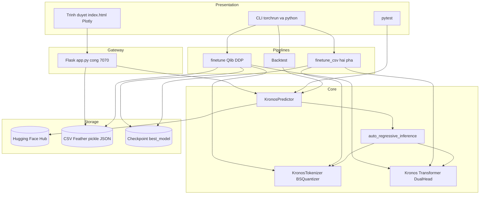

# 01 - SYSTEM OVERVIEW (KRONOS)

| Thuộc tính | Giá trị |
|---|---|
| Phạm vi | Tổng quan kiến trúc và cấu hình của kho mã `phuongdvk47ds/kronos` |
| Phương pháp | Quét cây thư mục, đọc tệp cấu hình và điểm vào; số liệu từ `git ls-files` |
| Nhãn bằng chứng | `[CODE]` có trong mã; `[UNKNOWN]`, `[OPEN]`, `[PROPOSED]` theo nghĩa thông thường |

## 1. Tóm tắt điều hành

Kronos là mô hình nền tảng cho chuỗi nến tài chính (OHLCV). Mô hình gồm hai thành phần: tokenizer lượng tử hóa nhị phân và Transformer tự hồi quy. Kho mã cung cấp bốn năng lực:

| Năng lực | Thành phần | Hình thức |
|---|---|---|
| Suy luận | `model/` | Thư viện Python |
| Trình diễn | `webui/` | Ứng dụng Flask, cổng 7070 |
| Tinh chỉnh | `finetune/` (Qlib), `finetune_csv/` (CSV, YAML) | Tập lệnh dòng lệnh |
| Đánh giá | `examples/`, `finetune/qlib_test.py`, `tests/` | Backtest, hồi quy `pytest` |

Kho mã là công cụ nghiên cứu chạy cục bộ. Không có dịch vụ đa người dùng, cơ sở dữ liệu, hàng đợi hay cơ chế xác thực `[CODE]`.

## 2. Cấu trúc thư mục

| Thư mục | Số tệp được theo dõi | Vai trò |
|---|---|---|
| `model/` | 3 | Lõi: `kronos.py` (tokenizer, mô hình, lấy mẫu, bộ dự báo), `module.py` (khối xây dựng) |
| `webui/` | 35 | `app.py`, `run.py`, `start.sh`, `templates/index.html`, 28 tệp kết quả mẫu `prediction_results/*.json` |
| `finetune/` | 8 | Luồng Qlib: `config.py`, `dataset.py`, `qlib_data_preprocess.py`, `train_tokenizer.py`, `train_predictor.py`, `qlib_test.py`, `utils/` |
| `finetune_csv/` | 13 | Luồng CSV: `config_loader.py`, `finetune_tokenizer.py`, `finetune_base_model.py`, `train_sequential.py`, `configs/*.yaml`, dữ liệu và ảnh mẫu |
| `examples/` | 20 | Kịch bản dự báo, thu thập dữ liệu AKShare, backtest, kết quả mẫu `yuce/` |
| `tests/` | 5 | `test_kronos_regression.py`, dữ liệu hồi quy `tests/data/` |
| `figures/` | 4 | Hình minh họa README |
| `docs/` | 4 | Tài liệu phân tích (`AGILE_SRS.md`, `URD.md`, `WF_SRS.md`, `rea/`) |
| `.claude/` | 17 | Skill và cấu hình công cụ AI |
| `rev/` | 1 | `task.txt`: lời nhắc nhiệm vụ, không phải mã sản phẩm |

## 3. Cấu hình và phụ thuộc

| Tệp | Nội dung | Ghi chú |
|---|---|---|
| `pyproject.toml`, `setup.py`, `setup.cfg` | Không tồn tại | Kho mã không đóng gói thành gói Python `[CODE]` |
| `requirements.txt` | `numpy`, `pandas`, `torch>=2.0.0`, `einops==0.8.1`, `huggingface_hub==0.33.1`, `matplotlib==3.9.3`, `pandas==2.2.2`, `tqdm==4.67.1`, `safetensors==0.6.2` | `pandas` khai báo hai lần (không ghim và ghim `2.2.2`) |
| `webui/requirements.txt` | `flask==2.3.3`, `flask-cors==4.0.0`, `pandas==2.2.2`, `numpy>=1.26.0`, `plotly==5.17.0`, `torch>=2.1.0`, `huggingface_hub==0.33.1` | Ràng buộc `torch` cao hơn tệp gốc |
| `finetune/config.py` | Lớp `Config`: đường dẫn Qlib, khoảng thời gian chia tập, siêu tham số, Comet, backtest | Nhiều giá trị là giữ chỗ (`TODO`) |
| `finetune_csv/configs/*.yaml` | Mẫu cấu hình: `data`, `training`, `model_paths`, `experiment`, `device` | Đường dẫn `/xxxx/` là giữ chỗ |
| `README.md` | Python 3.10 trở lên; `pip install -r requirements.txt`; `pyqlib` cài thủ công | |
| `.gitignore` | Loại trừ bộ nhớ đệm Python và thư mục build | |
| CI, linter, Dockerfile | Không tồn tại | `[CODE]` |

## 4. Điểm vào chính

| Điểm vào | Lệnh | Mục đích |
|---|---|---|
| API thư viện | `from model import Kronos, KronosTokenizer, KronosPredictor` (`model/__init__.py`) | Dự báo qua `KronosPredictor.predict`, `predict_batch` |
| Web UI | `python webui/run.py` hoặc `python webui/app.py`; `webui/start.sh` | Kiểm tra phụ thuộc, khởi động Flask tại `0.0.0.0:7070` với `debug=True` |
| Tiền xử lý Qlib | `python finetune/qlib_data_preprocess.py` | Tạo `train/val/test_data.pkl` |
| Huấn luyện Qlib | `torchrun --standalone --nproc_per_node=N finetune/train_tokenizer.py`, sau đó `train_predictor.py` | Bắt buộc `torchrun` (thiếu `WORLD_SIZE` thì dừng) |
| Backtest Qlib | `python finetune/qlib_test.py --device cuda:0` | Mặc định thiết bị `cuda:1` |
| Huấn luyện CSV | `python finetune_csv/train_sequential.py --config <yaml>` (cờ `--skip-tokenizer`, `--skip-basemodel`, `--skip-existing`) | Chuỗi hai pha; hỗ trợ `torchrun` |
| Ví dụ | `examples/prediction_example.py`, `prediction_batch_example.py`, `run_backtest_kronos.py` | Minh họa; `examples/` chứa đường dẫn Windows cố định ở một số tệp |
| Hồi quy | `pytest tests/test_kronos_regression.py` | Cần truy cập Hugging Face Hub |

## 5. Mô hình kiến trúc

Kiến trúc: **thư viện lõi dùng chung, nhiều lớp vỏ điều khiển (CLI, Web, test)**. Không có tầng dịch vụ riêng. Mọi lớp vỏ gọi trực tiếp lõi trong cùng tiến trình.

### 5.1 Luồng suy luận cốt lõi

| Bước | Thành phần | Mô tả |
|---|---|---|
| 1 | `KronosPredictor.predict` | Kiểm tra đầu vào; điền `volume`, `amount`; chuẩn hóa z-score và cắt `clip` |
| 2 | `KronosTokenizer.encode` | Mã hóa nến thành token hai nửa (s1, s2) |
| 3 | `auto_regressive_inference` | Lặp `pred_len` bước: `decode_s1`, lấy mẫu s1, `decode_s2` có điều kiện s1, lấy mẫu s2; cửa sổ trượt `max_context` |
| 4 | `KronosTokenizer.decode` | Giải mã token về không gian đặc trưng; lấy trung bình `sample_count` đường |
| 5 | `KronosPredictor.predict` | Khôi phục thang đo; trả về DataFrame sáu cột |

### 5.2 Cấu hình mô hình công bố

| Mô hình | Tokenizer | Ngữ cảnh | Tham số |
|---|---|---|---|
| Kronos-mini | Kronos-Tokenizer-2k | 2048 | 4.1M |
| Kronos-small | Kronos-Tokenizer-base | 512 | 24.7M |
| Kronos-base | Kronos-Tokenizer-base | 512 | 102.3M |

Kronos-large (499.2M) chưa phát hành theo README.

## 6. Tích hợp ngoại vi

| Hệ thống | Mục đích |
|---|---|
| Hugging Face Hub (`NeoQuasar/*`) | Tải trọng số mô hình và tokenizer |
| Qlib `cn_data` | Dữ liệu huấn luyện và backtest |
| AKShare | Thu thập dữ liệu ví dụ |
| Comet ML | Theo dõi thí nghiệm; bật mặc định kèm khóa giữ chỗ |
| `torch.distributed` (NCCL) | Huấn luyện đa GPU |

## 7. Nhận định kiến trúc

| Mã | Phát hiện | Mức | Vị trí |
|---|---|---|---|
| A-01 | Web UI không xác thực, `debug=True`, `0.0.0.0`, CORS mở | Cao | `webui/app.py`, `webui/run.py` |
| A-02 | `file_path` từ máy khách không bị ràng buộc thư mục | Cao | `webui/app.py` |
| A-03 | Không đóng gói, không CI; `sys.path.append("../")` phụ thuộc thư mục chạy | Trung bình | `model/kronos.py:9` |
| A-04 | Hai luồng tinh chỉnh trùng lặp logic và khác cách chuẩn hóa mẫu (lookback so với toàn cửa sổ) | Trung bình | `finetune/dataset.py`, `finetune_csv/finetune_base_model.py` |
| A-05 | Trạng thái mô hình toàn cục trong Web UI, suy luận đồng bộ | Trung bình | `webui/app.py` |
| A-06 | Kiểm thử chỉ phủ lõi suy luận; Web UI, huấn luyện, backtest không có kiểm thử | Trung bình | `tests/` |
| A-07 | Đường dẫn Windows cố định và dự báo random walk trong ví dụ backtest | Thấp | `examples/` |

Chi tiết yêu cầu và truy vết: `docs/WF_SRS.md`, `docs/AGILE_SRS.md`, `docs/URD.md`.
