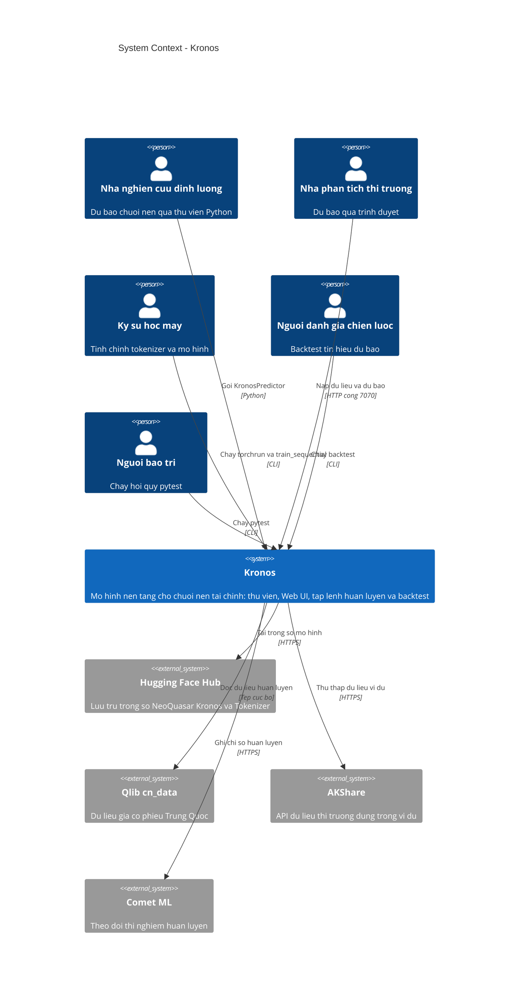
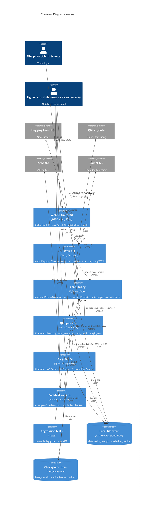
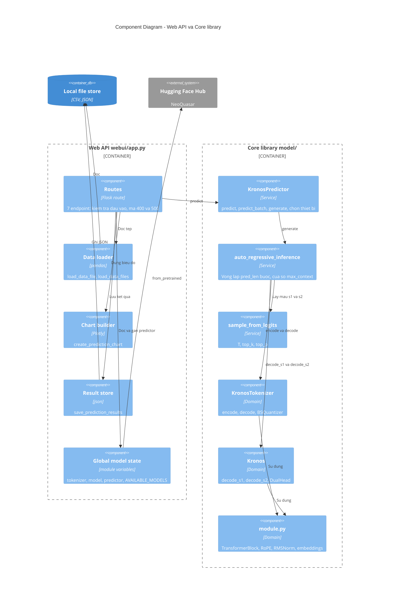
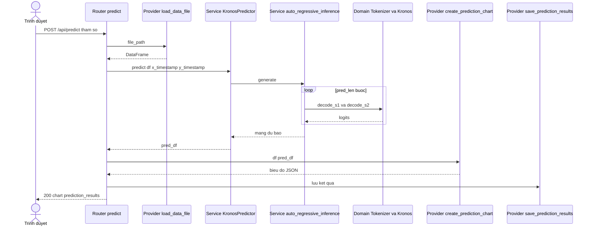

# 02 - ARCHITECTURE C4 (KRONOS)

| Thuộc tính | Giá trị |
|---|---|
| Phạm vi | Tương tác giữa các package; sơ đồ C4 mức System Context, Container, Component |
| Phương pháp | Phân tích câu lệnh `import` và `sys.path` của từng package; đọc `webui/app.py`, `model/kronos.py` |
| Nhãn bằng chứng | `[CODE]` có trong mã; `[OPEN]`, `[PROPOSED]`, `[UNKNOWN]` theo nghĩa thông thường |
| Tài liệu liên quan | `01_System_Overview.md` |

## 1. Ánh xạ tầng Router - Service - Provider

Kronos không áp dụng kiến trúc phân tầng chính thức. Bảng dưới ánh xạ các thành phần thực tế vào mô hình ba tầng để phục vụ phân tích.

| Tầng | Vai trò | Thành phần trong mã |
|---|---|---|
| Router / Controller | Nhận yêu cầu từ Tác nhân, kiểm tra đầu vào, trả phản hồi | Route Flask trong `webui/app.py` (`/`, `/api/data-files`, `/api/load-data`, `/api/load-model`, `/api/predict`, `/api/available-models`, `/api/model-status`); hàm `main()` của các tập lệnh CLI (`finetune/`, `finetune_csv/`, `examples/`); hàm kiểm thử trong `tests/` |
| Service | Điều phối nghiệp vụ | `KronosPredictor` (`predict`, `predict_batch`, `generate`), `auto_regressive_inference`, `sample_from_logits`; `SequentialTrainer` (`finetune_csv/train_sequential.py`); `train_model` trong các tập lệnh huấn luyện; `QlibBacktest`, `KronosBacktester`, `HistoricalBacktester` |
| Domain / Model | Thuật toán mô hình | `Kronos`, `KronosTokenizer` (`model/kronos.py`); `BSQuantizer`, `TransformerBlock`, `DualHead`, `DependencyAwareLayer` (`model/module.py`) |
| Provider | Truy cập tài nguyên ngoài tiến trình | Hugging Face Hub qua `from_pretrained` (`PyTorchModelHubMixin`); `load_data_file`, `save_prediction_results`, `create_prediction_chart` (`webui/app.py`); `QlibDataPreprocessor`, `QlibDataset`; `CustomKlineDataset`, `ConfigLoader`; Qlib, AKShare, Comet ML |

Giới hạn: Router của Web UI chứa cả logic Provider (đọc tệp, ghi JSON, dựng biểu đồ) và một phần Service (cắt cửa sổ dữ liệu, tính chỉ số liên tục) trong cùng tệp `webui/app.py` `[CODE]`. Không có lớp Repository hay Dependency Injection.

## 2. Phụ thuộc giữa các package

| Package nguồn | Phụ thuộc vào | Cơ chế nhập | Bằng chứng |
|---|---|---|---|
| `webui` | `model` | `sys.path.append(<repo root>)` rồi `from model import ...`; lỗi import đặt cờ `MODEL_AVAILABLE=False` | `webui/app.py:15-22`, `webui/run.py:55-56` |
| `finetune` | `model.kronos`; `finetune.config`, `dataset`, `utils` | `sys.path.append("../")`; `from config import Config`, `from dataset import QlibDataset` | `train_tokenizer.py`, `train_predictor.py`, `qlib_test.py` |
| `finetune_csv` | `model`; nội bộ `config_loader`, `finetune_tokenizer`, `finetune_base_model` | `sys.path.append('../')`; nhập tên mô-đun trần | `train_sequential.py:10-15` |
| `examples` | `model` (7 tệp dự báo); không phụ thuộc `model` ở `run_backtest_kronos.py`, `historical_backtest.py` | `sys.path.append("../")` | `examples/prediction_example.py:4-5` |
| `tests` | `model` | `from model import ...` | `tests/test_kronos_regression.py:10` |
| `model.kronos` | `model.module` | `sys.path.append("../")`; `from model.module import *` | `model/kronos.py:9-10` |

Chiều phụ thuộc: mọi package vỏ trỏ vào `model`; `model` không phụ thuộc package nào khác. Không có phụ thuộc vòng `[CODE]`. Hai luồng `finetune` và `finetune_csv` không tham chiếu lẫn nhau.

`[OPEN]` Cơ chế `sys.path.append("../")` và `from config import Config` phụ thuộc thư mục làm việc. README hướng dẫn chạy `torchrun ... finetune/train_tokenizer.py` từ thư mục gốc; khi đó `"../"` trỏ tới thư mục cha của kho mã, và việc phân giải `model` phụ thuộc môi trường (`PYTHONPATH` hoặc chạy trong `finetune/`). `[PROPOSED]` đóng gói thành gói Python hoặc chuẩn hóa `PYTHONPATH`.

## 3. C4 Mức 1 - System Context

| Tương tác | Giao thức | Ghi chú |
|---|---|---|
| Tác nhân tới Kronos | Lời gọi Python, HTTP cổng 7070, CLI | Không có xác thực ở bất kỳ kênh nào |
| Kronos tới Hub | HTTPS | Cần ở lần nạp đầu tiên hoặc khi bộ nhớ đệm trống |
| Kronos tới Qlib | Tệp cục bộ | `qlib_data_path` |
| Kronos tới Comet | HTTPS | `use_comet=True` mặc định, khóa giữ chỗ |

## 4. C4 Mức 2 - Container Diagram

Container là đơn vị thực thi hoặc lưu trữ độc lập. Kronos không có container triển khai riêng; mỗi tiến trình sau do Tác nhân khởi chạy cục bộ.

| Container | Đường dẫn | Điểm vào | Trạng thái | Trách nhiệm |
|---|---|---|---|---|
| Web UI frontend | `webui/templates/index.html` | `GET /` | Không trạng thái phía máy chủ | Giao diện và gọi `/api/*` |
| Web API | `webui/app.py`, `webui/run.py` | `python webui/run.py` | Biến toàn cục `tokenizer`, `model`, `predictor` | Router, nạp dữ liệu, dựng biểu đồ, lưu JSON |
| Core library | `model/` | `from model import ...` | Không trạng thái ngoài tham số mô hình | Mã hóa, sinh tự hồi quy, dự báo |
| Qlib pipeline | `finetune/` | `torchrun ... train_*.py`, `qlib_test.py` | Tiến trình theo lần chạy | Tiền xử lý, huấn luyện, backtest |
| CSV pipeline | `finetune_csv/` | `train_sequential.py --config` | Tiến trình theo lần chạy | Huấn luyện hai pha từ CSV |
| Backtest và ví dụ | `examples/` | Tập lệnh riêng lẻ | Tiến trình theo lần chạy | Minh họa dự báo và đánh giá tín hiệu |
| Regression tests | `tests/` | `pytest` | Không | Phát hiện thay đổi hành vi |

## 5. C4 Mức 3 - Component (Web API và Core library)

## 6. Trình tự gọi qua các tầng (`POST /api/predict`)

## 7. Nhận định kiến trúc

| Mã | Phát hiện | Hệ quả | Đề xuất `[PROPOSED]` |
|---|---|---|---|
| C-01 | Router `webui/app.py` chứa logic Provider và Service | Khó kiểm thử độc lập; không có kiểm thử Web UI | Tách `data_service`, `result_store`, `chart_service` |
| C-02 | Trạng thái mô hình là biến toàn cục theo tiến trình | Không an toàn với nhiều worker; nạp mô hình thay thế mô hình đang dùng | Đóng gói trong lớp quản lý mô hình có khóa |
| C-03 | `KronosPredictor` đảm nhiệm cả kiểm tra đầu vào, chuẩn hóa, sinh và khôi phục thang đo | Logic trùng lặp giữa `predict` và `predict_batch` | Trích hàm chuẩn bị đầu vào dùng chung |
| C-04 | Phụ thuộc `sys.path.append("../")` | Kết quả nhập phụ thuộc thư mục làm việc | Đóng gói với `pyproject.toml` |
| C-05 | Hai pipeline tinh chỉnh trùng lặp (tập dữ liệu, vòng huấn luyện) | Bảo trì kép; chuẩn hóa mẫu khác nhau | Hợp nhất lớp dữ liệu và vòng huấn luyện |
| C-06 | Provider Hub gắn trực tiếp vào lớp mô hình qua `PyTorchModelHubMixin` | Không thay thế được nguồn trọng số khi kiểm thử | Cho phép nạp từ đường dẫn cục bộ qua cấu hình (đã hỗ trợ bởi `from_pretrained` với đường dẫn) |
| C-07 | Không có xác thực ở Router | Xem `01_System_Overview.md` mục 7 | Đặt sau lớp xác thực |

Ghi chú định dạng: cú pháp C4 của Mermaid yêu cầu chuỗi trong dấu ngoặc kép cho tham số; ngoại lệ so với quy tắc cấm ngoặc kép trần áp dụng cho flowchart. Nhãn trong sơ đồ dùng chữ không dấu để bảo đảm trình phân tích cú pháp.
