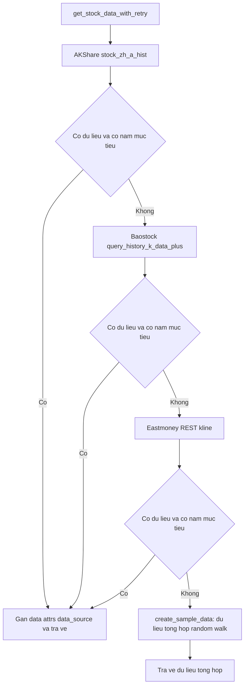
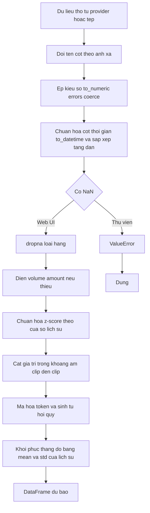

# 03 - CORE BUSINESS LOGIC: DỮ LIỆU TÀI CHÍNH VÀ DATA PROVIDER (KRONOS)

| Thuộc tính | Giá trị |
|---|---|
| Phạm vi | Logic xử lý dữ liệu tài chính, tích hợp data provider, quy tắc chuyển đổi, xử lý lỗi, chuẩn hóa schema, công thức tài chính |
| Phương pháp | Đọc trực tiếp `model/kronos.py`, `webui/app.py`, `webui/templates/index.html`, `finetune/`, `finetune_csv/`, `examples/` |
| Nhãn bằng chứng | `[CODE]` có trong mã; `[!]` khuyết điểm đã xác minh bằng đọc mã; `[ASSUMPTION]`, `[UNKNOWN]`, `[OPEN]`, `[PROPOSED]` |
| Tài liệu liên quan | `01_System_Overview.md`, `02_Architecture_C4.md` |

Ghi chú phạm vi: các công thức dưới đây trích từ mã. Mọi giá trị tính toán chưa được chạy thực nghiệm trong phiên phân tích; ví dụ số học là minh họa suy từ công thức.

## 1. Bản đồ thành phần xử lý dữ liệu tài chính

| Nhóm | Thành phần | Vai trò |
|---|---|---|
| Lõi chuẩn hóa và dự báo | `model/kronos.py:KronosPredictor.predict`, `predict_batch`, `calc_time_stamps` | Kiểm tra, điền khuyết, chuẩn hóa, khôi phục thang đo |
| Nạp dữ liệu Web UI | `webui/app.py:load_data_file`, `load_data` | Chuẩn hóa tên cột, ép kiểu, loại NaN |
| Tiền xử lý Qlib | `finetune/qlib_data_preprocess.py`, `finetune/dataset.py` | Dữ liệu cổ phiếu CSI, sinh `vol`, `amt` |
| Tiền xử lý CSV | `finetune_csv/finetune_base_model.py:CustomKlineDataset` | Chia theo thời gian, chuẩn hóa cửa sổ |
| Thu thập dữ liệu | `examples/get_akshare_date_2024-2025_x.py`, `get_date_new.py`, `prediction_new.py`, `prediction_cn_markets_day.py` | Tích hợp AKShare, Baostock, Eastmoney |
| Hiệu chỉnh dự báo theo thị trường | `examples/prediction_new.py:EnhancedMarketFactorAnalyzer`, `enhance_prediction_with_market_factors` | Nhân dự báo với hệ số điều chỉnh |
| Backtest | `examples/run_backtest_kronos.py`, `examples/yuce/historical_backtest.py`, `finetune/qlib_test.py` | Tín hiệu, mô phỏng danh mục, chỉ số hiệu suất |
| Chỉ số sai số | `webui/templates/index.html` (hàm tính MAE, RMSE, MAPE), `webui/app.py:save_prediction_results` | Đối chiếu dự báo với thực tế |

## 2. Tích hợp data provider

### 2.1 Danh mục provider

| Provider | Điểm gọi | Tham số chính | Hiệu chỉnh giá | Tệp |
|---|---|---|---|---|
| AKShare (lịch sử cổ phiếu A) | `ak.stock_zh_a_hist(symbol, period="daily", adjust=...)` | `symbol`, `start_date`, `end_date` | `qfq` (trước phục hồi) trong thu thập và `prediction_new.py`; `adjust=""` (không hiệu chỉnh) trong `prediction_cn_markets_day.py` | `examples/` |
| AKShare (chỉ số) | `ak.stock_zh_index_hist(symbol, period="daily")` | `000001` (SSE), `399001` (SZSE) | Không áp dụng | `prediction_new.py` |
| AKShare (thông tin cổ phiếu) | `ak.stock_individual_info_em(symbol)` | Trường `行业` | Không áp dụng | `prediction_new.py` |
| Baostock | `bs.query_history_k_data_plus(..., frequency="d", adjustflag="2")` | Trường `date,open,high,low,close,volume,amount,turn,pctChg` | `adjustflag=2` (trước phục hồi) | `get_akshare_date_2024-2025_x.py`, `get_date_new.py` |
| Eastmoney (REST) | `GET http://push2his.eastmoney.com/api/qt/stock/kline/get` | `secid`, `klt=101` (ngày), `fqt=1` (trước phục hồi), `lmt=10000`, `beg`, `end` | `fqt=1` | như trên |
| Qlib | `D.calendar()`, `QlibDataLoader(...).load(instrument, start, end)` | Trường `$open,$close,$high,$low,$volume,$vwap`; `region=REG_CN` | Theo bộ dữ liệu Qlib `[UNKNOWN]` | `finetune/qlib_data_preprocess.py` |
| Hugging Face Hub | `from_pretrained` | Trọng số mô hình | Không áp dụng | `model/kronos.py` |
| Nguồn tệp CSV/Feather | `pd.read_csv`, `pd.read_feather` | `file_path` | Do Tác nhân cung cấp | `webui/app.py`, `examples/` |

### 2.2 Chiến lược dự phòng nguồn dữ liệu

| Tập lệnh | Thứ tự nguồn | Dự phòng cuối |
|---|---|---|
| `get_akshare_date_2024-2025_x.py`, `get_date_new.py` | AKShare, Baostock, Eastmoney | `create_sample_data`: sinh giá tổng hợp (`np.random.seed(42)`, bước ngẫu nhiên chuẩn) |
| `prediction_new.py` | AKShare | `create_realistic_fallback_data`: dữ liệu mô phỏng |
| `prediction_cn_markets_day.py` | AKShare, 3 lần thử, chờ 1.5 giây giữa các lần | `sys.exit(1)` khi thất bại; không có dữ liệu mô phỏng |

`[!]` Các tập lệnh thu thập và `prediction_new.py` thay thế dữ liệu thị trường thật bằng dữ liệu tổng hợp khi mọi nguồn thất bại. Thông điệp được in ra console và `df.attrs['data_source']` được gán cho cả nguồn thật lẫn dữ liệu tổng hợp (`'模拟数据'` hoặc `'模拟历史数据'`), nhưng `attrs` không được ghi vào tệp CSV (`to_csv`). Tệp CSV, kết quả dự báo và biểu đồ sau đó không phân biệt nguồn `[CODE]`.

## 3. Chuẩn hóa schema

### 3.1 Schema chuẩn nội bộ (đầu vào `KronosPredictor`)

| Cột | Kiểu | Bắt buộc | Quy tắc |
|---|---|---|---|
| `open`, `high`, `low`, `close` | float | Có | Thiếu cột thì `ValueError`; NaN thì `ValueError` |
| `volume` | float | Không | Thiếu thì 0.0 |
| `amount` | float | Không | Thiếu và có `volume`: `volume` x trung bình bốn cột giá; thiếu cả hai: 0.0 |
| Thời gian | `Series` datetime (không phải `DatetimeIndex`) | Có | `.dt` được dùng để rút `minute, hour, weekday, day, month` |
| Đặc trưng thời gian | `minute, hour, weekday, day, month` | Sinh tự động | `calc_time_stamps` |

### 3.2 Ánh xạ tên cột theo provider

| Nguồn | Tên cột gốc | Tên chuẩn đích | Ghi chú |
|---|---|---|---|
| AKShare | `日期, 开盘, 收盘, 最高, 最低, 成交量, 成交额, 振幅, 涨跌幅, 涨跌额, 换手率` | `timestamps, open, close, high, low, volume, amount, amplitude, pct_chg, change_amount, turnover` (`prediction_new.py`) | Chỉ ánh xạ cột tồn tại |
| AKShare (thu thập) | như trên | `日期, 开盘价, 收盘价, 最高价, 最低价, 成交量, 成交额, ...` (giữ tên tiếng Trung) | Chuẩn hóa sang tiếng Anh ở bước `prepare_stock_data` |
| Baostock | `date, open, high, low, close, volume, amount, turn, pctChg` | Tên tiếng Trung tương ứng | Ép kiểu `to_numeric` |
| Eastmoney | Mảng chuỗi `klines`, cắt theo dấu phẩy | Chỉ số 0 ngày; 1 mở; 2 đóng; 3 cao; 4 thấp; 5 khối lượng; 6 giá trị giao dịch; 7 biên độ; 8 % thay đổi; 9 thay đổi; 10 vòng quay | Thứ tự mở, đóng, cao, thấp |
| `prepare_stock_data` | `日期, 开盘价, 最高价, 最低价, 收盘价, 成交量, 成交额, 开盘, 收盘, 最高, 最低` | `timestamps, open, high, low, close, volume, amount` | Chấp nhận cả hai biến thể tên Trung |
| Web UI | `timestamps` hoặc `timestamp` hoặc `date` | `timestamps` | Vắng cột thời gian: sinh từ `2024-01-01`, bước 1 giờ |
| Qlib | `$open, $close, $high, $low, $volume, $vwap` | `open, close, high, low, volume, vwap`, rồi `vol`, `amt` | `vwap` được nạp nhưng `feature_list` không dùng |

### 3.3 Schema đầu ra

| Đầu ra | Schema | Nguồn |
|---|---|---|
| `KronosPredictor.predict` | `DataFrame` cột `open, high, low, close, volume, amount`; chỉ mục `y_timestamp`; thang đo của đầu vào | `kronos.py:558` |
| `predict_batch` | Danh sách DataFrame như trên theo thứ tự đầu vào | `kronos.py:655-661` |
| `/api/predict` | `{success, prediction_type, chart, prediction_results[], actual_data[], has_comparison, message}`; phần tử: `timestamp (ISO), open, high, low, close, volume, amount` | `webui/app.py` |
| Tệp `prediction_*.json` | `timestamp, file_path, prediction_type, prediction_params, input_data_summary, prediction_results, actual_data, analysis.continuity` | `save_prediction_results` |
| Tín hiệu Qlib | `DataFrame` chỉ mục `datetime`, cột là mã (`instrument`), giá trị `score`; bốn loại `last`, `mean`, `max`, `min` | `finetune/qlib_test.py:generate_predictions` |
| Backtest mẫu | `capital, position, returns, price` theo ngày; danh sách `trades{date, action, price, shares, capital}` | `run_backtest_kronos.py` |

## 4. Quy tắc chuyển đổi dữ liệu

| Mã | Quy tắc | Điều kiện | Nguồn |
|---|---|---|---|
| DT-01 | Ép kiểu số cho `open, high, low, close`; giá trị không hợp lệ thành NaN, sau đó loại hàng NaN | Web UI | `load_data_file` |
| DT-02 | Làm sạch chuỗi số: xóa dấu phẩy, thay `--` và chuỗi rỗng bằng None, rồi `to_numeric` | `prediction_cn_markets_day.py` | `load_data` |
| DT-03 | `open` bằng 0 hoặc NaN được thay bằng `close` của hàng trước, phần còn lại thay bằng `close` cùng hàng | `prediction_cn_markets_day.py` | `load_data` |
| DT-04 | `amount` thiếu hoàn toàn hoặc toàn 0 được thay bằng `close` x `volume` | `prediction_cn_markets_day.py` | `load_data` |
| DT-05 | `amount` thiếu trong thư viện: `volume` x trung bình của `open, high, low, close` | Thư viện | `kronos.py:531-532` |
| DT-06 | Qlib: `vol = volume`; `amt = (open + high + low + close) / 4 x vol` | Tiền xử lý Qlib | `qlib_data_preprocess.py:74-75` |
| DT-07 | Qlib: loại hàng NaN; loại mã có số dòng nhỏ hơn `lookback_window + predict_window + 1` | Tiền xử lý Qlib | `prepare_dataset` |
| DT-08 | Chuẩn hóa z-score theo cửa sổ rồi cắt `[-clip, clip]`, `clip = 5` | Suy luận và huấn luyện | Mục 5.1 |
| DT-09 | Lọc theo khoảng năm `start_year` đến `end_year` sau khi lấy dữ liệu | Thu thập | `get_stock_data_*` |
| DT-10 | Lọc `history_years`: giữ bản ghi có thời gian lớn hơn hoặc bằng `now - history_years x 365` ngày | `prediction_new.py` | `prepare_stock_data` |
| DT-11 | Phát hiện tần suất dữ liệu: trung bình 9 chênh lệch thời gian đầu tiên, làm tròn theo giây, phút, giờ hoặc ngày | Web UI | `detect_timeframe` |
| DT-12 | Sinh ngày tương lai: bỏ thứ bảy, chủ nhật; không loại ngày lễ | `prediction_new.py` | `generate_future_dates` |
| DT-13 | Sinh ngày tương lai theo `pd.bdate_range` (ngày làm việc) | `prediction_cn_markets_day.py` | `prepare_inputs` |
| DT-14 | Ràng buộc biên độ giá dự báo ±`limit_rate` (mặc định 10 phần trăm) quanh `close` ngày trước, cập nhật lũy tiến theo `close` dự báo | `prediction_cn_markets_day.py` | `apply_price_limits` |
| DT-15 | Tham số cửa sổ: `lookback` giới hạn trong [100, 400]; `pred_len` trong [20, 120] | `prediction_new.py` | `calculate_prediction_parameters` |

`[i]` DT-12 và DT-13 không tính lịch nghỉ lễ của thị trường; `prediction_akshare_2024-2025.py` có hàm `generate_future_dates_with_holidays` riêng.

## 5. Công thức tài chính

### 5.1 Chuẩn hóa và khôi phục thang đo (`KronosPredictor`)

Ký hiệu: `x` là ma trận lịch sử `[open, high, low, close, volume, amount]` (độ dài `L`), `mu` và `sigma` là trung bình và độ lệch chuẩn theo cột (`np.std`, tổng thể), `c = clip = 5`.

| Mã | Công thức | Nguồn |
|---|---|---|
| F-01 | `x_norm = clip( (x - mu) / (sigma + 1e-5), -c, c )` | `kronos.py:544-547` |
| F-02 | `pred = pred_norm x (sigma + 1e-5) + mu` | `kronos.py:556` |
| F-03 | `amount` (thiếu) `= volume x mean(open, high, low, close)` | `kronos.py:531-532` |
| F-04 | Trung bình `sample_count` đường: `pred = mean_k( pred_k )` theo trục mẫu | `kronos.py:465-467` |
| F-05 | Tinh chỉnh Qlib: `x_norm` theo `mu`, `sigma` của `lookback_window` đầu, áp dụng cho toàn cửa sổ gồm phần dự báo | `finetune/dataset.py` |
| F-06 | Tinh chỉnh CSV: `mu`, `sigma` tính trên toàn cửa sổ (gồm phần dự báo) | `finetune_csv/finetune_base_model.py:__getitem__` |

`[OPEN]` F-05 và F-06 khác nhau về phạm vi tính `mu`, `sigma`; suy luận (F-01) dùng toàn bộ lịch sử và không có phần dự báo.

### 5.2 Hàm mất mát huấn luyện

| Mã | Công thức | Nguồn |
|---|---|---|
| F-07 | Tokenizer: `L = ( MSE(z_pre, x) + MSE(z, x) + bsq_loss ) / 2` | `finetune/train_tokenizer.py:141-144` |
| F-08 | Mô hình: `L = DualHead.compute_loss(s1_logits, s2_logits, s1_target, s2_target)` (tổng mất mát s1 và s2) | `finetune/train_predictor.py:109` |
| F-09 | Tối ưu: AdamW (beta 0.9, 0.95; decay 0.1) với OneCycleLR; cắt gradient `max_norm` 2.0 (tokenizer) và 3.0 (mô hình) | `train_*.py` |

### 5.3 Chỉ số sai số dự báo (Web UI)

Ký hiệu: `p_i` là `close` dự báo, `a_i` là `close` thực tế, `n = min(len(dự báo), len(thực tế))`.

| Mã | Công thức | Nguồn |
|---|---|---|
| F-10 | `MAE = (1/n) x Sum |p_i - a_i|` | `index.html` (hàm tính sai số) |
| F-11 | `RMSE = sqrt( (1/n) x Sum (p_i - a_i)^2 )` | như trên |
| F-12 | `MAPE = (1/n) x Sum ( |p_i - a_i| / a_i x 100 )` | như trên |
| F-13 | Chênh lệch liên tục: `gap_x = |pred_0.x - actual_0.x|`; `gap_pct_x = gap_x / actual_0.x x 100` với `x` thuộc `open, high, low, close` | `save_prediction_results` |

`[!]` F-12 và F-13 chia cho giá thực tế không có kiểm tra bằng 0. `[!]` F-13 so sánh phần tử dự báo đầu tiên với phần tử thực tế đầu tiên, nhưng khóa lưu là `last_prediction`.

### 5.4 Tín hiệu giao dịch

| Mã | Công thức | Nguồn |
|---|---|---|
| F-14 | `pred_return_t = (predicted_t - predicted_{t-1}) / predicted_{t-1}` (`pct_change` của giá dự báo) | `run_backtest_kronos.py:calculate_trading_signals` |
| F-15 | `signal_t = +1` nếu `pred_return_t > T`; `-1` nếu `pred_return_t < -T`; ngược lại `0`; `T = 0.02` | như trên |
| F-16 | `position_t = signal_t`, thay `0` bằng giá trị gần nhất trước đó (`ffill`) | như trên |
| F-17 | Qlib: `score = pred_close - last_close`, với `pred_close` ở các dạng `last`, `mean`, `max`, `min` trên `pred_len` bước | `finetune/qlib_test.py:generate_predictions` |
| F-18 | Mẫu lịch sử: `predicted_return = (predicted_close - actual_close) / actual_close`; mua khi `> T` và không có vị thế; bán khi `< -T` và có vị thế; `T = 0.03` | `historical_backtest.py:run_trading_strategy` |

`[i]` F-17: `x` đưa vào mô hình đã chuẩn hóa z-score (F-01) và không được khôi phục thang đo, nên `score` có đơn vị là độ lệch chuẩn của `close` trong cửa sổ lịch sử. Đơn vị này nhất quán giữa các mã trong cùng một lượt `[CODE]`.

### 5.5 Mô phỏng danh mục (`KronosBacktester.run_backtest`)

Ký hiệu: `C` tiền mặt, `S` số cổ phiếu (âm khi bán khống), `P_t` giá, vốn ban đầu `C_0 = 100000`.

| Mã | Công thức | Ghi chú |
|---|---|---|
| F-19 | Mở vị thế (vị thế trước bằng 0, tín hiệu khác 0): `shares = floor(C / P_t)`; `S = shares x signal`; `C = C - shares x P_t` | Mua toàn bộ vốn; không có phí |
| F-20 | Đóng vị thế (vị thế trước khác 0, tín hiệu bằng 0): `C = S x P_t`; `S = 0` | Ghi đè `C` |
| F-21 | Giá trị danh mục: `V_t = C + S x P_t` | |
| F-22 | Lợi suất ngày: `r_t = (V_t - V_{t-1}) / V_{t-1}` khi `V_{t-1} > 0` | |
| F-23 | Tổng lợi suất: `R = (V_last - C_0) / C_0` | |
| F-24 | Lợi suất năm hóa: `R_a = (1 + R)^(252 / N) - 1`, `N` là số quan sát `r_t` | |
| F-25 | Độ biến động: `sigma_a = std(r) x sqrt(252)` | `std` mẫu của pandas |
| F-26 | Sharpe: `(R_a - 0.03) / sigma_a`; bằng 0 khi `sigma_a = 0` | Lãi suất phi rủi ro 3 phần trăm |
| F-27 | Drawdown tối đa: `min( (cum_t - peak_t) / peak_t )`, `cum_t = Prod(1 + r)`, `peak_t = max cum` | |
| F-28 | Lợi suất giao dịch: `(sell_price - buy_price) / buy_price` theo cặp thứ tự mua, bán | Ghép theo chỉ số, không theo chiều |
| F-29 | Tỷ lệ thắng: số giao dịch có lợi suất lớn hơn 0 chia tổng số cặp | |
| F-30 | Mẫu lịch sử: lợi suất mua giữ `B = (P_last - P_first) / P_first`; vượt trội `= R - B` | `historical_backtest.py:calculate_performance` |

`[!]` Khuyết điểm đã xác minh bằng đọc mã trong F-19 và F-20:

| ID | Phát hiện | Minh họa suy từ công thức |
|---|---|---|
| BL-01 | Vị thế bán (`signal = -1`) trừ tiền mặt như mua: `C = C - shares x P`, đồng thời `S = -shares` | Với `C = 100000`, `P = 10`: `shares = 10000`, `C = 0`, `S = -10000`, `V = 0 + (-10000) x 10 = -100000`, tức -100 phần trăm tại thời điểm mở vị thế. Hạch toán đúng của bán khống là cộng tiền thu về |
| BL-02 | Khi đóng vị thế, `C = S x P` ghi đè tiền mặt còn dư sau lệnh mua | Phần dư `C - shares x P` do làm tròn xuống bị mất |
| BL-03 | Đóng vị thế bán cho `C = S x P < 0` | Tiền mặt âm sau khi đóng |
| BL-04 | F-28 ghép giao dịch mua và bán theo thứ tự chỉ số | Không phản ánh vị thế bán khống |
| BL-05 | F-18: `predicted_return` so sánh giá dự báo và giá thực tế của cùng ngày, và giao dịch thực hiện tại giá thực tế đó | Tín hiệu dựa trên sai số dự báo của chính ngày giao dịch (thiên lệch nhìn trước); `simple_prediction` còn là random walk không seed |
| BL-06 | F-19 đến F-29 không có phí, thuế, trượt giá | `[CODE]` |

### 5.6 Backtest Qlib (`finetune/qlib_test.py`)

| Tham số | Giá trị | Ý nghĩa |
|---|---|---|
| Chiến lược | `TopkDropoutStrategy(topk=50, n_drop=5)` | Giữ 50 mã điểm cao nhất, thay tối đa 5 mã mỗi kỳ |
| Vốn | `100_000_000` | |
| Giá khớp | `deal_price = open` | |
| Phí mua | `open_cost = 0.001` (0.10 phần trăm) | |
| Phí bán | `close_cost = 0.0015` (0.15 phần trăm) | |
| Phí tối thiểu | `min_cost = 5` | |
| Ngưỡng biên độ | `limit_threshold = 0.095` | Ngưỡng biên độ giá của sàn mô phỏng (ý nghĩa chi tiết do Qlib quyết định `[UNKNOWN]`) |
| Chuẩn so sánh | `csi300 = SH000300`, `csi800 = SH000906`, `csi1000 = SH000852` | |

| Mã | Công thức | Nguồn |
|---|---|---|
| F-31 | Vượt chuẩn không phí: `r_excess = r_return - r_bench` | `run_single_backtest` |
| F-32 | Vượt chuẩn có phí: `r_excess_cost = r_return - r_bench - r_cost` | như trên |
| F-33 | Lũy kế: `cum_x = cumsum(x)` (cộng dồn, không nhân dồn) cho `bench`, `return - cost`, `return - bench - cost` | như trên |
| F-34 | Phân tích rủi ro bằng `qlib.contrib.evaluate.risk_analysis(..., freq="day")` | Công thức nội bộ Qlib `[UNKNOWN]` |

### 5.7 Hệ số hiệu chỉnh dự báo theo thị trường (`prediction_new.py`)

Hệ số `f` nhân vào `open, high, low, close` dự báo; `volume` nhân với `1 + (f - 1) x 0.3`.

| Mã | Thành phần | Công thức |
|---|---|---|
| F-35 | Đường trung bình | `ma5, ma20, ma60 = rolling mean` của `close`; `vol_ma5 = rolling mean 5` của `volume` |
| F-36 | Độ mạnh xu hướng | `ma_slope = (ma5_t - ma5_{t-20}) / ma5_{t-20}`; `price_slope = (close_t - close_{t-20}) / close_{t-20}`; `volume_trend = mean(volume 5 ngày cuối) / mean(volume 5 ngày trước đó)`; `strength = clamp( 10 x (0.4 x ma_slope + 0.4 x price_slope + 0.2 x min(volume_trend - 1, 0.2)), 0, 1 )`; trả 0.5 khi dưới 20 quan sát |
| F-37 | Xu hướng chủ đạo | `ma5 > ma20 > ma60` và `close > ma20` và `strength > 0.6` |
| F-38 | Đại diện thị trường | `uptrend` khi số chỉ số tăng hạng lớn hơn hoặc bằng 50 phần trăm số chỉ số; `strength` là trung bình |
| F-39 | Hệ số thị trường | Tăng hạng: `1 + strength x 0.08`; ngược lại: `1 + (strength - 0.5) x 0.04` |
| F-40 | Hệ số ngành | Ngành nóng: `1 + resonance x 0.06 + min(sector_count x 0.01, 0.03)`; ngược lại: `1 + (resonance - 0.5) x 0.02` |
| F-41 | Hệ số vĩ mô | `1 + (macro_score - 0.5) x 0.06` |
| F-42 | Hệ số lãi suất Mỹ | Chu kỳ giảm lãi suất: `1 + expected_cuts x 0.015` |
| F-43 | Hệ số cơ bản | `1 + (fundamental_score - 0.5) x 0.08` |
| F-44 | Hệ số tổng hợp | `f = clamp( Prod các hệ số trên, 0.85, 1.15 )` |
| F-45 | Giới hạn lượt điều chỉnh | Nếu `max(adjusted/original) > 1.1` thì nhân `1.1`; nếu `min < 0.9` thì nhân `0.9` (áp dụng cho cả cột) |

`[!]` Đặc điểm của khối hiệu chỉnh này:

| ID | Phát hiện |
|---|---|
| MF-01 | `overall_macro_score = 0.75`, lãi suất Mỹ `4.25`, `expected_cuts_2025` và `fundamental_score = 0.7` (mã `600580`) là hằng số trong mã, không lấy từ provider |
| MF-02 | Từ điển `hot_sectors` (momentum 0.5-0.85, số mã tăng trần) là hằng số; mã `600580` và `300207` được gán ngành bằng điều kiện đặc biệt |
| MF-03 | Chú thích gán "trọng số 25 phần trăm, 25, 20, 10, 20" nhưng công thức là tích các hệ số với hệ số nhân độc lập, không phải bình quân có trọng số |
| MF-04 | Hệ số điều chỉnh đổi kết quả của mô hình bằng một phép nhân heuristic; kết quả `enhanced_prediction` không còn là đầu ra của Kronos |
| MF-05 | Khi thiếu dữ liệu, các hàm `_get_default_*` trả điểm trung tính 0.5 |

## 6. Cơ chế xử lý lỗi

| Thành phần | Cơ chế | Hành vi khi lỗi |
|---|---|---|
| `KronosPredictor.predict` | Kiểm tra kiểu, cột, NaN | `ValueError` với thông điệp nêu điều kiện; không thay đổi đầu vào (bản sao) |
| `predict_batch` | Kiểm tra kiểu list, số lượng, độ dài chuỗi | `ValueError` kèm chỉ số chuỗi hoặc danh sách độ dài |
| Web UI `load_data_file` | `try/except` bao toàn bộ | Trả `(None, "Failed to load file: ...")`; route trả 400 |
| Web UI `/api/*` | `try/except` ngoài cùng | Trả 500 với `error` chuỗi tự do |
| Web UI `save_prediction_results` | `try/except` | In lỗi và trả None; phản hồi dự báo không bị ảnh hưởng |
| `get_stock_data_*` | `try/except`; `ImportError` riêng cho AKShare, Baostock | Trả None; vòng dự phòng chuyển nguồn kế tiếp |
| Eastmoney | Kiểm tra `status_code == 200`, `JSONDecodeError`, `klines` rỗng; `time.sleep(random.uniform(1, 2))` trước khi gọi, `timeout=10` hoặc `15` | Bỏ qua dòng lỗi (`continue`); trả None khi rỗng |
| `prediction_cn_markets_day.load_data` | 3 lần thử, chờ 1.5 giây | `sys.exit(1)` sau lần thử cuối |
| `prediction_new` analyzers | `try/except` mỗi `analyze_*` | Trả cấu trúc mặc định điểm 0.5 |
| Huấn luyện | `RuntimeError` thiếu `WORLD_SIZE`; `FileNotFoundError` cấu hình YAML | Dừng tiến trình |
| `SequentialTrainer.run_training` | `try/except` toàn pha | In traceback và trả False |
| Backtest | `try/except` trong `run_complete_backtest` | In lỗi; kết thúc cho mã đó |

| Điểm yếu | Mô tả |
|---|---|
| `except Exception` rộng | Che dấu nguyên nhân gốc; thông điệp trả về là chuỗi tự do, không có mã lỗi |
| Không có retry cho Web UI và thư viện | Lỗi Hub và đọc tệp truyền thẳng |
| Dự phòng dữ liệu tổng hợp im lặng | Xem mục 2.2 |
| Không có kiểm tra tính hợp lệ OHLC | Không kiểm tra `low <= open, close <= high`, giá âm hoặc khối lượng âm trong đường nạp dữ liệu `[CODE]` |
| Không có kiểm tra tính liên tục thời gian | Không phát hiện khoảng trống hoặc bản ghi trùng thời gian |

## 7. Tổng hợp khuyết điểm theo mức độ

| Mã | Mức | Phát hiện | Vị trí |
|---|---|---|---|
| BL-01 | Cao | Hạch toán vị thế bán khống sai (mất 100 phần trăm vốn khi mở) | `run_backtest_kronos.py:run_backtest` |
| BL-05 | Cao | Tín hiệu dựa trên sai số dự báo của chính ngày giao dịch (nhìn trước) | `historical_backtest.py:run_trading_strategy` |
| DP-01 | Cao | Dự phòng im lặng sang dữ liệu tổng hợp khi mọi provider thất bại | `get_stock_data_with_retry`, `prediction_new.py` |
| MF-01..04 | Trung bình | Hiệu chỉnh dựa trên hằng số, không phải dữ liệu; mô tả trọng số không khớp công thức | `prediction_new.py` |
| BL-02, BL-03 | Trung bình | Mất tiền dư, tiền mặt âm khi đóng vị thế | `run_backtest` |
| DP-02 | Trung bình | Không nhất quán hiệu chỉnh giá: `qfq` và `adjust=""` giữa các tập lệnh | `examples/` |
| DP-03 | Thấp | `amount = close x volume` (DT-04) giả định đơn vị khối lượng là cổ phiếu; AKShare báo khối lượng theo lô `[ASSUMPTION]` | `prediction_cn_markets_day.py` |
| DP-04 | Thấp | Chia cho giá thực tế không kiểm tra bằng 0 (F-12, F-13) | `index.html`, `app.py` |
| DP-05 | Thấp | `amt` Qlib xấp xỉ bằng trung bình OHLC; trường `vwap` được nạp nhưng không dùng | `qlib_data_preprocess.py` |
| DP-06 | Thấp | Lịch nghỉ lễ không được tính khi sinh ngày tương lai | `prediction_new.py`, `prediction_cn_markets_day.py` |
